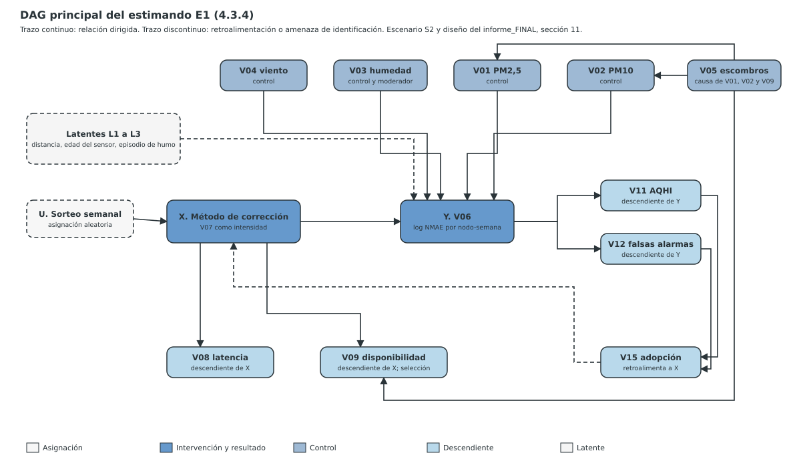

CASE_ID: SGR_CONV56_AIRE

## 4.3 Clasificación de variables para inferencia causal

Esta sección declara el estimando antes de clasificar variables. Deriva los roles del grafo y no de la clase de Vester. La clasificación estructural de 4.4 aporta hipótesis de influencia (HIE). No sustituye la identificación causal (Pearl y Mackenzie, 2018). Todos los juicios son propuestas de la instancia analítica y carecen de ratificación.

### 4.3.1 Estimando antes del ajuste causal

El expediente E3 omitió esta sección. Los registros de decisión del documento asignan estatutos IDC y EST sin declarar estimando. Esta sección declara dos estimandos y evalúa si cada uno puede publicarse como efecto causal. Si algún campo es VACIO, no se publica un efecto causal.

| Campo | E1. Efecto técnico del método de corrección | E2. Efecto institucional de la adopción |
| --- | --- | --- |
| Intervención X | Nivel del método de corrección de los nodos: N1 corrección lineal fija; N2 referencia cercana con humedad; N3 N2 más alineación temporal; N4 N3 más ponderación por confianza o autocalibración por ventana estable (variante en el borde, ALT-03). Intensidad en el modelo: V07. | Adopción formal del tablero por la alcaldía (V15) mediante acto administrativo. |
| Resultado Y | V06: logaritmo del NMAE del PM2,5 de cada nodo frente a la referencia asignada, por semana. | V14: personas bajo protección efectiva. |
| Población | Nodos fijos del piloto (100 más 20 % de repuestos) en sitios de remoción de escombros. | Municipios con sitios de remoción. |
| Territorio | Caldas, Cundinamarca y Valle del Cauca (SUPUESTO). | Mismo (SUPUESTO). |
| Horizonte | Diseño alternado de 52 semanas dentro de los 24 meses de ejecución; el Hito 2 (mes 12) usa las primeras 30 jornadas de contraste. | 36 meses (24 de ejecución y 12 posproyecto). |
| Contraste causal | N4 frente a N1 (paquete de corrección en el borde frente a la lectura sin corrección dinámica). Contrastes secundarios: N4 frente a N2 y N4 en el borde frente a N4 en la nube. | VACIO: no existe grupo comparable ni regla de asignación. |
| Estimando | Efecto promedio en los tratados (ATT) sobre el logaritmo del NMAE, bajo sorteo semanal de nivel por nodo. | VACIO. |
| Unidad de análisis | Nodo-semana. | Municipio-mes (propuesta). |
| Resultado de la evaluación | Estimando completo. Identificable por diseño si se ejecuta el sorteo (IDC prospectivo). Sin datos: no se publica ningún efecto. | NO IDENTIFICADO CON LOS INSUMOS DISPONIBLES. |

**Origen del diseño.** El informe_FINAL (sección 11.4 a 11.8) propone un diseño alternado con asignación aleatoria semanal, panel con efectos fijos por nodo y semana y 52 semanas. La propuesta nace en SIATA (Valle de Aburrá). Aquí se adapta a nodos de remoción de escombros. Las cuatro hipótesis del informe (H1 a H4) siguen sin evidencia propia.

**Estimando E3 (fuera de alcance).** El efecto del sistema de alerta sobre morbilidad respiratoria no tiene variable de resultado ni línea base en el modelo (VACIO-05 de E3-P20). No se declara estimando. Cualquier afirmación sobre morbilidad permanece como hipótesis.

### 4.3.2 Roles del DAG y regla de ajuste

| Rol | Definición operacional | Regla para el efecto total de X sobre Y |
| --- | --- | --- |
| CONFUSOR_PRE | Causa pretratamiento de X y de Y, o nodo que bloquea un camino trasero. | Candidato al conjunto de ajuste. |
| PREDICTOR_Y | Predice Y sin abrir caminos espurios. | Mejora precisión; no se incluye solo por correlación. |
| MEDIADOR | Está en el camino causal de X a Y. | No ajustar para el efecto total. |
| COLLIDER | Efecto común de dos nodos relevantes. | No condicionar sin justificación. |
| DESCENDIENTE_X | Variable causada por X. | No usar como control pretratamiento. |
| INSTRUMENTO | Afecta X y cumple relevancia, exclusión e independencia declaradas. | Solo bajo estrategia instrumental explícita. |
| LATENTE | Nodo no observado relevante. | Registrar amenaza de identificación; no fingir control. |

La frase «correlacionada con X» no es un rol causal. El conjunto de ajuste se deriva del grafo y del estimando. Se retira la taxonomía universal A/B/C/E y el umbral del 50 % de caída del coeficiente como prueba de mediación.

### 4.3.3 Tabla de clasificación DAG para el estimando E1

La tabla usa X = método de corrección (V07) y Y = V06. El estatuto de cada fila es HIE: ningún rol se estima con datos. La naturaleza de cada fila es INFERIDO y su verificación NO_VERIFICADO. Las relaciones provienen de las fichas de S2 (4.4.4).

| Variable | Temporalidad respecto a X | Rol DAG | Caminos relevantes | ¿Ajustar? | Evidencia | Estatuto |
| --- | --- | --- | --- | --- | --- | --- |
| V01 PM2,5 | Simultánea; independiente de X | PREDICTOR_Y | V01→V06 (2); V05→V01→V06 | Sí, por precisión. No es necesario para identificar bajo sorteo. | Ficha V01→V06, confianza BAJA | HIE |
| V02 PM10 | Simultánea; independiente de X | PREDICTOR_Y | V02→V06 (3); V02→V09 (1); V05→V02 | Sí, por precisión. Evitar incluir V01 y V02 si son colineales por inclusión. | Ficha V02→V06, confianza MEDIA | HIE |
| V03 humedad | Simultánea; independiente de X | PREDICTOR_Y y moderador | V03→V06 (3); V03→V09 (1) | Sí, con interacción X por V03. | F-INF §3.1 (Suresh et al., 2025, p. 30), cita secundaria | HIE |
| V04 viento | Simultánea; independiente de X | PREDICTOR_Y débil | V04→V06 (1); V04→V01 y V04→V02 | Sí, como control. | Control del NMAE en F-INF §11.4 | HIE |
| V05 escombros | Pretratamiento de cada semana | PREDICTOR_Y indirecto; causa de atrición | V05→V01 y V05→V02→V06; V05→V09 | Depende: absorber con efectos fijos de nodo y semana. No condicionar sobre V09. | Fichas V05→V09 (MEDIA) y V05→V02 (ALTA) | HIE |
| V06 error de medición | Posterior a X | Resultado Y | X→V06 (3) | No aplica | Ficha V07→V06; F-INF §3.1 (Bang et al., 2026, pp. 6-8) | HIE |
| V07 calibración | Asignada al inicio de la semana | Exposición X (intensidad) | V07→V06; V07→V08; V07→V09 | No aplica | Sorteo semanal propuesto en F-INF §11.7 | IDC prospectivo |
| V08 latencia | Posterior a X | DESCENDIENTE_X; MEDIADOR si V08→V06 fuera positivo | V07→V08 (1) | No. Bajo la ficha V08→V06 = 0 no hay camino a Y. | Fichas V07→V08 y V08→V06 (dominio {0,1,2}) | HIE |
| V09 disponibilidad | Posterior a X | DESCENDIENTE_X y COLLIDER (V05→V09←X) para la muestra observada | V07→V09 (1); V05→V09 (2); V02→V09 (1) | No condicionar a nodos activos. Usar intención de tratar con ponderación. | Fichas V07→V09, V05→V09, V02→V09 | HIE |
| V10 densidad | Nominal: previa. Efectiva: posterior (depende de V09) | PREDICTOR_Y débil (nominal); DESCENDIENTE_X (efectiva) | V10→V06 (1); V09→V10 (3) | Depende: usar solo la densidad nominal de diseño. | Ficha V10→V06; VACIO V-DIC-02 | HIE |
| V11 AQHI | Posterior a Y | DESCENDIENTE de Y | V06→V11 (3) | No | Ficha V06→V11 | HIE |
| V12 falsas alarmas | Posterior a Y | DESCENDIENTE de Y | V06→V12 (2); V11→V12 (2) | No | Fichas V06→V12 y V11→V12 | HIE |
| V13 anticipación | Posterior a Y | DESCENDIENTE de Y (vía V10 y V08) | V08→V13; V10→V13 | No | Fichas V08→V13 y V10→V13 | HIE |
| V14 personas alertadas | Posterior a Y | DESCENDIENTE de Y | V11→V14; V13→V14; V12→V14 | No | Fichas de entrada de V14 | HIE |
| V15 adopción | Posterior; retroalimenta a X | DESCENDIENTE de Y; causa de X futuro si X no es aleatorizado | V06→V15; V12→V15; V15→V07 | No. Riesgo de confusión dependiente del tiempo sin sorteo. | Fichas V12→V15, V15→V07 | HIE |
| L1 distancia a la referencia | Previa | LATENTE (medible) | L1→V06 (H2 del informe) | Sí si hay medición y no hay sorteo | F-INF §11.4 y §11.6 | HIE |
| L2 edad del sensor | Previa | LATENTE (medible); moderador | L2→V06 (H4 del informe) | Sí si no hay sorteo | F-INF §11.4 y §11.6 | HIE |
| L3 episodio de humo | Simultánea | LATENTE; moderador | L3→V06 (H3 del informe) | Sí como interacción | F-INF §11.4 y §11.6 | HIE |
| L4 precipitación | Simultánea | LATENTE; no modelada | L4→V03, L4→V02, L4→V05 | Declarar como amenaza | VACIO V-LLUVIA-01 | HIE |
| U sorteo semanal | Previa | INSTRUMENTO y regla de asignación | U→X | No aplica | F-INF §11.7 | IDC prospectivo |

### 4.3.4 Identificación y DAGs rivales

El DAG principal se dibujó antes de cualquier estimación. La figura y su alternativa textual constan en DAG_E1.svg y DAG_E1.alt.md.

**Conjunto de ajuste mínimo bajo el DAG principal.** Con sorteo semanal por nodo, el conjunto de ajuste mínimo es vacío: X es independiente de las causas de Y por diseño. Para precisión se propone {V03 con interacción, V01 o V02, V04} más efectos fijos de nodo y de semana. No se incluyen V08, V09, V11, V12, V13, V14 ni V15.

**DAGs rivales y conjuntos de ajuste.**

| DAG rival | Hipótesis | Amenaza | Conjunto de ajuste | Resultado de identificación |
| --- | --- | --- | --- | --- |
| R1 | La distancia a la referencia explica más del error que el método y se asigna por conveniencia a sitios cercanos. | Confusión por selección de sitios (L1). | Con sorteo: ninguno. Sin sorteo: L1 medida. | Identificado con sorteo. Sin sorteo, NO IDENTIFICADO CON LOS INSUMOS DISPONIBLES. |
| R2 | La edad del sensor determina la deriva y los nodos viejos reciben más recalibración. | Confusión por L2. | Con sorteo: ninguno. Sin sorteo: L2 medida. | Igual que R1. |
| R3 | La pérdida de nodos por maquinaria (V05→V09) y el efecto de X sobre la energía (X→V09) abren un camino por V09. | Colisionador: condicionar a nodos activos sesga el efecto. | No condicionar sobre V09; intención de tratar y ponderación inversa por disponibilidad. | Identificado bajo intención de tratar. Efecto sobre nodos activos NO IDENTIFICADO. |
| R4 | La adopción institucional (V15) modifica el uso de X en el tiempo. | Retroalimentación: rompe la aciclicidad y la exogeneidad de X. | Sorteo como regla de asignación o instrumento con F de primera etapa mayor que 10. | Identificado solo con sorteo cumplido o instrumento válido. |

**Declaración de identificación.** Con los insumos actuales no existe ningún dato del piloto, ni sorteo ejecutado, ni referencia para todos los nodos. El efecto de E1 queda NO IDENTIFICADO CON LOS INSUMOS DISPONIBLES para cualquier estimación observacional. Es identificable por diseño si se ejecutan el sorteo y los supuestos de 4.3.6. El estimando E2 no es identificable en este diseño.

### 4.3.5 Estatutos de afirmación causal

| Código | Estatuto | Lenguaje permitido |
| --- | --- | --- |
| HIE | Hipótesis de influencia estructural | «podría influir», «se prioriza como hipótesis» |
| IDC | Estimando causal identificado bajo supuestos | «efecto identificable si se cumplen…» |
| EST | Efecto estimado con datos y diseño | «se estimó…», con intervalo y sensibilidad |

Está prohibido pasar de HIE a IDC o a EST porque una variable resulte activa o crítica en Vester o ascienda en MICMAC. Las 210 puntuaciones de 4.4 y las clases de 4.4.8 son HIE. El estimando E1 es IDC prospectivo, condicionado al sorteo. Ninguna afirmación del proyecto es EST.

**Auditoría de los estatutos del documento previo.** El documento declara estatutos causales en sus registros RDG sin estimando ni datos.

| Nodo | Estatuto declarado | Estatuto sostenible hoy | Motivo |
| --- | --- | --- | --- |
| ND-05 Brechas instanciadas | IDC | NO_APLICA (descriptivo) | Es un hallazgo bibliométrico; no declara estimando. |
| ND-06 Ortodoxias | HIE | HIE | Coincide. |
| ND-10 Causa raíz adoptada | IDC | HIE | No existe estimando ni identificación; la causa raíz es una hipótesis estructural. |
| ND-11 Enunciado tripartito | IDC | HIE | La ecuación Y = f(X1, X2, X3 \| M, C) no está identificada; X2 y X3 no actúan sobre V06 en el ledger E3. |
| ND-12 Autenticidad contrainductiva | HIE | HIE | Coincide. |
| ND-13 Pesos y puntajes MCDA | IDC | NO_APLICA | Es una evaluación multicriterio con pesos supuestos; no estima efectos. |
| ND-14 Metaheurística | EST | NO_APLICA | El código es una función de aptitud sin ejecución trazable; no estima un efecto con datos. |
| ND-15 Alternativa seleccionada | EST | HIE | La alternativa se selecciona por puntaje; no hay efecto estimado. |
| ND-16 Output, outcome e impact | IDC | HIE | La cadena hasta morbilidad no tiene resultado identificado (E3 en 4.3.1). |

### 4.3.6 Pruebas de robustez

| Prueba | Aplicación al diseño E1 | Estado |
| --- | --- | --- |
| Precedencia temporal | El nivel se asigna el lunes antes de la medición semanal. V01 a V04 se miden en la misma semana y no son causadas por X. | Diseño propuesto; NO_EJECUTADO |
| Positividad y solapamiento | Con 4 niveles y 52 semanas, cada nodo recibe cada nivel unas 13 veces en promedio. La positividad se cumple por diseño si el sorteo es estricto. | Diseño propuesto; NO_EJECUTADO |
| Medición | El denominador depende de una referencia. El presupuesto prevé 3 monitores gravimétricos (Capítulo 8, Tabla 8.3) para 100 nodos en tres departamentos. | VACIO: cobertura de referencias |
| Selección | Se espera pérdida de nodos por maquinaria (V05→V09). Se analiza por intención de tratar con ponderación por disponibilidad y se informa la atrición por nivel. | Diseño propuesto; NO_EJECUTADO |
| Datos faltantes | No se imputa Y. Se ponderan las observaciones y se informan cotas por escenarios de pérdida. | Diseño propuesto; NO_EJECUTADO |
| Confusión no observada | El sorteo la neutraliza si se cumple. Sin sorteo, se requiere análisis de sensibilidad a confusión no medida [conocimiento externo]. | No aplicable aún |
| Sensibilidad compatible con el diseño | Balance de covariables por nivel, prueba de arrastre con una semana de lavado, pruebas placebo con fechas falsas y modelos alternos M2 y M3 del informe_FINAL. | Diseño propuesto; NO_EJECUTADO |
| Potencia (recalculada) | Con desviación 0,25, efecto de diseño 3, 5.200 nodo-semanas y proporción 0,5, el error estándar es 0.0120 y la diferencia mínima detectable con 80 % de potencia es 0.0336 puntos de NMAE, cerca de 11.2 % de una línea base de 0,30. Premisas del informe_FINAL §11.8. | CALCULADO sobre premisas NO_VERIFICADAS |
| Predicción frente a causalidad | El modelo TinyML puede usar V03 y V01 como predictores de corrección. Que mejoren el ajuste no los convierte en causas de V06 ni valida el efecto del método. | Regla de interpretación |

**Factibilidad del sorteo.** El sorteo semanal exige control remoto del nivel de corrección en cada nodo. El expediente no describe actualización remota ni registro de asignación. La factibilidad es un VACIO que condiciona el estatuto IDC del estimando E1.

**Registro de decisión ND-07 (estimando, roles y conjunto de ajuste).**

**Tabla RDG. Registro de decisión GENESIS**

| Campo | Contenido |
| --- | --- |
| NODO | ND-07 Estimando, roles y conjunto de ajuste |
| CLASE | MAYOR. Determina qué afirmaciones causales pueden publicarse. |
| DECISION | Declarar el estimando del efecto del método de corrección sobre el error de medición y adoptar el conjunto de ajuste mínimo que deriva del DAG. |
| DECIDE | Equipo formulador (rol POR_IDENTIFICAR). La propuesta proviene de la instancia analítica. |
| EXCLUYE | Publicar un efecto causal con datos observacionales. Ajustar por V08, V09, V11 a V15. Usar la clase de Vester como rol causal. |
| NODOS_BLANCOS | 6: diseño alternado con sorteo semanal (F-INF §11.7, T08); 5.200 nodo-semanas (F-INF §11.8, T09); diferencia mínima detectable 0,034 recalculada (T09); V03→V06 = 3 y V07→V06 = 3 (fichas de S2, T09); V05→V09 = 2 (ficha, T09); corrección por estación cercana con R2 de menos de 0,2 a 0,81 (Bang et al., 2026, pp. 6-8, T08). |
| NODOS_GRISES | 2: el sorteo semanal es operable en terreno; hay referencia gravimétrica para los nodos del sorteo (solo 3 monitores presupuestados). |
| RUPTURAS | R-01: 0 \| R-02: 0 \| R-03: 0 \| R-04: 0 \| R-05: 1 (el estimando no alcanza V14; la cadena hasta personas protegidas permanece HIE y se declara). |
| PATRON_DOMINANTE | PR-06 (patrón emergente): exogeneidad condicionada al sorteo. La retroalimentación V15→V07 aparece en S2 (ciclos de 4.4.13) y justifica el patrón. |
| ANTIPATRONES_PR | PR-04 ausente: Sí. PR-05 ausente: No. El sorteo y las referencias exigen capacidad técnica y conectividad no verificadas en el territorio. |
| ESCENA_SIMULABLE | El ingeniero de campo de la IES registra cada lunes el nivel sorteado por nodo antes de ver los datos. El científico de datos compara en el mes 12 el NMAE del nivel 4 con el del nivel 1. |
| EVIDENCIA_JH_A | Acta semanal de asignación con listado de nodos por municipio (artefacto por producir; no existe aún). |
| EVIDENCIA_JH_B | Ecuación M1 del informe_FINAL §11.7, potencia recalculada y 3 monitores de referencia presupuestados (Tabla 8.3). |
| CERCA_CONCEPTUAL | El estimando no prueba que el sistema proteja personas. Mide el efecto del método de corrección sobre el error del sensor. |
| ESTATUTO_CAUSAL | IDC prospectivo para E1, condicionado al sorteo cumplido. HIE para toda otra relación. Ninguna EST. |
| VEREDICTO | Estimando E1 declarado. Conjunto de ajuste mínimo vacío bajo sorteo. E2 no identificado. |
| RAZON_DEL_DESCARTE | Se descarta estimar el efecto con comparaciones entre sitios sin sorteo, por confusión con la distancia a la referencia y la edad del sensor. |
| RESULTADO | CIERRA con vacíos declarados (factibilidad del sorteo; cobertura de referencias). |

**Referencias de la sección 4.3 (APA 7).**

Pearl, J., y Mackenzie, D. (2018). *The book of why: The new science of cause and effect*. Basic Books.

Los demás respaldos son los archivos aportados por el usuario (informe_FINAL.docx y Problematica_E3-P00.docx) y las citas secundarias identificadas en cada fila. No se verificó la edición ni la paginación de Pearl y Mackenzie (2018) en esta corrida (estado NO_VERIFICADO_EN_ESTA_CORRIDA).
