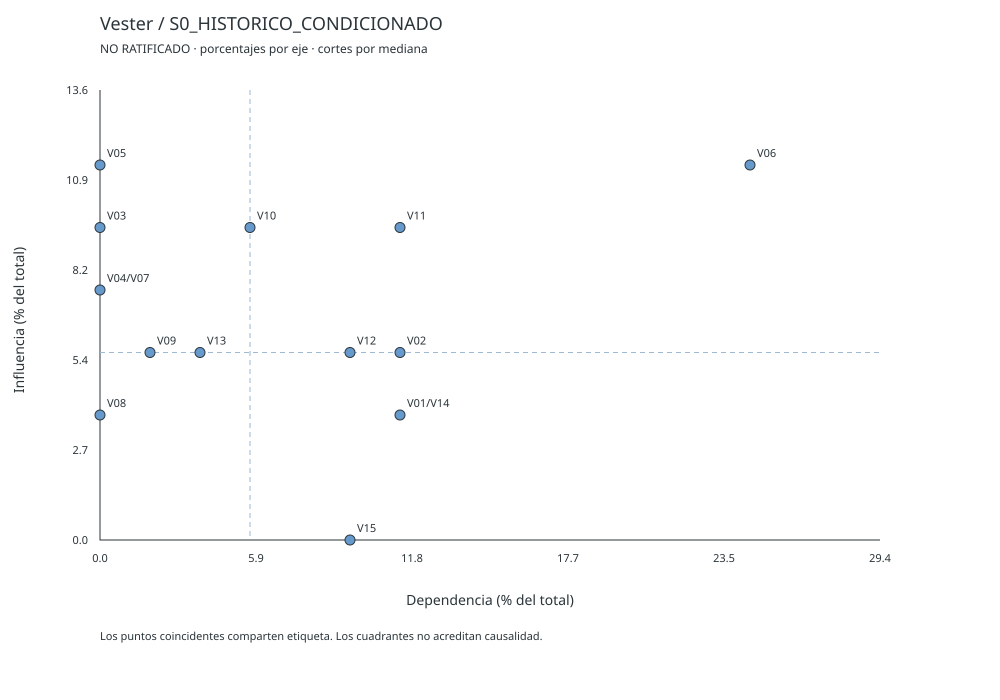
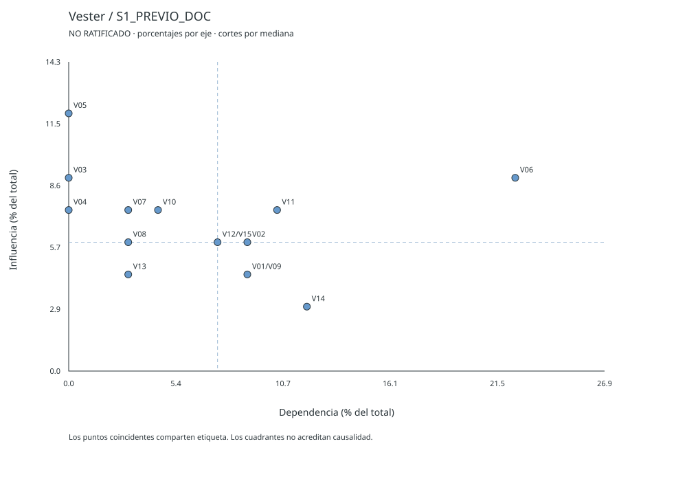
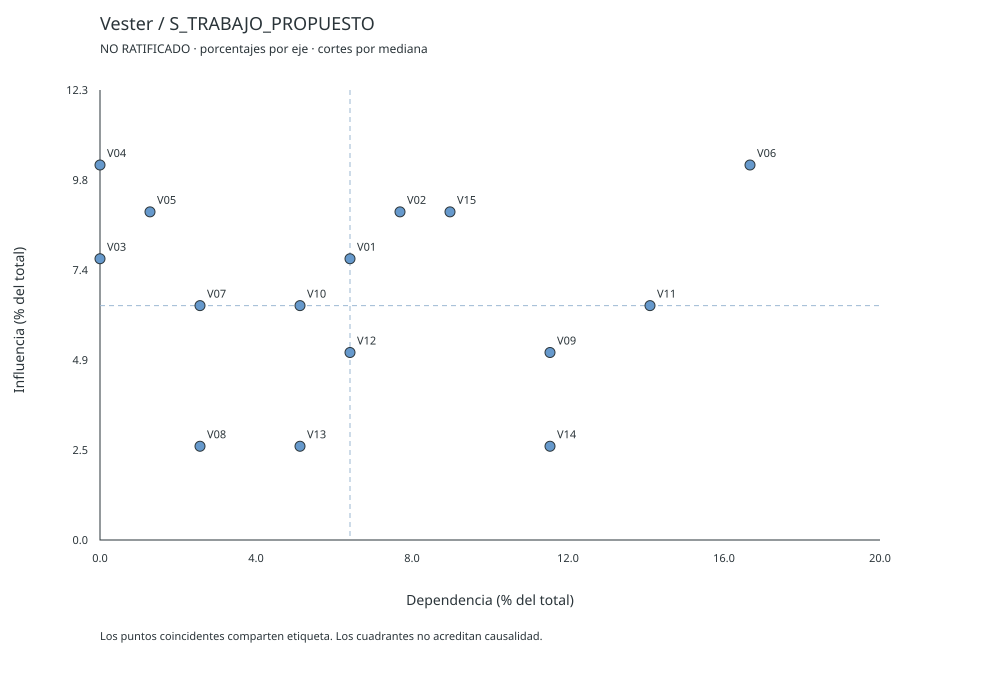
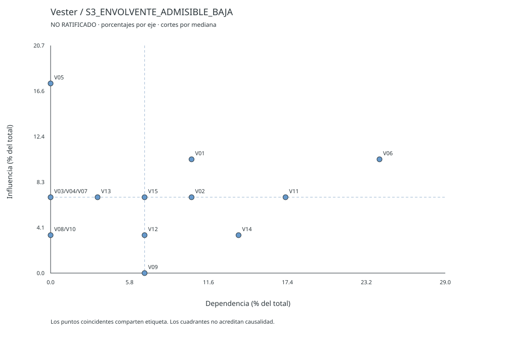
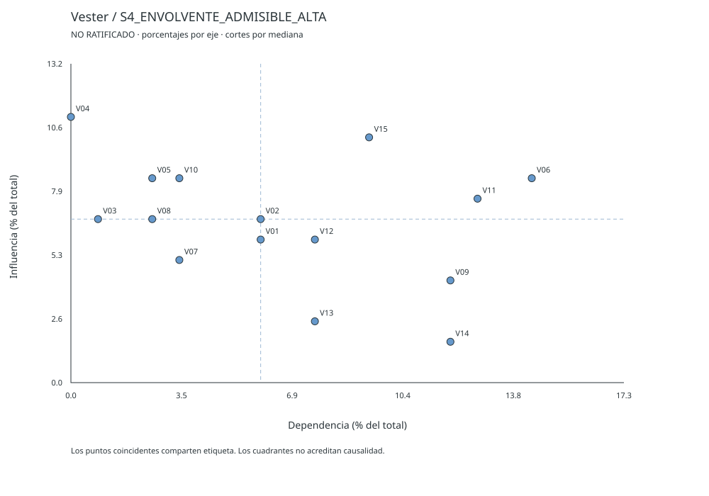
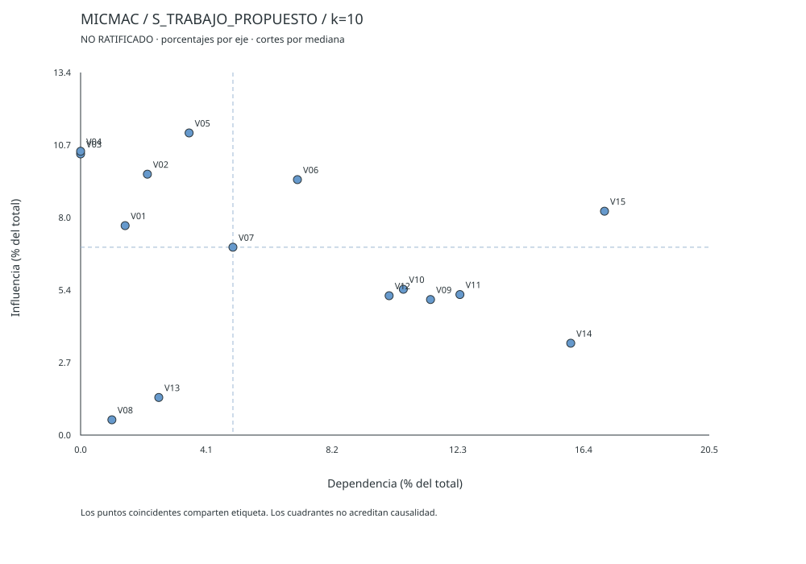

CASE_ID: SGR_CONV56_AIRE

## 4.4 Vester y MICMAC: protocolo paritario integrado

Sección generada con GENESIS-CTeI 36.10 RC2 / VM-PAR3-MDR3-CONT1. Contiene las catorce piezas MP-06, numeradas 4.4.1 a 4.4.14. Las piezas son subsecciones y no autorizan otras secciones. Los valores son propuestas no ratificadas. El análisis estructural expresa hipótesis de influencia (HIE), no efectos causales.

### 4.4.1 Procedencia, estado y alcance de los objetos

Esta pieza identifica los objetos que entran al análisis, su naturaleza y su estado de verificación. Separa el cálculo de la ratificación, como exige el canon paritario VM-PAR3.

**Identidad de la corrida.** Caso SGR_CONV56_AIRE. Implementación GENESIS-CTeI 36.10 RC2, revisión VM-PAR3-MDR3-CONT1. Fecha de corrida: 13 de octubre de 2026. Semilla del plan: 20261011. Corte principal: mediana. KMAX: 10. Ventana de estabilidad: 3.

| Objeto | Procedencia y localizador | Contenido | Naturaleza | Verificación y alcance | Estado |
| --- | --- | --- | --- | --- | --- |
| E3_ORIGINAL | Problematica_E3-P00.docx, E3-P04 §12 | 22 aristas positivas (ΣI = 53) y 188 ceros por «Regla Cero» | DECLARADO | PARCIALMENTE_VERIFICADO: aritmética recalculada (ΣI = ΣD = 53); contenido semántico NO_VERIFICADO | Conservado sin cambios |
| MID_FORMAL | Derivada de E3_ORIGINAL | 22 valores positivos como DECLARADO; 188 celdas U | DECLARADO y VACIO | NO_VERIFICADO. El cero por bloque no cumple la adjudicación individual que exige el contrato E3→E4 V2.1 | Matriz formal preservada; no se eleva |
| S0 | Mismo origen | Escenario histórico condicionado: 22 aristas, 188 ceros heredados | DECLARADO | VERIFICADO (aritmético) | Escenario independiente |
| S1 | Problematica_E3-P00.docx, Paso 4, 4.4.5 | 32 aristas, ΣI = 67 | PROPUESTO | VERIFICADO (aritmético). La narrativa asociada resulta CONTRADICTORIA con el cálculo (4.4.11 y 4.4.12) | Escenario independiente |
| S2 (MID_TRABAJO) | Esta corrida, 105 fichas paritarias | 48 aristas, ΣI = 78 | PROPUESTO | Esquema VERIFICADO; contenido semántico NO_VERIFICADO | Escenario de trabajo; no ratificado |
| S3 y S4 | Esta corrida, dominios admisibles de las fichas | Valor mínimo y máximo admisible por dirección | CALCULADO | VERIFICADO (aritmético) | Envolventes de sensibilidad, no predictivas |
| Plantilla XLSX | Vester_MICMAC_Plantilla_15_vacia.xlsx | Nombres de las 15 variables y matriz idéntica a S1 (no está vacía) | DECLARADO | Coincidencia exacta con S1 VERIFICADA celda a celda | Usada como segunda implementación de cálculo |
| informe_FINAL | informe_FINAL.docx (42 documentos, consolidado al 30-09-2026) | Vigilancia tecnológica y bibliometría | DOCUMENTADO | PARCIAL: secciones 1, 2, 3.1, 4.1, 8.4, 11 y anexos; artículos originales NO leídos | Fuente secundaria |

**Separación de dimensiones.** La autorrevisión no emite un veredicto global único. Cada dimensión tiene su estado.

| Dimensión | Estado | Evidencia y límite |
| --- | --- | --- |
| CÁLCULO | EJECUTADO | Motor genesis_paritario_vm.py con SHA-256 comprobado. Cinco escenarios. La plantilla XLSX, recalculada con LibreOffice, reproduce A¹ a A⁶ en S0, S1 y S2. Cinco permutaciones de filas y columnas dan resultados idénticos tras restaurar los IDs. |
| COMPLETITUD DE FICHAS | 105 de 105 fichas válidas por esquema | 210 direcciones únicas; 0 errores de esquema. El esquema no prueba mecanismo, intensidad ni fuentes. |
| RESPALDO DOCUMENTAL | PARCIAL | De 48 direcciones no nulas, 22 citan el informe_FINAL, 19 citan solo el expediente E3 y 7 se apoyan en premisas. Ninguna fuente primaria fue leída. Las 162 direcciones nulas se apoyan en premisas de frontera y mediación. |
| RATIFICACIÓN | PENDIENTE | Cero adjudicaciones documentadas. Todo valor es PROPUESTO por la instancia analítica de esta corrida, sin panel humano. |
| ALCANCE | 4.4 dentro de la cadena 4.3, 4.4, 4.4-MDR y 4.5 | La corrida no incluye los pasos 5 y 6 ni los 21 capítulos ni el paquete 1000X. |
| ARTEFACTOS | Ver 4.4.14 | XLSX oficial (artifact_tool): XLSX_PENDIENTE_POR_DEPENDENCIA. Se entregan CSV, JSON, SVG y tres libros derivados de la plantilla del usuario. |

**Conteos separados de fichas (H02).** Ningún contador mecánico equivale a verificación semántica.

| Contador | Valor |
| --- | --- |
| Fichas recibidas | 105 |
| Fichas bidireccionales válidas | 105 |
| Fichas con justificación declarada | 105 |
| Fichas con dos valores propuestos | 105 |
| Fichas con adjudicación documentada | 0 |
| Direcciones recibidas únicas | 210 |
| Direcciones con justificación declarada | 210 |
| Direcciones con valor propuesto | 210 |
| Direcciones con adjudicación documentada | 0 |
| Fichas verificadas semánticamente | no medido |

**Naturaleza de las 48 direcciones no nulas.** INFERIDO: 27; PROPUESTO: 11; SUPUESTO: 8; DOCUMENTADO: 2. Las dos direcciones DOCUMENTADO (V03→V06 y V04→V01) se apoyan en citas secundarias del informe_FINAL.

**Reservas vigentes.**

- R-01. El territorio (Caldas, Cundinamarca, Valle del Cauca) y la alianza son SUPUESTO por instrucción del usuario. No existen términos de referencia en el expediente (F_TDR_MINCIENCIAS no aportado).

- R-02. Los valores heredados de E3 conservan su estado DECLARADO. El rótulo DOCUMENTADO de E3-P04 para V03→V01 y V03→V02 carece de localizador y no se acepta.

- R-03. VACIO V-DIC-01: el diccionario no precisa si V01 y V02 son concentración real o medida. VACIO V-DIC-02: V10 puede ser densidad nominal o efectiva. VACIO V-DIC-03: V06 puede referirse al sensor o al producto de red.

- R-04. VACIO V-AQHI-01: la fórmula local del índice V11 no figura en el expediente.

- R-05. VACIO V-LLUVIA-01 y V-VIENTO-01: no hay variable de precipitación ni umbral operativo de viento.

- R-06. La iteración previa atribuyó a la patente Ali et al. (2022) un respaldo empírico que el informe_FINAL niega; esa cita no respalda mecanismo alguno.

### 4.4.2 Diccionario revisado y tabla de escala con anclas y límites

El diccionario conserva los 15 identificadores y las definiciones operacionales de E3-P01. No se agregan ni se retiran variables. La revisión añade el sentido de aumento y las observaciones de ambigüedad.

**Frontera y horizonte.** Frontera: red IoT de material particulado en sitios de remoción de escombros, con territorio y alianza como SUPUESTO. Horizonte H: 24 meses de ejecución más 12 meses posproyecto (36 meses). El horizonte es una propuesta de esta corrida; E3 no lo fija.

| ID | Variable | Definición operacional (unidad) | Bloque | Sentido de aumento | Observación de revisión |
| --- | --- | --- | --- | --- | --- |
| V01 | Concentración PM2.5 | Masa de partículas <2,5 µm (µg/m³). | FIS | mayor concentración | Incluida en V02 por tamaño de partícula. |
| V02 | Concentración PM10 | Masa de partículas <10 µm (µg/m³). | FIS | mayor concentración | Incluye la masa de V01; se propone redefinirla como fracción gruesa (PM10 menos PM2,5) en una versión posterior. |
| V03 | Humedad relativa | Saturación de vapor de agua (%). | FIS | mayor humedad | Exógena; sin variable de precipitación en el modelo. |
| V04 | Velocidad del viento | Fuerza de dispersión eólica superficial (m/s). | FIS | mayor velocidad | Exógena; la dirección del viento no figura en el modelo. |
| V05 | Volumen de escombros | Residuos removidos tras el sismo (t/día). | FIS | mayor volumen removido | Variable de actividad; modificable por decisión institucional. |
| V06 | Error de medición IoT | Desfase metrológico del sensor láser (NMAE %). | TEC | mayor error | Se define para el sensor individual; el error del producto de red es otro objeto. |
| V07 | Frecuencia de calibración | Tasa de ajuste algorítmico del gemelo (ajustes/semana). | TEC | más ajustes por semana | Variable de operación; palanca de diseño. |
| V08 | Latencia de datos | Retraso en la transmisión a la nube central (minutos). | TEC | mayor retraso | No distingue retraso de red y desfase temporal sensor-estación. |
| V09 | Disponibilidad de nodos IoT | Porcentaje de la red de sensores activa y con energía (%). | TEC | más nodos activos con energía | Condiciona la lectura efectiva de V10. |
| V10 | Densidad del gemelo | Resolución del mapa predictivo espacial (nodos/km²). | TEC | mayor densidad efectiva o nominal (ambigua) | Ambigua entre densidad nominal de diseño y resolución efectiva. |
| V11 | Índice AQHI | Nivel de peligro de salud pública emitido (escala 1-10). | DEC | mayor peligro | Fórmula local no disponible en el expediente. |
| V12 | Falsas alarmas | Tasa de alertas emitidas sin superación de umbral real (%). | DEC | más alertas sin superación real | Depende del umbral del índice y del error de medición. |
| V13 | Anticipación | Tiempo de aviso preventivo antes del impacto (horas). | DEC | más horas de aviso | Sin línea base en el corpus. |
| V14 | Personas alertadas | Población y operarios bajo protección efectiva (conteo). | DEC | más personas protegidas | Mide protección efectiva; la definición no separa protección autónoma de la inducida por alerta. |
| V15 | Adopción institucional | Uso efectivo del tablero por alcaldías y UNGRD (%). | DEC | mayor uso efectivo | Variable de resultado institucional y de sostenibilidad. |

**Revisión de solapamiento.** Se examinaron los 105 pares posibles. Resultado: UNICA 101; SOLAPAMIENTO_DEFINICIONAL 1; AMBIGUEDAD_CONDICIONAL 2; DEPENDENCIA_FUNCIONAL 1. El archivo REVISION_SOLAPAMIENTO.csv registra los 105 veredictos. E3-P02 solo documentó 5 pares y declaró ÚNICA los otros 100 en bloque; esa revisión no examinó la inclusión de V01 en V02.

**Escala operacional 0 a 3.** La escala es ordinal. No expresa proporciones, probabilidades ni magnitudes métricas. Las anclas se fijan antes de puntuar las 210 direcciones.

| Valor | Definición operacional | Ancla del caso |
| --- | --- | --- |
| 0 | Ausencia de influencia directa dentro del modelo, por frontera, definición, mediación explícita o mecanismo ausente. No equivale a U. | V11->V04: el índice emitido en pantalla no altera el viento (ausencia por imposibilidad física). |
| 1 | Influencia directa débil: efecto gradual, parcial o mitigable por diseño dentro de H. | V03->V09: la humedad corroe y condensa; reduce la vida útil de los nodos a mediano plazo y la carcasa NEMA 4X lo mitiga (influencia débil). |
| 2 | Influencia directa moderada: altera el funcionamiento estándar y exige acción correctiva, sin determinarlo. | V08->V13: la latencia resta una fracción del tiempo útil de aviso; la relación es aritmética pero parcial (minutos frente a horas) (influencia moderada). |
| 3 | Influencia directa fuerte: determina la variable destino casi de forma mecánica, sin agente intermedio y sin explicar por qué 2 no representa la hipótesis. | V05->V02 y V06->V11: la remoción mecánica genera PM10 y el error del sensor entra al cálculo del índice sin acción humana intermedia (influencia fuerte). |
| null (U) | No existe fundamento para preferir un valor. Se conserva en la matriz formal y se documenta el conjunto plausible. | Celdas U de MID_FORMAL: 188 |

**Límites de la escala.** La confianza es otro eje y no multiplica la puntuación. Una fuente respalda el mecanismo que contiene, no un valor ordinal exacto. El documento previo usa V09→V10 como ancla del valor 2. Su propio ledger le asigna 3. Aquí se fijan anclas únicas.

### 4.4.3 Plan paritario completo, semilla y orden de ejecución

El plan contiene 105 pares no ordenados y 210 direcciones para n = 15. Semilla registrada: 20261011. Los bloques declarados son FIS (V01 a V05), TEC (V06 a V10) y DEC (V11 a V15). Hay 30 pares intrabloque y 75 pares interbloque.

El motor ordena al azar cada clase con la semilla y alterna un par interbloque con un par intrabloque mientras existan ambas clases. El plan se registró antes de valorar. La paridad es de atención analítica: ambos sentidos reciben su propia ficha, sin imponer simetría de valores.

**Primeros 15 pares del orden de ejecución.** El orden completo de los 105 pares consta en PLAN_PARITARIO.csv.

| Orden | Par | Clase |
| --- | --- | --- |
| 1 | V04__V08 | INTER |
| 2 | V07__V09 | INTRA |
| 3 | V06__V14 | INTER |
| 4 | V06__V08 | INTRA |
| 5 | V05__V10 | INTER |
| 6 | V14__V15 | INTRA |
| 7 | V03__V11 | INTER |
| 8 | V06__V07 | INTRA |
| 9 | V04__V14 | INTER |
| 10 | V03__V05 | INTRA |
| 11 | V03__V14 | INTER |
| 12 | V01__V03 | INTRA |
| 13 | V05__V11 | INTER |
| 14 | V12__V13 | INTRA |
| 15 | V09__V11 | INTER |

Los lotes organizan el trabajo; no atribuyen independencia estadística entre fichas. La instancia analítica valoró las 105 fichas en esta corrida sin solicitar un comando por par.

### 4.4.4 Fichas bidireccionales con mecanismos, fundamentos y estados

Esta pieza contiene las 105 fichas paritarias en el orden del plan. Cada ficha valora los dos sentidos del par por separado. Ninguna ficha es una plantilla: cada dirección declara su mecanismo o la razón del cero, su fundamento, su justificación y la explicación rival.

**Campos uniformes en las 210 direcciones.** Horizonte: H = 24 meses de ejecución más 12 meses posproyecto (36 meses). Horizonte PROPUESTO por la corrida; el diccionario E3 no lo fija. Recorrido directo sin pasar por otra variable explícita del modelo. Frontera: Red IoT de material particulado en sitios de remoción de escombros. El territorio y la alianza son SUPUESTO por instrucción del usuario. El modelo incluye solo las variables V01 a V15. Quedan fuera la distancia a la referencia, la edad del sensor y el episodio de humo. Procedencia: Instancia analítica de GENESIS en esta corrida. Sin panel humano, sin adjudicación ni acta. Juicio PROPUESTO, sujeto a ratificación. Estado de todas las direcciones: PROPUESTO. El archivo FICHAS_PARITARIAS.json repite esos campos en cada dirección, como exige el esquema.

**Lectura de los rótulos.** «Valor» es la puntuación propuesta en la escala 0 a 3. «Admisibles» es el conjunto de valores que la instancia considera plausibles y alimenta la sensibilidad. «Naturaleza» y «verificación» son ejes independientes (NTC 1.1); todas las fichas tienen verificación semántica NO_VERIFICADO. Las fuentes F-INF y F-E3 son los archivos aportados por el usuario; las demás son citas secundarias dentro de F-INF. Los artículos y patentes originales no fueron leídos.

**Ficha 001 · V04__V08 · clase INTER**

- **V04→V08** · valor **1** (admisibles: 0, 1) · signo + · naturaleza SUPUESTO · estado PROPUESTO · confianza BAJA
  - Mecanismo: Ráfagas fuertes desalinean antenas y mástiles temporales y elevan la pérdida de paquetes y el retraso de entrega.
  - Fundamento: Premisa de la iteración previa del documento (4.4.4). La fuente que esa iteración cita, Ali et al. (2022), es una solicitud de patente sin datos de desempeño según F-INF. La cita no respalda el mecanismo.
  - Fuentes: F-INF, §1.3 hallazgo 3 y §2.3: las patentes del corpus, incluida Ali et al. (2022), no reportan datos de desempeño (alcance: Muestra que la cita de la iteración previa no respalda el mecanismo)
  - Premisas: P-V04-V08: las cargas de viento sobre mástiles y antenas degradan el enlace (supuesto de escenario).
  - Justificación del valor: Se asigna 1: el efecto es esporádico y afecta a los enlaces con antena direccional. Se descarta 2 por falta de evidencia.
  - Ancla comparada: Igual a ANC-1. Menor que ANC-2.
  - Explicación rival: Con antenas omnidireccionales y mástiles reforzados el valor sería 0.
  - Mediadores del modelo: ninguno
  - Motivo de la confianza: Cita previa invalidada. Mecanismo plausible sin fuente.
- **V08→V04** · valor **0** (admisibles: 0) · signo NO_APLICA · naturaleza INFERIDO · estado PROPUESTO · confianza ALTA
  - Razón del cero: El retraso de datos no modifica el viento.
  - Fundamento: Premisa P-0: no existe mecanismo físico, informático ni institucional que conecte V08 con V04 dentro de la frontera y el horizonte declarados.
  - Justificación del valor: Se asigna 0 porque el retraso de datos no modifica el viento.
  - Ancla comparada: ANC-0 (ver 4.4.2).
  - Explicación rival: Ninguna alternativa plausible dentro de la frontera.
  - Mediadores del modelo: ninguno
  - Motivo de la confianza: Ausencia de mecanismo por razonamiento físico. Sin medición ni fuente específica.

**Ficha 002 · V07__V09 · clase INTRA**

- **V07→V09** · valor **1** (admisibles: 0, 1, 2) · signo - · naturaleza INFERIDO · estado PROPUESTO · confianza MEDIA
  - Mecanismo: La calibración consume energía y puede sacar el nodo de línea durante reinicios de software.
  - Fundamento: Ledger E3-P04, fila V07->V09 (PROPUESTO, magnitud 1, signo -).
  - Fuentes: F-E3, E3-P04 §12, fila V07->V09 (alcance: Valor heredado)
  - Justificación del valor: Se asigna 1: el costo es periódico y breve. Se descarta 2 porque el modelo ligero ejecuta pocos ciclos.
  - Ancla comparada: Igual a ANC-1.
  - Explicación rival: Con calibración sin reinicio el valor sería 0.
  - Mediadores del modelo: ninguno
  - Motivo de la confianza: Valor heredado y consistente con el diseño de bajo consumo.
- **V09→V07** · valor **0** (admisibles: 0) · signo NO_APLICA · naturaleza INFERIDO · estado PROPUESTO · confianza MEDIA
  - Razón del cero: La disponibilidad de nodos no fija la frecuencia de calibración por nodo.
  - Fundamento: Premisa P-0: no existe mecanismo físico, informático ni institucional que conecte V09 con V07 dentro de la frontera y el horizonte declarados.
  - Justificación del valor: Se asigna 0 porque la disponibilidad de nodos no fija la frecuencia de calibración por nodo.
  - Ancla comparada: ANC-0 (ver 4.4.2).
  - Explicación rival: Menos nodos disminuyen la carga total de calibración. La frecuencia por nodo no cambia.
  - Mediadores del modelo: ninguno
  - Motivo de la confianza: Ausencia de mecanismo por razonamiento físico. Sin medición ni fuente específica.

**Ficha 003 · V06__V14 · clase INTER**

- **V06→V14** · valor **0** (admisibles: 0) · signo NO_APLICA · naturaleza INFERIDO · estado PROPUESTO · confianza MEDIA
  - Razón del cero: El error afecta la protección efectiva mediante el índice (V11) y las alertas (V12). No actúa de forma directa.
  - Fundamento: Premisa P-M: la influencia de V06 sobre V14 opera solo a través de V11, V12. Se puntúa en los pares V06→V11 y V11→V14, V06→V12 y V12→V14. No se duplica aquí.
  - Justificación del valor: Se asigna 0 porque el error afecta la protección efectiva mediante el índice (V11) y las alertas (V12). No actúa de forma directa.
  - Ancla comparada: ANC-0 (ver 4.4.2).
  - Explicación rival: Ninguna alternativa plausible dentro de la frontera.
  - Mediadores del modelo: V11, V12
  - Motivo de la confianza: Ruta indirecta explícita en el modelo.
- **V14→V06** · valor **0** (admisibles: 0) · signo NO_APLICA · naturaleza INFERIDO · estado PROPUESTO · confianza ALTA
  - Razón del cero: El número de personas protegidas no modifica el error del sensor.
  - Fundamento: Premisa P-0: no existe mecanismo físico, informático ni institucional que conecte V14 con V06 dentro de la frontera y el horizonte declarados.
  - Justificación del valor: Se asigna 0 porque el número de personas protegidas no modifica el error del sensor.
  - Ancla comparada: ANC-0 (ver 4.4.2).
  - Explicación rival: Ninguna alternativa plausible dentro de la frontera.
  - Mediadores del modelo: ninguno
  - Motivo de la confianza: Ausencia de mecanismo por razonamiento físico. Sin medición ni fuente específica.

**Ficha 004 · V06__V08 · clase INTRA**

- **V06→V08** · valor **0** (admisibles: 0) · signo NO_APLICA · naturaleza INFERIDO · estado PROPUESTO · confianza ALTA
  - Razón del cero: El error de medición no cambia el retraso de transmisión.
  - Fundamento: Premisa P-0: no existe mecanismo físico, informático ni institucional que conecte V06 con V08 dentro de la frontera y el horizonte declarados.
  - Justificación del valor: Se asigna 0 porque el error de medición no cambia el retraso de transmisión.
  - Ancla comparada: ANC-0 (ver 4.4.2).
  - Explicación rival: Los disparos espurios por error aumentan el tráfico. El efecto es de segundo orden y se refleja en V06->V09.
  - Mediadores del modelo: ninguno
  - Motivo de la confianza: Ausencia de mecanismo por razonamiento físico. Sin medición ni fuente específica.
- **V08→V06** · valor **0** (admisibles: 0, 1, 2) · signo NO_APLICA · naturaleza INFERIDO · estado PROPUESTO · confianza MEDIA
  - Razón del cero: El retraso de transmisión no cambia el error del sensor si el nodo estampa el tiempo en origen. Solo afecta la calibración cuando la marca de tiempo se asigna a la llegada del paquete.
  - Fundamento: Premisa P-0: no existe mecanismo físico, informático ni institucional que conecte V08 con V06 dentro de la frontera y el horizonte declarados.
  - Justificación del valor: Se asigna 0 porque el retraso de transmisión no cambia el error del sensor si el nodo estampa el tiempo en origen. Solo afecta la calibración cuando la marca de tiempo se asigna a la llegada del paquete.
  - Ancla comparada: ANC-0 (ver 4.4.2).
  - Explicación rival: La iteración previa asigna 2 apoyándose en el desfase de 35 minutos de Bang et al.. Ese desfase es temporal entre sensor y estación, no latencia de red (hallazgo H-AH de la revisión).
  - Mediadores del modelo: ninguno
  - Motivo de la confianza: Depende de si el sello de tiempo se asigna en origen. Diseño no fijado en el expediente.

**Ficha 005 · V05__V10 · clase INTER**

- **V05→V10** · valor **0** (admisibles: 0) · signo NO_APLICA · naturaleza INFERIDO · estado PROPUESTO · confianza ALTA
  - Razón del cero: El volumen de escombros no cambia la cantidad de nodos por km² diseñada. La pérdida física se puntúa en V05->V09.
  - Fundamento: Premisa P-0: no existe mecanismo físico, informático ni institucional que conecte V05 con V10 dentro de la frontera y el horizonte declarados.
  - Justificación del valor: Se asigna 0 porque el volumen de escombros no cambia la cantidad de nodos por km² diseñada. La pérdida física se puntúa en V05->V09.
  - Ancla comparada: ANC-0 (ver 4.4.2).
  - Explicación rival: Ninguna alternativa plausible dentro de la frontera.
  - Mediadores del modelo: ninguno
  - Motivo de la confianza: Ausencia de mecanismo por razonamiento físico. Sin medición ni fuente específica.
- **V10→V05** · valor **0** (admisibles: 0) · signo NO_APLICA · naturaleza INFERIDO · estado PROPUESTO · confianza ALTA
  - Razón del cero: La densidad de nodos no cambia las toneladas de escombros removidas.
  - Fundamento: Premisa P-0: no existe mecanismo físico, informático ni institucional que conecte V10 con V05 dentro de la frontera y el horizonte declarados.
  - Justificación del valor: Se asigna 0 porque la densidad de nodos no cambia las toneladas de escombros removidas.
  - Ancla comparada: ANC-0 (ver 4.4.2).
  - Explicación rival: Ninguna alternativa plausible dentro de la frontera.
  - Mediadores del modelo: ninguno
  - Motivo de la confianza: Ausencia de mecanismo por razonamiento físico. Sin medición ni fuente específica.

**Ficha 006 · V14__V15 · clase INTRA**

- **V14→V15** · valor **2** (admisibles: 1, 2) · signo + · naturaleza INFERIDO · estado PROPUESTO · confianza MEDIA
  - Mecanismo: La protección demostrada de personas legitima el sistema ante las autoridades y sostiene su uso y su financiamiento.
  - Fundamento: Ledger E3-P04, fila V14->V15 (INFERIDO, magnitud 2). F-INF §2.3 y §1.3 señalan como falsa causa la atribución de efectividad de SIATA. El caso asocia ausencia de víctimas con inversión (Ruiz-Carrascal et al., 2026, pp. 3 y 5).
  - Fuentes: F-E3, E3-P04 §12, fila V14->V15 (alcance: Valor heredado); F-INF, §2.3 (falsa causa en Ruiz-Carrascal et al., 2026, pp. 3 y 5) (alcance: Cita secundaria sobre atribución de efectividad)
  - Justificación del valor: Se asigna 2. La cobertura reportada sirve como argumento de legitimidad. El cálculo de beneficios es incierto y el ciclo presupuestal modera el efecto.
  - Ancla comparada: Igual a ANC-2.
  - Explicación rival: Si las instituciones solo valoran resultados de salud medidos, el valor sería 1 durante los primeros 24 meses.
  - Mediadores del modelo: ninguno
  - Motivo de la confianza: Mecanismo plausible. La atribución de efectividad en el caso de referencia es frágil.
- **V15→V14** · valor **2** (admisibles: 1, 2, 3) · signo + · naturaleza INFERIDO · estado PROPUESTO · confianza MEDIA
  - Mecanismo: Las instituciones que usan el tablero ejecutan protocolos en el Puesto de Mando Unificado y difunden alertas a cuadrillas y comunidades. Sin ese uso el índice no llega a las personas.
  - Fundamento: E3-P17: las alcaldías son responsables de la emisión de alertas (matriz RACI); E3-P18, artefactos P17 y P22.
  - Fuentes: F-E3, E3-P17 §12 (fila Emisión de alertas M4: Alcaldías A); E3-P18, P17 y P22 (alcance: Responsabilidad propuesta, no firmada)
  - Justificación del valor: Se asigna 2: el uso institucional es condición para que la información llegue a las personas. El canal puede suplirse parcialmente con comunicación directa a las cuadrillas.
  - Ancla comparada: Igual a ANC-2.
  - Explicación rival: Si la protección depende solo de la comunicación directa a las cuadrillas, el valor sería 1.
  - Mediadores del modelo: ninguno
  - Motivo de la confianza: Condición institucional descrita en el diseño. Sin protocolo vigente.

**Ficha 007 · V03__V11 · clase INTER**

- **V03→V11** · valor **0** (admisibles: 0) · signo NO_APLICA · naturaleza INFERIDO · estado PROPUESTO · confianza MEDIA
  - Razón del cero: La humedad no entra al cálculo del índice de peligro de PM. Su efecto aparece por el sesgo de medición (V06) o la concentración (V01, V02).
  - Fundamento: Premisa P-M: la influencia de V03 sobre V11 opera solo a través de V06, V01, V02. Se puntúa en los pares V03→V06 y V06→V11, V03→V01 y V01→V11, V03→V02 y V02→V11. No se duplica aquí.
  - Justificación del valor: Se asigna 0 porque la humedad no entra al cálculo del índice de peligro de PM. Su efecto aparece por el sesgo de medición (V06) o la concentración (V01, V02).
  - Ancla comparada: ANC-0 (ver 4.4.2).
  - Explicación rival: Un índice que corrigiera por humedad la incorporaría. El expediente no lo describe así.
  - Mediadores del modelo: V06, V01, V02
  - Motivo de la confianza: Ruta indirecta explícita en el modelo.
- **V11→V03** · valor **0** (admisibles: 0) · signo NO_APLICA · naturaleza INFERIDO · estado PROPUESTO · confianza ALTA
  - Razón del cero: El índice emitido en pantalla no modifica la humedad relativa.
  - Fundamento: Premisa P-0: no existe mecanismo físico, informático ni institucional que conecte V11 con V03 dentro de la frontera y el horizonte declarados.
  - Justificación del valor: Se asigna 0 porque el índice emitido en pantalla no modifica la humedad relativa.
  - Ancla comparada: ANC-0 (ver 4.4.2).
  - Explicación rival: Ninguna alternativa plausible dentro de la frontera.
  - Mediadores del modelo: ninguno
  - Motivo de la confianza: Ausencia de mecanismo por razonamiento físico. Sin medición ni fuente específica.

**Ficha 008 · V06__V07 · clase INTRA**

- **V06→V07** · valor **1** (admisibles: 0, 1, 2) · signo + · naturaleza PROPUESTO · estado PROPUESTO · confianza MEDIA
  - Mecanismo: Un error por encima del umbral dispara el reentrenamiento o la recalibración del modelo de corrección.
  - Fundamento: Regla de disparo del Capítulo 10 (Tabla 10.4, R-TEC-01: NMAE mayor que 15 % durante 48 horas reentrena los pesos) y Hito 2 del Capítulo 9. La regla es una propuesta no ejecutada.
  - Fuentes: F-E3, Capítulo 10, Tabla 10.4, fila R-TEC-01; Capítulo 9, Tabla 9.1, Hito 2 (alcance: Regla de disparo propuesta); F-E3, Capítulo 8, Tabla 8.3, fila Monitores gravimétricos patrón (3 unidades) (alcance: Cantidad de referencias presupuestadas)
  - Justificación del valor: Se asigna 1: el disparo exige una referencia para medir el error, y el diseño dispone de solo 3 monitores gravimétricos (Tabla 8.3). La retroalimentación cubre pocos nodos.
  - Ancla comparada: Igual a ANC-1.
  - Explicación rival: Si la calibración se ejecuta por calendario fijo, el valor sería 0.
  - Mediadores del modelo: ninguno
  - Motivo de la confianza: Regla documentada como propuesta en el expediente. Cobertura de referencias limitada.
- **V07→V06** · valor **3** (admisibles: 2, 3) · signo - · naturaleza INFERIDO · estado PROPUESTO · confianza MEDIA
  - Mecanismo: La calibración dinámica con referencia estima el sesgo higroscópico y la deriva, y los resta de la lectura. Reduce el error del sensor.
  - Fundamento: F-INF §3.1 documenta en una red urbana de Seúl una mejora de R2 de menos de 0,2 a 0,81 (Bang et al., 2026, pp. 6-8). La corrección usó una estación cercana y 35 minutos de desfase. F-INF §11.6 plantea la hipótesis H1 (más sofisticación, menos error) como hipótesis no probada.
  - Fuentes: F-INF, §3.1 y §1.3 hallazgo 3 (Bang et al., 2026, pp. 6-8): R2 de menos de 0,2 a 0,81 (alcance: Cita secundaria; método de corrección, no frecuencia); F-INF, §11.6, hipótesis H1 y H2 (alcance: Hipótesis del informe, sin resultado); F-E3, E3-P04 §12, fila V07->V06 (PROPUESTO, magnitud 3) (alcance: Valor heredado)
  - Justificación del valor: Se asigna 3 porque la corrección actúa directamente sobre el sesgo sin intermediario, con efecto grande en el caso documentado. El valor supone que existen referencias disponibles.
  - Ancla comparada: Igual a ANC-3 en nivel.
  - Explicación rival: La variable explicativa del informe es el método de corrección y la distancia a la referencia. La frecuencia puede tener rendimientos decrecientes y un efecto menor.
  - Mediadores del modelo: ninguno
  - Motivo de la confianza: Efecto documentado en otra red con otro método. La frecuencia de ajuste no fue la variable estudiada.

**Ficha 009 · V04__V14 · clase INTER**

- **V04→V14** · valor **0** (admisibles: 0) · signo NO_APLICA · naturaleza INFERIDO · estado PROPUESTO · confianza ALTA
  - Razón del cero: El viento no cambia directamente el número de personas protegidas.
  - Fundamento: Premisa P-0: no existe mecanismo físico, informático ni institucional que conecte V04 con V14 dentro de la frontera y el horizonte declarados.
  - Justificación del valor: Se asigna 0 porque el viento no cambia directamente el número de personas protegidas.
  - Ancla comparada: ANC-0 (ver 4.4.2).
  - Explicación rival: Ninguna alternativa plausible dentro de la frontera.
  - Mediadores del modelo: ninguno
  - Motivo de la confianza: Ausencia de mecanismo por razonamiento físico. Sin medición ni fuente específica.
- **V14→V04** · valor **0** (admisibles: 0) · signo NO_APLICA · naturaleza INFERIDO · estado PROPUESTO · confianza ALTA
  - Razón del cero: El número de personas protegidas no modifica el viento superficial.
  - Fundamento: Premisa P-0: no existe mecanismo físico, informático ni institucional que conecte V14 con V04 dentro de la frontera y el horizonte declarados.
  - Justificación del valor: Se asigna 0 porque el número de personas protegidas no modifica el viento superficial.
  - Ancla comparada: ANC-0 (ver 4.4.2).
  - Explicación rival: Ninguna alternativa plausible dentro de la frontera.
  - Mediadores del modelo: ninguno
  - Motivo de la confianza: Ausencia de mecanismo por razonamiento físico. Sin medición ni fuente específica.

**Ficha 010 · V03__V05 · clase INTRA**

- **V03→V05** · valor **0** (admisibles: 0, 1) · signo NO_APLICA · naturaleza INFERIDO · estado PROPUESTO · confianza BAJA
  - Razón del cero: La humedad relativa no cambia el volumen de escombros removidos. La lluvia, que sí detiene obras, no figura como variable del modelo.
  - Fundamento: Premisa P-E: V05 es exógena al sistema de monitoreo dentro de H. Responde a procesos fuera de V01-V15.
  - Justificación del valor: Se asigna 0 porque la humedad relativa no cambia el volumen de escombros removidos. La lluvia, que sí detiene obras, no figura como variable del modelo.
  - Ancla comparada: ANC-0 (ver 4.4.2).
  - Explicación rival: La lluvia asociada a alta humedad detiene la remoción. Sin variable de precipitación, esa ruta queda fuera de la frontera (VACIO V-LLUVIA-01).
  - Mediadores del modelo: ninguno
  - Motivo de la confianza: Exogeneidad por razonamiento. Sin fuente específica.
- **V05→V03** · valor **0** (admisibles: 0) · signo NO_APLICA · naturaleza INFERIDO · estado PROPUESTO · confianza ALTA
  - Razón del cero: El volumen de escombros removidos no modifica la humedad relativa del aire a escala de sitio.
  - Fundamento: Premisa P-0: no existe mecanismo físico, informático ni institucional que conecte V05 con V03 dentro de la frontera y el horizonte declarados.
  - Justificación del valor: Se asigna 0 porque el volumen de escombros removidos no modifica la humedad relativa del aire a escala de sitio.
  - Ancla comparada: ANC-0 (ver 4.4.2).
  - Explicación rival: El rociado de agua aumenta la humedad local de forma marginal. No se considera en H.
  - Mediadores del modelo: ninguno
  - Motivo de la confianza: Ausencia de mecanismo por razonamiento físico. Sin medición ni fuente específica.

**Ficha 011 · V03__V14 · clase INTER**

- **V03→V14** · valor **0** (admisibles: 0) · signo NO_APLICA · naturaleza INFERIDO · estado PROPUESTO · confianza ALTA
  - Razón del cero: La humedad no cambia el número de personas protegidas.
  - Fundamento: Premisa P-0: no existe mecanismo físico, informático ni institucional que conecte V03 con V14 dentro de la frontera y el horizonte declarados.
  - Justificación del valor: Se asigna 0 porque la humedad no cambia el número de personas protegidas.
  - Ancla comparada: ANC-0 (ver 4.4.2).
  - Explicación rival: Ninguna alternativa plausible dentro de la frontera.
  - Mediadores del modelo: ninguno
  - Motivo de la confianza: Ausencia de mecanismo por razonamiento físico. Sin medición ni fuente específica.
- **V14→V03** · valor **0** (admisibles: 0) · signo NO_APLICA · naturaleza INFERIDO · estado PROPUESTO · confianza ALTA
  - Razón del cero: El número de personas protegidas no modifica la humedad relativa.
  - Fundamento: Premisa P-0: no existe mecanismo físico, informático ni institucional que conecte V14 con V03 dentro de la frontera y el horizonte declarados.
  - Justificación del valor: Se asigna 0 porque el número de personas protegidas no modifica la humedad relativa.
  - Ancla comparada: ANC-0 (ver 4.4.2).
  - Explicación rival: Ninguna alternativa plausible dentro de la frontera.
  - Mediadores del modelo: ninguno
  - Motivo de la confianza: Ausencia de mecanismo por razonamiento físico. Sin medición ni fuente específica.

**Ficha 012 · V01__V03 · clase INTRA**

- **V01→V03** · valor **0** (admisibles: 0) · signo NO_APLICA · naturaleza INFERIDO · estado PROPUESTO · confianza MEDIA
  - Razón del cero: La masa de PM2,5 no modifica la humedad relativa del aire a escala de sitio dentro de H.
  - Fundamento: Premisa P-0: no existe mecanismo físico, informático ni institucional que conecte V01 con V03 dentro de la frontera y el horizonte declarados.
  - Justificación del valor: Se asigna 0 porque la masa de PM2,5 no modifica la humedad relativa del aire a escala de sitio dentro de H.
  - Ancla comparada: ANC-0 (ver 4.4.2).
  - Explicación rival: Los aerosoles higroscópicos actúan como núcleos de condensación, pero el efecto sobre la humedad ambiental de un sitio abierto es despreciable.
  - Mediadores del modelo: ninguno
  - Motivo de la confianza: Ausencia de mecanismo por razonamiento físico. Sin medición ni fuente específica.
- **V03→V01** · valor **1** (admisibles: 0, 1) · signo MIXTO · naturaleza INFERIDO · estado PROPUESTO · confianza BAJA
  - Mecanismo: La humedad modifica el tamaño de las partículas por crecimiento higroscópico y favorece la deposición húmeda. El efecto sobre la masa de PM2,5 tiene signo variable.
  - Fundamento: Procesos físicos generales de aerosoles. E3-P04 lo rotula DOCUMENTADO con signo (+) sin localizador. La revisión no encontró la fuente en F-INF.
  - Fuentes: F-E3, E3-P04 §12, fila V03->V01 (rotulada DOCUMENTADO sin localizador) (alcance: Valor heredado; el rótulo DOCUMENTADO no se acepta sin localizador)
  - Premisas: P-V03-V01: la humedad altera el reparto de masa entre tamaños y la deposición húmeda remueve partículas (conocimiento general de aerosoles).
  - Justificación del valor: Se asigna 1: la masa seca no cambia con la humedad, pero sí la distribución por tamaño y la remoción. Efecto débil y de signo mixto.
  - Ancla comparada: Igual a ANC-1 en nivel.
  - Explicación rival: Para sensores ópticos el efecto aparente sobre la lectura es mayor. Ese efecto se puntúa en V03->V06, no aquí.
  - Mediadores del modelo: ninguno
  - Motivo de la confianza: Mecanismo general. Sin fuente localizada. Signo mixto.

**Ficha 013 · V05__V11 · clase INTER**

- **V05→V11** · valor **0** (admisibles: 0) · signo NO_APLICA · naturaleza INFERIDO · estado PROPUESTO · confianza ALTA
  - Razón del cero: El volumen de escombros afecta el índice por la concentración que genera (V01, V02), no de forma directa.
  - Fundamento: Premisa P-M: la influencia de V05 sobre V11 opera solo a través de V01, V02. Se puntúa en los pares V05→V01 y V01→V11, V05→V02 y V02→V11. No se duplica aquí.
  - Justificación del valor: Se asigna 0 porque el volumen de escombros afecta el índice por la concentración que genera (V01, V02), no de forma directa.
  - Ancla comparada: ANC-0 (ver 4.4.2).
  - Explicación rival: Ninguna alternativa plausible dentro de la frontera.
  - Mediadores del modelo: V01, V02
  - Motivo de la confianza: Ruta indirecta explícita en el modelo.
- **V11→V05** · valor **0** (admisibles: 0) · signo NO_APLICA · naturaleza INFERIDO · estado PROPUESTO · confianza MEDIA
  - Razón del cero: El índice no cambia por sí solo las toneladas removidas. Una orden de pausa o rociado requiere decisión institucional.
  - Fundamento: Premisa P-M: la influencia de V11 sobre V05 opera solo a través de V15. Se puntúa en los pares V11→V15 y V15→V05. No se duplica aquí.
  - Justificación del valor: Se asigna 0 porque el índice no cambia por sí solo las toneladas removidas. Una orden de pausa o rociado requiere decisión institucional.
  - Ancla comparada: ANC-0 (ver 4.4.2).
  - Explicación rival: La orden de cese basada en el índice se puntúa en V15->V05.
  - Mediadores del modelo: V15
  - Motivo de la confianza: Ruta indirecta explícita en el modelo.

**Ficha 014 · V12__V13 · clase INTRA**

- **V12→V13** · valor **0** (admisibles: 0) · signo NO_APLICA · naturaleza INFERIDO · estado PROPUESTO · confianza ALTA
  - Razón del cero: Las falsas alarmas no cambian el tiempo de aviso.
  - Fundamento: Premisa P-0: no existe mecanismo físico, informático ni institucional que conecte V12 con V13 dentro de la frontera y el horizonte declarados.
  - Justificación del valor: Se asigna 0 porque las falsas alarmas no cambian el tiempo de aviso.
  - Ancla comparada: ANC-0 (ver 4.4.2).
  - Explicación rival: Ninguna alternativa plausible dentro de la frontera.
  - Mediadores del modelo: ninguno
  - Motivo de la confianza: Ausencia de mecanismo por razonamiento físico. Sin medición ni fuente específica.
- **V13→V12** · valor **0** (admisibles: 0) · signo NO_APLICA · naturaleza INFERIDO · estado PROPUESTO · confianza ALTA
  - Razón del cero: El tiempo de aviso no modifica la tasa de falsas alarmas.
  - Fundamento: Premisa P-0: no existe mecanismo físico, informático ni institucional que conecte V13 con V12 dentro de la frontera y el horizonte declarados.
  - Justificación del valor: Se asigna 0 porque el tiempo de aviso no modifica la tasa de falsas alarmas.
  - Ancla comparada: ANC-0 (ver 4.4.2).
  - Explicación rival: Ninguna alternativa plausible dentro de la frontera.
  - Mediadores del modelo: ninguno
  - Motivo de la confianza: Ausencia de mecanismo por razonamiento físico. Sin medición ni fuente específica.

**Ficha 015 · V09__V11 · clase INTER**

- **V09→V11** · valor **0** (admisibles: 0) · signo NO_APLICA · naturaleza INFERIDO · estado PROPUESTO · confianza MEDIA
  - Razón del cero: La pérdida de nodos afecta el índice mediante la densidad y la representatividad (V10).
  - Fundamento: Premisa P-M: la influencia de V09 sobre V11 opera solo a través de V10. Se puntúa en los pares V09→V10 y V10→V11. No se duplica aquí.
  - Justificación del valor: Se asigna 0 porque la pérdida de nodos afecta el índice mediante la densidad y la representatividad (V10).
  - Ancla comparada: ANC-0 (ver 4.4.2).
  - Explicación rival: Ninguna alternativa plausible dentro de la frontera.
  - Mediadores del modelo: V10
  - Motivo de la confianza: Ruta indirecta explícita en el modelo.
- **V11→V09** · valor **0** (admisibles: 0) · signo NO_APLICA · naturaleza INFERIDO · estado PROPUESTO · confianza ALTA
  - Razón del cero: El nivel del índice no cambia la disponibilidad de los nodos.
  - Fundamento: Premisa P-0: no existe mecanismo físico, informático ni institucional que conecte V11 con V09 dentro de la frontera y el horizonte declarados.
  - Justificación del valor: Se asigna 0 porque el nivel del índice no cambia la disponibilidad de los nodos.
  - Ancla comparada: ANC-0 (ver 4.4.2).
  - Explicación rival: Ninguna alternativa plausible dentro de la frontera.
  - Mediadores del modelo: ninguno
  - Motivo de la confianza: Ausencia de mecanismo por razonamiento físico. Sin medición ni fuente específica.

**Ficha 016 · V13__V15 · clase INTRA**

- **V13→V15** · valor **0** (admisibles: 0) · signo NO_APLICA · naturaleza INFERIDO · estado PROPUESTO · confianza MEDIA
  - Razón del cero: El tiempo de aviso afecta el uso institucional mediante la protección lograda (V14), no de forma directa.
  - Fundamento: Premisa P-M: la influencia de V13 sobre V15 opera solo a través de V14. Se puntúa en los pares V13→V14 y V14→V15. No se duplica aquí.
  - Justificación del valor: Se asigna 0 porque el tiempo de aviso afecta el uso institucional mediante la protección lograda (V14), no de forma directa.
  - Ancla comparada: ANC-0 (ver 4.4.2).
  - Explicación rival: Ninguna alternativa plausible dentro de la frontera.
  - Mediadores del modelo: V14
  - Motivo de la confianza: Ruta indirecta explícita en el modelo.
- **V15→V13** · valor **0** (admisibles: 0, 1) · signo NO_APLICA · naturaleza INFERIDO · estado PROPUESTO · confianza MEDIA
  - Razón del cero: La adopción institucional no cambia el tiempo físico de aviso. Podría reducir el tiempo de decisión, efecto que no está modelado.
  - Fundamento: Premisa P-0: no existe mecanismo físico, informático ni institucional que conecte V15 con V13 dentro de la frontera y el horizonte declarados.
  - Justificación del valor: Se asigna 0 porque la adopción institucional no cambia el tiempo físico de aviso. Podría reducir el tiempo de decisión, efecto que no está modelado.
  - Ancla comparada: ANC-0 (ver 4.4.2).
  - Explicación rival: Un protocolo en el Puesto de Mando Unificado acorta la decisión. El diseño lo trata como parte de V14.
  - Mediadores del modelo: ninguno
  - Motivo de la confianza: Ausencia de mecanismo por razonamiento físico. Sin medición ni fuente específica.

**Ficha 017 · V02__V09 · clase INTER**

- **V02→V09** · valor **1** (admisibles: 0, 1) · signo - · naturaleza INFERIDO · estado PROPUESTO · confianza BAJA
  - Mecanismo: El polvo grueso se deposita sobre paneles solares y entradas de aire, reduce la carga disponible y obliga a limpiezas que sacan nodos de servicio.
  - Fundamento: Premisa general de ensuciamiento fotovoltaico. Sin fuente en el expediente. F-INF no reporta datos de energía de nodos.
  - Fuentes: F-E3, Capítulo 10, Tabla 10.5, fila Mes 6: pivote por baterías o módulos fotovoltaicos (alcance: Indica que el diseño contempla energía solar; no cuantifica el efecto del polvo)
  - Premisas: P-V02-V09: el depósito de polvo reduce la generación fotovoltaica y bloquea ventilación (conocimiento técnico general).
  - Justificación del valor: Se asigna 1: el efecto es gradual y mitigable con limpieza, comparable con ANC-1 (V03->V09). Se descarta 2 porque no destruye el nodo.
  - Ancla comparada: Igual a ANC-1.
  - Explicación rival: Si los nodos usan solo batería primaria sin panel, el efecto es 0. El expediente cita módulos fotovoltaicos en el plan de pivote (Tabla 10.5).
  - Mediadores del modelo: ninguno
  - Motivo de la confianza: Premisa general. Tecnología de alimentación no definida.
- **V09→V02** · valor **0** (admisibles: 0) · signo NO_APLICA · naturaleza INFERIDO · estado PROPUESTO · confianza ALTA
  - Razón del cero: La disponibilidad de nodos no modifica la masa de PM10 del aire.
  - Fundamento: Premisa P-0: no existe mecanismo físico, informático ni institucional que conecte V09 con V02 dentro de la frontera y el horizonte declarados.
  - Justificación del valor: Se asigna 0 porque la disponibilidad de nodos no modifica la masa de PM10 del aire.
  - Ancla comparada: ANC-0 (ver 4.4.2).
  - Explicación rival: Ninguna alternativa plausible dentro de la frontera.
  - Mediadores del modelo: ninguno
  - Motivo de la confianza: Ausencia de mecanismo por razonamiento físico. Sin medición ni fuente específica.

**Ficha 018 · V13__V14 · clase INTRA**

- **V13→V14** · valor **2** (admisibles: 2, 3) · signo + · naturaleza INFERIDO · estado PROPUESTO · confianza MEDIA
  - Mecanismo: Más tiempo de aviso permite que más operarios y residentes adopten medidas de protección antes del impacto.
  - Fundamento: Ledger E3-P04, fila V13->V14 (INFERIDO, magnitud 3). F-INF §1.3 hallazgo 2: ningún documento de alertas reporta anticipación, por lo que no hay curva empírica aviso-protección.
  - Fuentes: F-E3, E3-P04 §12, fila V13->V14 (alcance: Valor heredado; la revisión lo modifica); F-INF, §1.3 hallazgo 2 (alcance: Ausencia de evidencia sobre anticipación)
  - Justificación del valor: Se asigna 2 y no 3: el efecto crece hasta superar el tiempo de respuesta (colocar mascarilla, evacuar) y luego satura. Para operarios con mascarilla disponible el rendimiento marginal es bajo.
  - Ancla comparada: Igual a ANC-2.
  - Explicación rival: Para evacuación de comunidades el aviso es crítico y el valor sería 3.
  - Mediadores del modelo: ninguno
  - Motivo de la confianza: Mecanismo lógico con saturación. Sin curva empírica.
- **V14→V13** · valor **0** (admisibles: 0) · signo NO_APLICA · naturaleza INFERIDO · estado PROPUESTO · confianza ALTA
  - Razón del cero: El número de personas protegidas no modifica el tiempo de aviso.
  - Fundamento: Premisa P-0: no existe mecanismo físico, informático ni institucional que conecte V14 con V13 dentro de la frontera y el horizonte declarados.
  - Justificación del valor: Se asigna 0 porque el número de personas protegidas no modifica el tiempo de aviso.
  - Ancla comparada: ANC-0 (ver 4.4.2).
  - Explicación rival: Ninguna alternativa plausible dentro de la frontera.
  - Mediadores del modelo: ninguno
  - Motivo de la confianza: Ausencia de mecanismo por razonamiento físico. Sin medición ni fuente específica.

**Ficha 019 · V03__V06 · clase INTER**

- **V03→V06** · valor **3** (admisibles: 2, 3) · signo + · naturaleza DOCUMENTADO · estado PROPUESTO · confianza MEDIA
  - Mecanismo: El crecimiento higroscópico infla el tamaño aparente de las partículas y las gotas dispersan la luz del contador láser. El resultado es un sesgo positivo en la lectura óptica.
  - Fundamento: F-INF §1.3 hallazgo 3 y §3.1 registran una correlación de 0,73 entre partículas y humedad en una mina a cielo abierto (Suresh et al., 2025, p. 30). El valor documentado es una correlación, no el NMAE.
  - Fuentes: F-INF, §1.3 hallazgo 3 y §3.1 (Suresh et al., 2025, p. 30): correlación PM-humedad = 0,73 (alcance: Cita secundaria; alcance: sesgo por humedad en mina a cielo abierto); F-INF, §3.1 (Bang et al., 2026, pp. 6-8): R2 de <0,2 a 0,81 con corrección por estación cercana (alcance: Respalda que el sesgo corregible existe en una red urbana)
  - Premisas: P-V03-V06: la dispersión de luz por gotas y partículas hidratadas aumenta la señal óptica a igual masa seca (principio físico de los contadores ópticos).
  - Justificación del valor: Se asigna 3 porque la humedad determina de forma crítica el sesgo del sensor óptico en las condiciones de interés, sin intermediario. Es el vínculo mejor respaldado del modelo.
  - Ancla comparada: Igual a ANC-3 en nivel. Mayor que ANC-1 porque el efecto es medido y no solo gradual.
  - Explicación rival: La corrección con referencia cercana puede neutralizar el sesgo. Eso se puntúa en V07->V06. La correlación 0,73 podría reflejar covariación estacional de PM y humedad.
  - Mediadores del modelo: ninguno
  - Motivo de la confianza: Fuente secundaria localizada. Correlación en mina, no NMAE en escombreras. El artículo original no fue leído.
- **V06→V03** · valor **0** (admisibles: 0) · signo NO_APLICA · naturaleza INFERIDO · estado PROPUESTO · confianza ALTA
  - Razón del cero: El error del sensor óptico no modifica la humedad relativa del aire.
  - Fundamento: Premisa P-0: no existe mecanismo físico, informático ni institucional que conecte V06 con V03 dentro de la frontera y el horizonte declarados.
  - Justificación del valor: Se asigna 0 porque el error del sensor óptico no modifica la humedad relativa del aire.
  - Ancla comparada: ANC-0 (ver 4.4.2).
  - Explicación rival: Ninguna alternativa plausible dentro de la frontera.
  - Mediadores del modelo: ninguno
  - Motivo de la confianza: Ausencia de mecanismo por razonamiento físico. Sin medición ni fuente específica.

**Ficha 020 · V11__V15 · clase INTRA**

- **V11→V15** · valor **1** (admisibles: 0, 1, 2) · signo + · naturaleza PROPUESTO · estado PROPUESTO · confianza BAJA
  - Mecanismo: Un índice comprensible y útil incentiva el uso del tablero por parte de las alcaldías y la UNGRD.
  - Fundamento: Premisa de utilidad percibida; F-INF §8.4 D-05 recomienda validar un índice local con desenlaces, lo que indica que la utilidad aún no está demostrada.
  - Fuentes: F-INF, §8.4 D-05 (alcance: Recomienda validar el índice local)
  - Premisas: P-V11-V15: la utilidad percibida del indicador principal sostiene el uso institucional (supuesto de escenario).
  - Justificación del valor: Se asigna 1: el uso depende más del mandato formal y de la confiabilidad que del nivel del índice.
  - Ancla comparada: Igual a ANC-1.
  - Explicación rival: Si el índice se considera la razón principal del tablero, el valor sería 2.
  - Mediadores del modelo: ninguno
  - Motivo de la confianza: Premisa sin medición.
- **V15→V11** · valor **0** (admisibles: 0) · signo NO_APLICA · naturaleza INFERIDO · estado PROPUESTO · confianza MEDIA
  - Razón del cero: La adopción institucional no cambia el valor del índice emitido.
  - Fundamento: Premisa P-0: no existe mecanismo físico, informático ni institucional que conecte V15 con V11 dentro de la frontera y el horizonte declarados.
  - Justificación del valor: Se asigna 0 porque la adopción institucional no cambia el valor del índice emitido.
  - Ancla comparada: ANC-0 (ver 4.4.2).
  - Explicación rival: Las instituciones podrían modificar la fórmula. Sería una decisión explícita fuera de esta relación.
  - Mediadores del modelo: ninguno
  - Motivo de la confianza: Ausencia de mecanismo por razonamiento físico. Sin medición ni fuente específica.

**Ficha 021 · V07__V13 · clase INTER**

- **V07→V13** · valor **0** (admisibles: 0) · signo NO_APLICA · naturaleza INFERIDO · estado PROPUESTO · confianza ALTA
  - Razón del cero: La calibración no cambia el tiempo de aviso.
  - Fundamento: Premisa P-0: no existe mecanismo físico, informático ni institucional que conecte V07 con V13 dentro de la frontera y el horizonte declarados.
  - Justificación del valor: Se asigna 0 porque la calibración no cambia el tiempo de aviso.
  - Ancla comparada: ANC-0 (ver 4.4.2).
  - Explicación rival: Ninguna alternativa plausible dentro de la frontera.
  - Mediadores del modelo: ninguno
  - Motivo de la confianza: Ausencia de mecanismo por razonamiento físico. Sin medición ni fuente específica.
- **V13→V07** · valor **0** (admisibles: 0) · signo NO_APLICA · naturaleza INFERIDO · estado PROPUESTO · confianza ALTA
  - Razón del cero: El tiempo de aviso no modifica la frecuencia de calibración.
  - Fundamento: Premisa P-0: no existe mecanismo físico, informático ni institucional que conecte V13 con V07 dentro de la frontera y el horizonte declarados.
  - Justificación del valor: Se asigna 0 porque el tiempo de aviso no modifica la frecuencia de calibración.
  - Ancla comparada: ANC-0 (ver 4.4.2).
  - Explicación rival: Ninguna alternativa plausible dentro de la frontera.
  - Mediadores del modelo: ninguno
  - Motivo de la confianza: Ausencia de mecanismo por razonamiento físico. Sin medición ni fuente específica.

**Ficha 022 · V01__V02 · clase INTRA**

- **V01→V02** · valor **0** (admisibles: 0) · signo NO_APLICA · naturaleza INFERIDO · estado PROPUESTO · confianza ALTA
  - Razón del cero: PM2,5 está contenida en PM10 por definición de tamaño (partículas <2,5 µm dentro de las <10 µm). La inclusión no es influencia causal.
  - Fundamento: Premisa P-D: la relación entre V01 y V02 es definicional (inclusión matemática). Una inclusión no justifica una flecha causal.
  - Justificación del valor: Se asigna 0 porque pM2,5 está contenida en PM10 por definición de tamaño (partículas <2,5 µm dentro de las <10 µm). La inclusión no es influencia causal.
  - Ancla comparada: ANC-0 (ver 4.4.2).
  - Explicación rival: Una lectura causal supondría que más PM2,5 genera PM10. La masa fina ya está sumada en PM10 y no crea masa gruesa.
  - Mediadores del modelo: ninguno
  - Motivo de la confianza: Relación definicional verificable en el diccionario.
- **V02→V01** · valor **0** (admisibles: 0) · signo NO_APLICA · naturaleza INFERIDO · estado PROPUESTO · confianza ALTA
  - Razón del cero: PM10 incluye la masa de PM2,5 por definición de tamaño; PM10 no genera PM2,5 y la inclusión no es una flecha causal.
  - Fundamento: Premisa P-D: la relación entre V02 y V01 es definicional (inclusión matemática). Una inclusión no justifica una flecha causal.
  - Justificación del valor: Se asigna 0 porque pM10 incluye la masa de PM2,5 por definición de tamaño; PM10 no genera PM2,5 y la inclusión no es una flecha causal.
  - Ancla comparada: ANC-0 (ver 4.4.2).
  - Explicación rival: La fragmentación de partículas gruesas produce algo de masa fina. Su magnitud es despreciable dentro de H y se contabiliza en V05->V01.
  - Mediadores del modelo: ninguno
  - Motivo de la confianza: Relación definicional verificable en el diccionario.

**Ficha 023 · V01__V14 · clase INTER**

- **V01→V14** · valor **1** (admisibles: 0, 1) · signo + · naturaleza SUPUESTO · estado PROPUESTO · confianza BAJA
  - Mecanismo: La bruma visible por PM2,5 alerta a operarios y vecinos sin intervención del sistema y los lleva a protegerse.
  - Fundamento: Premisa visual de la iteración previa del documento (Paso 4, 4.4.4), de naturaleza INFERIDA. Sin fuente en el corpus. Aquí se rotula SUPUESTO.
  - Premisas: P-V01-V14: la reducción de visibilidad por partículas finas induce conductas de protección sin mediación del sistema de alerta (supuesto de escenario).
  - Justificación del valor: Se asigna 1 y no 0 porque la señal sensorial puede inducir protección autónoma. Se descarta 2 porque la bruma fina es menos perceptible que la nube de polvo grueso y no activa un protocolo.
  - Ancla comparada: Igual en nivel a ANC-1. Menor que ANC-2 por ausencia de mecanismo institucional.
  - Explicación rival: V14 cuenta personas protegidas por alerta. La protección autónoma podría quedar fuera de su definición, y entonces el valor sería 0.
  - Mediadores del modelo: ninguno
  - Motivo de la confianza: Premisa visual sin fuente. Ambigüedad en la definición de V14.
- **V14→V01** · valor **0** (admisibles: 0) · signo NO_APLICA · naturaleza INFERIDO · estado PROPUESTO · confianza ALTA
  - Razón del cero: El número de personas protegidas no modifica la masa de PM2,5 del aire.
  - Fundamento: Premisa P-0: no existe mecanismo físico, informático ni institucional que conecte V14 con V01 dentro de la frontera y el horizonte declarados.
  - Justificación del valor: Se asigna 0 porque el número de personas protegidas no modifica la masa de PM2,5 del aire.
  - Ancla comparada: ANC-0 (ver 4.4.2).
  - Explicación rival: Ninguna alternativa plausible dentro de la frontera.
  - Mediadores del modelo: ninguno
  - Motivo de la confianza: Ausencia de mecanismo por razonamiento físico. Sin medición ni fuente específica.

**Ficha 024 · V11__V14 · clase INTRA**

- **V11→V14** · valor **2** (admisibles: 1, 2, 3) · signo + · naturaleza PROPUESTO · estado PROPUESTO · confianza MEDIA
  - Mecanismo: Un nivel alto activa el protocolo de alerta. La protección efectiva exige que el protocolo exista y se ejecute.
  - Fundamento: Ledger E3-P04 asigna 3 (PROPUESTO). F-INF §1.3 hallazgo 9 cita a Rendón-Marín et al. (2024, p. 8). En estudiantes de Medellín, el conocimiento no se asocia de forma directa con la práctica.
  - Fuentes: F-E3, E3-P04 §12, fila V11->V14; E3-P18 tabla de artefactos, P17 Protocolo de Alertas (alcance: Valor heredado y protocolo propuesto); F-INF, §1.3 hallazgo 9 (Rendón-Marín et al., 2024, p. 8) (alcance: Cita secundaria; población de estudiantes de medicina)
  - Justificación del valor: Se asigna 2 y no 3: la información es necesaria pero no suficiente para producir conducta protectora. El efecto depende además del protocolo y del mensaje.
  - Ancla comparada: Mayor que ANC-1. Igual a ANC-2.
  - Explicación rival: Si el protocolo obligatorio (E3-P18, artefacto P17) activa medidas automáticas, el valor sería 3.
  - Mediadores del modelo: ninguno
  - Motivo de la confianza: Mecanismo plausible. Evidencia indirecta de brecha conocimiento-conducta.
- **V14→V11** · valor **0** (admisibles: 0) · signo NO_APLICA · naturaleza INFERIDO · estado PROPUESTO · confianza ALTA
  - Razón del cero: El número de personas protegidas no modifica el valor del índice.
  - Fundamento: Premisa P-0: no existe mecanismo físico, informático ni institucional que conecte V14 con V11 dentro de la frontera y el horizonte declarados.
  - Justificación del valor: Se asigna 0 porque el número de personas protegidas no modifica el valor del índice.
  - Ancla comparada: ANC-0 (ver 4.4.2).
  - Explicación rival: Ninguna alternativa plausible dentro de la frontera.
  - Mediadores del modelo: ninguno
  - Motivo de la confianza: Ausencia de mecanismo por razonamiento físico. Sin medición ni fuente específica.

**Ficha 025 · V07__V11 · clase INTER**

- **V07→V11** · valor **0** (admisibles: 0) · signo NO_APLICA · naturaleza INFERIDO · estado PROPUESTO · confianza ALTA
  - Razón del cero: La calibración afecta el índice mediante el error (V06), no de forma directa.
  - Fundamento: Premisa P-M: la influencia de V07 sobre V11 opera solo a través de V06. Se puntúa en los pares V07→V06 y V06→V11. No se duplica aquí.
  - Justificación del valor: Se asigna 0 porque la calibración afecta el índice mediante el error (V06), no de forma directa.
  - Ancla comparada: ANC-0 (ver 4.4.2).
  - Explicación rival: Ninguna alternativa plausible dentro de la frontera.
  - Mediadores del modelo: V06
  - Motivo de la confianza: Ruta indirecta explícita en el modelo.
- **V11→V07** · valor **0** (admisibles: 0) · signo NO_APLICA · naturaleza INFERIDO · estado PROPUESTO · confianza MEDIA
  - Razón del cero: El nivel del índice no fija la frecuencia de calibración.
  - Fundamento: Premisa P-0: no existe mecanismo físico, informático ni institucional que conecte V11 con V07 dentro de la frontera y el horizonte declarados.
  - Justificación del valor: Se asigna 0 porque el nivel del índice no fija la frecuencia de calibración.
  - Ancla comparada: ANC-0 (ver 4.4.2).
  - Explicación rival: Un índice alto sostenido podría motivar auditoría de sensores. Esa ruta pasa por V12 y V06.
  - Mediadores del modelo: ninguno
  - Motivo de la confianza: Ausencia de mecanismo por razonamiento físico. Sin medición ni fuente específica.

**Ficha 026 · V02__V05 · clase INTRA**

- **V02→V05** · valor **0** (admisibles: 0) · signo NO_APLICA · naturaleza INFERIDO · estado PROPUESTO · confianza MEDIA
  - Razón del cero: La concentración de PM10 no cambia por sí sola las toneladas removidas. La suspensión de obras exige una decisión institucional.
  - Fundamento: Premisa P-M: la influencia de V02 sobre V05 opera solo a través de V11, V15. Se puntúa en los pares V02→V11 y V11→V05, V02→V15 y V15→V05. No se duplica aquí.
  - Justificación del valor: Se asigna 0 porque la concentración de PM10 no cambia por sí sola las toneladas removidas. La suspensión de obras exige una decisión institucional.
  - Ancla comparada: ANC-0 (ver 4.4.2).
  - Explicación rival: Una nube densa puede detener la maquinaria por seguridad visual. Esa decisión se puntúa en V15->V05.
  - Mediadores del modelo: V11, V15
  - Motivo de la confianza: Ruta indirecta explícita en el modelo.
- **V05→V02** · valor **3** (admisibles: 2, 3) · signo + · naturaleza INFERIDO · estado PROPUESTO · confianza ALTA
  - Mecanismo: La demolición, carga y transporte de escombros resuspenden y generan polvo grueso en proporción directa al volumen movido.
  - Fundamento: E3-P04 asigna 3 (INFERIDO). El cociente PM2,5/PM10 de 0,88 de la mina (F-INF) indica un régimen distinto. Para escombros se espera fracción gruesa mayoritaria.
  - Fuentes: F-E3, E3-P04 §12, fila V05->V02 (INFERIDO, magnitud 3); Paso 4, 4.4.2, ancla del valor 3 (alcance: Define el ancla)
  - Premisas: P-V05-V02: la emisión de polvo por manejo de material granular crece con la masa movida (inventarios de emisión, conocimiento general).
  - Justificación del valor: Se asigna 3 porque el movimiento de material produce polvo grueso de forma casi mecánica, sin intermediario: es el ancla ANC-3.
  - Ancla comparada: Es ANC-3.
  - Explicación rival: El rociado de agua y los cerramientos pueden reducir la emisión. Eso sería una intervención sobre V05, no un cambio de esta relación.
  - Mediadores del modelo: ninguno
  - Motivo de la confianza: Mecanismo físico directo. Magnitud exacta dependiente de la tarea.

**Ficha 027 · V04__V06 · clase INTER**

- **V04→V06** · valor **1** (admisibles: 0, 1) · signo MIXTO · naturaleza INFERIDO · estado PROPUESTO · confianza BAJA
  - Mecanismo: El viento modifica el flujo de aire en la entrada del sensor. Cambia la eficiencia de captura de partículas y sesga la lectura.
  - Fundamento: Efecto conocido de la meteorología sobre sensores de bajo costo. El expediente lo incluye como control (F-INF §11.4 lista el viento como control del error).
  - Fuentes: F-INF, §11.4 Modelo conceptual causal: el viento figura entre los controles del NMAE (alcance: Respalda la inclusión como control; no cuantifica el efecto)
  - Premisas: P-V04-V06: la velocidad del aire en la entrada del sensor altera la eficiencia de muestreo (conocimiento técnico general).
  - Justificación del valor: Se asigna 1: el efecto es secundario frente a la humedad y su sentido depende del diseño del inlet.
  - Ancla comparada: Igual a ANC-1.
  - Explicación rival: Con inlet protegido el valor tiende a 0.
  - Mediadores del modelo: ninguno
  - Motivo de la confianza: Control declarado en el diseño del informe. Magnitud desconocida.
- **V06→V04** · valor **0** (admisibles: 0) · signo NO_APLICA · naturaleza INFERIDO · estado PROPUESTO · confianza ALTA
  - Razón del cero: El error del sensor no modifica el viento superficial.
  - Fundamento: Premisa P-0: no existe mecanismo físico, informático ni institucional que conecte V06 con V04 dentro de la frontera y el horizonte declarados.
  - Justificación del valor: Se asigna 0 porque el error del sensor no modifica el viento superficial.
  - Ancla comparada: ANC-0 (ver 4.4.2).
  - Explicación rival: Ninguna alternativa plausible dentro de la frontera.
  - Mediadores del modelo: ninguno
  - Motivo de la confianza: Ausencia de mecanismo por razonamiento físico. Sin medición ni fuente específica.

**Ficha 028 · V07__V10 · clase INTRA**

- **V07→V10** · valor **0** (admisibles: 0) · signo NO_APLICA · naturaleza INFERIDO · estado PROPUESTO · confianza ALTA
  - Razón del cero: La calibración no cambia la cantidad de nodos por km² diseñada.
  - Fundamento: Premisa P-0: no existe mecanismo físico, informático ni institucional que conecte V07 con V10 dentro de la frontera y el horizonte declarados.
  - Justificación del valor: Se asigna 0 porque la calibración no cambia la cantidad de nodos por km² diseñada.
  - Ancla comparada: ANC-0 (ver 4.4.2).
  - Explicación rival: Ninguna alternativa plausible dentro de la frontera.
  - Mediadores del modelo: ninguno
  - Motivo de la confianza: Ausencia de mecanismo por razonamiento físico. Sin medición ni fuente específica.
- **V10→V07** · valor **0** (admisibles: 0) · signo NO_APLICA · naturaleza INFERIDO · estado PROPUESTO · confianza MEDIA
  - Razón del cero: La densidad de nodos no fija la frecuencia de calibración por nodo.
  - Fundamento: Premisa P-0: no existe mecanismo físico, informático ni institucional que conecte V10 con V07 dentro de la frontera y el horizonte declarados.
  - Justificación del valor: Se asigna 0 porque la densidad de nodos no fija la frecuencia de calibración por nodo.
  - Ancla comparada: ANC-0 (ver 4.4.2).
  - Explicación rival: Más nodos aumentan la carga de calibración. La frecuencia por nodo no cambia.
  - Mediadores del modelo: ninguno
  - Motivo de la confianza: Ausencia de mecanismo por razonamiento físico. Sin medición ni fuente específica.

**Ficha 029 · V03__V07 · clase INTER**

- **V03→V07** · valor **0** (admisibles: 0) · signo NO_APLICA · naturaleza INFERIDO · estado PROPUESTO · confianza MEDIA
  - Razón del cero: La humedad relativa no fija la frecuencia de calibración. La calibración depende de la regla operativa y de la deriva detectada.
  - Fundamento: Premisa P-0: no existe mecanismo físico, informático ni institucional que conecte V03 con V07 dentro de la frontera y el horizonte declarados.
  - Justificación del valor: Se asigna 0 porque la humedad relativa no fija la frecuencia de calibración. La calibración depende de la regla operativa y de la deriva detectada.
  - Ancla comparada: ANC-0 (ver 4.4.2).
  - Explicación rival: Una regla de recalibración por umbral de humedad la haría depender de V03. El diseño del expediente no la establece.
  - Mediadores del modelo: ninguno
  - Motivo de la confianza: Ausencia de mecanismo por razonamiento físico. Sin medición ni fuente específica.
- **V07→V03** · valor **0** (admisibles: 0) · signo NO_APLICA · naturaleza INFERIDO · estado PROPUESTO · confianza ALTA
  - Razón del cero: La calibración no modifica la humedad relativa del aire.
  - Fundamento: Premisa P-0: no existe mecanismo físico, informático ni institucional que conecte V07 con V03 dentro de la frontera y el horizonte declarados.
  - Justificación del valor: Se asigna 0 porque la calibración no modifica la humedad relativa del aire.
  - Ancla comparada: ANC-0 (ver 4.4.2).
  - Explicación rival: Ninguna alternativa plausible dentro de la frontera.
  - Mediadores del modelo: ninguno
  - Motivo de la confianza: Ausencia de mecanismo por razonamiento físico. Sin medición ni fuente específica.

**Ficha 030 · V02__V03 · clase INTRA**

- **V02→V03** · valor **0** (admisibles: 0) · signo NO_APLICA · naturaleza INFERIDO · estado PROPUESTO · confianza ALTA
  - Razón del cero: La masa de PM10 no modifica la humedad relativa del aire a escala de sitio.
  - Fundamento: Premisa P-0: no existe mecanismo físico, informático ni institucional que conecte V02 con V03 dentro de la frontera y el horizonte declarados.
  - Justificación del valor: Se asigna 0 porque la masa de PM10 no modifica la humedad relativa del aire a escala de sitio.
  - Ancla comparada: ANC-0 (ver 4.4.2).
  - Explicación rival: Ninguna alternativa plausible dentro de la frontera.
  - Mediadores del modelo: ninguno
  - Motivo de la confianza: Ausencia de mecanismo por razonamiento físico. Sin medición ni fuente específica.
- **V03→V02** · valor **1** (admisibles: 0, 1) · signo - · naturaleza INFERIDO · estado PROPUESTO · confianza BAJA
  - Mecanismo: La humedad del aire y del material reduce la resuspensión de polvo y favorece su sedimentación.
  - Fundamento: Principio de supresión de polvo por humedad del material (práctica de rociado en obras). E3-P04 asigna signo (+) por condensación. La revisión invierte el signo.
  - Premisas: P-V03-V02: la humedad superficial del material y del aire reduce la emisión por resuspensión (práctica de control de polvo).
  - Justificación del valor: Se asigna 1: la humedad ambiental se asocia a humedad superficial solo de forma parcial. Efecto débil.
  - Ancla comparada: Igual a ANC-1.
  - Explicación rival: El rociado de agua sobre escombros es una intervención (V05 modificado), no la humedad relativa del aire.
  - Mediadores del modelo: ninguno
  - Motivo de la confianza: Mecanismo conocido en práctica de obra. Correlato entre humedad del aire y del material es parcial.

**Ficha 031 · V08__V11 · clase INTER**

- **V08→V11** · valor **0** (admisibles: 0, 1) · signo NO_APLICA · naturaleza INFERIDO · estado PROPUESTO · confianza MEDIA
  - Razón del cero: La latencia retrasa la actualización del índice pero no cambia su valor para un instante dado. La oportunidad se mide en V13.
  - Fundamento: Premisa P-0: no existe mecanismo físico, informático ni institucional que conecte V08 con V11 dentro de la frontera y el horizonte declarados.
  - Justificación del valor: Se asigna 0 porque la latencia retrasa la actualización del índice pero no cambia su valor para un instante dado. La oportunidad se mide en V13.
  - Ancla comparada: ANC-0 (ver 4.4.2).
  - Explicación rival: Un índice basado en datos rezagados describe un instante anterior. Esa pérdida de vigencia se capta en V13.
  - Mediadores del modelo: ninguno
  - Motivo de la confianza: Ausencia de mecanismo por razonamiento físico. Sin medición ni fuente específica.
- **V11→V08** · valor **0** (admisibles: 0) · signo NO_APLICA · naturaleza INFERIDO · estado PROPUESTO · confianza ALTA
  - Razón del cero: El nivel del índice no cambia el retraso de transmisión.
  - Fundamento: Premisa P-0: no existe mecanismo físico, informático ni institucional que conecte V11 con V08 dentro de la frontera y el horizonte declarados.
  - Justificación del valor: Se asigna 0 porque el nivel del índice no cambia el retraso de transmisión.
  - Ancla comparada: ANC-0 (ver 4.4.2).
  - Explicación rival: Ninguna alternativa plausible dentro de la frontera.
  - Mediadores del modelo: ninguno
  - Motivo de la confianza: Ausencia de mecanismo por razonamiento físico. Sin medición ni fuente específica.

**Ficha 032 · V03__V04 · clase INTRA**

- **V03→V04** · valor **0** (admisibles: 0) · signo NO_APLICA · naturaleza INFERIDO · estado PROPUESTO · confianza ALTA
  - Razón del cero: La humedad relativa no altera la velocidad del viento superficial a escala de sitio.
  - Fundamento: Premisa P-0: no existe mecanismo físico, informático ni institucional que conecte V03 con V04 dentro de la frontera y el horizonte declarados.
  - Justificación del valor: Se asigna 0 porque la humedad relativa no altera la velocidad del viento superficial a escala de sitio.
  - Ancla comparada: ANC-0 (ver 4.4.2).
  - Explicación rival: La convección húmeda modifica el viento regional. No es relevante dentro de H a escala de sitio.
  - Mediadores del modelo: ninguno
  - Motivo de la confianza: Ausencia de mecanismo por razonamiento físico. Sin medición ni fuente específica.
- **V04→V03** · valor **0** (admisibles: 0, 1) · signo NO_APLICA · naturaleza INFERIDO · estado PROPUESTO · confianza MEDIA
  - Razón del cero: La velocidad del viento no modifica la humedad relativa a escala de sitio en H. La dirección del viento sí la modifica por advección de masas de aire.
  - Fundamento: Premisa P-0: no existe mecanismo físico, informático ni institucional que conecte V04 con V03 dentro de la frontera y el horizonte declarados.
  - Justificación del valor: Se asigna 0 porque la velocidad del viento no modifica la humedad relativa a escala de sitio en H. La dirección del viento sí la modifica por advección de masas de aire.
  - Ancla comparada: ANC-0 (ver 4.4.2).
  - Explicación rival: La advección de aire húmedo cambia la humedad. Depende de la dirección y de las masas de aire, no de la velocidad.
  - Mediadores del modelo: ninguno
  - Motivo de la confianza: Ausencia de mecanismo por razonamiento físico. Sin medición ni fuente específica.

**Ficha 033 · V03__V09 · clase INTER**

- **V03→V09** · valor **1** (admisibles: 0, 1, 2) · signo - · naturaleza INFERIDO · estado PROPUESTO · confianza MEDIA
  - Mecanismo: La humedad sostenida condensa y corroe carcasas y conectores, y reduce la vida útil de la electrónica de bajo costo.
  - Fundamento: Mismo vínculo que el ancla ANC-1 definida en el Paso 4 del documento (4.4.2). F-INF cita 96 de 570 estaciones inactivas en Brasil (Tavella et al., 2026, p. 6) sin atribuir causa.
  - Fuentes: F-E3, Paso 4, 4.4.2, ancla del valor 1; Capítulo 8, Tabla 8.4 (kits NEMA 4X) (alcance: Define el ancla y la mitigación presupuestada); F-INF, §3.1 (Tavella et al., 2026, p. 6): 96 de 570 estaciones inactivas o sin estado (16,8 %) (alcance: No atribuye la inactividad a la humedad)
  - Justificación del valor: Se asigna 1: el efecto es gradual y las carcasas NEMA 4X (Tabla 8.4) lo mitigan. Es el ancla del valor 1.
  - Ancla comparada: Es ANC-1.
  - Explicación rival: Con carcasas bien selladas el valor tiende a 0. Con sellos defectuosos puede subir a 2.
  - Mediadores del modelo: ninguno
  - Motivo de la confianza: Mecanismo conocido. Mitigación presupuestada. Sin dato de falla por humedad.
- **V09→V03** · valor **0** (admisibles: 0) · signo NO_APLICA · naturaleza INFERIDO · estado PROPUESTO · confianza ALTA
  - Razón del cero: La disponibilidad de nodos no modifica la humedad relativa.
  - Fundamento: Premisa P-0: no existe mecanismo físico, informático ni institucional que conecte V09 con V03 dentro de la frontera y el horizonte declarados.
  - Justificación del valor: Se asigna 0 porque la disponibilidad de nodos no modifica la humedad relativa.
  - Ancla comparada: ANC-0 (ver 4.4.2).
  - Explicación rival: Ninguna alternativa plausible dentro de la frontera.
  - Mediadores del modelo: ninguno
  - Motivo de la confianza: Ausencia de mecanismo por razonamiento físico. Sin medición ni fuente específica.

**Ficha 034 · V09__V10 · clase INTRA**

- **V09→V10** · valor **3** (admisibles: 0, 2, 3) · signo + · naturaleza INFERIDO · estado PROPUESTO · confianza MEDIA
  - Mecanismo: Si V10 mide la resolución efectiva del mapa, la cantidad de nodos activos determina aritméticamente los nodos por km² con datos.
  - Fundamento: Ledger E3-P04, fila V09->V10 (PROPUESTO, magnitud 3). El diccionario define V10 como resolución del mapa predictivo (nodos/km²) sin precisar si es nominal o efectiva (VACIO V-DIC-02).
  - Fuentes: F-E3, E3-P04 §12, fila V09->V10; Paso 4, 4.4.2, ancla del valor 2 (alcance: Muestra la incoherencia del documento previo)
  - Justificación del valor: Se asigna 3 bajo la lectura efectiva: la relación es definicional y sin intermediario (ancla ANC-3). El documento previo usa el mismo vínculo como ancla del valor 2, lo que es incoherente con su propio ledger.
  - Ancla comparada: Es ANC-3 bajo la lectura efectiva.
  - Explicación rival: Si V10 es la densidad nominal de diseño, el valor es 0.
  - Mediadores del modelo: ninguno
  - Motivo de la confianza: Depende de una ambigüedad del diccionario (V-DIC-02).
- **V10→V09** · valor **0** (admisibles: 0) · signo NO_APLICA · naturaleza INFERIDO · estado PROPUESTO · confianza MEDIA
  - Razón del cero: La densidad de diseño no cambia el porcentaje de nodos activos.
  - Fundamento: Premisa P-0: no existe mecanismo físico, informático ni institucional que conecte V10 con V09 dentro de la frontera y el horizonte declarados.
  - Justificación del valor: Se asigna 0 porque la densidad de diseño no cambia el porcentaje de nodos activos.
  - Ancla comparada: ANC-0 (ver 4.4.2).
  - Explicación rival: Ninguna alternativa plausible dentro de la frontera.
  - Mediadores del modelo: ninguno
  - Motivo de la confianza: Ausencia de mecanismo por razonamiento físico. Sin medición ni fuente específica.

**Ficha 035 · V02__V14 · clase INTER**

- **V02→V14** · valor **1** (admisibles: 0, 1) · signo + · naturaleza SUPUESTO · estado PROPUESTO · confianza BAJA
  - Mecanismo: La nube de polvo grueso visible alerta a las cuadrillas, que se resguardan o usan mascarilla sin esperar el sistema.
  - Fundamento: Premisa visual de la iteración previa del documento (Paso 4, 4.4.4), INFERIDA. Sin fuente en el corpus. Aquí se rotula SUPUESTO.
  - Premisas: P-V02-V14: la nube de polvo visible induce conductas de protección sin mediación del sistema de alerta (supuesto de escenario).
  - Justificación del valor: Se asigna 1: la nube visible es más perceptible que la bruma fina, pero no equivale a una alerta protocolizada. Se descarta 2 por esa razón.
  - Ancla comparada: Igual en nivel a ANC-1. Menor que ANC-2.
  - Explicación rival: Si V14 solo cuenta personas protegidas por alerta del sistema, el valor sería 0.
  - Mediadores del modelo: ninguno
  - Motivo de la confianza: Premisa visual sin fuente. Definición de V14 ambigua.
- **V14→V02** · valor **0** (admisibles: 0) · signo NO_APLICA · naturaleza INFERIDO · estado PROPUESTO · confianza ALTA
  - Razón del cero: El número de personas protegidas no modifica la masa de PM10 del aire.
  - Fundamento: Premisa P-0: no existe mecanismo físico, informático ni institucional que conecte V14 con V02 dentro de la frontera y el horizonte declarados.
  - Justificación del valor: Se asigna 0 porque el número de personas protegidas no modifica la masa de PM10 del aire.
  - Ancla comparada: ANC-0 (ver 4.4.2).
  - Explicación rival: Ninguna alternativa plausible dentro de la frontera.
  - Mediadores del modelo: ninguno
  - Motivo de la confianza: Ausencia de mecanismo por razonamiento físico. Sin medición ni fuente específica.

**Ficha 036 · V06__V10 · clase INTRA**

- **V06→V10** · valor **0** (admisibles: 0) · signo NO_APLICA · naturaleza INFERIDO · estado PROPUESTO · confianza ALTA
  - Razón del cero: El error de medición no cambia la cantidad de nodos por km² diseñada.
  - Fundamento: Premisa P-0: no existe mecanismo físico, informático ni institucional que conecte V06 con V10 dentro de la frontera y el horizonte declarados.
  - Justificación del valor: Se asigna 0 porque el error de medición no cambia la cantidad de nodos por km² diseñada.
  - Ancla comparada: ANC-0 (ver 4.4.2).
  - Explicación rival: Ninguna alternativa plausible dentro de la frontera.
  - Mediadores del modelo: ninguno
  - Motivo de la confianza: Ausencia de mecanismo por razonamiento físico. Sin medición ni fuente específica.
- **V10→V06** · valor **1** (admisibles: 0, 1, 2) · signo - · naturaleza INFERIDO · estado PROPUESTO · confianza BAJA
  - Mecanismo: Una red densa permite validación cruzada entre vecinos y corrección de valores atípicos. Reduce el error del producto de red más que el del sensor individual.
  - Fundamento: Ledger E3-P04, fila V10->V06 (PROPUESTO, magnitud 2, signo -). El diccionario define V06 como desfase metrológico del sensor láser, es decir, del sensor individual.
  - Fuentes: F-E3, E3-P04 §12, fila V10->V06; Paso 4, 4.4.2, definición de V06 (alcance: Valor heredado y definición)
  - Justificación del valor: Se asigna 1. Bajo la definición de V06 como error de cada sensor, la densidad no lo cambia. Actúa solo mediante correcciones de red. Se baja el valor heredado de 2.
  - Ancla comparada: Igual a ANC-1.
  - Explicación rival: Si V06 se redefine como error del producto de red, el valor sería 2.
  - Mediadores del modelo: ninguno
  - Motivo de la confianza: Depende de la definición de V06 (VACIO V-DIC-03).

**Ficha 037 · V09__V13 · clase INTER**

- **V09→V13** · valor **0** (admisibles: 0) · signo NO_APLICA · naturaleza INFERIDO · estado PROPUESTO · confianza MEDIA
  - Razón del cero: La pérdida de nodos afecta el aviso mediante la capacidad de detección temprana (V10).
  - Fundamento: Premisa P-M: la influencia de V09 sobre V13 opera solo a través de V10. Se puntúa en los pares V09→V10 y V10→V13. No se duplica aquí.
  - Justificación del valor: Se asigna 0 porque la pérdida de nodos afecta el aviso mediante la capacidad de detección temprana (V10).
  - Ancla comparada: ANC-0 (ver 4.4.2).
  - Explicación rival: Ninguna alternativa plausible dentro de la frontera.
  - Mediadores del modelo: V10
  - Motivo de la confianza: Ruta indirecta explícita en el modelo.
- **V13→V09** · valor **0** (admisibles: 0) · signo NO_APLICA · naturaleza INFERIDO · estado PROPUESTO · confianza ALTA
  - Razón del cero: El tiempo de aviso no modifica la disponibilidad de nodos.
  - Fundamento: Premisa P-0: no existe mecanismo físico, informático ni institucional que conecte V13 con V09 dentro de la frontera y el horizonte declarados.
  - Justificación del valor: Se asigna 0 porque el tiempo de aviso no modifica la disponibilidad de nodos.
  - Ancla comparada: ANC-0 (ver 4.4.2).
  - Explicación rival: Ninguna alternativa plausible dentro de la frontera.
  - Mediadores del modelo: ninguno
  - Motivo de la confianza: Ausencia de mecanismo por razonamiento físico. Sin medición ni fuente específica.

**Ficha 038 · V01__V05 · clase INTRA**

- **V01→V05** · valor **0** (admisibles: 0) · signo NO_APLICA · naturaleza INFERIDO · estado PROPUESTO · confianza MEDIA
  - Razón del cero: La concentración de PM2,5 no cambia por sí sola las toneladas removidas por día. Una suspensión de obras depende de una decisión institucional.
  - Fundamento: Premisa P-M: la influencia de V01 sobre V05 opera solo a través de V11, V15. Se puntúa en los pares V01→V11 y V11→V05, V01→V15 y V15→V05. No se duplica aquí.
  - Justificación del valor: Se asigna 0 porque la concentración de PM2,5 no cambia por sí sola las toneladas removidas por día. Una suspensión de obras depende de una decisión institucional.
  - Ancla comparada: ANC-0 (ver 4.4.2).
  - Explicación rival: Una orden de cese basada en el índice reduciría V05. Esa ruta se puntúa en V15->V05.
  - Mediadores del modelo: V11, V15
  - Motivo de la confianza: Ruta indirecta explícita en el modelo.
- **V05→V01** · valor **2** (admisibles: 2, 3) · signo + · naturaleza INFERIDO · estado PROPUESTO · confianza MEDIA
  - Mecanismo: La demolición, trituración y carga de escombros emiten partículas finas, y la maquinaria diésel suma PM2,5 de combustión.
  - Fundamento: E3-P04 asigna 3 (INFERIDO). La revisión baja a 2: la masa de la emisión por demolición es principalmente gruesa y la fracción fina es menor; F-INF cita decisión sobre flota diésel (D-08 del informe) sin cuantificar.
  - Fuentes: F-E3, E3-P04 §12, fila V05->V01 (INFERIDO, magnitud 3) (alcance: Valor heredado; la revisión lo modifica); F-INF, §1.4 y §8.4 (flota diésel con emisiones como decisión del informe) (alcance: Respalda la relevancia de las emisiones de la maquinaria; no cuantifica)
  - Premisas: P-V05-V01: la demolición y la combustión diésel generan PM2,5 en proporción al trabajo mecánico (inventarios de emisión, conocimiento general).
  - Justificación del valor: Se asigna 2 y no 3: la emisión es directa, pero la fracción fina es menor que la gruesa (V05->V02).
  - Ancla comparada: Menor que ANC-3 (V05->V02). Mayor que ANC-1.
  - Explicación rival: Con maquinaria eléctrica o con rociado de agua el valor sería menor. Con trituración de concreto sin control podría ser 3.
  - Mediadores del modelo: ninguno
  - Motivo de la confianza: Mecanismo físico sólido. Cociente fino/grueso del escombro local desconocido (VACIO).

**Ficha 039 · V03__V15 · clase INTER**

- **V03→V15** · valor **0** (admisibles: 0) · signo NO_APLICA · naturaleza INFERIDO · estado PROPUESTO · confianza ALTA
  - Razón del cero: La humedad no determina el uso institucional del tablero.
  - Fundamento: Premisa P-0: no existe mecanismo físico, informático ni institucional que conecte V03 con V15 dentro de la frontera y el horizonte declarados.
  - Justificación del valor: Se asigna 0 porque la humedad no determina el uso institucional del tablero.
  - Ancla comparada: ANC-0 (ver 4.4.2).
  - Explicación rival: Ninguna alternativa plausible dentro de la frontera.
  - Mediadores del modelo: ninguno
  - Motivo de la confianza: Ausencia de mecanismo por razonamiento físico. Sin medición ni fuente específica.
- **V15→V03** · valor **0** (admisibles: 0) · signo NO_APLICA · naturaleza INFERIDO · estado PROPUESTO · confianza ALTA
  - Razón del cero: El uso institucional del tablero no modifica la humedad relativa.
  - Fundamento: Premisa P-0: no existe mecanismo físico, informático ni institucional que conecte V15 con V03 dentro de la frontera y el horizonte declarados.
  - Justificación del valor: Se asigna 0 porque el uso institucional del tablero no modifica la humedad relativa.
  - Ancla comparada: ANC-0 (ver 4.4.2).
  - Explicación rival: Las órdenes de rociado afectan las emisiones por V05, no la humedad ambiental.
  - Mediadores del modelo: ninguno
  - Motivo de la confianza: Ausencia de mecanismo por razonamiento físico. Sin medición ni fuente específica.

**Ficha 040 · V08__V10 · clase INTRA**

- **V08→V10** · valor **0** (admisibles: 0) · signo NO_APLICA · naturaleza INFERIDO · estado PROPUESTO · confianza ALTA
  - Razón del cero: El retraso no cambia la cantidad de nodos por km² diseñada.
  - Fundamento: Premisa P-0: no existe mecanismo físico, informático ni institucional que conecte V08 con V10 dentro de la frontera y el horizonte declarados.
  - Justificación del valor: Se asigna 0 porque el retraso no cambia la cantidad de nodos por km² diseñada.
  - Ancla comparada: ANC-0 (ver 4.4.2).
  - Explicación rival: Ninguna alternativa plausible dentro de la frontera.
  - Mediadores del modelo: ninguno
  - Motivo de la confianza: Ausencia de mecanismo por razonamiento físico. Sin medición ni fuente específica.
- **V10→V08** · valor **0** (admisibles: 0, 1) · signo NO_APLICA · naturaleza INFERIDO · estado PROPUESTO · confianza MEDIA
  - Razón del cero: Con 100 nodos, la densidad no satura los enlaces ni cambia el retraso de forma apreciable.
  - Fundamento: Premisa P-0: no existe mecanismo físico, informático ni institucional que conecte V10 con V08 dentro de la frontera y el horizonte declarados.
  - Justificación del valor: Se asigna 0 porque con 100 nodos, la densidad no satura los enlaces ni cambia el retraso de forma apreciable.
  - Ancla comparada: ANC-0 (ver 4.4.2).
  - Explicación rival: Redes de más de mil nodos (S-Dot de Seúl, 1.138 sitios) podrían congestionar enlaces. No es el caso de 100 nodos.
  - Mediadores del modelo: ninguno
  - Motivo de la confianza: Ausencia de mecanismo por razonamiento físico. Sin medición ni fuente específica.

**Ficha 041 · V02__V10 · clase INTER**

- **V02→V10** · valor **0** (admisibles: 0) · signo NO_APLICA · naturaleza INFERIDO · estado PROPUESTO · confianza ALTA
  - Razón del cero: La concentración no cambia la cantidad de nodos por km² del gemelo.
  - Fundamento: Premisa P-0: no existe mecanismo físico, informático ni institucional que conecte V02 con V10 dentro de la frontera y el horizonte declarados.
  - Justificación del valor: Se asigna 0 porque la concentración no cambia la cantidad de nodos por km² del gemelo.
  - Ancla comparada: ANC-0 (ver 4.4.2).
  - Explicación rival: Ninguna alternativa plausible dentro de la frontera.
  - Mediadores del modelo: ninguno
  - Motivo de la confianza: Ausencia de mecanismo por razonamiento físico. Sin medición ni fuente específica.
- **V10→V02** · valor **0** (admisibles: 0) · signo NO_APLICA · naturaleza INFERIDO · estado PROPUESTO · confianza ALTA
  - Razón del cero: La densidad de nodos no modifica la masa de PM10 del aire.
  - Fundamento: Premisa P-0: no existe mecanismo físico, informático ni institucional que conecte V10 con V02 dentro de la frontera y el horizonte declarados.
  - Justificación del valor: Se asigna 0 porque la densidad de nodos no modifica la masa de PM10 del aire.
  - Ancla comparada: ANC-0 (ver 4.4.2).
  - Explicación rival: Ninguna alternativa plausible dentro de la frontera.
  - Mediadores del modelo: ninguno
  - Motivo de la confianza: Ausencia de mecanismo por razonamiento físico. Sin medición ni fuente específica.

**Ficha 042 · V01__V04 · clase INTRA**

- **V01→V04** · valor **0** (admisibles: 0) · signo NO_APLICA · naturaleza INFERIDO · estado PROPUESTO · confianza ALTA
  - Razón del cero: La concentración de partículas no altera la velocidad del viento superficial.
  - Fundamento: Premisa P-0: no existe mecanismo físico, informático ni institucional que conecte V01 con V04 dentro de la frontera y el horizonte declarados.
  - Justificación del valor: Se asigna 0 porque la concentración de partículas no altera la velocidad del viento superficial.
  - Ancla comparada: ANC-0 (ver 4.4.2).
  - Explicación rival: El forzamiento radiativo de los aerosoles modifica la circulación solo a escalas regionales y a plazos mayores que H.
  - Mediadores del modelo: ninguno
  - Motivo de la confianza: Ausencia de mecanismo por razonamiento físico. Sin medición ni fuente específica.
- **V04→V01** · valor **2** (admisibles: 1, 2, 3) · signo - · naturaleza DOCUMENTADO · estado PROPUESTO · confianza MEDIA
  - Mecanismo: El viento advecta y dispersa las partículas. Reduce la concentración local de PM2,5 y modula los episodios regionales.
  - Fundamento: F-INF §1.3 hallazgo 9: el episodio de 2022 del Valle de Aburrá se explicó por advección (Ayala-Parra et al., 2026, pp. 7-10). El hallazgo documenta transporte regional, no dispersión local de plumas de escombros.
  - Fuentes: F-INF, §1.3 hallazgo 9 (Ayala-Parra et al., 2026, pp. 7-10): advección explica el episodio de 2022 (alcance: Cita secundaria; transporte regional)
  - Premisas: P-V04-V01: la dilución por mezcla y arrastre reduce la concentración a sotavento (principio de dispersión atmosférica).
  - Justificación del valor: Se asigna 2 y no 3: la dispersión depende de la estabilidad atmosférica y de la distancia a la fuente, que el modelo no incluye. El efecto es moderado y variable.
  - Ancla comparada: Mayor que ANC-1. Menor que ANC-3 porque la relación no es mecánica.
  - Explicación rival: A baja velocidad el viento no dispersa y acumula. El signo depende del régimen.
  - Mediadores del modelo: ninguno
  - Motivo de la confianza: Fuente secundaria sobre transporte. Falta evidencia local de dispersión de plumas de obra.

**Ficha 043 · V06__V12 · clase INTER**

- **V06→V12** · valor **2** (admisibles: 1, 2, 3) · signo + · naturaleza INFERIDO · estado PROPUESTO · confianza MEDIA
  - Mecanismo: En el protocolo por eventos, los picos falsos por sesgo o ruido disparan la alerta local antes de agregar el índice.
  - Fundamento: Ledger E3-P04 asigna 3 (INFERIDO). La revisión baja a 2 para no duplicar la ruta por V11. La alerta parte del índice (V11->V12) y, en el nodo, del umbral estadístico (ruta directa).
  - Fuentes: F-E3, E3-P04 §12, fila V06->V12 (INFERIDO, magnitud 3) (alcance: Valor heredado; la revisión lo modifica); F-INF, §1.3 hallazgo 2: ninguno de los cinco documentos de alertas reporta falsas alarmas (alcance: Muestra ausencia de evidencia empírica sobre falsas alarmas en el corpus)
  - Justificación del valor: Se asigna 2: solo la porción directa, el disparo por umbral en el nodo, se atribuye a V06->V12. La porción mediada por el índice se cuenta en V06->V11 y V11->V12.
  - Ancla comparada: Igual a ANC-2.
  - Explicación rival: Si todas las alertas parten del índice agregado, el valor directo sería 0 o 1.
  - Mediadores del modelo: V11
  - Motivo de la confianza: Depende de dónde se evalúa el umbral. Arquitectura de alertas no fijada.
- **V12→V06** · valor **0** (admisibles: 0) · signo NO_APLICA · naturaleza INFERIDO · estado PROPUESTO · confianza ALTA
  - Razón del cero: Las falsas alarmas no modifican el error del sensor.
  - Fundamento: Premisa P-0: no existe mecanismo físico, informático ni institucional que conecte V12 con V06 dentro de la frontera y el horizonte declarados.
  - Justificación del valor: Se asigna 0 porque las falsas alarmas no modifican el error del sensor.
  - Ancla comparada: ANC-0 (ver 4.4.2).
  - Explicación rival: Ninguna alternativa plausible dentro de la frontera.
  - Mediadores del modelo: ninguno
  - Motivo de la confianza: Ausencia de mecanismo por razonamiento físico. Sin medición ni fuente específica.

**Ficha 044 · V12__V15 · clase INTRA**

- **V12→V15** · valor **2** (admisibles: 1, 2, 3) · signo - · naturaleza INFERIDO · estado PROPUESTO · confianza MEDIA
  - Mecanismo: Las alertas inútiles generan fatiga de alarma y los municipios reducen o suspenden el uso del tablero.
  - Fundamento: Ledger E3-P04, fila V12->V15 (INFERIDO, magnitud 3, signo -). La revisión baja a 2 porque el uso institucional también depende de un mandato formal (E3-P18, artefacto P22) que amortigua el abandono.
  - Fuentes: F-E3, E3-P04 §12, fila V12->V15; E3-P18, artefacto P22 (resolución de adopción) (alcance: Valor heredado y mandato propuesto)
  - Justificación del valor: Se asigna 2 y no 3: el efecto es fuerte pero el mandato administrativo y la contrapartida contractual retienen el uso. No se declara el máximo sin haberlo examinado.
  - Ancla comparada: Igual a ANC-2. Menor que ANC-3.
  - Explicación rival: Si un municipio suspende el uso tras dos episodios, el valor sería 3.
  - Mediadores del modelo: ninguno
  - Motivo de la confianza: Mecanismo conocido en alertas. Sin evidencia local. Amortiguación por mandato supuesta.
- **V15→V12** · valor **0** (admisibles: 0, 1) · signo NO_APLICA · naturaleza INFERIDO · estado PROPUESTO · confianza MEDIA
  - Razón del cero: La adopción institucional no cambia por sí sola la tasa de falsas alarmas.
  - Fundamento: Premisa P-0: no existe mecanismo físico, informático ni institucional que conecte V15 con V12 dentro de la frontera y el horizonte declarados.
  - Justificación del valor: Se asigna 0 porque la adopción institucional no cambia por sí sola la tasa de falsas alarmas.
  - Ancla comparada: ANC-0 (ver 4.4.2).
  - Explicación rival: El uso sostenido genera retroalimentación para ajustar umbrales. El diseño no lo establece.
  - Mediadores del modelo: ninguno
  - Motivo de la confianza: Ausencia de mecanismo por razonamiento físico. Sin medición ni fuente específica.

**Ficha 045 · V05__V12 · clase INTER**

- **V05→V12** · valor **0** (admisibles: 0) · signo NO_APLICA · naturaleza INFERIDO · estado PROPUESTO · confianza ALTA
  - Razón del cero: El volumen de escombros no determina las falsas alarmas.
  - Fundamento: Premisa P-0: no existe mecanismo físico, informático ni institucional que conecte V05 con V12 dentro de la frontera y el horizonte declarados.
  - Justificación del valor: Se asigna 0 porque el volumen de escombros no determina las falsas alarmas.
  - Ancla comparada: ANC-0 (ver 4.4.2).
  - Explicación rival: Ninguna alternativa plausible dentro de la frontera.
  - Mediadores del modelo: ninguno
  - Motivo de la confianza: Ausencia de mecanismo por razonamiento físico. Sin medición ni fuente específica.
- **V12→V05** · valor **0** (admisibles: 0) · signo NO_APLICA · naturaleza INFERIDO · estado PROPUESTO · confianza MEDIA
  - Razón del cero: Las falsas alarmas no cambian por sí solas las toneladas removidas. Podrían inducir pausas innecesarias por decisión institucional (V15).
  - Fundamento: Premisa P-M: la influencia de V12 sobre V05 opera solo a través de V15. Se puntúa en los pares V12→V15 y V15→V05. No se duplica aquí.
  - Justificación del valor: Se asigna 0 porque las falsas alarmas no cambian por sí solas las toneladas removidas. Podrían inducir pausas innecesarias por decisión institucional (V15).
  - Ancla comparada: ANC-0 (ver 4.4.2).
  - Explicación rival: La pausa innecesaria se puntúa en V15->V05.
  - Mediadores del modelo: V15
  - Motivo de la confianza: Ruta indirecta explícita en el modelo.

**Ficha 046 · V02__V04 · clase INTRA**

- **V02→V04** · valor **0** (admisibles: 0) · signo NO_APLICA · naturaleza INFERIDO · estado PROPUESTO · confianza ALTA
  - Razón del cero: La concentración de polvo no altera la velocidad del viento superficial.
  - Fundamento: Premisa P-0: no existe mecanismo físico, informático ni institucional que conecte V02 con V04 dentro de la frontera y el horizonte declarados.
  - Justificación del valor: Se asigna 0 porque la concentración de polvo no altera la velocidad del viento superficial.
  - Ancla comparada: ANC-0 (ver 4.4.2).
  - Explicación rival: Ninguna alternativa plausible a escala de sitio.
  - Mediadores del modelo: ninguno
  - Motivo de la confianza: Ausencia de mecanismo por razonamiento físico. Sin medición ni fuente específica.
- **V04→V02** · valor **2** (admisibles: 1, 2, 3) · signo MIXTO · naturaleza INFERIDO · estado PROPUESTO · confianza BAJA
  - Mecanismo: El viento dispersa el polvo, pero también lo resuspende desde superficies expuestas y suma emisión. El signo neto depende de la velocidad.
  - Fundamento: E3-P04 asigna signo (-) por dispersión. La revisión añade la resuspensión eólica de polvo grueso.
  - Fuentes: F-E3, E3-P04 §12, fila V04->V02 (INFERIDO, magnitud 2, signo -) (alcance: Valor heredado)
  - Premisas: P-V04-V02: la velocidad del viento supera el umbral de arrastre del polvo seco y lo resuspende. A la vez lo diluye (aerodinámica de partículas).
  - Justificación del valor: Se asigna 2: el viento actúa directamente sobre la emisión y la dilución del polvo grueso. No se asigna 3 por el signo variable.
  - Ancla comparada: Mayor que ANC-1. Menor que ANC-3.
  - Explicación rival: Con superficies húmedas o cubiertas la resuspensión es nula y el signo es (-).
  - Mediadores del modelo: ninguno
  - Motivo de la confianza: Dos mecanismos opuestos. Sin datos de campo.

**Ficha 047 · V06__V15 · clase INTER**

- **V06→V15** · valor **1** (admisibles: 0, 1) · signo - · naturaleza SUPUESTO · estado PROPUESTO · confianza BAJA
  - Mecanismo: Técnicos y usuarios detectan discrepancias con instrumentos de referencia y restan credibilidad a los datos aunque no haya falsas alarmas.
  - Fundamento: Supuesto de escenario. La Tabla 5.3 del Paso 5 lista la confianza de la UNGRD en el AQHI como riesgo si persiste el sesgo.
  - Fuentes: F-E3, Paso 5, Tabla 5.3, fila Tasa de adopción institucional (V15) (alcance: Plantea el riesgo; no mide el efecto)
  - Premisas: P-V06-V15: la divergencia observable entre el sensor y la referencia reduce la confianza institucional en el dato (supuesto de escenario).
  - Justificación del valor: Se asigna 1: el efecto de credibilidad se expresa sobre todo por las falsas alarmas (V12->V15), que se puntúan aparte.
  - Ancla comparada: Igual a ANC-1.
  - Explicación rival: Si los usuarios solo observan alertas y no cotejan datos, el valor sería 0.
  - Mediadores del modelo: ninguno
  - Motivo de la confianza: Supuesto sin fuente. Comportamiento de usuarios no observado.
- **V15→V06** · valor **0** (admisibles: 0) · signo NO_APLICA · naturaleza INFERIDO · estado PROPUESTO · confianza MEDIA
  - Razón del cero: La adopción institucional no cambia el error del sensor individual. Actúa mediante el financiamiento de calibración y mantenimiento (V07, V09).
  - Fundamento: Premisa P-M: la influencia de V15 sobre V06 opera solo a través de V07, V09. Se puntúa en los pares V15→V07 y V07→V06, V15→V09 y V09→V06. No se duplica aquí.
  - Justificación del valor: Se asigna 0 porque la adopción institucional no cambia el error del sensor individual. Actúa mediante el financiamiento de calibración y mantenimiento (V07, V09).
  - Ancla comparada: ANC-0 (ver 4.4.2).
  - Explicación rival: Ninguna alternativa plausible dentro de la frontera.
  - Mediadores del modelo: V07, V09
  - Motivo de la confianza: Ruta indirecta explícita en el modelo.

**Ficha 048 · V08__V09 · clase INTRA**

- **V08→V09** · valor **0** (admisibles: 0, 1) · signo NO_APLICA · naturaleza INFERIDO · estado PROPUESTO · confianza MEDIA
  - Razón del cero: El retraso no descarga la batería. La retransmisión por enlace pobre sí, pero es un efecto de segundo orden.
  - Fundamento: Premisa P-0: no existe mecanismo físico, informático ni institucional que conecte V08 con V09 dentro de la frontera y el horizonte declarados.
  - Justificación del valor: Se asigna 0 porque el retraso no descarga la batería. La retransmisión por enlace pobre sí, pero es un efecto de segundo orden.
  - Ancla comparada: ANC-0 (ver 4.4.2).
  - Explicación rival: Enlaces con retransmisiones frecuentes consumirían más energía. No hay dato del enlace.
  - Mediadores del modelo: ninguno
  - Motivo de la confianza: Ausencia de mecanismo por razonamiento físico. Sin medición ni fuente específica.
- **V09→V08** · valor **0** (admisibles: 0) · signo NO_APLICA · naturaleza INFERIDO · estado PROPUESTO · confianza MEDIA
  - Razón del cero: La caída de nodos no cambia el retraso de los nodos activos de forma directa.
  - Fundamento: Premisa P-0: no existe mecanismo físico, informático ni institucional que conecte V09 con V08 dentro de la frontera y el horizonte declarados.
  - Justificación del valor: Se asigna 0 porque la caída de nodos no cambia el retraso de los nodos activos de forma directa.
  - Ancla comparada: ANC-0 (ver 4.4.2).
  - Explicación rival: La congestión baja con menos nodos. El efecto es despreciable con 100 nodos.
  - Mediadores del modelo: ninguno
  - Motivo de la confianza: Ausencia de mecanismo por razonamiento físico. Sin medición ni fuente específica.

**Ficha 049 · V01__V09 · clase INTER**

- **V01→V09** · valor **0** (admisibles: 0) · signo NO_APLICA · naturaleza INFERIDO · estado PROPUESTO · confianza MEDIA
  - Razón del cero: La masa de PM2,5 no daña ni descarga los nodos. El depósito relevante para la energía y los lentes corresponde a la fracción gruesa (V02->V09).
  - Fundamento: Premisa P-0: no existe mecanismo físico, informático ni institucional que conecte V01 con V09 dentro de la frontera y el horizonte declarados.
  - Justificación del valor: Se asigna 0 porque la masa de PM2,5 no daña ni descarga los nodos. El depósito relevante para la energía y los lentes corresponde a la fracción gruesa (V02->V09).
  - Ancla comparada: ANC-0 (ver 4.4.2).
  - Explicación rival: El depósito fino en lentes y ventiladores podría acortar la vida útil. Se considera cubierto por V02->V09.
  - Mediadores del modelo: ninguno
  - Motivo de la confianza: Ausencia de mecanismo por razonamiento físico. Sin medición ni fuente específica.
- **V09→V01** · valor **0** (admisibles: 0) · signo NO_APLICA · naturaleza INFERIDO · estado PROPUESTO · confianza ALTA
  - Razón del cero: La disponibilidad de nodos no modifica la masa de PM2,5 del aire.
  - Fundamento: Premisa P-0: no existe mecanismo físico, informático ni institucional que conecte V09 con V01 dentro de la frontera y el horizonte declarados.
  - Justificación del valor: Se asigna 0 porque la disponibilidad de nodos no modifica la masa de PM2,5 del aire.
  - Ancla comparada: ANC-0 (ver 4.4.2).
  - Explicación rival: Ninguna alternativa plausible dentro de la frontera.
  - Mediadores del modelo: ninguno
  - Motivo de la confianza: Ausencia de mecanismo por razonamiento físico. Sin medición ni fuente específica.

**Ficha 050 · V07__V08 · clase INTRA**

- **V07→V08** · valor **1** (admisibles: 0, 1) · signo + · naturaleza SUPUESTO · estado PROPUESTO · confianza BAJA
  - Mecanismo: El cómputo de calibración y la descarga de pesos usan CPU y ancho de banda y retrasan la emisión de otros paquetes.
  - Fundamento: Premisa de la iteración previa del documento (4.4.4, V07->V08 = 1, mecanismo de software). Sin medición en el expediente.
  - Premisas: P-V07-V08: la actualización de pesos compite por CPU y canal con la telemetría (supuesto de diseño).
  - Justificación del valor: Se asigna 1: la carga adicional es pequeña para 100 nodos y para actualizaciones espaciadas.
  - Ancla comparada: Igual a ANC-1.
  - Explicación rival: Con actualizaciones fuera de ventanas de transmisión el valor sería 0.
  - Mediadores del modelo: ninguno
  - Motivo de la confianza: Premisa de software sin medición.
- **V08→V07** · valor **0** (admisibles: 0) · signo NO_APLICA · naturaleza INFERIDO · estado PROPUESTO · confianza MEDIA
  - Razón del cero: El retraso de datos no fija la frecuencia de calibración.
  - Fundamento: Premisa P-0: no existe mecanismo físico, informático ni institucional que conecte V08 con V07 dentro de la frontera y el horizonte declarados.
  - Justificación del valor: Se asigna 0 porque el retraso de datos no fija la frecuencia de calibración.
  - Ancla comparada: ANC-0 (ver 4.4.2).
  - Explicación rival: La descarga tardía de pesos puede retrasar un ajuste. El efecto es de segundo orden.
  - Mediadores del modelo: ninguno
  - Motivo de la confianza: Ausencia de mecanismo por razonamiento físico. Sin medición ni fuente específica.

**Ficha 051 · V01__V13 · clase INTER**

- **V01→V13** · valor **0** (admisibles: 0) · signo NO_APLICA · naturaleza INFERIDO · estado PROPUESTO · confianza ALTA
  - Razón del cero: La concentración no cambia el tiempo de aviso, que depende de la detección temprana, el enlace y el pronóstico.
  - Fundamento: Premisa P-0: no existe mecanismo físico, informático ni institucional que conecte V01 con V13 dentro de la frontera y el horizonte declarados.
  - Justificación del valor: Se asigna 0 porque la concentración no cambia el tiempo de aviso, que depende de la detección temprana, el enlace y el pronóstico.
  - Ancla comparada: ANC-0 (ver 4.4.2).
  - Explicación rival: Concentraciones altas podrían acelerar la detección. La detección depende de la densidad (V10) y de la latencia (V08).
  - Mediadores del modelo: ninguno
  - Motivo de la confianza: Ausencia de mecanismo por razonamiento físico. Sin medición ni fuente específica.
- **V13→V01** · valor **0** (admisibles: 0) · signo NO_APLICA · naturaleza INFERIDO · estado PROPUESTO · confianza ALTA
  - Razón del cero: El tiempo de aviso no modifica la masa de PM2,5 del aire.
  - Fundamento: Premisa P-0: no existe mecanismo físico, informático ni institucional que conecte V13 con V01 dentro de la frontera y el horizonte declarados.
  - Justificación del valor: Se asigna 0 porque el tiempo de aviso no modifica la masa de PM2,5 del aire.
  - Ancla comparada: ANC-0 (ver 4.4.2).
  - Explicación rival: Ninguna alternativa plausible dentro de la frontera.
  - Mediadores del modelo: ninguno
  - Motivo de la confianza: Ausencia de mecanismo por razonamiento físico. Sin medición ni fuente específica.

**Ficha 052 · V12__V14 · clase INTRA**

- **V12→V14** · valor **1** (admisibles: 0, 1, 2) · signo - · naturaleza SUPUESTO · estado PROPUESTO · confianza BAJA
  - Mecanismo: Tras falsas alarmas repetidas, cuadrillas y población atienden menos las alertas siguientes y la protección efectiva baja.
  - Fundamento: Efecto de alarma falsa repetida descrito en la literatura general de alertas; F-INF no lo documenta y reporta ausencia de datos de falsas alarmas en el corpus.
  - Fuentes: F-INF, §1.3 hallazgo 2 (alcance: Ausencia de datos de falsas alarmas en el corpus)
  - Premisas: P-V12-V14: la repetición de alertas falsas reduce el cumplimiento de alertas posteriores (efecto de alarma falsa repetida).
  - Justificación del valor: Se asigna 1: el efecto aparece tras varios episodios, no en los primeros meses, y se amortigua con protocolos obligatorios.
  - Ancla comparada: Igual a ANC-1.
  - Explicación rival: En un entorno de mando estricto, con uso obligatorio de protección, el valor sería 0.
  - Mediadores del modelo: ninguno
  - Motivo de la confianza: Mecanismo general sin evidencia local.
- **V14→V12** · valor **0** (admisibles: 0) · signo NO_APLICA · naturaleza INFERIDO · estado PROPUESTO · confianza ALTA
  - Razón del cero: El número de personas protegidas no modifica la tasa de falsas alarmas.
  - Fundamento: Premisa P-0: no existe mecanismo físico, informático ni institucional que conecte V14 con V12 dentro de la frontera y el horizonte declarados.
  - Justificación del valor: Se asigna 0 porque el número de personas protegidas no modifica la tasa de falsas alarmas.
  - Ancla comparada: ANC-0 (ver 4.4.2).
  - Explicación rival: Ninguna alternativa plausible dentro de la frontera.
  - Mediadores del modelo: ninguno
  - Motivo de la confianza: Ausencia de mecanismo por razonamiento físico. Sin medición ni fuente específica.

**Ficha 053 · V04__V10 · clase INTER**

- **V04→V10** · valor **0** (admisibles: 0) · signo NO_APLICA · naturaleza INFERIDO · estado PROPUESTO · confianza ALTA
  - Razón del cero: La velocidad del viento no cambia la cantidad de nodos por km² diseñada.
  - Fundamento: Premisa P-0: no existe mecanismo físico, informático ni institucional que conecte V04 con V10 dentro de la frontera y el horizonte declarados.
  - Justificación del valor: Se asigna 0 porque la velocidad del viento no cambia la cantidad de nodos por km² diseñada.
  - Ancla comparada: ANC-0 (ver 4.4.2).
  - Explicación rival: Ninguna alternativa plausible dentro de la frontera.
  - Mediadores del modelo: ninguno
  - Motivo de la confianza: Ausencia de mecanismo por razonamiento físico. Sin medición ni fuente específica.
- **V10→V04** · valor **0** (admisibles: 0) · signo NO_APLICA · naturaleza INFERIDO · estado PROPUESTO · confianza ALTA
  - Razón del cero: La densidad de nodos no modifica el viento.
  - Fundamento: Premisa P-0: no existe mecanismo físico, informático ni institucional que conecte V10 con V04 dentro de la frontera y el horizonte declarados.
  - Justificación del valor: Se asigna 0 porque la densidad de nodos no modifica el viento.
  - Ancla comparada: ANC-0 (ver 4.4.2).
  - Explicación rival: Ninguna alternativa plausible dentro de la frontera.
  - Mediadores del modelo: ninguno
  - Motivo de la confianza: Ausencia de mecanismo por razonamiento físico. Sin medición ni fuente específica.

**Ficha 054 · V04__V05 · clase INTRA**

- **V04→V05** · valor **0** (admisibles: 0, 1) · signo NO_APLICA · naturaleza INFERIDO · estado PROPUESTO · confianza BAJA
  - Razón del cero: La velocidad del viento no cambia las toneladas de escombros removidas, salvo condiciones extremas sin umbral documentado.
  - Fundamento: Premisa P-0: no existe mecanismo físico, informático ni institucional que conecte V04 con V05 dentro de la frontera y el horizonte declarados.
  - Justificación del valor: Se asigna 0 porque la velocidad del viento no cambia las toneladas de escombros removidas, salvo condiciones extremas sin umbral documentado.
  - Ancla comparada: ANC-0 (ver 4.4.2).
  - Explicación rival: Vientos fuertes detienen grúas y demolición. El umbral operativo no figura en el expediente (VACIO V-VIENTO-01).
  - Mediadores del modelo: ninguno
  - Motivo de la confianza: Ausencia de mecanismo por razonamiento físico. Sin medición ni fuente específica.
- **V05→V04** · valor **0** (admisibles: 0) · signo NO_APLICA · naturaleza INFERIDO · estado PROPUESTO · confianza ALTA
  - Razón del cero: El volumen de escombros removidos no altera la velocidad del viento a escala de sitio.
  - Fundamento: Premisa P-0: no existe mecanismo físico, informático ni institucional que conecte V05 con V04 dentro de la frontera y el horizonte declarados.
  - Justificación del valor: Se asigna 0 porque el volumen de escombros removidos no altera la velocidad del viento a escala de sitio.
  - Ancla comparada: ANC-0 (ver 4.4.2).
  - Explicación rival: Las pilas de escombros cambian la rugosidad local. El efecto es despreciable para el modelo.
  - Mediadores del modelo: ninguno
  - Motivo de la confianza: Ausencia de mecanismo por razonamiento físico. Sin medición ni fuente específica.

**Ficha 055 · V10__V14 · clase INTER**

- **V10→V14** · valor **0** (admisibles: 0) · signo NO_APLICA · naturaleza INFERIDO · estado PROPUESTO · confianza MEDIA
  - Razón del cero: La densidad afecta la protección efectiva mediante el índice (V11) y el aviso (V13).
  - Fundamento: Premisa P-M: la influencia de V10 sobre V14 opera solo a través de V11, V13. Se puntúa en los pares V10→V11 y V11→V14, V10→V13 y V13→V14. No se duplica aquí.
  - Justificación del valor: Se asigna 0 porque la densidad afecta la protección efectiva mediante el índice (V11) y el aviso (V13).
  - Ancla comparada: ANC-0 (ver 4.4.2).
  - Explicación rival: Ninguna alternativa plausible dentro de la frontera.
  - Mediadores del modelo: V11, V13
  - Motivo de la confianza: Ruta indirecta explícita en el modelo.
- **V14→V10** · valor **0** (admisibles: 0) · signo NO_APLICA · naturaleza INFERIDO · estado PROPUESTO · confianza ALTA
  - Razón del cero: El número de personas protegidas no modifica la cantidad de nodos por km² diseñada.
  - Fundamento: Premisa P-0: no existe mecanismo físico, informático ni institucional que conecte V14 con V10 dentro de la frontera y el horizonte declarados.
  - Justificación del valor: Se asigna 0 porque el número de personas protegidas no modifica la cantidad de nodos por km² diseñada.
  - Ancla comparada: ANC-0 (ver 4.4.2).
  - Explicación rival: Ninguna alternativa plausible dentro de la frontera.
  - Mediadores del modelo: ninguno
  - Motivo de la confianza: Ausencia de mecanismo por razonamiento físico. Sin medición ni fuente específica.

**Ficha 056 · V06__V09 · clase INTRA**

- **V06→V09** · valor **1** (admisibles: 0, 1) · signo - · naturaleza PROPUESTO · estado PROPUESTO · confianza BAJA
  - Mecanismo: En el protocolo por eventos, el ruido y el sesgo generan disparos espurios de transmisión que consumen batería.
  - Fundamento: Premisa de arquitectura de ALT-03: el nodo transmite al superar umbrales estadísticos (Paso 1, sección C del documento). No hay medición de consumo en el expediente.
  - Fuentes: F-E3, Paso 1, sección C (solución propuesta): transmisión por umbrales estadísticos (alcance: Describe el protocolo; no mide consumo)
  - Premisas: P-V06-V09: cada transmisión adicional consume energía del nodo en proporción a la cantidad de eventos espurios (modelo energético general).
  - Justificación del valor: Se asigna 1: el costo energético depende del umbral y del filtrado local. No se asigna 2 porque un nodo con consenso previo no transmite por ruido.
  - Ancla comparada: Igual a ANC-1.
  - Explicación rival: Con consenso multinodo previo a la transmisión el valor sería 0.
  - Mediadores del modelo: ninguno
  - Motivo de la confianza: Premisa de diseño sin medición.
- **V09→V06** · valor **0** (admisibles: 0) · signo NO_APLICA · naturaleza INFERIDO · estado PROPUESTO · confianza MEDIA
  - Razón del cero: La pérdida de nodos no cambia el error del sensor individual. Reduce la corrección entre vecinos, efecto que pasa por la densidad (V10).
  - Fundamento: Premisa P-M: la influencia de V09 sobre V06 opera solo a través de V10. Se puntúa en los pares V09→V10 y V10→V06. No se duplica aquí.
  - Justificación del valor: Se asigna 0 porque la pérdida de nodos no cambia el error del sensor individual. Reduce la corrección entre vecinos, efecto que pasa por la densidad (V10).
  - Ancla comparada: ANC-0 (ver 4.4.2).
  - Explicación rival: Ninguna alternativa plausible dentro de la frontera.
  - Mediadores del modelo: V10
  - Motivo de la confianza: Ruta indirecta explícita en el modelo.

**Ficha 057 · V01__V07 · clase INTER**

- **V01→V07** · valor **0** (admisibles: 0) · signo NO_APLICA · naturaleza INFERIDO · estado PROPUESTO · confianza MEDIA
  - Razón del cero: La concentración de PM2,5 no fija la frecuencia de calibración, que es una decisión operativa y de diseño.
  - Fundamento: Premisa P-M: la influencia de V01 sobre V07 opera solo a través de V06. Se puntúa en los pares V01→V06 y V06→V07. No se duplica aquí.
  - Justificación del valor: Se asigna 0 porque la concentración de PM2,5 no fija la frecuencia de calibración, que es una decisión operativa y de diseño.
  - Ancla comparada: ANC-0 (ver 4.4.2).
  - Explicación rival: Un episodio extremo podría motivar calibraciones adicionales. Esa respuesta pasa por el error observado (V06) y por la decisión institucional.
  - Mediadores del modelo: V06
  - Motivo de la confianza: Ruta indirecta explícita en el modelo.
- **V07→V01** · valor **0** (admisibles: 0) · signo NO_APLICA · naturaleza INFERIDO · estado PROPUESTO · confianza ALTA
  - Razón del cero: La calibración algorítmica corrige la lectura, no la masa de PM2,5 del aire.
  - Fundamento: Premisa P-0: no existe mecanismo físico, informático ni institucional que conecte V07 con V01 dentro de la frontera y el horizonte declarados.
  - Justificación del valor: Se asigna 0 porque la calibración algorítmica corrige la lectura, no la masa de PM2,5 del aire.
  - Ancla comparada: ANC-0 (ver 4.4.2).
  - Explicación rival: Ninguna alternativa plausible dentro de la frontera.
  - Mediadores del modelo: ninguno
  - Motivo de la confianza: Ausencia de mecanismo por razonamiento físico. Sin medición ni fuente específica.

**Ficha 058 · V11__V13 · clase INTRA**

- **V11→V13** · valor **0** (admisibles: 0, 1) · signo NO_APLICA · naturaleza INFERIDO · estado PROPUESTO · confianza MEDIA
  - Razón del cero: El nivel del índice no cambia el tiempo de aviso. Un índice con pronóstico sí lo haría, pero el diseño no lo incluye.
  - Fundamento: Premisa P-0: no existe mecanismo físico, informático ni institucional que conecte V11 con V13 dentro de la frontera y el horizonte declarados.
  - Justificación del valor: Se asigna 0 porque el nivel del índice no cambia el tiempo de aviso. Un índice con pronóstico sí lo haría, pero el diseño no lo incluye.
  - Ancla comparada: ANC-0 (ver 4.4.2).
  - Explicación rival: Un índice predictivo cambiaría el aviso. Se evalúa como alternativa en 4.4-MDR.
  - Mediadores del modelo: ninguno
  - Motivo de la confianza: Ausencia de mecanismo por razonamiento físico. Sin medición ni fuente específica.
- **V13→V11** · valor **0** (admisibles: 0) · signo NO_APLICA · naturaleza INFERIDO · estado PROPUESTO · confianza ALTA
  - Razón del cero: El tiempo de aviso no modifica el valor del índice.
  - Fundamento: Premisa P-0: no existe mecanismo físico, informático ni institucional que conecte V13 con V11 dentro de la frontera y el horizonte declarados.
  - Justificación del valor: Se asigna 0 porque el tiempo de aviso no modifica el valor del índice.
  - Ancla comparada: ANC-0 (ver 4.4.2).
  - Explicación rival: Ninguna alternativa plausible dentro de la frontera.
  - Mediadores del modelo: ninguno
  - Motivo de la confianza: Ausencia de mecanismo por razonamiento físico. Sin medición ni fuente específica.

**Ficha 059 · V04__V15 · clase INTER**

- **V04→V15** · valor **0** (admisibles: 0) · signo NO_APLICA · naturaleza INFERIDO · estado PROPUESTO · confianza ALTA
  - Razón del cero: El viento no determina el uso institucional del tablero.
  - Fundamento: Premisa P-0: no existe mecanismo físico, informático ni institucional que conecte V04 con V15 dentro de la frontera y el horizonte declarados.
  - Justificación del valor: Se asigna 0 porque el viento no determina el uso institucional del tablero.
  - Ancla comparada: ANC-0 (ver 4.4.2).
  - Explicación rival: Ninguna alternativa plausible dentro de la frontera.
  - Mediadores del modelo: ninguno
  - Motivo de la confianza: Ausencia de mecanismo por razonamiento físico. Sin medición ni fuente específica.
- **V15→V04** · valor **0** (admisibles: 0) · signo NO_APLICA · naturaleza INFERIDO · estado PROPUESTO · confianza ALTA
  - Razón del cero: El uso institucional del tablero no modifica el viento superficial.
  - Fundamento: Premisa P-0: no existe mecanismo físico, informático ni institucional que conecte V15 con V04 dentro de la frontera y el horizonte declarados.
  - Justificación del valor: Se asigna 0 porque el uso institucional del tablero no modifica el viento superficial.
  - Ancla comparada: ANC-0 (ver 4.4.2).
  - Explicación rival: Las órdenes de rociado afectan las emisiones por V05, no la humedad ambiental.
  - Mediadores del modelo: ninguno
  - Motivo de la confianza: Ausencia de mecanismo por razonamiento físico. Sin medición ni fuente específica.

**Ficha 060 · V11__V12 · clase INTRA**

- **V11→V12** · valor **2** (admisibles: 1, 2, 3) · signo + · naturaleza INFERIDO · estado PROPUESTO · confianza MEDIA
  - Mecanismo: El umbral del índice define qué se considera alerta. Umbrales bajos o índices hipersensibles aumentan la proporción de alertas sin superación de umbral real.
  - Fundamento: Ledger E3-P04, fila V11->V12 (INFERIDO, magnitud 2, signo +). F-INF §1.3 hallazgo 2: ningún documento de alertas reporta falsas alarmas, por lo que no existe línea base empírica.
  - Fuentes: F-E3, E3-P04 §12, fila V11->V12 (alcance: Valor heredado); F-INF, §1.3 hallazgo 2; §8.4 D-05 (validar un índice local AQHI) (alcance: Respalda la ausencia de validación y la recomendación de validar)
  - Justificación del valor: Se asigna 2. El umbral es un parámetro de diseño que modifica la tasa sin agente intermedio. Una validación adecuada acota su efecto.
  - Ancla comparada: Igual a ANC-2.
  - Explicación rival: Si el umbral se calibra con curva ROC y verdad de referencia, el índice no aumenta por sí mismo las falsas alarmas. El valor sería 0 o 1.
  - Mediadores del modelo: ninguno
  - Motivo de la confianza: Mecanismo de diseño. Sin línea base empírica en el corpus.
- **V12→V11** · valor **1** (admisibles: 0, 1, 2) · signo - · naturaleza PROPUESTO · estado PROPUESTO · confianza BAJA
  - Mecanismo: Ante falsas alarmas repetidas, los responsables ajustan a la baja la sensibilidad del índice para evitar pánico y desgaste.
  - Fundamento: Premisa de la iteración previa del documento (4.4.4, V12->V11 = 1, mecanismo algorítmico). Sin fuente en el corpus.
  - Premisas: P-V12-V11: los operadores del índice reajustan umbrales en respuesta a la tasa de falsas alarmas observada (práctica de gestión).
  - Justificación del valor: Se asigna 1: el ajuste es una respuesta de gestión posible pero no automática ni inmediata.
  - Ancla comparada: Igual a ANC-1.
  - Explicación rival: Si los umbrales están fijados por norma, el valor sería 0.
  - Mediadores del modelo: ninguno
  - Motivo de la confianza: Premisa de gestión sin evidencia.

**Ficha 061 · V10__V15 · clase INTER**

- **V10→V15** · valor **0** (admisibles: 0) · signo NO_APLICA · naturaleza INFERIDO · estado PROPUESTO · confianza MEDIA
  - Razón del cero: La densidad no determina el uso institucional del tablero de forma directa.
  - Fundamento: Premisa P-0: no existe mecanismo físico, informático ni institucional que conecte V10 con V15 dentro de la frontera y el horizonte declarados.
  - Justificación del valor: Se asigna 0 porque la densidad no determina el uso institucional del tablero de forma directa.
  - Ancla comparada: ANC-0 (ver 4.4.2).
  - Explicación rival: Una mayor resolución puede aumentar la utilidad percibida. Ese efecto pasa por V11.
  - Mediadores del modelo: ninguno
  - Motivo de la confianza: Ausencia de mecanismo por razonamiento físico. Sin medición ni fuente específica.
- **V15→V10** · valor **1** (admisibles: 0, 1) · signo + · naturaleza PROPUESTO · estado PROPUESTO · confianza BAJA
  - Mecanismo: Las entidades que adoptan el sistema pueden financiar nodos adicionales y ampliar la resolución del gemelo.
  - Fundamento: Paso 5, Tabla 5.0: indicador del PDD de Caldas con línea base 12 y meta 40 estaciones. El documento lo rotula Verificado sin aportar fuente.
  - Fuentes: F-E3, Paso 5, Tabla 5.0, fila Indicador del PDD asociado (alcance: Indicador citado sin fuente en el expediente)
  - Justificación del valor: Se asigna 1: la ampliación es una opción posterior a la adopción y depende de ciclos presupuestales de dos años.
  - Ancla comparada: Igual a ANC-1.
  - Explicación rival: Sin recursos de expansión el valor sería 0.
  - Mediadores del modelo: ninguno
  - Motivo de la confianza: Meta territorial sin verificación. El territorio es un SUPUESTO.

**Ficha 062 · V02__V11 · clase INTER**

- **V02→V11** · valor **2** (admisibles: 0, 2, 3) · signo + · naturaleza INFERIDO · estado PROPUESTO · confianza BAJA
  - Mecanismo: Las formulaciones de AQHI con PM10 incorporan el polvo grueso al nivel de peligro. En actividades de demolición el PM10 predomina en la exposición ocupacional.
  - Fundamento: Mismas bases que V01->V11. La participación del PM10 en la fórmula local es VACIO V-AQHI-01.
  - Fuentes: F-INF, §1.3 hallazgo 5 (Liao et al., 2026, pp. 6 y 8) (alcance: Respalda la existencia de la familia de índices; no la composición local)
  - Premisas: P-AQHI: el índice del proyecto usa PM2,5 y PM10 como insumos (descripción del tablero en E3-P09 y E3-P11).
  - Justificación del valor: Se asigna 2 y no 3. El PM10 entra al índice con menor peso de mortalidad que el PM2,5 en las formulaciones conocidas. Su participación local es incierta.
  - Ancla comparada: Menor que ANC-3. Mayor que ANC-2 porque el efecto es directo, no una resta parcial.
  - Explicación rival: Si el índice usa solo PM2,5, el valor sería 0. Si el tablero reporta PM10 como índice separado, el valor sería 3.
  - Mediadores del modelo: ninguno
  - Motivo de la confianza: Fórmula local no disponible.
- **V11→V02** · valor **0** (admisibles: 0) · signo NO_APLICA · naturaleza INFERIDO · estado PROPUESTO · confianza ALTA
  - Razón del cero: El índice emitido en pantalla no modifica la masa de PM10 del aire.
  - Fundamento: Premisa P-0: no existe mecanismo físico, informático ni institucional que conecte V11 con V02 dentro de la frontera y el horizonte declarados.
  - Justificación del valor: Se asigna 0 porque el índice emitido en pantalla no modifica la masa de PM10 del aire.
  - Ancla comparada: ANC-0 (ver 4.4.2).
  - Explicación rival: Ninguna alternativa plausible dentro de la frontera.
  - Mediadores del modelo: ninguno
  - Motivo de la confianza: Ausencia de mecanismo por razonamiento físico. Sin medición ni fuente específica.

**Ficha 063 · V10__V12 · clase INTER**

- **V10→V12** · valor **1** (admisibles: 0, 1, 2) · signo - · naturaleza PROPUESTO · estado PROPUESTO · confianza BAJA
  - Mecanismo: El consenso entre nodos vecinos filtra picos espurios antes de emitir una alerta.
  - Fundamento: Paso 4, Tabla 4.2, fila C11 (V12): alternativa imaginable de suprimir alertas espurias con lógica de consenso multinodo (decisión Cuestionar).
  - Fuentes: F-E3, Paso 4, Tabla 4.2, fila C11 (V12) (alcance: Propuesta de diseño)
  - Justificación del valor: Se asigna 1: el consenso requiere vecinos cercanos y sensores independientes, condición que 100 nodos en tres departamentos cumplen solo en parte.
  - Ancla comparada: Igual a ANC-1.
  - Explicación rival: Con nodos dispersos sin vecinos, el valor sería 0.
  - Mediadores del modelo: ninguno
  - Motivo de la confianza: Alternativa de diseño sin evidencia empírica.
- **V12→V10** · valor **0** (admisibles: 0) · signo NO_APLICA · naturaleza INFERIDO · estado PROPUESTO · confianza ALTA
  - Razón del cero: Las falsas alarmas no cambian la cantidad de nodos por km² diseñada.
  - Fundamento: Premisa P-0: no existe mecanismo físico, informático ni institucional que conecte V12 con V10 dentro de la frontera y el horizonte declarados.
  - Justificación del valor: Se asigna 0 porque las falsas alarmas no cambian la cantidad de nodos por km² diseñada.
  - Ancla comparada: ANC-0 (ver 4.4.2).
  - Explicación rival: Ninguna alternativa plausible dentro de la frontera.
  - Mediadores del modelo: ninguno
  - Motivo de la confianza: Ausencia de mecanismo por razonamiento físico. Sin medición ni fuente específica.

**Ficha 064 · V02__V07 · clase INTER**

- **V02→V07** · valor **0** (admisibles: 0) · signo NO_APLICA · naturaleza INFERIDO · estado PROPUESTO · confianza MEDIA
  - Razón del cero: La concentración de PM10 no fija la frecuencia de calibración. Esta es una decisión operativa.
  - Fundamento: Premisa P-M: la influencia de V02 sobre V07 opera solo a través de V06. Se puntúa en los pares V02→V06 y V06→V07. No se duplica aquí.
  - Justificación del valor: Se asigna 0 porque la concentración de PM10 no fija la frecuencia de calibración. Esta es una decisión operativa.
  - Ancla comparada: ANC-0 (ver 4.4.2).
  - Explicación rival: Un episodio extremo podría motivar calibraciones adicionales mediante el error observado (V06).
  - Mediadores del modelo: V06
  - Motivo de la confianza: Ruta indirecta explícita en el modelo.
- **V07→V02** · valor **0** (admisibles: 0) · signo NO_APLICA · naturaleza INFERIDO · estado PROPUESTO · confianza ALTA
  - Razón del cero: La calibración algorítmica corrige la lectura, no la masa de PM10 del aire.
  - Fundamento: Premisa P-0: no existe mecanismo físico, informático ni institucional que conecte V07 con V02 dentro de la frontera y el horizonte declarados.
  - Justificación del valor: Se asigna 0 porque la calibración algorítmica corrige la lectura, no la masa de PM10 del aire.
  - Ancla comparada: ANC-0 (ver 4.4.2).
  - Explicación rival: Ninguna alternativa plausible dentro de la frontera.
  - Mediadores del modelo: ninguno
  - Motivo de la confianza: Ausencia de mecanismo por razonamiento físico. Sin medición ni fuente específica.

**Ficha 065 · V03__V08 · clase INTER**

- **V03→V08** · valor **0** (admisibles: 0) · signo NO_APLICA · naturaleza INFERIDO · estado PROPUESTO · confianza MEDIA
  - Razón del cero: La humedad relativa no altera el retraso de transmisión en los enlaces sub-GHz y celulares considerados.
  - Fundamento: Premisa P-0: no existe mecanismo físico, informático ni institucional que conecte V03 con V08 dentro de la frontera y el horizonte declarados.
  - Justificación del valor: Se asigna 0 porque la humedad relativa no altera el retraso de transmisión en los enlaces sub-GHz y celulares considerados.
  - Ancla comparada: ANC-0 (ver 4.4.2).
  - Explicación rival: La lluvia degrada enlaces de microondas. No aplica a los enlaces del diseño y la lluvia no está en el modelo.
  - Mediadores del modelo: ninguno
  - Motivo de la confianza: Ausencia de mecanismo por razonamiento físico. Sin medición ni fuente específica.
- **V08→V03** · valor **0** (admisibles: 0) · signo NO_APLICA · naturaleza INFERIDO · estado PROPUESTO · confianza ALTA
  - Razón del cero: El retraso de datos no modifica la humedad relativa.
  - Fundamento: Premisa P-0: no existe mecanismo físico, informático ni institucional que conecte V08 con V03 dentro de la frontera y el horizonte declarados.
  - Justificación del valor: Se asigna 0 porque el retraso de datos no modifica la humedad relativa.
  - Ancla comparada: ANC-0 (ver 4.4.2).
  - Explicación rival: Ninguna alternativa plausible dentro de la frontera.
  - Mediadores del modelo: ninguno
  - Motivo de la confianza: Ausencia de mecanismo por razonamiento físico. Sin medición ni fuente específica.

**Ficha 066 · V02__V15 · clase INTER**

- **V02→V15** · valor **0** (admisibles: 0) · signo NO_APLICA · naturaleza INFERIDO · estado PROPUESTO · confianza MEDIA
  - Razón del cero: La concentración de polvo no determina el uso institucional del tablero.
  - Fundamento: Premisa P-0: no existe mecanismo físico, informático ni institucional que conecte V02 con V15 dentro de la frontera y el horizonte declarados.
  - Justificación del valor: Se asigna 0 porque la concentración de polvo no determina el uso institucional del tablero.
  - Ancla comparada: ANC-0 (ver 4.4.2).
  - Explicación rival: Una exposición visible podría aumentar la demanda de información. Esa demanda se expresa por V11.
  - Mediadores del modelo: ninguno
  - Motivo de la confianza: Ausencia de mecanismo por razonamiento físico. Sin medición ni fuente específica.
- **V15→V02** · valor **0** (admisibles: 0) · signo NO_APLICA · naturaleza INFERIDO · estado PROPUESTO · confianza ALTA
  - Razón del cero: El uso institucional del tablero no modifica la masa de PM10 del aire.
  - Fundamento: Premisa P-0: no existe mecanismo físico, informático ni institucional que conecte V15 con V02 dentro de la frontera y el horizonte declarados.
  - Justificación del valor: Se asigna 0 porque el uso institucional del tablero no modifica la masa de PM10 del aire.
  - Ancla comparada: ANC-0 (ver 4.4.2).
  - Explicación rival: Las órdenes de rociado afectan las emisiones por V05, no la humedad ambiental.
  - Mediadores del modelo: ninguno
  - Motivo de la confianza: Ausencia de mecanismo por razonamiento físico. Sin medición ni fuente específica.

**Ficha 067 · V08__V15 · clase INTER**

- **V08→V15** · valor **0** (admisibles: 0, 1) · signo NO_APLICA · naturaleza INFERIDO · estado PROPUESTO · confianza BAJA
  - Razón del cero: El retraso no determina el uso institucional del tablero de forma directa.
  - Fundamento: Premisa P-0: no existe mecanismo físico, informático ni institucional que conecte V08 con V15 dentro de la frontera y el horizonte declarados.
  - Justificación del valor: Se asigna 0 porque el retraso no determina el uso institucional del tablero de forma directa.
  - Ancla comparada: ANC-0 (ver 4.4.2).
  - Explicación rival: Latencias perceptibles pueden desmotivar el uso. No hay evidencia en el expediente.
  - Mediadores del modelo: ninguno
  - Motivo de la confianza: Ausencia de mecanismo por razonamiento físico. Sin medición ni fuente específica.
- **V15→V08** · valor **0** (admisibles: 0) · signo NO_APLICA · naturaleza INFERIDO · estado PROPUESTO · confianza ALTA
  - Razón del cero: La adopción institucional no cambia el retraso de transmisión.
  - Fundamento: Premisa P-0: no existe mecanismo físico, informático ni institucional que conecte V15 con V08 dentro de la frontera y el horizonte declarados.
  - Justificación del valor: Se asigna 0 porque la adopción institucional no cambia el retraso de transmisión.
  - Ancla comparada: ANC-0 (ver 4.4.2).
  - Explicación rival: Ninguna alternativa plausible dentro de la frontera.
  - Mediadores del modelo: ninguno
  - Motivo de la confianza: Ausencia de mecanismo por razonamiento físico. Sin medición ni fuente específica.

**Ficha 068 · V02__V12 · clase INTER**

- **V02→V12** · valor **0** (admisibles: 0) · signo NO_APLICA · naturaleza INFERIDO · estado PROPUESTO · confianza MEDIA
  - Razón del cero: Una concentración real alta genera alertas verdaderas. La falsa alarma proviene del error de medición o del umbral.
  - Fundamento: Premisa P-M: la influencia de V02 sobre V12 opera solo a través de V06, V11. Se puntúa en los pares V02→V06 y V06→V12, V02→V11 y V11→V12. No se duplica aquí.
  - Justificación del valor: Se asigna 0 porque una concentración real alta genera alertas verdaderas. La falsa alarma proviene del error de medición o del umbral.
  - Ancla comparada: ANC-0 (ver 4.4.2).
  - Explicación rival: Cerca del umbral, una concentración alta aumenta la probabilidad de clasificar mal. Ese efecto opera por V06 y V11.
  - Mediadores del modelo: V06, V11
  - Motivo de la confianza: Ruta indirecta explícita en el modelo.
- **V12→V02** · valor **0** (admisibles: 0) · signo NO_APLICA · naturaleza INFERIDO · estado PROPUESTO · confianza ALTA
  - Razón del cero: Las falsas alarmas no modifican la masa de PM10 del aire.
  - Fundamento: Premisa P-0: no existe mecanismo físico, informático ni institucional que conecte V12 con V02 dentro de la frontera y el horizonte declarados.
  - Justificación del valor: Se asigna 0 porque las falsas alarmas no modifican la masa de PM10 del aire.
  - Ancla comparada: ANC-0 (ver 4.4.2).
  - Explicación rival: Ninguna alternativa plausible dentro de la frontera.
  - Mediadores del modelo: ninguno
  - Motivo de la confianza: Ausencia de mecanismo por razonamiento físico. Sin medición ni fuente específica.

**Ficha 069 · V04__V11 · clase INTER**

- **V04→V11** · valor **0** (admisibles: 0) · signo NO_APLICA · naturaleza INFERIDO · estado PROPUESTO · confianza MEDIA
  - Razón del cero: El viento afecta el índice a través de la concentración (V01, V02), no directamente.
  - Fundamento: Premisa P-M: la influencia de V04 sobre V11 opera solo a través de V01, V02. Se puntúa en los pares V04→V01 y V01→V11, V04→V02 y V02→V11. No se duplica aquí.
  - Justificación del valor: Se asigna 0 porque el viento afecta el índice a través de la concentración (V01, V02), no directamente.
  - Ancla comparada: ANC-0 (ver 4.4.2).
  - Explicación rival: Un pronóstico de viento integrado al índice cambiaría la relación. El expediente no lo describe.
  - Mediadores del modelo: V01, V02
  - Motivo de la confianza: Ruta indirecta explícita en el modelo.
- **V11→V04** · valor **0** (admisibles: 0) · signo NO_APLICA · naturaleza INFERIDO · estado PROPUESTO · confianza ALTA
  - Razón del cero: El índice emitido en pantalla no modifica el viento superficial.
  - Fundamento: Premisa P-0: no existe mecanismo físico, informático ni institucional que conecte V11 con V04 dentro de la frontera y el horizonte declarados.
  - Justificación del valor: Se asigna 0 porque el índice emitido en pantalla no modifica el viento superficial.
  - Ancla comparada: ANC-0 (ver 4.4.2).
  - Explicación rival: Ninguna alternativa plausible dentro de la frontera.
  - Mediadores del modelo: ninguno
  - Motivo de la confianza: Ausencia de mecanismo por razonamiento físico. Sin medición ni fuente específica.

**Ficha 070 · V07__V12 · clase INTER**

- **V07→V12** · valor **0** (admisibles: 0) · signo NO_APLICA · naturaleza INFERIDO · estado PROPUESTO · confianza MEDIA
  - Razón del cero: La calibración reduce las falsas alarmas mediante el error (V06) y el índice (V11).
  - Fundamento: Premisa P-M: la influencia de V07 sobre V12 opera solo a través de V06, V11. Se puntúa en los pares V07→V06 y V06→V12, V07→V11 y V11→V12. No se duplica aquí.
  - Justificación del valor: Se asigna 0 porque la calibración reduce las falsas alarmas mediante el error (V06) y el índice (V11).
  - Ancla comparada: ANC-0 (ver 4.4.2).
  - Explicación rival: Ninguna alternativa plausible dentro de la frontera.
  - Mediadores del modelo: V06, V11
  - Motivo de la confianza: Ruta indirecta explícita en el modelo.
- **V12→V07** · valor **0** (admisibles: 0) · signo NO_APLICA · naturaleza INFERIDO · estado PROPUESTO · confianza MEDIA
  - Razón del cero: Las falsas alarmas no fijan la frecuencia de calibración. La revisión técnica de alertas espurias se realiza mediante el error detectado (V06).
  - Fundamento: Premisa P-M: la influencia de V12 sobre V07 opera solo a través de V06. Se puntúa en los pares V12→V06 y V06→V07. No se duplica aquí.
  - Justificación del valor: Se asigna 0 porque las falsas alarmas no fijan la frecuencia de calibración. La revisión técnica de alertas espurias se realiza mediante el error detectado (V06).
  - Ancla comparada: ANC-0 (ver 4.4.2).
  - Explicación rival: Una política de auditoría tras cada falsa alarma elevaría la frecuencia. No está definida.
  - Mediadores del modelo: V06
  - Motivo de la confianza: Ruta indirecta explícita en el modelo.

**Ficha 071 · V09__V12 · clase INTER**

- **V09→V12** · valor **0** (admisibles: 0) · signo NO_APLICA · naturaleza INFERIDO · estado PROPUESTO · confianza MEDIA
  - Razón del cero: La pérdida de nodos afecta las falsas alarmas mediante la capacidad de consenso (V10).
  - Fundamento: Premisa P-M: la influencia de V09 sobre V12 opera solo a través de V10. Se puntúa en los pares V09→V10 y V10→V12. No se duplica aquí.
  - Justificación del valor: Se asigna 0 porque la pérdida de nodos afecta las falsas alarmas mediante la capacidad de consenso (V10).
  - Ancla comparada: ANC-0 (ver 4.4.2).
  - Explicación rival: Ninguna alternativa plausible dentro de la frontera.
  - Mediadores del modelo: V10
  - Motivo de la confianza: Ruta indirecta explícita en el modelo.
- **V12→V09** · valor **0** (admisibles: 0) · signo NO_APLICA · naturaleza INFERIDO · estado PROPUESTO · confianza MEDIA
  - Razón del cero: Las falsas alarmas no cambian la disponibilidad de nodos.
  - Fundamento: Premisa P-0: no existe mecanismo físico, informático ni institucional que conecte V12 con V09 dentro de la frontera y el horizonte declarados.
  - Justificación del valor: Se asigna 0 porque las falsas alarmas no cambian la disponibilidad de nodos.
  - Ancla comparada: ANC-0 (ver 4.4.2).
  - Explicación rival: Las transmisiones por alerta consumen batería. El efecto es el de V06->V09.
  - Mediadores del modelo: ninguno
  - Motivo de la confianza: Ausencia de mecanismo por razonamiento físico. Sin medición ni fuente específica.

**Ficha 072 · V05__V08 · clase INTER**

- **V05→V08** · valor **0** (admisibles: 0) · signo NO_APLICA · naturaleza INFERIDO · estado PROPUESTO · confianza ALTA
  - Razón del cero: El volumen de escombros no cambia el retraso de transmisión.
  - Fundamento: Premisa P-0: no existe mecanismo físico, informático ni institucional que conecte V05 con V08 dentro de la frontera y el horizonte declarados.
  - Justificación del valor: Se asigna 0 porque el volumen de escombros no cambia el retraso de transmisión.
  - Ancla comparada: ANC-0 (ver 4.4.2).
  - Explicación rival: Ninguna alternativa plausible dentro de la frontera.
  - Mediadores del modelo: ninguno
  - Motivo de la confianza: Ausencia de mecanismo por razonamiento físico. Sin medición ni fuente específica.
- **V08→V05** · valor **0** (admisibles: 0) · signo NO_APLICA · naturaleza INFERIDO · estado PROPUESTO · confianza ALTA
  - Razón del cero: El retraso de datos no cambia las toneladas de escombros removidas.
  - Fundamento: Premisa P-0: no existe mecanismo físico, informático ni institucional que conecte V08 con V05 dentro de la frontera y el horizonte declarados.
  - Justificación del valor: Se asigna 0 porque el retraso de datos no cambia las toneladas de escombros removidas.
  - Ancla comparada: ANC-0 (ver 4.4.2).
  - Explicación rival: Ninguna alternativa plausible dentro de la frontera.
  - Mediadores del modelo: ninguno
  - Motivo de la confianza: Ausencia de mecanismo por razonamiento físico. Sin medición ni fuente específica.

**Ficha 073 · V07__V14 · clase INTER**

- **V07→V14** · valor **0** (admisibles: 0) · signo NO_APLICA · naturaleza INFERIDO · estado PROPUESTO · confianza MEDIA
  - Razón del cero: La calibración afecta la protección efectiva mediante V06, V11 y V12.
  - Fundamento: Premisa P-M: la influencia de V07 sobre V14 opera solo a través de V06, V11. Se puntúa en los pares V07→V06 y V06→V14, V07→V11 y V11→V14. No se duplica aquí.
  - Justificación del valor: Se asigna 0 porque la calibración afecta la protección efectiva mediante V06, V11 y V12.
  - Ancla comparada: ANC-0 (ver 4.4.2).
  - Explicación rival: Ninguna alternativa plausible dentro de la frontera.
  - Mediadores del modelo: V06, V11
  - Motivo de la confianza: Ruta indirecta explícita en el modelo.
- **V14→V07** · valor **0** (admisibles: 0) · signo NO_APLICA · naturaleza INFERIDO · estado PROPUESTO · confianza ALTA
  - Razón del cero: El número de personas protegidas no modifica la frecuencia de calibración.
  - Fundamento: Premisa P-0: no existe mecanismo físico, informático ni institucional que conecte V14 con V07 dentro de la frontera y el horizonte declarados.
  - Justificación del valor: Se asigna 0 porque el número de personas protegidas no modifica la frecuencia de calibración.
  - Ancla comparada: ANC-0 (ver 4.4.2).
  - Explicación rival: Ninguna alternativa plausible dentro de la frontera.
  - Mediadores del modelo: ninguno
  - Motivo de la confianza: Ausencia de mecanismo por razonamiento físico. Sin medición ni fuente específica.

**Ficha 074 · V03__V12 · clase INTER**

- **V03→V12** · valor **0** (admisibles: 0) · signo NO_APLICA · naturaleza INFERIDO · estado PROPUESTO · confianza MEDIA
  - Razón del cero: La humedad produce falsas alarmas al sesgar la lectura óptica. La ruta pasa por V06.
  - Fundamento: Premisa P-M: la influencia de V03 sobre V12 opera solo a través de V06. Se puntúa en los pares V03→V06 y V06→V12. No se duplica aquí.
  - Justificación del valor: Se asigna 0 porque la humedad produce falsas alarmas al sesgar la lectura óptica. La ruta pasa por V06.
  - Ancla comparada: ANC-0 (ver 4.4.2).
  - Explicación rival: Un umbral dependiente de la humedad cambiaría la relación. No existe en el expediente.
  - Mediadores del modelo: V06
  - Motivo de la confianza: Ruta indirecta explícita en el modelo.
- **V12→V03** · valor **0** (admisibles: 0) · signo NO_APLICA · naturaleza INFERIDO · estado PROPUESTO · confianza ALTA
  - Razón del cero: Las falsas alarmas no modifican la humedad relativa.
  - Fundamento: Premisa P-0: no existe mecanismo físico, informático ni institucional que conecte V12 con V03 dentro de la frontera y el horizonte declarados.
  - Justificación del valor: Se asigna 0 porque las falsas alarmas no modifican la humedad relativa.
  - Ancla comparada: ANC-0 (ver 4.4.2).
  - Explicación rival: Ninguna alternativa plausible dentro de la frontera.
  - Mediadores del modelo: ninguno
  - Motivo de la confianza: Ausencia de mecanismo por razonamiento físico. Sin medición ni fuente específica.

**Ficha 075 · V10__V11 · clase INTER**

- **V10→V11** · valor **2** (admisibles: 1, 2, 3) · signo NO_IDENTIFICADO · naturaleza PROPUESTO · estado PROPUESTO · confianza BAJA
  - Mecanismo: Mayor resolución espacial representa mejor la exposición local y cambia el valor del índice asignado a cada sitio.
  - Fundamento: Ledger E3-P04, fila V10->V11 (PROPUESTO, magnitud 3, signo +). El sentido de la influencia no es un aumento del nivel del índice sino un cambio de su fidelidad.
  - Fuentes: F-E3, E3-P04 §12, fila V10->V11 (alcance: Valor heredado; la revisión lo modifica)
  - Justificación del valor: Se asigna 2 y no 3: la resolución mejora la representatividad pero no altera la fórmula. El efecto es moderado y su signo no es identificable.
  - Ancla comparada: Igual a ANC-2.
  - Explicación rival: Con interpolación pobre entre nodos, la densidad no mejoraría la fidelidad y el valor sería 1.
  - Mediadores del modelo: ninguno
  - Motivo de la confianza: Relación de fidelidad, no de magnitud. Sin dato de representatividad.
- **V11→V10** · valor **0** (admisibles: 0) · signo NO_APLICA · naturaleza INFERIDO · estado PROPUESTO · confianza MEDIA
  - Razón del cero: El nivel del índice no cambia la cantidad de nodos por km² diseñada.
  - Fundamento: Premisa P-0: no existe mecanismo físico, informático ni institucional que conecte V11 con V10 dentro de la frontera y el horizonte declarados.
  - Justificación del valor: Se asigna 0 porque el nivel del índice no cambia la cantidad de nodos por km² diseñada.
  - Ancla comparada: ANC-0 (ver 4.4.2).
  - Explicación rival: Un índice crítico podría justificar más nodos. Esa decisión pasa por V15->V10.
  - Mediadores del modelo: ninguno
  - Motivo de la confianza: Ausencia de mecanismo por razonamiento físico. Sin medición ni fuente específica.

**Ficha 076 · V10__V13 · clase INTER**

- **V10→V13** · valor **1** (admisibles: 0, 1, 2) · signo + · naturaleza PROPUESTO · estado PROPUESTO · confianza BAJA
  - Mecanismo: Una red más densa detecta la pluma aguas arriba y alarga el aviso a los receptores.
  - Fundamento: Relación geométrica entre la distancia de detección y los receptores (P-V04-V13).
  - Premisas: P-V10-V13: más puntos de detección reducen la distancia media entre la pluma y el sensor más cercano (relación geométrica).
  - Justificación del valor: Se asigna 1: el beneficio depende de la geometría fuente-receptor, no definida.
  - Ancla comparada: Igual a ANC-1.
  - Explicación rival: Para exposición dentro del sitio el valor sería 0.
  - Mediadores del modelo: ninguno
  - Motivo de la confianza: Relación geométrica sin diseño de ubicación.
- **V13→V10** · valor **0** (admisibles: 0) · signo NO_APLICA · naturaleza INFERIDO · estado PROPUESTO · confianza ALTA
  - Razón del cero: El tiempo de aviso no modifica la cantidad de nodos por km² diseñada.
  - Fundamento: Premisa P-0: no existe mecanismo físico, informático ni institucional que conecte V13 con V10 dentro de la frontera y el horizonte declarados.
  - Justificación del valor: Se asigna 0 porque el tiempo de aviso no modifica la cantidad de nodos por km² diseñada.
  - Ancla comparada: ANC-0 (ver 4.4.2).
  - Explicación rival: Ninguna alternativa plausible dentro de la frontera.
  - Mediadores del modelo: ninguno
  - Motivo de la confianza: Ausencia de mecanismo por razonamiento físico. Sin medición ni fuente específica.

**Ficha 077 · V09__V15 · clase INTER**

- **V09→V15** · valor **1** (admisibles: 0, 1, 2) · signo + · naturaleza SUPUESTO · estado PROPUESTO · confianza BAJA
  - Mecanismo: Un tablero con huecos por nodos inactivos pierde utilidad percibida. La confiabilidad del servicio sostiene el uso institucional.
  - Fundamento: Supuesto de escenario. F-INF §3.1 documenta 96 de 570 estaciones inactivas o sin estado en Brasil (Tavella et al., 2026, p. 6). No mide su efecto sobre el uso.
  - Fuentes: F-INF, §3.1 (Tavella et al., 2026, p. 6): 96 de 570 estaciones inactivas o sin estado (alcance: Cita secundaria; no mide efecto sobre uso)
  - Premisas: P-V09-V15: la percepción de falla del servicio reduce el uso del tablero (supuesto de escenario).
  - Justificación del valor: Se asigna 1: la relación es plausible y directa, pero el uso depende más del mandato formal y de la utilidad del índice.
  - Ancla comparada: Igual a ANC-1.
  - Explicación rival: Con cobertura redundante la caída de nodos no sería visible para el usuario y el valor sería 0.
  - Mediadores del modelo: ninguno
  - Motivo de la confianza: Supuesto sin medición. El efecto sobre el uso no se estudia en el corpus.
- **V15→V09** · valor **2** (admisibles: 1, 2, 3) · signo + · naturaleza INFERIDO · estado PROPUESTO · confianza MEDIA
  - Mecanismo: La adopción institucional legitima el gasto en cuadrillas de mantenimiento que reponen baterías y nodos, y sostiene la disponibilidad.
  - Fundamento: Iteración previa del documento (4.4.4, V15->V09 = 2). La Tabla 14.2 presupuesta mantenimiento FRU de 25 a 45 M por año con convenios con ARL y corporación. F-INF cita 96 de 570 estaciones inactivas en Brasil (Tavella et al., 2026, p. 6).
  - Fuentes: F-E3, Capítulo 14, Tabla 14.2, fila Mantenimiento FRU (alcance: Propuesta de financiamiento); F-INF, §3.1 y §10.2 (Tavella et al., 2026, p. 6): pérdida de datos por falta de mantenimiento (alcance: Cita secundaria)
  - Justificación del valor: Se asigna 2: el mantenimiento depende de presupuesto recurrente de quien adopta. Es una condición clara pero no mecánica de la disponibilidad.
  - Ancla comparada: Igual a ANC-2.
  - Explicación rival: Si el mantenimiento lo cubre la empresa por contrato, el valor sería 1.
  - Mediadores del modelo: ninguno
  - Motivo de la confianza: Mecanismo coherente con la evidencia de inactividad por falta de mantenimiento. Sin compromiso firmado.

**Ficha 078 · V08__V14 · clase INTER**

- **V08→V14** · valor **0** (admisibles: 0) · signo NO_APLICA · naturaleza INFERIDO · estado PROPUESTO · confianza MEDIA
  - Razón del cero: El retraso afecta la protección efectiva mediante el tiempo de aviso (V13).
  - Fundamento: Premisa P-M: la influencia de V08 sobre V14 opera solo a través de V13. Se puntúa en los pares V08→V13 y V13→V14. No se duplica aquí.
  - Justificación del valor: Se asigna 0 porque el retraso afecta la protección efectiva mediante el tiempo de aviso (V13).
  - Ancla comparada: ANC-0 (ver 4.4.2).
  - Explicación rival: Ninguna alternativa plausible dentro de la frontera.
  - Mediadores del modelo: V13
  - Motivo de la confianza: Ruta indirecta explícita en el modelo.
- **V14→V08** · valor **0** (admisibles: 0) · signo NO_APLICA · naturaleza INFERIDO · estado PROPUESTO · confianza ALTA
  - Razón del cero: El número de personas protegidas no modifica el retraso de transmisión.
  - Fundamento: Premisa P-0: no existe mecanismo físico, informático ni institucional que conecte V14 con V08 dentro de la frontera y el horizonte declarados.
  - Justificación del valor: Se asigna 0 porque el número de personas protegidas no modifica el retraso de transmisión.
  - Ancla comparada: ANC-0 (ver 4.4.2).
  - Explicación rival: Ninguna alternativa plausible dentro de la frontera.
  - Mediadores del modelo: ninguno
  - Motivo de la confianza: Ausencia de mecanismo por razonamiento físico. Sin medición ni fuente específica.

**Ficha 079 · V06__V11 · clase INTER**

- **V06→V11** · valor **3** (admisibles: 2, 3) · signo + · naturaleza INFERIDO · estado PROPUESTO · confianza MEDIA
  - Mecanismo: El error del hardware entra al cálculo del índice sin intermediario humano y desplaza su nivel de peligro.
  - Fundamento: Ledger E3-P04, fila V06->V11 (INFERIDO, magnitud 3). F-INF documenta que los índices carecen de validación (9,4 % con partición de datos). Las patentes de calificación cambian de valor con reglas de datos faltantes.
  - Fuentes: F-E3, E3-P04 §12, fila V06->V11; Paso 4, 4.4.2, ancla del valor 3 (alcance: Define el ancla); F-INF, §1.3 hallazgo 5 (Liao et al., 2026, pp. 6 y 8; Wilson et al., 2024, p. 108) (alcance: Respalda la sensibilidad de los índices a las reglas de datos; no cuantifica la propagación del error)
  - Justificación del valor: Se asigna 3 porque la propagación es aritmética y no tiene paso humano intermedio: es el ancla ANC-3.
  - Ancla comparada: Es ANC-3.
  - Explicación rival: Un índice con filtros de calidad de dato que descarte lecturas dudosas amortiguaría la propagación. El expediente no los describe.
  - Mediadores del modelo: ninguno
  - Motivo de la confianza: Mecanismo aritmético. Filtros de calidad no descritos.
- **V11→V06** · valor **0** (admisibles: 0) · signo NO_APLICA · naturaleza INFERIDO · estado PROPUESTO · confianza ALTA
  - Razón del cero: El nivel del índice no cambia el error del sensor.
  - Fundamento: Premisa P-0: no existe mecanismo físico, informático ni institucional que conecte V11 con V06 dentro de la frontera y el horizonte declarados.
  - Justificación del valor: Se asigna 0 porque el nivel del índice no cambia el error del sensor.
  - Ancla comparada: ANC-0 (ver 4.4.2).
  - Explicación rival: Ninguna alternativa plausible dentro de la frontera.
  - Mediadores del modelo: ninguno
  - Motivo de la confianza: Ausencia de mecanismo por razonamiento físico. Sin medición ni fuente específica.

**Ficha 080 · V01__V08 · clase INTER**

- **V01→V08** · valor **0** (admisibles: 0) · signo NO_APLICA · naturaleza INFERIDO · estado PROPUESTO · confianza ALTA
  - Razón del cero: La concentración no cambia el retraso de transmisión de los paquetes. El contenido del dato no altera el enlace.
  - Fundamento: Premisa P-0: no existe mecanismo físico, informático ni institucional que conecte V01 con V08 dentro de la frontera y el horizonte declarados.
  - Justificación del valor: Se asigna 0 porque la concentración no cambia el retraso de transmisión de los paquetes. El contenido del dato no altera el enlace.
  - Ancla comparada: ANC-0 (ver 4.4.2).
  - Explicación rival: Ninguna alternativa plausible dentro de la frontera.
  - Mediadores del modelo: ninguno
  - Motivo de la confianza: Ausencia de mecanismo por razonamiento físico. Sin medición ni fuente específica.
- **V08→V01** · valor **0** (admisibles: 0) · signo NO_APLICA · naturaleza INFERIDO · estado PROPUESTO · confianza ALTA
  - Razón del cero: El retraso de datos no modifica la masa de PM2,5 del aire.
  - Fundamento: Premisa P-0: no existe mecanismo físico, informático ni institucional que conecte V08 con V01 dentro de la frontera y el horizonte declarados.
  - Justificación del valor: Se asigna 0 porque el retraso de datos no modifica la masa de PM2,5 del aire.
  - Ancla comparada: ANC-0 (ver 4.4.2).
  - Explicación rival: Ninguna alternativa plausible dentro de la frontera.
  - Mediadores del modelo: ninguno
  - Motivo de la confianza: Ausencia de mecanismo por razonamiento físico. Sin medición ni fuente específica.

**Ficha 081 · V09__V14 · clase INTER**

- **V09→V14** · valor **0** (admisibles: 0) · signo NO_APLICA · naturaleza INFERIDO · estado PROPUESTO · confianza MEDIA
  - Razón del cero: La pérdida de nodos afecta la protección efectiva mediante el índice (V11) y el aviso (V13).
  - Fundamento: Premisa P-M: la influencia de V09 sobre V14 opera solo a través de V11, V13. Se puntúa en los pares V09→V11 y V11→V14, V09→V13 y V13→V14. No se duplica aquí.
  - Justificación del valor: Se asigna 0 porque la pérdida de nodos afecta la protección efectiva mediante el índice (V11) y el aviso (V13).
  - Ancla comparada: ANC-0 (ver 4.4.2).
  - Explicación rival: Ninguna alternativa plausible dentro de la frontera.
  - Mediadores del modelo: V11, V13
  - Motivo de la confianza: Ruta indirecta explícita en el modelo.
- **V14→V09** · valor **0** (admisibles: 0) · signo NO_APLICA · naturaleza INFERIDO · estado PROPUESTO · confianza ALTA
  - Razón del cero: El número de personas protegidas no modifica la disponibilidad de nodos.
  - Fundamento: Premisa P-0: no existe mecanismo físico, informático ni institucional que conecte V14 con V09 dentro de la frontera y el horizonte declarados.
  - Justificación del valor: Se asigna 0 porque el número de personas protegidas no modifica la disponibilidad de nodos.
  - Ancla comparada: ANC-0 (ver 4.4.2).
  - Explicación rival: Ninguna alternativa plausible dentro de la frontera.
  - Mediadores del modelo: ninguno
  - Motivo de la confianza: Ausencia de mecanismo por razonamiento físico. Sin medición ni fuente específica.

**Ficha 082 · V05__V07 · clase INTER**

- **V05→V07** · valor **0** (admisibles: 0) · signo NO_APLICA · naturaleza INFERIDO · estado PROPUESTO · confianza ALTA
  - Razón del cero: El volumen de escombros no fija la frecuencia de calibración.
  - Fundamento: Premisa P-0: no existe mecanismo físico, informático ni institucional que conecte V05 con V07 dentro de la frontera y el horizonte declarados.
  - Justificación del valor: Se asigna 0 porque el volumen de escombros no fija la frecuencia de calibración.
  - Ancla comparada: ANC-0 (ver 4.4.2).
  - Explicación rival: Ninguna alternativa plausible dentro de la frontera.
  - Mediadores del modelo: ninguno
  - Motivo de la confianza: Ausencia de mecanismo por razonamiento físico. Sin medición ni fuente específica.
- **V07→V05** · valor **0** (admisibles: 0) · signo NO_APLICA · naturaleza INFERIDO · estado PROPUESTO · confianza ALTA
  - Razón del cero: La calibración no cambia las toneladas de escombros removidas.
  - Fundamento: Premisa P-0: no existe mecanismo físico, informático ni institucional que conecte V07 con V05 dentro de la frontera y el horizonte declarados.
  - Justificación del valor: Se asigna 0 porque la calibración no cambia las toneladas de escombros removidas.
  - Ancla comparada: ANC-0 (ver 4.4.2).
  - Explicación rival: Ninguna alternativa plausible dentro de la frontera.
  - Mediadores del modelo: ninguno
  - Motivo de la confianza: Ausencia de mecanismo por razonamiento físico. Sin medición ni fuente específica.

**Ficha 083 · V05__V09 · clase INTER**

- **V05→V09** · valor **2** (admisibles: 1, 2, 3) · signo - · naturaleza INFERIDO · estado PROPUESTO · confianza MEDIA
  - Mecanismo: La maquinaria pesada golpea, entierra o desplaza nodos instalados cerca del frente de obra, y el vandalismo aumenta con la actividad.
  - Fundamento: Premisa de la iteración previa (4.4.4, V05->V09 = 2) citada a Ruiz-Carrascal et al. (2026, p. 14), cuya página no figura en F-INF (F-INF cita pp. 3, 5, 6 y 8). El mecanismo es plausible y coherente con los riesgos de vandalismo y antivandálicos del expediente.
  - Fuentes: F-E3, Paso 4, 4.4.4, fila V05->V09; Capítulo 10 R-TEC; Capítulo 8 Tabla 8.4 (antivandálico) (alcance: El expediente anticipa vandalismo y daño físico); F-INF, §1.3 hallazgo 4 y §3.1: SIATA opera 535 equipos (Ruiz-Carrascal et al., 2026, p. 8) (alcance: No reporta pérdidas por maquinaria)
  - Premisas: P-V05-V09: los nodos en el frente de obra enfrentan tránsito de maquinaria pesada y movimiento de material (condición del sitio).
  - Justificación del valor: Se asigna 2. La pérdida física de nodos es una falla propia del sitio. Es mayor que la corrosión gradual (ANC-1) y menor que una destrucción total de la red.
  - Ancla comparada: Mayor que ANC-1. Igual a ANC-2 en nivel.
  - Explicación rival: Con ubicación acordada fuera del frente de obra (P03) el valor sería 1.
  - Mediadores del modelo: ninguno
  - Motivo de la confianza: Mecanismo plausible. Cita previa no verificable en F-INF. Sin tasa de pérdida.
- **V09→V05** · valor **0** (admisibles: 0) · signo NO_APLICA · naturaleza INFERIDO · estado PROPUESTO · confianza ALTA
  - Razón del cero: La disponibilidad de nodos no cambia las toneladas de escombros removidas.
  - Fundamento: Premisa P-0: no existe mecanismo físico, informático ni institucional que conecte V09 con V05 dentro de la frontera y el horizonte declarados.
  - Justificación del valor: Se asigna 0 porque la disponibilidad de nodos no cambia las toneladas de escombros removidas.
  - Ancla comparada: ANC-0 (ver 4.4.2).
  - Explicación rival: Ninguna alternativa plausible dentro de la frontera.
  - Mediadores del modelo: ninguno
  - Motivo de la confianza: Ausencia de mecanismo por razonamiento físico. Sin medición ni fuente específica.

**Ficha 084 · V04__V09 · clase INTER**

- **V04→V09** · valor **1** (admisibles: 0, 1) · signo - · naturaleza SUPUESTO · estado PROPUESTO · confianza BAJA
  - Mecanismo: El viento fuerte derriba o daña mástiles y carcasas montadas sobre escombros inestables.
  - Fundamento: Premisa de ingeniería. El expediente presupuesta mástiles NEMA 4X antivandálicos (Tabla 8.4) sin carga de viento declarada.
  - Fuentes: F-E3, Capítulo 8, Tabla 8.4 (kits de cerramiento NEMA 4X y mástiles) (alcance: Muestra la existencia de mástiles; no declara cargas de viento)
  - Premisas: P-V04-V09: las ráfagas generan cargas sobre estructuras ligeras en terreno inestable (conocimiento de ingeniería general).
  - Justificación del valor: Se asigna 1: la falla por viento es esporádica. La causa principal de pérdida física es la maquinaria (V05->V09).
  - Ancla comparada: Igual a ANC-1.
  - Explicación rival: Con cimentación adecuada el valor sería 0.
  - Mediadores del modelo: ninguno
  - Motivo de la confianza: Sin dato de diseño estructural.
- **V09→V04** · valor **0** (admisibles: 0) · signo NO_APLICA · naturaleza INFERIDO · estado PROPUESTO · confianza ALTA
  - Razón del cero: La disponibilidad de nodos no modifica el viento.
  - Fundamento: Premisa P-0: no existe mecanismo físico, informático ni institucional que conecte V09 con V04 dentro de la frontera y el horizonte declarados.
  - Justificación del valor: Se asigna 0 porque la disponibilidad de nodos no modifica el viento.
  - Ancla comparada: ANC-0 (ver 4.4.2).
  - Explicación rival: Ninguna alternativa plausible dentro de la frontera.
  - Mediadores del modelo: ninguno
  - Motivo de la confianza: Ausencia de mecanismo por razonamiento físico. Sin medición ni fuente específica.

**Ficha 085 · V01__V12 · clase INTER**

- **V01→V12** · valor **0** (admisibles: 0) · signo NO_APLICA · naturaleza INFERIDO · estado PROPUESTO · confianza MEDIA
  - Razón del cero: Una concentración real alta genera alertas verdaderas. La falsa alarma proviene del error de medición o del umbral, no de la concentración.
  - Fundamento: Premisa P-M: la influencia de V01 sobre V12 opera solo a través de V06, V11. Se puntúa en los pares V01→V06 y V06→V12, V01→V11 y V11→V12. No se duplica aquí.
  - Justificación del valor: Se asigna 0 porque una concentración real alta genera alertas verdaderas. La falsa alarma proviene del error de medición o del umbral, no de la concentración.
  - Ancla comparada: ANC-0 (ver 4.4.2).
  - Explicación rival: Cerca del umbral, una concentración alta aumenta la probabilidad de clasificar mal. Ese efecto opera por V06 y V11.
  - Mediadores del modelo: V06, V11
  - Motivo de la confianza: Ruta indirecta explícita en el modelo.
- **V12→V01** · valor **0** (admisibles: 0) · signo NO_APLICA · naturaleza INFERIDO · estado PROPUESTO · confianza ALTA
  - Razón del cero: Las falsas alarmas no modifican la masa de PM2,5 del aire.
  - Fundamento: Premisa P-0: no existe mecanismo físico, informático ni institucional que conecte V12 con V01 dentro de la frontera y el horizonte declarados.
  - Justificación del valor: Se asigna 0 porque las falsas alarmas no modifican la masa de PM2,5 del aire.
  - Ancla comparada: ANC-0 (ver 4.4.2).
  - Explicación rival: Ninguna alternativa plausible dentro de la frontera.
  - Mediadores del modelo: ninguno
  - Motivo de la confianza: Ausencia de mecanismo por razonamiento físico. Sin medición ni fuente específica.

**Ficha 086 · V03__V10 · clase INTER**

- **V03→V10** · valor **0** (admisibles: 0) · signo NO_APLICA · naturaleza INFERIDO · estado PROPUESTO · confianza MEDIA
  - Razón del cero: La humedad no cambia la cantidad de nodos por km² del gemelo diseñada.
  - Fundamento: Premisa P-0: no existe mecanismo físico, informático ni institucional que conecte V03 con V10 dentro de la frontera y el horizonte declarados.
  - Justificación del valor: Se asigna 0 porque la humedad no cambia la cantidad de nodos por km² del gemelo diseñada.
  - Ancla comparada: ANC-0 (ver 4.4.2).
  - Explicación rival: Si V10 midiera densidad efectiva, la humedad actuaría por V09. Ese vínculo se puntúa allí.
  - Mediadores del modelo: V09
  - Motivo de la confianza: Ausencia de mecanismo por razonamiento físico. Sin medición ni fuente específica.
- **V10→V03** · valor **0** (admisibles: 0) · signo NO_APLICA · naturaleza INFERIDO · estado PROPUESTO · confianza ALTA
  - Razón del cero: La densidad de nodos no modifica la humedad relativa.
  - Fundamento: Premisa P-0: no existe mecanismo físico, informático ni institucional que conecte V10 con V03 dentro de la frontera y el horizonte declarados.
  - Justificación del valor: Se asigna 0 porque la densidad de nodos no modifica la humedad relativa.
  - Ancla comparada: ANC-0 (ver 4.4.2).
  - Explicación rival: Ninguna alternativa plausible dentro de la frontera.
  - Mediadores del modelo: ninguno
  - Motivo de la confianza: Ausencia de mecanismo por razonamiento físico. Sin medición ni fuente específica.

**Ficha 087 · V02__V06 · clase INTER**

- **V02→V06** · valor **3** (admisibles: 2, 3) · signo + · naturaleza INFERIDO · estado PROPUESTO · confianza MEDIA
  - Mecanismo: El polvo grueso ensucia lentes y entradas de aire del sensor. El canal de PM10 de los sensores de bajo costo tiene eficiencia de captura limitada. Ambos efectos elevan el error sistemático.
  - Fundamento: Mecanismo de ensuciamiento de lente del ledger E3-P04 (INFERIDO, magnitud 3). F-INF registra en una mina a cielo abierto un PM2,5 medio de 159,11 µg/m3 y un cociente PM2,5/PM10 de 0,88. Eso muestra carga de polvo alta en sitios de operación.
  - Fuentes: F-INF, §3.1 Tabla maestra de KPI (Suresh et al., 2025, pp. 10, 22 y 30): PM2,5 medio 159,11 µg/m3; PM2,5/PM10 = 0,88 (alcance: Respalda la carga de polvo en sitio de mina; no mide ensuciamiento de lente); F-E3, E3-P04 §12, fila V02->V06 (INFERIDO, magnitud 3) (alcance: Valor heredado)
  - Premisas: P-V02-V06: el depósito de partículas sobre la óptica del sensor aumenta con la exposición acumulada y degrada la lectura (conocimiento técnico general).
  - Justificación del valor: Se asigna 3. El depósito de polvo grueso degrada la medición de forma persistente y obliga a limpiar o sustituir. Difiere del efecto gradual de ANC-1.
  - Ancla comparada: Menor o igual que ANC-3: el ensuciamiento actúa con el tiempo de exposición, no de forma instantánea.
  - Explicación rival: Los sensores con inlet protegido y limpieza programada reducen el efecto. El valor sería 2 si el mantenimiento preventivo (P05) se cumple.
  - Mediadores del modelo: ninguno
  - Motivo de la confianza: Mecanismo físico plausible. Evidencia indirecta de carga de polvo. Efecto del mantenimiento desconocido.
- **V06→V02** · valor **0** (admisibles: 0) · signo NO_APLICA · naturaleza INFERIDO · estado PROPUESTO · confianza MEDIA
  - Razón del cero: El error del sensor altera la medición de PM10. No altera la masa de partículas que el diccionario define como V02.
  - Fundamento: Premisa P-0: no existe mecanismo físico, informático ni institucional que conecte V06 con V02 dentro de la frontera y el horizonte declarados.
  - Justificación del valor: Se asigna 0 porque el error del sensor altera la medición de PM10. No altera la masa de partículas que el diccionario define como V02.
  - Ancla comparada: ANC-0 (ver 4.4.2).
  - Explicación rival: Si V02 se leyera como concentración medida por la red, el error la modificaría (VACIO V-DIC-01).
  - Mediadores del modelo: ninguno
  - Motivo de la confianza: Ausencia de mecanismo por razonamiento físico. Sin medición ni fuente específica.

**Ficha 088 · V04__V13 · clase INTER**

- **V04→V13** · valor **1** (admisibles: 0, 1, 2) · signo - · naturaleza INFERIDO · estado PROPUESTO · confianza BAJA
  - Mecanismo: La velocidad del viento determina el tiempo de transporte de una pluma entre la detección aguas arriba y la llegada a receptores. Mayor velocidad reduce el aviso útil.
  - Fundamento: Relación geométrica distancia/velocidad. Aplica a receptores a sotavento, no a operarios dentro de la propia nube.
  - Premisas: P-V04-V13: tiempo de aviso aguas abajo = distancia entre detección y receptor dividida por velocidad de advección (relación cinemática).
  - Justificación del valor: Se asigna 1. El efecto es real para comunidades vecinas, no para el personal en el sitio. Depende de la geometría de la red.
  - Ancla comparada: Menor que ANC-2 (V08->V13). Igual a ANC-1 en nivel.
  - Explicación rival: Para exposición in situ el valor sería 0.
  - Mediadores del modelo: ninguno
  - Motivo de la confianza: Relación geométrica. Depende de la ubicación de nodos y receptores, no definida.
- **V13→V04** · valor **0** (admisibles: 0) · signo NO_APLICA · naturaleza INFERIDO · estado PROPUESTO · confianza ALTA
  - Razón del cero: El tiempo de aviso no modifica el viento superficial.
  - Fundamento: Premisa P-0: no existe mecanismo físico, informático ni institucional que conecte V13 con V04 dentro de la frontera y el horizonte declarados.
  - Justificación del valor: Se asigna 0 porque el tiempo de aviso no modifica el viento superficial.
  - Ancla comparada: ANC-0 (ver 4.4.2).
  - Explicación rival: Ninguna alternativa plausible dentro de la frontera.
  - Mediadores del modelo: ninguno
  - Motivo de la confianza: Ausencia de mecanismo por razonamiento físico. Sin medición ni fuente específica.

**Ficha 089 · V02__V13 · clase INTER**

- **V02→V13** · valor **0** (admisibles: 0) · signo NO_APLICA · naturaleza INFERIDO · estado PROPUESTO · confianza ALTA
  - Razón del cero: La concentración de polvo no cambia el tiempo de aviso.
  - Fundamento: Premisa P-0: no existe mecanismo físico, informático ni institucional que conecte V02 con V13 dentro de la frontera y el horizonte declarados.
  - Justificación del valor: Se asigna 0 porque la concentración de polvo no cambia el tiempo de aviso.
  - Ancla comparada: ANC-0 (ver 4.4.2).
  - Explicación rival: Ninguna alternativa plausible dentro de la frontera.
  - Mediadores del modelo: ninguno
  - Motivo de la confianza: Ausencia de mecanismo por razonamiento físico. Sin medición ni fuente específica.
- **V13→V02** · valor **0** (admisibles: 0) · signo NO_APLICA · naturaleza INFERIDO · estado PROPUESTO · confianza ALTA
  - Razón del cero: El tiempo de aviso no modifica la masa de PM10 del aire.
  - Fundamento: Premisa P-0: no existe mecanismo físico, informático ni institucional que conecte V13 con V02 dentro de la frontera y el horizonte declarados.
  - Justificación del valor: Se asigna 0 porque el tiempo de aviso no modifica la masa de PM10 del aire.
  - Ancla comparada: ANC-0 (ver 4.4.2).
  - Explicación rival: Ninguna alternativa plausible dentro de la frontera.
  - Mediadores del modelo: ninguno
  - Motivo de la confianza: Ausencia de mecanismo por razonamiento físico. Sin medición ni fuente específica.

**Ficha 090 · V03__V13 · clase INTER**

- **V03→V13** · valor **0** (admisibles: 0) · signo NO_APLICA · naturaleza INFERIDO · estado PROPUESTO · confianza ALTA
  - Razón del cero: La humedad no cambia el tiempo de aviso.
  - Fundamento: Premisa P-0: no existe mecanismo físico, informático ni institucional que conecte V03 con V13 dentro de la frontera y el horizonte declarados.
  - Justificación del valor: Se asigna 0 porque la humedad no cambia el tiempo de aviso.
  - Ancla comparada: ANC-0 (ver 4.4.2).
  - Explicación rival: Ninguna alternativa plausible dentro de la frontera.
  - Mediadores del modelo: ninguno
  - Motivo de la confianza: Ausencia de mecanismo por razonamiento físico. Sin medición ni fuente específica.
- **V13→V03** · valor **0** (admisibles: 0) · signo NO_APLICA · naturaleza INFERIDO · estado PROPUESTO · confianza ALTA
  - Razón del cero: El tiempo de aviso no modifica la humedad relativa.
  - Fundamento: Premisa P-0: no existe mecanismo físico, informático ni institucional que conecte V13 con V03 dentro de la frontera y el horizonte declarados.
  - Justificación del valor: Se asigna 0 porque el tiempo de aviso no modifica la humedad relativa.
  - Ancla comparada: ANC-0 (ver 4.4.2).
  - Explicación rival: Ninguna alternativa plausible dentro de la frontera.
  - Mediadores del modelo: ninguno
  - Motivo de la confianza: Ausencia de mecanismo por razonamiento físico. Sin medición ni fuente específica.

**Ficha 091 · V08__V13 · clase INTER**

- **V08→V13** · valor **2** (admisibles: 1, 2, 3) · signo - · naturaleza INFERIDO · estado PROPUESTO · confianza MEDIA
  - Mecanismo: El retraso de datos resta minutos al tiempo útil de aviso desde la detección hasta el impacto.
  - Fundamento: Ledger E3-P04, fila V08->V13 (PROPUESTO, magnitud 2, signo -). F-INF §1.3 hallazgo 2 informa que ningún documento de alertas reporta anticipación, por lo que no hay línea base empírica.
  - Fuentes: F-E3, E3-P04 §12, fila V08->V13; Paso 4, 4.4.2, ancla del valor 2 (alcance: Define el ancla); F-INF, §1.3 hallazgo 2 (alcance: Ausencia de línea base de anticipación)
  - Justificación del valor: Se asigna 2. La relación es aritmética: tiempo de aviso igual a tiempo de impacto menos tiempo de detección menos latencia. Es parcial cuando el aviso se mide en horas.
  - Ancla comparada: Es ANC-2.
  - Explicación rival: Con aviso medido en horas y latencia de minutos la porción relativa es pequeña y el valor sería 1.
  - Mediadores del modelo: ninguno
  - Motivo de la confianza: Relación aritmética. Magnitudes de aviso y latencia sin medición.
- **V13→V08** · valor **0** (admisibles: 0) · signo NO_APLICA · naturaleza INFERIDO · estado PROPUESTO · confianza ALTA
  - Razón del cero: El tiempo de aviso no modifica el retraso de transmisión.
  - Fundamento: Premisa P-0: no existe mecanismo físico, informático ni institucional que conecte V13 con V08 dentro de la frontera y el horizonte declarados.
  - Justificación del valor: Se asigna 0 porque el tiempo de aviso no modifica el retraso de transmisión.
  - Ancla comparada: ANC-0 (ver 4.4.2).
  - Explicación rival: Ninguna alternativa plausible dentro de la frontera.
  - Mediadores del modelo: ninguno
  - Motivo de la confianza: Ausencia de mecanismo por razonamiento físico. Sin medición ni fuente específica.

**Ficha 092 · V07__V15 · clase INTER**

- **V07→V15** · valor **0** (admisibles: 0) · signo NO_APLICA · naturaleza INFERIDO · estado PROPUESTO · confianza MEDIA
  - Razón del cero: El uso institucional depende de la calidad percibida del dato, que la calibración mejora por V06 y V12.
  - Fundamento: Premisa P-M: la influencia de V07 sobre V15 opera solo a través de V06, V12. Se puntúa en los pares V07→V06 y V06→V15, V07→V12 y V12→V15. No se duplica aquí.
  - Justificación del valor: Se asigna 0 porque el uso institucional depende de la calidad percibida del dato, que la calibración mejora por V06 y V12.
  - Ancla comparada: ANC-0 (ver 4.4.2).
  - Explicación rival: Ninguna alternativa plausible dentro de la frontera.
  - Mediadores del modelo: V06, V12
  - Motivo de la confianza: Ruta indirecta explícita en el modelo.
- **V15→V07** · valor **1** (admisibles: 0, 1, 2) · signo + · naturaleza PROPUESTO · estado PROPUESTO · confianza BAJA
  - Mecanismo: Con presupuesto operativo de las alcaldías se sostienen científicos de datos y ciclos de actualización de la calibración.
  - Fundamento: Iteración previa del documento (4.4.4, V15->V07 = 2). La Tabla 14.2 asigna 120 M anuales de soporte de algoritmos a la IES y la UNGRD en especie.
  - Fuentes: F-E3, Capítulo 14, Tabla 14.2, fila Personal técnico y soporte de algoritmos; Paso 4, 4.4.4 (alcance: Propuesta de financiamiento; no hay compromiso)
  - Justificación del valor: Se asigna 1 y no 2: la calibración puede contratarse con la IES o la empresa independientemente del uso institucional durante H. El vínculo cobra fuerza en la fase posproyecto.
  - Ancla comparada: Igual a ANC-1.
  - Explicación rival: Bajo la premisa PD-0 (continuidad sin receptor público único), el financiamiento posproyecto de calibración depende de la adopción y el valor sería 2.
  - Mediadores del modelo: ninguno
  - Motivo de la confianza: Depende del diseño de sostenibilidad aún no ratificado.

**Ficha 093 · V01__V15 · clase INTER**

- **V01→V15** · valor **0** (admisibles: 0) · signo NO_APLICA · naturaleza INFERIDO · estado PROPUESTO · confianza MEDIA
  - Razón del cero: La concentración no determina el uso institucional del tablero. El uso depende de la utilidad percibida y del mandato (V11, V12, V14).
  - Fundamento: Premisa P-0: no existe mecanismo físico, informático ni institucional que conecte V01 con V15 dentro de la frontera y el horizonte declarados.
  - Justificación del valor: Se asigna 0 porque la concentración no determina el uso institucional del tablero. El uso depende de la utilidad percibida y del mandato (V11, V12, V14).
  - Ancla comparada: ANC-0 (ver 4.4.2).
  - Explicación rival: Una exposición visible podría aumentar la demanda de información. Esa demanda se expresa mediante la utilidad del índice (V11).
  - Mediadores del modelo: ninguno
  - Motivo de la confianza: Ausencia de mecanismo por razonamiento físico. Sin medición ni fuente específica.
- **V15→V01** · valor **0** (admisibles: 0) · signo NO_APLICA · naturaleza INFERIDO · estado PROPUESTO · confianza ALTA
  - Razón del cero: El uso institucional del tablero no modifica la masa de PM2,5 del aire.
  - Fundamento: Premisa P-0: no existe mecanismo físico, informático ni institucional que conecte V15 con V01 dentro de la frontera y el horizonte declarados.
  - Justificación del valor: Se asigna 0 porque el uso institucional del tablero no modifica la masa de PM2,5 del aire.
  - Ancla comparada: ANC-0 (ver 4.4.2).
  - Explicación rival: Las órdenes de rociado afectan las emisiones por V05, no la humedad ambiental.
  - Mediadores del modelo: ninguno
  - Motivo de la confianza: Ausencia de mecanismo por razonamiento físico. Sin medición ni fuente específica.

**Ficha 094 · V05__V15 · clase INTER**

- **V05→V15** · valor **0** (admisibles: 0) · signo NO_APLICA · naturaleza INFERIDO · estado PROPUESTO · confianza ALTA
  - Razón del cero: El volumen de escombros no determina el uso institucional del tablero.
  - Fundamento: Premisa P-0: no existe mecanismo físico, informático ni institucional que conecte V05 con V15 dentro de la frontera y el horizonte declarados.
  - Justificación del valor: Se asigna 0 porque el volumen de escombros no determina el uso institucional del tablero.
  - Ancla comparada: ANC-0 (ver 4.4.2).
  - Explicación rival: Ninguna alternativa plausible dentro de la frontera.
  - Mediadores del modelo: ninguno
  - Motivo de la confianza: Ausencia de mecanismo por razonamiento físico. Sin medición ni fuente específica.
- **V15→V05** · valor **1** (admisibles: 0, 1) · signo - · naturaleza PROPUESTO · estado PROPUESTO · confianza BAJA
  - Mecanismo: Las autoridades que usan el tablero pueden ordenar rociado, reprogramación o pausas de obra que reducen el volumen removido.
  - Fundamento: Registro RDG ND-16 del Capítulo 12 del documento: orden de cese de actividades basada en el dato como condición de eficacia. No hay norma de umbrales de PM para pausar obras en el expediente.
  - Fuentes: F-E3, Capítulo 12, registro RDG ND-16, campo NODOS_GRISES (alcance: Plantea la orden de cese como condición de eficacia)
  - Justificación del valor: Se asigna 1: la remoción es una prioridad de reconstrucción y las pausas serían excepcionales y localizadas.
  - Ancla comparada: Igual a ANC-1.
  - Explicación rival: Si las órdenes se limitan a la evacuación de personas sin pausar la remoción, el valor sería 0.
  - Mediadores del modelo: ninguno
  - Motivo de la confianza: Premisa de gestión. Sin umbral normativo.

**Ficha 095 · V06__V13 · clase INTER**

- **V06→V13** · valor **0** (admisibles: 0) · signo NO_APLICA · naturaleza INFERIDO · estado PROPUESTO · confianza MEDIA
  - Razón del cero: El error de medición no cambia el tiempo de aviso.
  - Fundamento: Premisa P-0: no existe mecanismo físico, informático ni institucional que conecte V06 con V13 dentro de la frontera y el horizonte declarados.
  - Justificación del valor: Se asigna 0 porque el error de medición no cambia el tiempo de aviso.
  - Ancla comparada: ANC-0 (ver 4.4.2).
  - Explicación rival: Un error grande puede retrasar la confirmación de una alerta. El efecto es de segundo orden.
  - Mediadores del modelo: ninguno
  - Motivo de la confianza: Ausencia de mecanismo por razonamiento físico. Sin medición ni fuente específica.
- **V13→V06** · valor **0** (admisibles: 0) · signo NO_APLICA · naturaleza INFERIDO · estado PROPUESTO · confianza ALTA
  - Razón del cero: El tiempo de aviso no modifica el error del sensor.
  - Fundamento: Premisa P-0: no existe mecanismo físico, informático ni institucional que conecte V13 con V06 dentro de la frontera y el horizonte declarados.
  - Justificación del valor: Se asigna 0 porque el tiempo de aviso no modifica el error del sensor.
  - Ancla comparada: ANC-0 (ver 4.4.2).
  - Explicación rival: Ninguna alternativa plausible dentro de la frontera.
  - Mediadores del modelo: ninguno
  - Motivo de la confianza: Ausencia de mecanismo por razonamiento físico. Sin medición ni fuente específica.

**Ficha 096 · V02__V08 · clase INTER**

- **V02→V08** · valor **0** (admisibles: 0) · signo NO_APLICA · naturaleza INFERIDO · estado PROPUESTO · confianza ALTA
  - Razón del cero: La concentración de polvo no cambia el retraso de transmisión.
  - Fundamento: Premisa P-0: no existe mecanismo físico, informático ni institucional que conecte V02 con V08 dentro de la frontera y el horizonte declarados.
  - Justificación del valor: Se asigna 0 porque la concentración de polvo no cambia el retraso de transmisión.
  - Ancla comparada: ANC-0 (ver 4.4.2).
  - Explicación rival: Ninguna alternativa plausible dentro de la frontera.
  - Mediadores del modelo: ninguno
  - Motivo de la confianza: Ausencia de mecanismo por razonamiento físico. Sin medición ni fuente específica.
- **V08→V02** · valor **0** (admisibles: 0) · signo NO_APLICA · naturaleza INFERIDO · estado PROPUESTO · confianza ALTA
  - Razón del cero: El retraso de datos no modifica la masa de PM10 del aire.
  - Fundamento: Premisa P-0: no existe mecanismo físico, informático ni institucional que conecte V08 con V02 dentro de la frontera y el horizonte declarados.
  - Justificación del valor: Se asigna 0 porque el retraso de datos no modifica la masa de PM10 del aire.
  - Ancla comparada: ANC-0 (ver 4.4.2).
  - Explicación rival: Ninguna alternativa plausible dentro de la frontera.
  - Mediadores del modelo: ninguno
  - Motivo de la confianza: Ausencia de mecanismo por razonamiento físico. Sin medición ni fuente específica.

**Ficha 097 · V04__V12 · clase INTER**

- **V04→V12** · valor **0** (admisibles: 0) · signo NO_APLICA · naturaleza INFERIDO · estado PROPUESTO · confianza MEDIA
  - Razón del cero: El viento no determina las falsas alarmas, que dependen del error y del umbral.
  - Fundamento: Premisa P-0: no existe mecanismo físico, informático ni institucional que conecte V04 con V12 dentro de la frontera y el horizonte declarados.
  - Justificación del valor: Se asigna 0 porque el viento no determina las falsas alarmas, que dependen del error y del umbral.
  - Ancla comparada: ANC-0 (ver 4.4.2).
  - Explicación rival: Ninguna alternativa plausible dentro de la frontera.
  - Mediadores del modelo: ninguno
  - Motivo de la confianza: Ausencia de mecanismo por razonamiento físico. Sin medición ni fuente específica.
- **V12→V04** · valor **0** (admisibles: 0) · signo NO_APLICA · naturaleza INFERIDO · estado PROPUESTO · confianza ALTA
  - Razón del cero: Las falsas alarmas no modifican el viento superficial.
  - Fundamento: Premisa P-0: no existe mecanismo físico, informático ni institucional que conecte V12 con V04 dentro de la frontera y el horizonte declarados.
  - Justificación del valor: Se asigna 0 porque las falsas alarmas no modifican el viento superficial.
  - Ancla comparada: ANC-0 (ver 4.4.2).
  - Explicación rival: Ninguna alternativa plausible dentro de la frontera.
  - Mediadores del modelo: ninguno
  - Motivo de la confianza: Ausencia de mecanismo por razonamiento físico. Sin medición ni fuente específica.

**Ficha 098 · V01__V11 · clase INTER**

- **V01→V11** · valor **3** (admisibles: 2, 3) · signo + · naturaleza INFERIDO · estado PROPUESTO · confianza MEDIA
  - Mecanismo: El AQHI se calcula a partir de concentraciones ponderadas por riesgo. El PM2,5 entra directamente a la fórmula del índice sin acción humana intermedia.
  - Fundamento: Definición de los índices de calidad del aire y salud (conocimiento técnico general). La fórmula local de V11 no figura en el expediente: VACIO V-AQHI-01. F-INF documenta la familia de índices AQHI y su baja validación.
  - Fuentes: F-INF, §1.3 hallazgo 5 (Liao et al., 2026, pp. 6 y 8): 53 estudios de índices; 9,4 % con partición de datos (alcance: Respalda la existencia y baja validación de la familia de índices; no la fórmula local)
  - Premisas: P-AQHI: el índice del proyecto usa PM2,5 y PM10 como insumos. E3-P09 y E3-P11 describen un tablero AQHI alimentado por los nodos de material particulado.
  - Justificación del valor: Se asigna 3 porque un cambio en PM2,5 modifica el valor del índice de forma casi mecánica, igual que el ancla ANC-3. E3-P04 omitió este vínculo (hallazgo H-E de la revisión).
  - Ancla comparada: Igual a ANC-3 (V06->V11).
  - Explicación rival: Si el índice local se basara solo en NO2 y O3, la influencia sería 0. El expediente describe un tablero alimentado por nodos de material particulado.
  - Mediadores del modelo: ninguno
  - Motivo de la confianza: Mecanismo definicional. Fórmula local no disponible. Los demás contaminantes no están en el modelo.
- **V11→V01** · valor **0** (admisibles: 0) · signo NO_APLICA · naturaleza INFERIDO · estado PROPUESTO · confianza ALTA
  - Razón del cero: El índice emitido en pantalla no modifica la masa de PM2,5 del aire.
  - Fundamento: Premisa P-0: no existe mecanismo físico, informático ni institucional que conecte V11 con V01 dentro de la frontera y el horizonte declarados.
  - Justificación del valor: Se asigna 0 porque el índice emitido en pantalla no modifica la masa de PM2,5 del aire.
  - Ancla comparada: ANC-0 (ver 4.4.2).
  - Explicación rival: Ninguna alternativa plausible dentro de la frontera.
  - Mediadores del modelo: ninguno
  - Motivo de la confianza: Ausencia de mecanismo por razonamiento físico. Sin medición ni fuente específica.

**Ficha 099 · V01__V10 · clase INTER**

- **V01→V10** · valor **0** (admisibles: 0) · signo NO_APLICA · naturaleza INFERIDO · estado PROPUESTO · confianza ALTA
  - Razón del cero: La concentración no cambia la cantidad de nodos por km² del gemelo.
  - Fundamento: Premisa P-0: no existe mecanismo físico, informático ni institucional que conecte V01 con V10 dentro de la frontera y el horizonte declarados.
  - Justificación del valor: Se asigna 0 porque la concentración no cambia la cantidad de nodos por km² del gemelo.
  - Ancla comparada: ANC-0 (ver 4.4.2).
  - Explicación rival: Ninguna alternativa plausible dentro de la frontera.
  - Mediadores del modelo: ninguno
  - Motivo de la confianza: Ausencia de mecanismo por razonamiento físico. Sin medición ni fuente específica.
- **V10→V01** · valor **0** (admisibles: 0) · signo NO_APLICA · naturaleza INFERIDO · estado PROPUESTO · confianza ALTA
  - Razón del cero: La densidad de nodos no modifica la masa de PM2,5 del aire.
  - Fundamento: Premisa P-0: no existe mecanismo físico, informático ni institucional que conecte V10 con V01 dentro de la frontera y el horizonte declarados.
  - Justificación del valor: Se asigna 0 porque la densidad de nodos no modifica la masa de PM2,5 del aire.
  - Ancla comparada: ANC-0 (ver 4.4.2).
  - Explicación rival: Ninguna alternativa plausible dentro de la frontera.
  - Mediadores del modelo: ninguno
  - Motivo de la confianza: Ausencia de mecanismo por razonamiento físico. Sin medición ni fuente específica.

**Ficha 100 · V08__V12 · clase INTER**

- **V08→V12** · valor **0** (admisibles: 0) · signo NO_APLICA · naturaleza INFERIDO · estado PROPUESTO · confianza MEDIA
  - Razón del cero: El retraso no determina la tasa de alertas sin superación de umbral real.
  - Fundamento: Premisa P-0: no existe mecanismo físico, informático ni institucional que conecte V08 con V12 dentro de la frontera y el horizonte declarados.
  - Justificación del valor: Se asigna 0 porque el retraso no determina la tasa de alertas sin superación de umbral real.
  - Ancla comparada: ANC-0 (ver 4.4.2).
  - Explicación rival: Datos rezagados podrían disparar alertas sobre condiciones ya superadas. El efecto es de segundo orden.
  - Mediadores del modelo: ninguno
  - Motivo de la confianza: Ausencia de mecanismo por razonamiento físico. Sin medición ni fuente específica.
- **V12→V08** · valor **0** (admisibles: 0) · signo NO_APLICA · naturaleza INFERIDO · estado PROPUESTO · confianza ALTA
  - Razón del cero: Las falsas alarmas no cambian el retraso de transmisión.
  - Fundamento: Premisa P-0: no existe mecanismo físico, informático ni institucional que conecte V12 con V08 dentro de la frontera y el horizonte declarados.
  - Justificación del valor: Se asigna 0 porque las falsas alarmas no cambian el retraso de transmisión.
  - Ancla comparada: ANC-0 (ver 4.4.2).
  - Explicación rival: Ninguna alternativa plausible dentro de la frontera.
  - Mediadores del modelo: ninguno
  - Motivo de la confianza: Ausencia de mecanismo por razonamiento físico. Sin medición ni fuente específica.

**Ficha 101 · V05__V06 · clase INTER**

- **V05→V06** · valor **0** (admisibles: 0) · signo NO_APLICA · naturaleza INFERIDO · estado PROPUESTO · confianza MEDIA
  - Razón del cero: El volumen de escombros afecta el error de medición por la carga de partículas (V01, V02), no de forma directa.
  - Fundamento: Premisa P-M: la influencia de V05 sobre V06 opera solo a través de V01, V02. Se puntúa en los pares V05→V01 y V01→V06, V05→V02 y V02→V06. No se duplica aquí.
  - Justificación del valor: Se asigna 0 porque el volumen de escombros afecta el error de medición por la carga de partículas (V01, V02), no de forma directa.
  - Ancla comparada: ANC-0 (ver 4.4.2).
  - Explicación rival: La vibración de la maquinaria puede afectar el sensor. El efecto es despreciable frente al polvo.
  - Mediadores del modelo: V01, V02
  - Motivo de la confianza: Ruta indirecta explícita en el modelo.
- **V06→V05** · valor **0** (admisibles: 0) · signo NO_APLICA · naturaleza INFERIDO · estado PROPUESTO · confianza ALTA
  - Razón del cero: El error del sensor no cambia las toneladas de escombros removidas.
  - Fundamento: Premisa P-0: no existe mecanismo físico, informático ni institucional que conecte V06 con V05 dentro de la frontera y el horizonte declarados.
  - Justificación del valor: Se asigna 0 porque el error del sensor no cambia las toneladas de escombros removidas.
  - Ancla comparada: ANC-0 (ver 4.4.2).
  - Explicación rival: Una decisión de obra basada en datos erróneos modificaría V05 por la vía institucional. Se puntúa en V15->V05.
  - Mediadores del modelo: ninguno
  - Motivo de la confianza: Ausencia de mecanismo por razonamiento físico. Sin medición ni fuente específica.

**Ficha 102 · V01__V06 · clase INTER**

- **V01→V06** · valor **2** (admisibles: 1, 2, 3) · signo + · naturaleza INFERIDO · estado PROPUESTO · confianza BAJA
  - Mecanismo: Concentraciones muy altas saturan el contador óptico y elevan el error de coincidencia frente a la referencia gravimétrica.
  - Fundamento: Mecanismo de saturación del contador láser del ledger E3-P04 (INFERIDO, magnitud 2). El umbral de saturación del sensor no figura en el expediente: VACIO.
  - Fuentes: F-E3, E3-P04 §12, fila V01->V06 (INFERIDO, magnitud 2) (alcance: Documenta el valor heredado, no su veracidad)
  - Premisas: P-V01-V06: el contador láser tiene un límite superior de detección. Sobre él la lectura se satura o se subestima (conocimiento técnico general, no fuente del expediente).
  - Justificación del valor: Se asigna 2 y no 3: el error crece con la concentración solo sobre un umbral de saturación del sensor que se desconoce. Sobre él la influencia sería mayor.
  - Ancla comparada: Mayor que ANC-1 (V03->V09, efecto gradual) y menor que ANC-3 (V06->V11, determinación sin intermediario).
  - Explicación rival: El error normalizado puede disminuir con la concentración, porque el cociente se divide por un denominador mayor. El signo podría ser MIXTO.
  - Mediadores del modelo: ninguno
  - Motivo de la confianza: Sin ficha técnica del sensor. Mecanismo plausible. Dominio admisible amplio.
- **V06→V01** · valor **0** (admisibles: 0) · signo NO_APLICA · naturaleza INFERIDO · estado PROPUESTO · confianza MEDIA
  - Razón del cero: El error del sensor altera la medición de PM2,5. No altera la masa de partículas que el diccionario define como V01.
  - Fundamento: Premisa P-0: no existe mecanismo físico, informático ni institucional que conecte V06 con V01 dentro de la frontera y el horizonte declarados.
  - Justificación del valor: Se asigna 0 porque el error del sensor altera la medición de PM2,5. No altera la masa de partículas que el diccionario define como V01.
  - Ancla comparada: ANC-0 (ver 4.4.2).
  - Explicación rival: Si V01 se leyera como concentración medida por la red, el error la modificaría. El diccionario E3-P01 la define como masa física (VACIO V-DIC-01).
  - Mediadores del modelo: ninguno
  - Motivo de la confianza: Ausencia de mecanismo por razonamiento físico. Sin medición ni fuente específica.

**Ficha 103 · V05__V13 · clase INTER**

- **V05→V13** · valor **0** (admisibles: 0) · signo NO_APLICA · naturaleza INFERIDO · estado PROPUESTO · confianza ALTA
  - Razón del cero: El volumen de escombros no cambia el tiempo de aviso.
  - Fundamento: Premisa P-0: no existe mecanismo físico, informático ni institucional que conecte V05 con V13 dentro de la frontera y el horizonte declarados.
  - Justificación del valor: Se asigna 0 porque el volumen de escombros no cambia el tiempo de aviso.
  - Ancla comparada: ANC-0 (ver 4.4.2).
  - Explicación rival: Ninguna alternativa plausible dentro de la frontera.
  - Mediadores del modelo: ninguno
  - Motivo de la confianza: Ausencia de mecanismo por razonamiento físico. Sin medición ni fuente específica.
- **V13→V05** · valor **0** (admisibles: 0) · signo NO_APLICA · naturaleza INFERIDO · estado PROPUESTO · confianza MEDIA
  - Razón del cero: El tiempo de aviso no cambia por sí solo las toneladas removidas. Una pausa programada exige decisión institucional (V15).
  - Fundamento: Premisa P-M: la influencia de V13 sobre V05 opera solo a través de V15. Se puntúa en los pares V13→V15 y V15→V05. No se duplica aquí.
  - Justificación del valor: Se asigna 0 porque el tiempo de aviso no cambia por sí solo las toneladas removidas. Una pausa programada exige decisión institucional (V15).
  - Ancla comparada: ANC-0 (ver 4.4.2).
  - Explicación rival: La pausa programada se puntúa en V15->V05.
  - Mediadores del modelo: V15
  - Motivo de la confianza: Ruta indirecta explícita en el modelo.

**Ficha 104 · V05__V14 · clase INTER**

- **V05→V14** · valor **0** (admisibles: 0, 1) · signo NO_APLICA · naturaleza INFERIDO · estado PROPUESTO · confianza MEDIA
  - Razón del cero: El volumen de escombros no cambia directamente el número de personas protegidas. La población expuesta es un dato de contexto fuera del modelo.
  - Fundamento: Premisa P-0: no existe mecanismo físico, informático ni institucional que conecte V05 con V14 dentro de la frontera y el horizonte declarados.
  - Justificación del valor: Se asigna 0 porque el volumen de escombros no cambia directamente el número de personas protegidas. La población expuesta es un dato de contexto fuera del modelo.
  - Ancla comparada: ANC-0 (ver 4.4.2).
  - Explicación rival: Más trabajo implica más operarios expuestos. La variable V14 mide protección efectiva, no exposición.
  - Mediadores del modelo: ninguno
  - Motivo de la confianza: Ausencia de mecanismo por razonamiento físico. Sin medición ni fuente específica.
- **V14→V05** · valor **0** (admisibles: 0) · signo NO_APLICA · naturaleza INFERIDO · estado PROPUESTO · confianza MEDIA
  - Razón del cero: El número de personas protegidas no cambia por sí solo las toneladas removidas. La protección podría imponer pausas por decisión institucional (V15).
  - Fundamento: Premisa P-M: la influencia de V14 sobre V05 opera solo a través de V15. Se puntúa en los pares V14→V15 y V15→V05. No se duplica aquí.
  - Justificación del valor: Se asigna 0 porque el número de personas protegidas no cambia por sí solo las toneladas removidas. La protección podría imponer pausas por decisión institucional (V15).
  - Ancla comparada: ANC-0 (ver 4.4.2).
  - Explicación rival: La pausa se puntúa en V15->V05.
  - Mediadores del modelo: V15
  - Motivo de la confianza: Ruta indirecta explícita en el modelo.

**Ficha 105 · V04__V07 · clase INTER**

- **V04→V07** · valor **0** (admisibles: 0) · signo NO_APLICA · naturaleza INFERIDO · estado PROPUESTO · confianza ALTA
  - Razón del cero: La velocidad del viento no fija la frecuencia de calibración.
  - Fundamento: Premisa P-0: no existe mecanismo físico, informático ni institucional que conecte V04 con V07 dentro de la frontera y el horizonte declarados.
  - Justificación del valor: Se asigna 0 porque la velocidad del viento no fija la frecuencia de calibración.
  - Ancla comparada: ANC-0 (ver 4.4.2).
  - Explicación rival: Ninguna alternativa plausible dentro de la frontera.
  - Mediadores del modelo: ninguno
  - Motivo de la confianza: Ausencia de mecanismo por razonamiento físico. Sin medición ni fuente específica.
- **V07→V04** · valor **0** (admisibles: 0) · signo NO_APLICA · naturaleza INFERIDO · estado PROPUESTO · confianza ALTA
  - Razón del cero: La calibración no modifica el viento.
  - Fundamento: Premisa P-0: no existe mecanismo físico, informático ni institucional que conecte V07 con V04 dentro de la frontera y el horizonte declarados.
  - Justificación del valor: Se asigna 0 porque la calibración no modifica el viento.
  - Ancla comparada: ANC-0 (ver 4.4.2).
  - Explicación rival: Ninguna alternativa plausible dentro de la frontera.
  - Mediadores del modelo: ninguno
  - Motivo de la confianza: Ausencia de mecanismo por razonamiento físico. Sin medición ni fuente específica.

### 4.4.5 Vester completa: matriz formal y matrices de trabajo por escenario

La matriz formal conserva los 22 valores heredados como DECLARADO y deja 188 celdas en U. Los vectores TA y TP no están definidos donde hay U. Cada escenario numérico usa los enteros 0 a 3 con diagonal cero. TA es la suma de la fila; TP es la suma de la columna.

**MID_FORMAL.**

| Origen \ Destino | V01 | V02 | V03 | V04 | V05 | V06 | V07 | V08 | V09 | V10 | V11 | V12 | V13 | V14 | V15 | TA |
| --- | --- | --- | --- | --- | --- | --- | --- | --- | --- | --- | --- | --- | --- | --- | --- | --- |
| V01 | 0 | U | U | U | U | 2 | U | U | U | U | U | U | U | U | U | PENDIENTE |
| V02 | U | 0 | U | U | U | 3 | U | U | U | U | U | U | U | U | U | PENDIENTE |
| V03 | 1 | 1 | 0 | U | U | 3 | U | U | U | U | U | U | U | U | U | PENDIENTE |
| V04 | 2 | 2 | U | 0 | U | U | U | U | U | U | U | U | U | U | U | PENDIENTE |
| V05 | 3 | 3 | U | U | 0 | U | U | U | U | U | U | U | U | U | U | PENDIENTE |
| V06 | U | U | U | U | U | 0 | U | U | U | U | 3 | 3 | U | U | U | PENDIENTE |
| V07 | U | U | U | U | U | 3 | 0 | U | 1 | U | U | U | U | U | U | PENDIENTE |
| V08 | U | U | U | U | U | U | U | 0 | U | U | U | U | 2 | U | U | PENDIENTE |
| V09 | U | U | U | U | U | U | U | U | 0 | 3 | U | U | U | U | U | PENDIENTE |
| V10 | U | U | U | U | U | 2 | U | U | U | 0 | 3 | U | U | U | U | PENDIENTE |
| V11 | U | U | U | U | U | U | U | U | U | U | 0 | 2 | U | 3 | U | PENDIENTE |
| V12 | U | U | U | U | U | U | U | U | U | U | U | 0 | U | U | 3 | PENDIENTE |
| V13 | U | U | U | U | U | U | U | U | U | U | U | U | 0 | 3 | U | PENDIENTE |
| V14 | U | U | U | U | U | U | U | U | U | U | U | U | U | 0 | 2 | PENDIENTE |
| V15 | U | U | U | U | U | U | U | U | U | U | U | U | U | U | 0 | PENDIENTE |
| TP | PENDIENTE | PENDIENTE | PENDIENTE | PENDIENTE | PENDIENTE | PENDIENTE | PENDIENTE | PENDIENTE | PENDIENTE | PENDIENTE | PENDIENTE | PENDIENTE | PENDIENTE | PENDIENTE | PENDIENTE | PENDIENTE |

**Cotas aritméticas de la matriz formal (NO_PREDICTIVAS).** Reemplazar cada U por 0 y por 3 produce una envolvente que no discrimina variables. No es un diagnóstico plausible ni una adjudicación. Estado: NO_PRIORIZACION_ROBUSTA con esa envolvente.

| ID | I inferior | I superior | D inferior | D superior |
| --- | --- | --- | --- | --- |
| V01 | 2 | 41 | 6 | 39 |
| V02 | 3 | 42 | 6 | 39 |
| V03 | 5 | 38 | 0 | 42 |
| V04 | 4 | 40 | 0 | 42 |
| V05 | 6 | 42 | 0 | 42 |
| V06 | 6 | 42 | 13 | 40 |
| V07 | 4 | 40 | 0 | 42 |
| V08 | 2 | 41 | 0 | 42 |
| V09 | 3 | 42 | 1 | 40 |
| V10 | 5 | 41 | 3 | 42 |
| V11 | 5 | 41 | 6 | 42 |
| V12 | 3 | 42 | 5 | 41 |
| V13 | 3 | 42 | 2 | 41 |
| V14 | 2 | 41 | 6 | 42 |
| V15 | 0 | 42 | 5 | 41 |

**S0. Ledger E3-P04 (22 aristas). Ceros heredados condicionados; no son adjudicaciones.** Total TA = TP = 53.

| Origen \ Destino | V01 | V02 | V03 | V04 | V05 | V06 | V07 | V08 | V09 | V10 | V11 | V12 | V13 | V14 | V15 | TA |
| --- | --- | --- | --- | --- | --- | --- | --- | --- | --- | --- | --- | --- | --- | --- | --- | --- |
| V01 | 0 | 0 | 0 | 0 | 0 | 2 | 0 | 0 | 0 | 0 | 0 | 0 | 0 | 0 | 0 | 2 |
| V02 | 0 | 0 | 0 | 0 | 0 | 3 | 0 | 0 | 0 | 0 | 0 | 0 | 0 | 0 | 0 | 3 |
| V03 | 1 | 1 | 0 | 0 | 0 | 3 | 0 | 0 | 0 | 0 | 0 | 0 | 0 | 0 | 0 | 5 |
| V04 | 2 | 2 | 0 | 0 | 0 | 0 | 0 | 0 | 0 | 0 | 0 | 0 | 0 | 0 | 0 | 4 |
| V05 | 3 | 3 | 0 | 0 | 0 | 0 | 0 | 0 | 0 | 0 | 0 | 0 | 0 | 0 | 0 | 6 |
| V06 | 0 | 0 | 0 | 0 | 0 | 0 | 0 | 0 | 0 | 0 | 3 | 3 | 0 | 0 | 0 | 6 |
| V07 | 0 | 0 | 0 | 0 | 0 | 3 | 0 | 0 | 1 | 0 | 0 | 0 | 0 | 0 | 0 | 4 |
| V08 | 0 | 0 | 0 | 0 | 0 | 0 | 0 | 0 | 0 | 0 | 0 | 0 | 2 | 0 | 0 | 2 |
| V09 | 0 | 0 | 0 | 0 | 0 | 0 | 0 | 0 | 0 | 3 | 0 | 0 | 0 | 0 | 0 | 3 |
| V10 | 0 | 0 | 0 | 0 | 0 | 2 | 0 | 0 | 0 | 0 | 3 | 0 | 0 | 0 | 0 | 5 |
| V11 | 0 | 0 | 0 | 0 | 0 | 0 | 0 | 0 | 0 | 0 | 0 | 2 | 0 | 3 | 0 | 5 |
| V12 | 0 | 0 | 0 | 0 | 0 | 0 | 0 | 0 | 0 | 0 | 0 | 0 | 0 | 0 | 3 | 3 |
| V13 | 0 | 0 | 0 | 0 | 0 | 0 | 0 | 0 | 0 | 0 | 0 | 0 | 0 | 3 | 0 | 3 |
| V14 | 0 | 0 | 0 | 0 | 0 | 0 | 0 | 0 | 0 | 0 | 0 | 0 | 0 | 0 | 2 | 2 |
| V15 | 0 | 0 | 0 | 0 | 0 | 0 | 0 | 0 | 0 | 0 | 0 | 0 | 0 | 0 | 0 | 0 |
| TP | 6 | 6 | 0 | 0 | 0 | 13 | 0 | 0 | 1 | 3 | 6 | 5 | 2 | 6 | 5 | 53 |

**S1. Matriz S1_TRABAJO_PROPUESTO del Paso 4 (32 aristas). Iteración previa, no ratificada, sin fichas completas.** Total TA = TP = 67.

| Origen \ Destino | V01 | V02 | V03 | V04 | V05 | V06 | V07 | V08 | V09 | V10 | V11 | V12 | V13 | V14 | V15 | TA |
| --- | --- | --- | --- | --- | --- | --- | --- | --- | --- | --- | --- | --- | --- | --- | --- | --- |
| V01 | 0 | 0 | 0 | 0 | 0 | 2 | 0 | 0 | 0 | 0 | 0 | 0 | 0 | 1 | 0 | 3 |
| V02 | 0 | 0 | 0 | 0 | 0 | 3 | 0 | 0 | 0 | 0 | 0 | 0 | 0 | 1 | 0 | 4 |
| V03 | 1 | 1 | 0 | 0 | 0 | 3 | 0 | 0 | 1 | 0 | 0 | 0 | 0 | 0 | 0 | 6 |
| V04 | 2 | 2 | 0 | 0 | 0 | 0 | 0 | 1 | 0 | 0 | 0 | 0 | 0 | 0 | 0 | 5 |
| V05 | 3 | 3 | 0 | 0 | 0 | 0 | 0 | 0 | 2 | 0 | 0 | 0 | 0 | 0 | 0 | 8 |
| V06 | 0 | 0 | 0 | 0 | 0 | 0 | 0 | 0 | 0 | 0 | 3 | 3 | 0 | 0 | 0 | 6 |
| V07 | 0 | 0 | 0 | 0 | 0 | 3 | 0 | 1 | 1 | 0 | 0 | 0 | 0 | 0 | 0 | 5 |
| V08 | 0 | 0 | 0 | 0 | 0 | 2 | 0 | 0 | 0 | 0 | 0 | 0 | 2 | 0 | 0 | 4 |
| V09 | 0 | 0 | 0 | 0 | 0 | 0 | 0 | 0 | 0 | 3 | 0 | 0 | 0 | 0 | 0 | 3 |
| V10 | 0 | 0 | 0 | 0 | 0 | 2 | 0 | 0 | 0 | 0 | 3 | 0 | 0 | 0 | 0 | 5 |
| V11 | 0 | 0 | 0 | 0 | 0 | 0 | 0 | 0 | 0 | 0 | 0 | 2 | 0 | 3 | 0 | 5 |
| V12 | 0 | 0 | 0 | 0 | 0 | 0 | 0 | 0 | 0 | 0 | 1 | 0 | 0 | 0 | 3 | 4 |
| V13 | 0 | 0 | 0 | 0 | 0 | 0 | 0 | 0 | 0 | 0 | 0 | 0 | 0 | 3 | 0 | 3 |
| V14 | 0 | 0 | 0 | 0 | 0 | 0 | 0 | 0 | 0 | 0 | 0 | 0 | 0 | 0 | 2 | 2 |
| V15 | 0 | 0 | 0 | 0 | 0 | 0 | 2 | 0 | 2 | 0 | 0 | 0 | 0 | 0 | 0 | 4 |
| TP | 6 | 6 | 0 | 0 | 0 | 15 | 2 | 2 | 6 | 3 | 7 | 5 | 2 | 8 | 5 | 67 |

**S2. MID_TRABAJO derivada de las 105 fichas de 4.4.4 (48 aristas). Juicios PROPUESTOS por la instancia analítica; no ratificados.** Total TA = TP = 78.

| Origen \ Destino | V01 | V02 | V03 | V04 | V05 | V06 | V07 | V08 | V09 | V10 | V11 | V12 | V13 | V14 | V15 | TA |
| --- | --- | --- | --- | --- | --- | --- | --- | --- | --- | --- | --- | --- | --- | --- | --- | --- |
| V01 | 0 | 0 | 0 | 0 | 0 | 2 | 0 | 0 | 0 | 0 | 3 | 0 | 0 | 1 | 0 | 6 |
| V02 | 0 | 0 | 0 | 0 | 0 | 3 | 0 | 0 | 1 | 0 | 2 | 0 | 0 | 1 | 0 | 7 |
| V03 | 1 | 1 | 0 | 0 | 0 | 3 | 0 | 0 | 1 | 0 | 0 | 0 | 0 | 0 | 0 | 6 |
| V04 | 2 | 2 | 0 | 0 | 0 | 1 | 0 | 1 | 1 | 0 | 0 | 0 | 1 | 0 | 0 | 8 |
| V05 | 2 | 3 | 0 | 0 | 0 | 0 | 0 | 0 | 2 | 0 | 0 | 0 | 0 | 0 | 0 | 7 |
| V06 | 0 | 0 | 0 | 0 | 0 | 0 | 1 | 0 | 1 | 0 | 3 | 2 | 0 | 0 | 1 | 8 |
| V07 | 0 | 0 | 0 | 0 | 0 | 3 | 0 | 1 | 1 | 0 | 0 | 0 | 0 | 0 | 0 | 5 |
| V08 | 0 | 0 | 0 | 0 | 0 | 0 | 0 | 0 | 0 | 0 | 0 | 0 | 2 | 0 | 0 | 2 |
| V09 | 0 | 0 | 0 | 0 | 0 | 0 | 0 | 0 | 0 | 3 | 0 | 0 | 0 | 0 | 1 | 4 |
| V10 | 0 | 0 | 0 | 0 | 0 | 1 | 0 | 0 | 0 | 0 | 2 | 1 | 1 | 0 | 0 | 5 |
| V11 | 0 | 0 | 0 | 0 | 0 | 0 | 0 | 0 | 0 | 0 | 0 | 2 | 0 | 2 | 1 | 5 |
| V12 | 0 | 0 | 0 | 0 | 0 | 0 | 0 | 0 | 0 | 0 | 1 | 0 | 0 | 1 | 2 | 4 |
| V13 | 0 | 0 | 0 | 0 | 0 | 0 | 0 | 0 | 0 | 0 | 0 | 0 | 0 | 2 | 0 | 2 |
| V14 | 0 | 0 | 0 | 0 | 0 | 0 | 0 | 0 | 0 | 0 | 0 | 0 | 0 | 0 | 2 | 2 |
| V15 | 0 | 0 | 0 | 0 | 1 | 0 | 1 | 0 | 2 | 1 | 0 | 0 | 0 | 2 | 0 | 7 |
| TP | 5 | 6 | 0 | 0 | 1 | 13 | 2 | 2 | 9 | 4 | 11 | 5 | 4 | 9 | 7 | 78 |

**S3. Cada dirección toma el mínimo de su conjunto admisible (21 aristas). Envolvente de sensibilidad, no predictiva.** Total TA = TP = 29.

| Origen \ Destino | V01 | V02 | V03 | V04 | V05 | V06 | V07 | V08 | V09 | V10 | V11 | V12 | V13 | V14 | V15 | TA |
| --- | --- | --- | --- | --- | --- | --- | --- | --- | --- | --- | --- | --- | --- | --- | --- | --- |
| V01 | 0 | 0 | 0 | 0 | 0 | 1 | 0 | 0 | 0 | 0 | 2 | 0 | 0 | 0 | 0 | 3 |
| V02 | 0 | 0 | 0 | 0 | 0 | 2 | 0 | 0 | 0 | 0 | 0 | 0 | 0 | 0 | 0 | 2 |
| V03 | 0 | 0 | 0 | 0 | 0 | 2 | 0 | 0 | 0 | 0 | 0 | 0 | 0 | 0 | 0 | 2 |
| V04 | 1 | 1 | 0 | 0 | 0 | 0 | 0 | 0 | 0 | 0 | 0 | 0 | 0 | 0 | 0 | 2 |
| V05 | 2 | 2 | 0 | 0 | 0 | 0 | 0 | 0 | 1 | 0 | 0 | 0 | 0 | 0 | 0 | 5 |
| V06 | 0 | 0 | 0 | 0 | 0 | 0 | 0 | 0 | 0 | 0 | 2 | 1 | 0 | 0 | 0 | 3 |
| V07 | 0 | 0 | 0 | 0 | 0 | 2 | 0 | 0 | 0 | 0 | 0 | 0 | 0 | 0 | 0 | 2 |
| V08 | 0 | 0 | 0 | 0 | 0 | 0 | 0 | 0 | 0 | 0 | 0 | 0 | 1 | 0 | 0 | 1 |
| V09 | 0 | 0 | 0 | 0 | 0 | 0 | 0 | 0 | 0 | 0 | 0 | 0 | 0 | 0 | 0 | 0 |
| V10 | 0 | 0 | 0 | 0 | 0 | 0 | 0 | 0 | 0 | 0 | 1 | 0 | 0 | 0 | 0 | 1 |
| V11 | 0 | 0 | 0 | 0 | 0 | 0 | 0 | 0 | 0 | 0 | 0 | 1 | 0 | 1 | 0 | 2 |
| V12 | 0 | 0 | 0 | 0 | 0 | 0 | 0 | 0 | 0 | 0 | 0 | 0 | 0 | 0 | 1 | 1 |
| V13 | 0 | 0 | 0 | 0 | 0 | 0 | 0 | 0 | 0 | 0 | 0 | 0 | 0 | 2 | 0 | 2 |
| V14 | 0 | 0 | 0 | 0 | 0 | 0 | 0 | 0 | 0 | 0 | 0 | 0 | 0 | 0 | 1 | 1 |
| V15 | 0 | 0 | 0 | 0 | 0 | 0 | 0 | 0 | 1 | 0 | 0 | 0 | 0 | 1 | 0 | 2 |
| TP | 3 | 3 | 0 | 0 | 0 | 7 | 0 | 0 | 2 | 0 | 5 | 2 | 1 | 4 | 2 | 29 |

**S4. Cada dirección toma el máximo de su conjunto admisible (60 aristas). Envolvente de sensibilidad, no predictiva.** Total TA = TP = 118.

| Origen \ Destino | V01 | V02 | V03 | V04 | V05 | V06 | V07 | V08 | V09 | V10 | V11 | V12 | V13 | V14 | V15 | TA |
| --- | --- | --- | --- | --- | --- | --- | --- | --- | --- | --- | --- | --- | --- | --- | --- | --- |
| V01 | 0 | 0 | 0 | 0 | 0 | 3 | 0 | 0 | 0 | 0 | 3 | 0 | 0 | 1 | 0 | 7 |
| V02 | 0 | 0 | 0 | 0 | 0 | 3 | 0 | 0 | 1 | 0 | 3 | 0 | 0 | 1 | 0 | 8 |
| V03 | 1 | 1 | 0 | 0 | 1 | 3 | 0 | 0 | 2 | 0 | 0 | 0 | 0 | 0 | 0 | 8 |
| V04 | 3 | 3 | 1 | 0 | 1 | 1 | 0 | 1 | 1 | 0 | 0 | 0 | 2 | 0 | 0 | 13 |
| V05 | 3 | 3 | 0 | 0 | 0 | 0 | 0 | 0 | 3 | 0 | 0 | 0 | 0 | 1 | 0 | 10 |
| V06 | 0 | 0 | 0 | 0 | 0 | 0 | 2 | 0 | 1 | 0 | 3 | 3 | 0 | 0 | 1 | 10 |
| V07 | 0 | 0 | 0 | 0 | 0 | 3 | 0 | 1 | 2 | 0 | 0 | 0 | 0 | 0 | 0 | 6 |
| V08 | 0 | 0 | 0 | 0 | 0 | 2 | 0 | 0 | 1 | 0 | 1 | 0 | 3 | 0 | 1 | 8 |
| V09 | 0 | 0 | 0 | 0 | 0 | 0 | 0 | 0 | 0 | 3 | 0 | 0 | 0 | 0 | 2 | 5 |
| V10 | 0 | 0 | 0 | 0 | 0 | 2 | 0 | 1 | 0 | 0 | 3 | 2 | 2 | 0 | 0 | 10 |
| V11 | 0 | 0 | 0 | 0 | 0 | 0 | 0 | 0 | 0 | 0 | 0 | 3 | 1 | 3 | 2 | 9 |
| V12 | 0 | 0 | 0 | 0 | 0 | 0 | 0 | 0 | 0 | 0 | 2 | 0 | 0 | 2 | 3 | 7 |
| V13 | 0 | 0 | 0 | 0 | 0 | 0 | 0 | 0 | 0 | 0 | 0 | 0 | 0 | 3 | 0 | 3 |
| V14 | 0 | 0 | 0 | 0 | 0 | 0 | 0 | 0 | 0 | 0 | 0 | 0 | 0 | 0 | 2 | 2 |
| V15 | 0 | 0 | 0 | 0 | 1 | 0 | 2 | 0 | 3 | 1 | 0 | 1 | 1 | 3 | 0 | 12 |
| TP | 7 | 7 | 1 | 0 | 3 | 17 | 4 | 3 | 14 | 4 | 15 | 9 | 9 | 14 | 11 | 118 |

Los vectores TA y TP de cada tabla se verificaron contra las celdas; ambos totales globales coinciden en los cinco escenarios. La igualdad es necesaria y no suficiente para validar el modelo.

### 4.4.6 Controles numéricos y metodológicos

Los controles describen la estructura de cada escenario. Ninguno impone densidad, simetría, mínimos de entradas o salidas ni límites a las variables exógenas. Las medidas de triangularidad y de reciprocidad son descriptivas y no constituyen un veto.

| Escenario | TA = TP | Aristas | Densidad | Ceros/1/2/3 | Ciclos | Sin entradas | Sin salidas | Estado MICMAC |
| --- | --- | --- | --- | --- | --- | --- | --- | --- |
| S0 | 53 | 22 | 10,5 % | 188/3/7/12 | No | V03, V04, V05, V07, V08 | V15 | EXTINCION_DE_CAMINOS |
| S1 | 67 | 32 | 15,2 % | 178/9/11/12 | Sí | V03, V04, V05 | ninguna | SIN_ESTABILIDAD_OBSERVADA_HASTA_KMAX |
| S2 | 78 | 48 | 22,9 % | 162/25/16/7 | Sí | V03, V04 | ninguna | SIN_ESTABILIDAD_OBSERVADA_HASTA_KMAX |
| S3 | 29 | 21 | 10 % | 189/13/8/0 | Sí | V03, V04, V05, V07, V08, V10 | V09 | PERIODICIDAD_OBSERVADA |
| S4 | 118 | 60 | 28,6 % | 150/24/14/22 | Sí | V04 | ninguna | SIN_ESTABILIDAD_OBSERVADA_HASTA_KMAX |

**Estructura de S2.** La componente fuertemente conexa mayor contiene 13 variables. V03 y V04 quedan fuera como fuentes sin entradas. Ciclo testigo: V06 → V07 → V06. El grafo no es acíclico; el ciclo V06↔V07 corresponde a la regla de reentrenamiento propuesta en E3 (Tabla 10.4).

**Reciprocidad y direccionalidad en S2.** Los 105 pares se distribuyen en tres grupos. 4 pares tienen aristas en ambos sentidos (V06–V07, V09–V15, V11–V12, V14–V15). 40 pares tienen una sola arista. 61 pares no tienen arista. 3 de los 4 pares recíprocos tienen valores distintos entre sentidos. El análisis paritario no impone simetría.

**Tríadas.** 94 tríadas A→B→C de S2 carecen de la arista A→C. La MID no se completa por transitividad; esas rutas se calculan en las potencias de 4.4.11.

**Medidas descriptivas dependientes del orden (S2).** Suma del triángulo superior: 55; inferior: 23. La razón no mide retroalimentación. Correlación de rangos entre posición e influencia: -0,552; entre posición y dependencia: 0,393. Son descriptivas y no prueban que el orden haya causado el patrón.

**Invarianza a permutaciones.** Se aplicaron 5 permutaciones simultáneas de filas y columnas con semilla 20261011. Tras restaurar los IDs, coincidieron los totales de las diez potencias, los vectores directos, las clases y los rangos indirectos: sí en todas.

**Objeciones metodológicas y respuesta (protocolo de auditoría Vester).**

| Objeción | Riesgo en este caso | Respuesta y límite |
| --- | --- | --- |
| Sesgo confirmacional | La instancia que redacta las fichas conoce la hipótesis ALT-03 y podría favorecerla. | V07→V06 recibe 3 con dominio {2,3}; V10→V06 baja de 2 a 1; V12→V15 baja de 3 a 2. La autorrevisión es una segunda pasada del mismo modelo, no un panel independiente. |
| Arrastre entre fichas | Las fichas de una misma variable comparten premisas. | Cada dirección tiene su ficha, rival y dominio. El arrastre no se mide; queda como reserva. |
| Inducción precipitada | Asignar flechas porque «tiene sentido» sin mecanismo. | 162 ceros declaran razón o mediación. Las 48 aristas declaran mecanismo; 7 se apoyan solo en premisas. |
| Escala temporal | Mezclar efectos de semanas con efectos de años. | Horizonte único H = 36 meses; los vínculos que solo actúan posproyecto (V15→V07) bajan a 1 con dominio {0,1,2}. |
| Directo frente a indirecto | Contar dos veces rutas mediadas (V06→V12 y V06→V11→V12). | V06→V12 baja de 3 a 2; las rutas por variables explícitas puntúan 0 con mediador declarado (31 ceros con mediador declarado). |

**Cambios entre escenarios.** 34 celdas difieren entre S0, S1 y S2. S2 coincide con S0 en 177 de 210 celdas y con S1 en 184. S1 coincide con S0 en 200. La tabla lista cada celda con su motivo en las fichas.

| Origen→Destino | S0 | S1 | S2 |
| --- | --- | --- | --- |
| V01→V11 | 0 | 0 | 3 |
| V01→V14 | 0 | 1 | 1 |
| V02→V09 | 0 | 0 | 1 |
| V02→V11 | 0 | 0 | 2 |
| V02→V14 | 0 | 1 | 1 |
| V03→V09 | 0 | 1 | 1 |
| V04→V06 | 0 | 0 | 1 |
| V04→V08 | 0 | 1 | 1 |
| V04→V09 | 0 | 0 | 1 |
| V04→V13 | 0 | 0 | 1 |
| V05→V01 | 3 | 3 | 2 |
| V05→V09 | 0 | 2 | 2 |
| V06→V07 | 0 | 0 | 1 |
| V06→V09 | 0 | 0 | 1 |
| V06→V12 | 3 | 3 | 2 |
| V06→V15 | 0 | 0 | 1 |
| V07→V08 | 0 | 1 | 1 |
| V08→V06 | 0 | 2 | 0 |
| V09→V15 | 0 | 0 | 1 |
| V10→V06 | 2 | 2 | 1 |
| V10→V11 | 3 | 3 | 2 |
| V10→V12 | 0 | 0 | 1 |
| V10→V13 | 0 | 0 | 1 |
| V11→V14 | 3 | 3 | 2 |
| V11→V15 | 0 | 0 | 1 |
| V12→V11 | 0 | 1 | 1 |
| V12→V14 | 0 | 0 | 1 |
| V12→V15 | 3 | 3 | 2 |
| V13→V14 | 3 | 3 | 2 |
| V15→V05 | 0 | 0 | 1 |
| V15→V07 | 0 | 2 | 1 |
| V15→V09 | 0 | 2 | 2 |
| V15→V10 | 0 | 0 | 1 |
| V15→V14 | 0 | 0 | 2 |

### 4.4.7 Plano Vester por escenario

Cada escenario tiene su plano con la dependencia en el eje X y la influencia en el eje Y. Las variables con idéntica posición comparten etiqueta. Los ejes usan el porcentaje del total de cada eje y los cortes por mediana. El motor genera el SVG editable con fondo transparente y la nota de que el escenario no está ratificado.

**S0 (S0_HISTORICO_CONDICIONADO).** Cortes: influencia 3 y dependencia 3 (mediana); media 3,533. Igualdad con un corte implica FRONTERA.



**S1 (S1_PREVIO_DOC).** Cortes: influencia 4 y dependencia 5 (mediana); media 4,467. Igualdad con un corte implica FRONTERA.



**S2 (S_TRABAJO_PROPUESTO).** Cortes: influencia 5 y dependencia 5 (mediana); media 5,2. Igualdad con un corte implica FRONTERA.



**S3 (S3_ENVOLVENTE_ADMISIBLE_BAJA).** Cortes: influencia 2 y dependencia 2 (mediana); media 1,933. Igualdad con un corte implica FRONTERA.



**S4 (S4_ENVOLVENTE_ADMISIBLE_ALTA).** Cortes: influencia 8 y dependencia 7 (mediana); media 7,867. Igualdad con un corte implica FRONTERA.



**Nota de lectura.** Los cuadrantes clasifican posiciones estructurales. No acreditan causalidad ni prioridad de inversión. Los planos S3 y S4 son envolventes de sensibilidad.

### 4.4.8 Clasificación directa por variable, rangos y contraste media-mediana

La clasificación usa enteros exactos. Una variable es CRITICA si supera ambos cortes. Es ACTIVA si supera el de influencia y no el de dependencia. Es REACTIVA en el caso inverso y AUTONOMA_RELATIVA si queda por debajo de ambos. Igualar un corte es FRONTERA.

**S0.** Mediana de I = 3; mediana de D = 3; media = 3,533. Clases por mediana: ACTIVA 4, AUTONOMA_RELATIVA 1, CRITICA 2, FRONTERA 5, REACTIVA 3. Cambian con la media: V02, V09, V10, V12, V13.

| ID | Variable | I | D | Rango I | Rango D | Clase por mediana | Clase por media |
| --- | --- | --- | --- | --- | --- | --- | --- |
| V01 | Concentración PM2.5 | 2 | 6 | 13 | 3,5 | REACTIVA | REACTIVA |
| V02 | Concentración PM10 | 3 | 6 | 9,5 | 3,5 | FRONTERA | REACTIVA |
| V03 | Humedad relativa | 5 | 0 | 4 | 13 | ACTIVA | ACTIVA |
| V04 | Velocidad del viento | 4 | 0 | 6,5 | 13 | ACTIVA | ACTIVA |
| V05 | Volumen de escombros | 6 | 0 | 1,5 | 13 | ACTIVA | ACTIVA |
| V06 | Error de medición IoT | 6 | 13 | 1,5 | 1 | CRITICA | CRITICA |
| V07 | Frecuencia de calibración | 4 | 0 | 6,5 | 13 | ACTIVA | ACTIVA |
| V08 | Latencia de datos | 2 | 0 | 13 | 13 | AUTONOMA_RELATIVA | AUTONOMA_RELATIVA |
| V09 | Disponibilidad de nodos IoT | 3 | 1 | 9,5 | 10 | FRONTERA | AUTONOMA_RELATIVA |
| V10 | Densidad del gemelo | 5 | 3 | 4 | 8 | FRONTERA | ACTIVA |
| V11 | Índice AQHI | 5 | 6 | 4 | 3,5 | CRITICA | CRITICA |
| V12 | Falsas alarmas | 3 | 5 | 9,5 | 6,5 | FRONTERA | REACTIVA |
| V13 | Anticipación | 3 | 2 | 9,5 | 9 | FRONTERA | AUTONOMA_RELATIVA |
| V14 | Personas alertadas | 2 | 6 | 13 | 3,5 | REACTIVA | REACTIVA |
| V15 | Adopción institucional | 0 | 5 | 15 | 6,5 | REACTIVA | REACTIVA |

**S1.** Mediana de I = 4; mediana de D = 5; media = 4,467. Clases por mediana: ACTIVA 5, AUTONOMA_RELATIVA 1, CRITICA 2, FRONTERA 4, REACTIVA 3. Cambian con la media: V02, V08, V12, V15.

| ID | Variable | I | D | Rango I | Rango D | Clase por mediana | Clase por media |
| --- | --- | --- | --- | --- | --- | --- | --- |
| V01 | Concentración PM2.5 | 3 | 6 | 13 | 5 | REACTIVA | REACTIVA |
| V02 | Concentración PM10 | 4 | 6 | 9,5 | 5 | FRONTERA | REACTIVA |
| V03 | Humedad relativa | 6 | 0 | 2,5 | 14 | ACTIVA | ACTIVA |
| V04 | Velocidad del viento | 5 | 0 | 5,5 | 14 | ACTIVA | ACTIVA |
| V05 | Volumen de escombros | 8 | 0 | 1 | 14 | ACTIVA | ACTIVA |
| V06 | Error de medición IoT | 6 | 15 | 2,5 | 1 | CRITICA | CRITICA |
| V07 | Frecuencia de calibración | 5 | 2 | 5,5 | 11 | ACTIVA | ACTIVA |
| V08 | Latencia de datos | 4 | 2 | 9,5 | 11 | FRONTERA | AUTONOMA_RELATIVA |
| V09 | Disponibilidad de nodos IoT | 3 | 6 | 13 | 5 | REACTIVA | REACTIVA |
| V10 | Densidad del gemelo | 5 | 3 | 5,5 | 9 | ACTIVA | ACTIVA |
| V11 | Índice AQHI | 5 | 7 | 5,5 | 3 | CRITICA | CRITICA |
| V12 | Falsas alarmas | 4 | 5 | 9,5 | 7,5 | FRONTERA | REACTIVA |
| V13 | Anticipación | 3 | 2 | 13 | 11 | AUTONOMA_RELATIVA | AUTONOMA_RELATIVA |
| V14 | Personas alertadas | 2 | 8 | 15 | 2 | REACTIVA | REACTIVA |
| V15 | Adopción institucional | 4 | 5 | 9,5 | 7,5 | FRONTERA | REACTIVA |

**S2.** Mediana de I = 5; mediana de D = 5; media = 5,2. Clases por mediana: ACTIVA 3, AUTONOMA_RELATIVA 2, CRITICA 3, FRONTERA 5, REACTIVA 2. Cambian con la media: V01, V07, V10, V11, V12.

| ID | Variable | I | D | Rango I | Rango D | Clase por mediana | Clase por media |
| --- | --- | --- | --- | --- | --- | --- | --- |
| V01 | Concentración PM2.5 | 6 | 5 | 6,5 | 7,5 | FRONTERA | ACTIVA |
| V02 | Concentración PM10 | 7 | 6 | 4 | 6 | CRITICA | CRITICA |
| V03 | Humedad relativa | 6 | 0 | 6,5 | 14,5 | ACTIVA | ACTIVA |
| V04 | Velocidad del viento | 8 | 0 | 1,5 | 14,5 | ACTIVA | ACTIVA |
| V05 | Volumen de escombros | 7 | 1 | 4 | 13 | ACTIVA | ACTIVA |
| V06 | Error de medición IoT | 8 | 13 | 1,5 | 1 | CRITICA | CRITICA |
| V07 | Frecuencia de calibración | 5 | 2 | 9 | 11,5 | FRONTERA | AUTONOMA_RELATIVA |
| V08 | Latencia de datos | 2 | 2 | 14 | 11,5 | AUTONOMA_RELATIVA | AUTONOMA_RELATIVA |
| V09 | Disponibilidad de nodos IoT | 4 | 9 | 11,5 | 3,5 | REACTIVA | REACTIVA |
| V10 | Densidad del gemelo | 5 | 4 | 9 | 9,5 | FRONTERA | AUTONOMA_RELATIVA |
| V11 | Índice AQHI | 5 | 11 | 9 | 2 | FRONTERA | REACTIVA |
| V12 | Falsas alarmas | 4 | 5 | 11,5 | 7,5 | FRONTERA | AUTONOMA_RELATIVA |
| V13 | Anticipación | 2 | 4 | 14 | 9,5 | AUTONOMA_RELATIVA | AUTONOMA_RELATIVA |
| V14 | Personas alertadas | 2 | 9 | 14 | 3,5 | REACTIVA | REACTIVA |
| V15 | Adopción institucional | 7 | 7 | 4 | 5 | CRITICA | CRITICA |

**S3.** Mediana de I = 2; mediana de D = 2; media = 1,933. Clases por mediana: ACTIVA 1, AUTONOMA_RELATIVA 2, CRITICA 2, FRONTERA 9, REACTIVA 1. Cambian con la media: V02, V03, V04, V07, V09, V11, V12, V13, V15.

| ID | Variable | I | D | Rango I | Rango D | Clase por mediana | Clase por media |
| --- | --- | --- | --- | --- | --- | --- | --- |
| V01 | Concentración PM2.5 | 3 | 3 | 2,5 | 4,5 | CRITICA | CRITICA |
| V02 | Concentración PM10 | 2 | 3 | 7 | 4,5 | FRONTERA | CRITICA |
| V03 | Humedad relativa | 2 | 0 | 7 | 12,5 | FRONTERA | ACTIVA |
| V04 | Velocidad del viento | 2 | 0 | 7 | 12,5 | FRONTERA | ACTIVA |
| V05 | Volumen de escombros | 5 | 0 | 1 | 12,5 | ACTIVA | ACTIVA |
| V06 | Error de medición IoT | 3 | 7 | 2,5 | 1 | CRITICA | CRITICA |
| V07 | Frecuencia de calibración | 2 | 0 | 7 | 12,5 | FRONTERA | ACTIVA |
| V08 | Latencia de datos | 1 | 0 | 12,5 | 12,5 | AUTONOMA_RELATIVA | AUTONOMA_RELATIVA |
| V09 | Disponibilidad de nodos IoT | 0 | 2 | 15 | 7 | FRONTERA | REACTIVA |
| V10 | Densidad del gemelo | 1 | 0 | 12,5 | 12,5 | AUTONOMA_RELATIVA | AUTONOMA_RELATIVA |
| V11 | Índice AQHI | 2 | 5 | 7 | 2 | FRONTERA | CRITICA |
| V12 | Falsas alarmas | 1 | 2 | 12,5 | 7 | FRONTERA | REACTIVA |
| V13 | Anticipación | 2 | 1 | 7 | 9 | FRONTERA | ACTIVA |
| V14 | Personas alertadas | 1 | 4 | 12,5 | 3 | REACTIVA | REACTIVA |
| V15 | Adopción institucional | 2 | 2 | 7 | 7 | FRONTERA | CRITICA |

**S4.** Mediana de I = 8; mediana de D = 7; media = 7,867. Clases por mediana: ACTIVA 3, AUTONOMA_RELATIVA 1, CRITICA 3, FRONTERA 4, REACTIVA 4. Cambian con la media: V01, V02, V03, V08.

| ID | Variable | I | D | Rango I | Rango D | Clase por mediana | Clase por media |
| --- | --- | --- | --- | --- | --- | --- | --- |
| V01 | Concentración PM2.5 | 7 | 7 | 10,5 | 8,5 | FRONTERA | AUTONOMA_RELATIVA |
| V02 | Concentración PM10 | 8 | 7 | 8 | 8,5 | FRONTERA | ACTIVA |
| V03 | Humedad relativa | 8 | 1 | 8 | 14 | FRONTERA | ACTIVA |
| V04 | Velocidad del viento | 13 | 0 | 1 | 15 | ACTIVA | ACTIVA |
| V05 | Volumen de escombros | 10 | 3 | 4 | 12,5 | ACTIVA | ACTIVA |
| V06 | Error de medición IoT | 10 | 17 | 4 | 1 | CRITICA | CRITICA |
| V07 | Frecuencia de calibración | 6 | 4 | 12 | 10,5 | AUTONOMA_RELATIVA | AUTONOMA_RELATIVA |
| V08 | Latencia de datos | 8 | 3 | 8 | 12,5 | FRONTERA | ACTIVA |
| V09 | Disponibilidad de nodos IoT | 5 | 14 | 13 | 3,5 | REACTIVA | REACTIVA |
| V10 | Densidad del gemelo | 10 | 4 | 4 | 10,5 | ACTIVA | ACTIVA |
| V11 | Índice AQHI | 9 | 15 | 6 | 2 | CRITICA | CRITICA |
| V12 | Falsas alarmas | 7 | 9 | 10,5 | 6,5 | REACTIVA | REACTIVA |
| V13 | Anticipación | 3 | 9 | 14 | 6,5 | REACTIVA | REACTIVA |
| V14 | Personas alertadas | 2 | 14 | 15 | 3,5 | REACTIVA | REACTIVA |
| V15 | Adopción institucional | 12 | 11 | 2 | 5 | CRITICA | CRITICA |

**Lectura condicional de S2.** Con corte por mediana, V02, V06, V15 quedan en el cuadrante crítico: ejercen y reciben influencia por encima de la mediana. V03, V04, V05 son activas. V09, V14 son reactivas. V08, V13 son autónomas relativas. V01, V07, V10, V11, V12 caen en FRONTERA porque igualan un corte.

El contraste con la media (5,2) cambia la clase de V01 a ACTIVA; V07 a AUTONOMA_RELATIVA; V10 a AUTONOMA_RELATIVA; V11 a REACTIVA; V12 a AUTONOMA_RELATIVA. La clasificación de esas variables depende del corte y no se interpreta como rol firme. La lectura vale solo para el escenario de trabajo propuesto.

**Registro de decisión ND-08 (cuadrantes y palancas de intervención).**

**Tabla RDG. Registro de decisión GENESIS**

| Campo | Contenido |
| --- | --- |
| NODO | ND-08 Clasificación por cuadrantes y palancas de intervención |
| CLASE | MAYOR. Determina qué variables se proponen como objeto de intervención. |
| DECISION | Adoptar la clasificación por mediana de S2 como lectura condicional. No designar palancas por la posición en el cuadrante. Proponer V07 como candidata de intervención condicionada, sin estatus de palanca máxima. |
| DECIDE | Equipo formulador (rol POR_IDENTIFICAR). La propuesta proviene de la instancia analítica. |
| EXCLUYE | Designar palancas por cuadrante. Usar la clase como rol causal. Presentar V07 como palanca independiente máxima. |
| NODOS_BLANCOS | 5: S2 con cortes de influencia y dependencia iguales a 5 (4.4.8); V07 con influencia 5, igual a la mediana, por eso FRONTERA (4.4.8); ficha V07→V06 = 3 con dominio de 2 a 3 (4.4.4); V07 pasa a AUTONOMA_RELATIVA si la ficha valiera 2 (4.4.13); V05, V06 y V14 conservan su clase en los cinco escenarios (4.4.13). |
| NODOS_GRISES | 2: el proyecto puede modificar V07, V09 y V10 en terreno (actualización remota, repuestos); V07 actúa sobre V06 con la magnitud asignada. |
| RUPTURAS | R-01: 0 \| R-02: 0 \| R-03: 0 \| R-04: 0 \| R-05: 1 (la clase no determina la controlabilidad; el límite se declara) |
| PATRON_DOMINANTE | PR-06 (patrón emergente): la prioridad de intervención depende de la frontera de clase y de la ratificación de las fichas. |
| ANTIPATRONES_PR | PR-04 ausente: Sí. PR-05 ausente: No. La controlabilidad exige conectividad y personal no verificados en el territorio. |
| ESCENA_SIMULABLE | Un analista de la IES recalcula cada trimestre la clase de V07 con las fichas ratificadas y registra si cambia. El equipo formulador revisa la prioridad de intervención con ese registro. |
| EVIDENCIA_JH_A | Acta de adjudicación de las fichas V07→V06 y V10→V06 con firmantes (artefacto por producir; no existe aún). |
| EVIDENCIA_JH_B | Tablas de 4.4.8 con influencia, dependencia, rangos y clases por mediana y por media, y perturbación de un enlace en 4.4.13 (87 cambios). |
| CERCA_CONCEPTUAL | La clasificación no es un orden de prioridad de inversión ni una prueba de causalidad. |
| ESTATUTO_CAUSAL | HIE. Ninguna afirmación pasa a IDC ni a EST por la clase. |
| VEREDICTO | Clasificación condicional. V07 es candidata de intervención, no palanca máxima. Ninguna variable técnica controlable es ACTIVA en S2. |
| RAZON_DEL_DESCARTE | Se descarta designar palancas por cuadrante porque las cuatro variables técnicas controlables (V07 a V10) cambian de clase entre los cinco escenarios. |
| RESULTADO | CIERRA con vacíos declarados (controlabilidad en terreno y ratificación de fichas). |

### 4.4.9 MID de MICMAC idéntica a Vester dentro de cada escenario

MICMAC usa exactamente la matriz de Vester de cada escenario como A¹. No se puntúa de nuevo ni se completa por transitividad. La tabla compara la huella SHA-256 de la matriz de Vester con la de la primera potencia y la igualdad celda por celda.

| Escenario | SHA-256 de la MID de Vester | SHA-256 de A¹ en MICMAC | Celda por celda |
| --- | --- | --- | --- |
| S0 | 719cc17f0a38cedb… | 719cc17f0a38cedb… | Idénticas |
| S1 | 65498ee94582a1e4… | 65498ee94582a1e4… | Idénticas |
| S2 | c36ed81b9bd96772… | c36ed81b9bd96772… | Idénticas |
| S3 | 62d8a1ee96b3f478… | 62d8a1ee96b3f478… | Idénticas |
| S4 | 7ba7240362ff9328… | 7ba7240362ff9328… | Idénticas |

Las huellas se truncan a 16 caracteres en la tabla; los valores completos constan en MANIFIESTO.json y RESULTADOS.json. La igualdad comprueba que el cálculo usa una sola matriz; no valida los juicios.

### 4.4.10 Influencias potenciales (MIDP) y máscara

Estado: **NO_CONFIGURADA_NO_INFERIDA**. Una MIDP exige un horizonte posterior a H y condiciones explícitas que habiliten relaciones hoy ausentes. El expediente no declara ninguno: no hay contrato de operación posproyecto, presupuesto territorial comprometido ni plazo mayor de 36 meses.

El motor no infiere relaciones potenciales ni usa U para forzar enlaces. El vínculo V15→V07 podría valer 2 bajo la premisa PD-0 en la fase posproyecto. Ese valor consta como dominio admisible de la ficha y como sensibilidad en 4.4.13, no como MIDP. La ausencia de MIDP no bloquea el análisis actual.

### 4.4.11 Potencias completas A¹ a Aᵏ, terminales y estabilidad observada

Las potencias se calculan con enteros exactos: A¹ = A y A^(k+1) = A^k · A. El índice k mide la longitud de recorrido y no el tiempo. Las diagonales de las potencias pueden ser positivas por recorridos cerrados y no se fuerzan a cero. Cada potencia completa consta en los CSV con TA y TP, y en RESULTADOS.json.

**S0.** Estado: EXTINCION_DE_CAMINOS. Primera potencia nula: 7. Potencia de referencia: A^6 (última no nula).

| k | Total TA = TP | Celdas no nulas |
| --- | --- | --- |
| 1 | 53 | 22 |
| 2 | 189 | 23 |
| 3 | 672 | 27 |
| 4 | 1.521 | 19 |
| 5 | 1.548 | 7 |
| 6 | 216 | 1 |
| 7 | 0 | 0 |

**S1.** Estado: SIN_ESTABILIDAD_OBSERVADA_HASTA_KMAX. Primera potencia nula: ninguna hasta KMAX. Potencia de referencia: A^10.

| k | Total TA = TP | Celdas no nulas |
| --- | --- | --- |
| 1 | 67 | 32 |
| 2 | 280 | 47 |
| 3 | 1.205 | 68 |
| 4 | 4.855 | 95 |
| 5 | 19.154 | 122 |
| 6 | 80.500 | 136 |
| 7 | 349.230 | 143 |
| 8 | 1.484.060 | 148 |
| 9 | 6.071.508 | 150 |
| 10 | 24.573.040 | 150 |

**S2.** Estado: SIN_ESTABILIDAD_OBSERVADA_HASTA_KMAX. Primera potencia nula: ninguna hasta KMAX. Potencia de referencia: A^10.

| k | Total TA = TP | Celdas no nulas |
| --- | --- | --- |
| 1 | 78 | 48 |
| 2 | 403 | 99 |
| 3 | 1.974 | 151 |
| 4 | 9.427 | 179 |
| 5 | 45.846 | 189 |
| 6 | 224.551 | 192 |
| 7 | 1.101.608 | 195 |
| 8 | 5.373.011 | 195 |
| 9 | 26.172.826 | 195 |
| 10 | 127.613.540 | 195 |

**S3.** Estado: PERIODICIDAD_OBSERVADA. Primera potencia nula: ninguna hasta KMAX. Potencia de referencia: A^10.

| k | Total TA = TP | Celdas no nulas |
| --- | --- | --- |
| 1 | 29 | 21 |
| 2 | 58 | 26 |
| 3 | 100 | 31 |
| 4 | 133 | 32 |
| 5 | 167 | 31 |
| 6 | 169 | 32 |
| 7 | 167 | 31 |
| 8 | 169 | 32 |
| 9 | 167 | 31 |
| 10 | 169 | 32 |

**S4.** Estado: SIN_ESTABILIDAD_OBSERVADA_HASTA_KMAX. Primera potencia nula: ninguna hasta KMAX. Potencia de referencia: A^10.

| k | Total TA = TP | Celdas no nulas |
| --- | --- | --- |
| 1 | 118 | 60 |
| 2 | 856 | 125 |
| 3 | 6.249 | 172 |
| 4 | 44.281 | 189 |
| 5 | 312.165 | 193 |
| 6 | 2.210.258 | 195 |
| 7 | 15.707.903 | 195 |
| 8 | 111.521.718 | 195 |
| 9 | 791.024.704 | 195 |
| 10 | 5.608.709.083 | 195 |

**Estabilidad observada en S2.** La ventana exige tres iteraciones consecutivas con igual rango de influencia y de dependencia. La tabla compara cada iteración con la anterior.

| k | Rango de influencia igual al anterior | Rango de dependencia igual al anterior |
| --- | --- | --- |
| 2 | no | no |
| 3 | no | no |
| 4 | no | no |
| 5 | no | sí |
| 6 | no | no |
| 7 | sí | no |
| 8 | sí | sí |
| 9 | sí | no |
| 10 | sí | sí |

El rango de influencia se mantiene desde k = 7. El de dependencia alterna. No se observa estabilidad conjunta. Esta condición no demuestra convergencia ni su ausencia dinámica.

**Rangos de influencia por iteración en S2** (1 = mayor influencia; promedio en empates).

| ID | k=1 | k=2 | k=3 | k=4 | k=5 | k=6 | k=7 | k=8 | k=9 | k=10 |
| --- | --- | --- | --- | --- | --- | --- | --- | --- | --- | --- |
| V01 | 6,5 | 6 | 7 | 7 | 7 | 7 | 7 | 7 | 7 | 7 |
| V02 | 4 | 4 | 4 | 4 | 4 | 4 | 4 | 4 | 4 | 4 |
| V03 | 6,5 | 2,5 | 3 | 3 | 3 | 3 | 3 | 3 | 3 | 3 |
| V04 | 1,5 | 1 | 2 | 2 | 2 | 2 | 2 | 2 | 2 | 2 |
| V05 | 4 | 2,5 | 1 | 1 | 1 | 1 | 1 | 1 | 1 | 1 |
| V06 | 1,5 | 5 | 5 | 5 | 5 | 5 | 5 | 5 | 5 | 5 |
| V07 | 9 | 7 | 8 | 8 | 8 | 8 | 8 | 8 | 8 | 8 |
| V08 | 14 | 14,5 | 15 | 15 | 15 | 15 | 15 | 15 | 15 | 15 |
| V09 | 11,5 | 10 | 10 | 11 | 12 | 12 | 12 | 12 | 12 | 12 |
| V10 | 9 | 9 | 9 | 9 | 10 | 9 | 9 | 9 | 9 | 9 |
| V11 | 9 | 12 | 11 | 12 | 9 | 10 | 10 | 10 | 10 | 10 |
| V12 | 11,5 | 11 | 12 | 10 | 11 | 11 | 11 | 11 | 11 | 11 |
| V13 | 14 | 14,5 | 14 | 14 | 14 | 14 | 14 | 14 | 14 | 14 |
| V14 | 14 | 13 | 13 | 13 | 13 | 13 | 13 | 13 | 13 | 13 |
| V15 | 4 | 8 | 6 | 6 | 6 | 6 | 6 | 6 | 6 | 6 |

**Rangos de dependencia por iteración en S2.**

| ID | k=1 | k=2 | k=3 | k=4 | k=5 | k=6 | k=7 | k=8 | k=9 | k=10 |
| --- | --- | --- | --- | --- | --- | --- | --- | --- | --- | --- |
| V01 | 7,5 | 12,5 | 13 | 12 | 12 | 12 | 12 | 12 | 12 | 12 |
| V02 | 6 | 11 | 11 | 11 | 11 | 11 | 11 | 11 | 11 | 11 |
| V03 | 14,5 | 14,5 | 14,5 | 14,5 | 14,5 | 14,5 | 14,5 | 14,5 | 14,5 | 14,5 |
| V04 | 14,5 | 14,5 | 14,5 | 14,5 | 14,5 | 14,5 | 14,5 | 14,5 | 14,5 | 14,5 |
| V05 | 13 | 10 | 9 | 9 | 9 | 9 | 9 | 9 | 9 | 9 |
| V06 | 1 | 5 | 7 | 7 | 7 | 7 | 7 | 7 | 7 | 7 |
| V07 | 11,5 | 8 | 8 | 8 | 8 | 8 | 8 | 8 | 8 | 8 |
| V08 | 11,5 | 12,5 | 12 | 13 | 13 | 13 | 13 | 13 | 13 | 13 |
| V09 | 3,5 | 6 | 5 | 3 | 3 | 4 | 4 | 4 | 4 | 4 |
| V10 | 9,5 | 7 | 6 | 5 | 5 | 5 | 6 | 6 | 5 | 5 |
| V11 | 2 | 1 | 4 | 4 | 4 | 3 | 3 | 3 | 3 | 3 |
| V12 | 7,5 | 4 | 3 | 6 | 6 | 6 | 5 | 5 | 6 | 6 |
| V13 | 9,5 | 9 | 10 | 10 | 10 | 10 | 10 | 10 | 10 | 10 |
| V14 | 3,5 | 3 | 2 | 2 | 2 | 2 | 2 | 2 | 2 | 2 |
| V15 | 5 | 2 | 1 | 1 | 1 | 1 | 1 | 1 | 1 | 1 |

**Terminal de S0.** Las potencias se extinguen en A^7. A^6 conserva un solo recorrido de seis aristas (V07→V09→V10→V06→V11→V14→V15), por lo que solo V07 tiene influencia indirecta positiva y las demás variables empatan. Los rangos indirectos de S0 no constituyen un ranking de importancia.

### 4.4.12 Plano indirecto, desplazamiento de rangos y variables ocultas

El plano indirecto usa la potencia de referencia de cada escenario. El ascenso es el rango directo menos el rango indirecto: un valor positivo indica que la variable gana posición al considerar recorridos largos.

**S2, referencia A^10.**

| ID | Rango I directo | Rango I indirecto | Ascenso I | Rango D directo | Rango D indirecto | Ascenso D | Clase indirecta |
| --- | --- | --- | --- | --- | --- | --- | --- |
| V01 | 6,5 | 7 | -0,5 | 7,5 | 12 | -4,5 | ACTIVA |
| V02 | 4 | 4 | 0 | 6 | 11 | -5 | ACTIVA |
| V03 | 6,5 | 3 | 3,5 | 14,5 | 14,5 | 0 | ACTIVA |
| V04 | 1,5 | 2 | -0,5 | 14,5 | 14,5 | 0 | ACTIVA |
| V05 | 4 | 1 | 3 | 13 | 9 | 4 | ACTIVA |
| V06 | 1,5 | 5 | -3,5 | 1 | 7 | -6 | CRITICA |
| V07 | 9 | 8 | 1 | 11,5 | 8 | 3,5 | FRONTERA |
| V08 | 14 | 15 | -1 | 11,5 | 13 | -1,5 | AUTONOMA_RELATIVA |
| V09 | 11,5 | 12 | -0,5 | 3,5 | 4 | -0,5 | REACTIVA |
| V10 | 9 | 9 | 0 | 9,5 | 5 | 4,5 | REACTIVA |
| V11 | 9 | 10 | -1 | 2 | 3 | -1 | REACTIVA |
| V12 | 11,5 | 11 | 0,5 | 7,5 | 6 | 1,5 | REACTIVA |
| V13 | 14 | 14 | 0 | 9,5 | 10 | -0,5 | AUTONOMA_RELATIVA |
| V14 | 14 | 13 | 1 | 3,5 | 2 | 1,5 | REACTIVA |
| V15 | 4 | 6 | -2 | 5 | 1 | 4 | CRITICA |



**Candidatas a variables ocultas en S2 (umbral de ascenso en influencia, como sensibilidad y no como prueba).** Umbral 2: V03, V05. Umbral 3: V03, V05. Umbral 4: ninguna.

Descienden dos o más posiciones: V06 (-3,5), V15 (-2). Las candidatas V03 y V05 son exógenas o poco controlables: reciben poca influencia y alimentan cadenas largas. Su ascenso describe origen de recorridos, no una palanca de intervención.

**Cotejo de la iteración previa (S1) con el cálculo exacto.** El documento previo afirma tres cosas sobre la influencia indirecta. V05 cae al rango 12. V15 sube al rango 2. V14 sube al rango 6.

| ID | Rango I indirecto según el documento previo | Rango I indirecto exacto (A^10) | Coincide |
| --- | --- | --- | --- |
| V05 | 12 | 1 | No |
| V15 | 2 | 6 | No |
| V14 | 6 | 14 | No |
| V06 | 4 | 4 | Sí |
| V07 | 1 | 3 | No |
| V03 | 13 | 2 | No |

Los totales de potencias del documento previo tampoco son reproducibles.

| k | 1 | 2 | 3 | 4 | 5 | 6 | 7 | 8 | 9 | 10 |
| --- | --- | --- | --- | --- | --- | --- | --- | --- | --- | --- |
| Documento previo | 67 | 129 | 258 | 561 | 1.257 | 2.894 | 6.574 | 15.195 | 35.539 | 82.529 |
| Cálculo exacto | 67 | 280 | 1.205 | 4.855 | 19.154 | 80.500 | 349.230 | 1.484.060 | 6.071.508 | 24.573.040 |

Solo A¹ coincide. El rango de V05 resulta 1 y no 12; el de V03 resulta 2 y no 13. La narrativa del documento previo sobre la caída de las variables ambientales no resiste el cálculo.

### 4.4.13 Contraste directo-indirecto, escenarios, rutas explicativas y sensibilidad ordinal

**Rango de influencia indirecta por escenario (potencia de referencia).** En S0 solo V07 tiene influencia positiva en A^6; los demás empatan en 8,5 y no hay ranking.

| ID | S0 | S1 | S2 | S3 | S4 |
| --- | --- | --- | --- | --- | --- |
| V01 | 8,5 | 13 | 7 | 3 | 8 |
| V02 | 8,5 | 9 | 4 | 5 | 7 |
| V03 | 8,5 | 2 | 3 | 5 | 4 |
| V04 | 8,5 | 7 | 2 | 2 | 1 |
| V05 | 8,5 | 1 | 1 | 1 | 3 |
| V06 | 8,5 | 4 | 5 | 7 | 2 |
| V07 | 1 | 3 | 8 | 5 | 9 |
| V08 | 8,5 | 12 | 15 | 8,5 | 12 |
| V09 | 8,5 | 10 | 12 | 15 | 13 |
| V10 | 8,5 | 5 | 9 | 8,5 | 6 |
| V11 | 8,5 | 11 | 10 | 11,5 | 10 |
| V12 | 8,5 | 8 | 11 | 11,5 | 11 |
| V13 | 8,5 | 15 | 14 | 11,5 | 15 |
| V14 | 8,5 | 14 | 13 | 11,5 | 14 |
| V15 | 8,5 | 6 | 6 | 14 | 5 |

**Clase directa por mediana en los cinco escenarios.**

| ID | S0 | S1 | S2 | S3 | S4 | Estable en las cinco |
| --- | --- | --- | --- | --- | --- | --- |
| V01 | REACTIVA | REACTIVA | FRONTERA | CRITICA | FRONTERA | No |
| V02 | FRONTERA | FRONTERA | CRITICA | FRONTERA | FRONTERA | No |
| V03 | ACTIVA | ACTIVA | ACTIVA | FRONTERA | FRONTERA | No |
| V04 | ACTIVA | ACTIVA | ACTIVA | FRONTERA | ACTIVA | No |
| V05 | ACTIVA | ACTIVA | ACTIVA | ACTIVA | ACTIVA | Sí |
| V06 | CRITICA | CRITICA | CRITICA | CRITICA | CRITICA | Sí |
| V07 | ACTIVA | ACTIVA | FRONTERA | FRONTERA | AUTONOMA_RELATIVA | No |
| V08 | AUTONOMA_RELATIVA | FRONTERA | AUTONOMA_RELATIVA | AUTONOMA_RELATIVA | FRONTERA | No |
| V09 | FRONTERA | REACTIVA | REACTIVA | FRONTERA | REACTIVA | No |
| V10 | FRONTERA | ACTIVA | FRONTERA | AUTONOMA_RELATIVA | ACTIVA | No |
| V11 | CRITICA | CRITICA | FRONTERA | FRONTERA | CRITICA | No |
| V12 | FRONTERA | FRONTERA | FRONTERA | FRONTERA | REACTIVA | No |
| V13 | FRONTERA | AUTONOMA_RELATIVA | AUTONOMA_RELATIVA | FRONTERA | REACTIVA | No |
| V14 | REACTIVA | REACTIVA | REACTIVA | REACTIVA | REACTIVA | Sí |
| V15 | REACTIVA | FRONTERA | CRITICA | FRONTERA | CRITICA | No |

La clase directa permanece idéntica en los cinco escenarios solo para V05, V06, V14. Las demás variables cambian de clase al variar los juicios, lo que limita cualquier afirmación de rol firme.

**Sensibilidad ordinal en S2.** Se recodificó la escala con [0,1,2,3], [0,1,3,5] y [0,1,2,4]. La recodificación prueba la robustez de una escala ordinal; no aporta evidencia del territorio.

| ID | Clase [0, 1, 2, 3] | Clase [0, 1, 3, 5] | Clase [0, 1, 2, 4] | Rango I A^10 [0, 1, 2, 3] | Rango I A^10 [0, 1, 3, 5] | Rango I A^10 [0, 1, 2, 4] |
| --- | --- | --- | --- | --- | --- | --- |
| V01 | FRONTERA | FRONTERA | FRONTERA | 7 | 6 | 8 |
| V02 | CRITICA | CRITICA | CRITICA | 4 | 4 | 3 |
| V03 | ACTIVA | ACTIVA | ACTIVA | 3 | 3 | 2 |
| V04 | ACTIVA | ACTIVA | ACTIVA | 2 | 2 | 4 |
| V05 | ACTIVA | ACTIVA | ACTIVA | 1 | 1 | 1 |
| V06 | CRITICA | CRITICA | CRITICA | 5 | 5 | 5 |
| V07 | FRONTERA | FRONTERA | FRONTERA | 8 | 8 | 6 |
| V08 | AUTONOMA_RELATIVA | AUTONOMA_RELATIVA | AUTONOMA_RELATIVA | 15 | 15 | 15 |
| V09 | REACTIVA | REACTIVA | REACTIVA | 12 | 11 | 9 |
| V10 | FRONTERA | AUTONOMA_RELATIVA | FRONTERA | 9 | 12 | 10 |
| V11 | FRONTERA | FRONTERA | REACTIVA | 10 | 9 | 12 |
| V12 | FRONTERA | FRONTERA | FRONTERA | 11 | 10 | 11 |
| V13 | AUTONOMA_RELATIVA | AUTONOMA_RELATIVA | AUTONOMA_RELATIVA | 14 | 14 | 14 |
| V14 | REACTIVA | REACTIVA | REACTIVA | 13 | 13 | 13 |
| V15 | CRITICA | CRITICA | CRITICA | 6 | 7 | 7 |

Cambian de clase directa con la recodificación: V10, V11. Los cinco primeros rangos de influencia indirecta (V05, V04, V03, V02, V06 en la codificación base) forman el mismo conjunto en las tres codificaciones. En [0,1,2,4] se permutan V02, V03 y V04.

**Perturbación de un enlace a la vez sobre los dominios admisibles.** Se evaluaron 87 cambios de un solo valor dentro del dominio admisible de cada dirección incierta. De ellos, 37 cambian la clase directa de alguna variable y 12 cambian la clase indirecta. Además, 10 alteran las tres primeras posiciones de influencia indirecta. El mayor desplazamiento de rango es 4,5 en el plano directo y 4 en el indirecto. No se asignan probabilidades a estos cambios.

| Enlace | Valor base → alterno | Clases directas que cambian | Clases indirectas que cambian | Desplazamiento máx. directo/indirecto | Altera top 3 indirecto |
| --- | --- | --- | --- | --- | --- |
| V05→V02 | 3 → 2 | V02 | — | 2 / 4 | Sí |
| V04→V01 | 2 → 1 | V12, V13 | — | 2 / 3 | Sí |
| V04→V02 | 2 → 1 | V02 | — | 2 / 3 | Sí |
| V04→V06 | 1 → 0 | — | — | 2 / 3 | Sí |
| V03→V01 | 1 → 0 | V03, V12, V13 | — | 2 / 2 | Sí |
| V03→V02 | 1 → 0 | V02, V03 | — | 2 / 2 | Sí |
| V03→V06 | 3 → 2 | V03 | — | 2 / 2 | Sí |
| V03→V09 | 1 → 0 | V03 | — | 2 / 2 | Sí |
| V04→V09 | 1 → 0 | — | — | 2 / 2 | Sí |
| V02→V11 | 2 → 3 | — | — | 2 / 1 | Sí |
| V15→V07 | 1 → 0 | — | V05, V07, V15 | 2 / 4 | No |
| V09→V10 | 3 → 0 | — | V05, V10 | 3,5 / 3,5 | No |
| V15→V05 | 1 → 0 | — | V15 | 2 / 4 | No |
| V07→V06 | 3 → 2 | V07 | V10 | 2 / 4 | No |

Los enlaces de mayor efecto son V05→V02, V04→V01, V04→V02, V04→V06, V03→V01, V03→V02, V03→V06, V03→V09, V04→V09 y V02→V11. Todos tienen origen en variables físicas. Los enlaces que mueven las clases indirectas de las variables de gobernanza son V15→V07, V15→V05, V09→V10 y V07→V06. La revisión prioritaria de fichas debe empezar por esos enlaces.

**Ciclos.** S2 tiene 144 ciclos simples de hasta siete aristas. 140 contienen V15; 94 contienen V10; 84 contienen V06; 84 contienen V09. Los ciclos de dos aristas son V06↔V07, V09↔V15, V11↔V12 y V14↔V15. La concentración en V15 resulta de las cinco aristas que salen de V15 y de las cinco que le llegan. Depende de esas fichas y de sus dominios admisibles.

**Rutas explicativas.** La tabla lista las tres rutas simples de mayor producto de pesos entre pares seleccionados. El producto es un índice de intensidad ordinal y no un efecto estimado.

| Origen→Destino | Rutas simples más intensas (hasta cinco aristas; producto de pesos) |
| --- | --- |
| V05->V14 | V05 → V02 → V06 → V11 → V12 → V15 → V14 (216); V05 → V02 → V06 → V09 → V10 → V11 → V14 (108); V05 → V01 → V06 → V11 → V12 → V15 → V14 (96) |
| V05->V15 | V05 → V02 → V06 → V11 → V12 → V15 (108); V05 → V02 → V06 → V11 → V14 → V15 (108); V05 → V02 → V06 → V11 → V12 → V14 → V15 (108) |
| V03->V11 | V03 → V06 → V12 → V15 → V09 → V10 → V11 (144); V03 → V06 → V12 → V15 → V05 → V01 → V11 (72); V03 → V06 → V12 → V15 → V05 → V02 → V11 (72) |
| V04->V11 | V04 → V02 → V06 → V15 → V09 → V10 → V11 (72); V04 → V01 → V06 → V15 → V09 → V10 → V11 (48); V04 → V01 → V14 → V15 → V09 → V10 → V11 (48) |
| V07->V14 | V07 → V06 → V11 → V12 → V15 → V14 (72); V07 → V06 → V15 → V09 → V10 → V11 → V14 (72); V07 → V06 → V12 → V15 → V10 → V11 → V14 (48) |
| V07->V15 | V07 → V06 → V09 → V10 → V11 → V12 → V15 (72); V07 → V06 → V09 → V10 → V11 → V14 → V15 (72); V07 → V06 → V11 → V12 → V15 (36) |
| V15->V06 | V15 → V05 → V02 → V06 (9); V15 → V05 → V02 → V09 → V10 → V06 (9); V15 → V09 → V10 → V06 (6) |
| V15->V11 | V15 → V05 → V02 → V06 → V09 → V10 → V11 (54); V15 → V05 → V02 → V06 → V11 (27); V15 → V05 → V02 → V09 → V10 → V06 → V11 (27) |
| V09->V14 | V09 → V10 → V06 → V11 → V12 → V15 → V14 (72); V09 → V15 → V05 → V02 → V06 → V11 → V14 (54); V09 → V10 → V11 → V12 → V15 → V14 (48) |
| V10->V15 | V10 → V06 → V11 → V12 → V15 (12); V10 → V06 → V11 → V14 → V15 (12); V10 → V06 → V11 → V12 → V14 → V15 (12) |
| V02->V15 | V02 → V06 → V09 → V10 → V11 → V12 → V15 (72); V02 → V06 → V09 → V10 → V11 → V14 → V15 (72); V02 → V06 → V11 → V12 → V15 (36) |

La ruta V05 → V02 → V06 → V11 → V12 → V15 explica por qué la remoción de escombros encabeza la influencia indirecta. Alcanza el resultado institucional por la cadena de medición y de índice. La ruta V15 → V05 → V02 → V06 muestra el único camino por el que el uso institucional retroalimenta la fuente.

**Coherencia de decisiones dependientes.** Este análisis no selecciona alternativa ni adjudica pesos. Aporta tres insumos a 4.4-MDR y 4.5: (i) V06 es crítica en los cinco escenarios y funciona como cuello de botella estructural en la hipótesis HIE; (ii) V07 no es una palanca independiente máxima en S2 (clase FRONTERA, rango indirecto 8); (iii) V15 concentra la retroalimentación. Ninguno de estos insumos eleva un estatuto HIE a IDC ni a EST.

**Registro de decisión ND-09 (prominencia directa e indirecta).**

**Tabla RDG. Registro de decisión GENESIS**

| Campo | Contenido |
| --- | --- |
| NODO | ND-09 Reconciliación entre prominencia directa e indirecta |
| CLASE | MAYOR. Determina cuál lectura sustenta las hipótesis de intervención. |
| DECISION | Conservar ambas lecturas. No sustituir la directa por la indirecta. Reconciliar variable por variable y tratar las diferencias como sensibilidad al horizonte de recorridos. |
| DECIDE | Equipo formulador (rol POR_IDENTIFICAR). La propuesta proviene de la instancia analítica. |
| EXCLUYE | Presentar la clase indirecta como rol causal. Elegir la lectura que favorece a una variable. Interpretar el rango como importancia. |
| NODOS_BLANCOS | 15: clase directa e indirecta de S2 comparadas para las quince variables; coinciden V03, V04, V05, V06, V07, V08, V09, V13, V14, V15; cambian V01 de FRONTERA a ACTIVA; V02 de CRITICA a ACTIVA; V10 de FRONTERA a REACTIVA; V11 de FRONTERA a REACTIVA; V12 de FRONTERA a REACTIVA; el rango de dependencia de V06 pasa de 1 a 7 y el de V15 de 5 a 1 (4.4.12). |
| NODOS_GRISES | 1: la dependencia indirecta de V15 refleja su presencia en ciclos y depende de cinco fichas de salida con confianza baja o media. |
| RUPTURAS | R-01: 0 \| R-02: 0 \| R-03: 0 \| R-04: 0 \| R-05: 1 (los recorridos miden longitud de caminos y no efectos; el límite se declara) |
| PATRON_DOMINANTE | PR-06 (patrón emergente): la posición indirecta depende de los ciclos del escenario y de k. |
| ANTIPATRONES_PR | PR-04 ausente: Sí. PR-05 ausente: Sí. |
| ESCENA_SIMULABLE | Un analista de la IES recalcula cada trimestre ambas lecturas con las fichas vigentes y registra las variables que cambian de clase. El equipo formulador decide con ese registro si revisa las hipótesis de intervención. |
| EVIDENCIA_JH_A | Registro trimestral de cambios de clase firmado por el analista (artefacto por producir; no existe aún). |
| EVIDENCIA_JH_B | Tabla de rangos indirectos por escenario, potencias hasta k = 10 y estabilidad observada (4.4.11 a 4.4.13). |
| CERCA_CONCEPTUAL | Los recorridos no son tiempo ni efecto causal. La estabilidad observada no prueba convergencia. |
| ESTATUTO_CAUSAL | HIE. |
| VEREDICTO | Lectura reconciliada: V06 permanece crítica en ambas lecturas; cinco variables cambian de clase y su rol queda condicionado. |
| RAZON_DEL_DESCARTE | Se descarta sustituir la lectura directa por la indirecta, porque la segunda depende de ciclos con fichas de confianza baja. |
| RESULTADO | CIERRA con vacíos declarados (ratificación de fichas). |

### 4.4.14 Interpretación estructural, límites, brechas, evidencias de ejecución y checkpoint

**Interpretación estructural.** Las afirmaciones siguientes valen para el escenario de trabajo S2 y sus envolventes. Son hipótesis de influencia estructural (estatuto HIE). Ninguna se eleva a efecto causal identificado ni estimado.

1. S2 contiene 48 aristas (7 de peso 3, 16 de peso 2 y 25 de peso 1) y suma 78 puntos. Frente a S0 (22 aristas, 53 puntos) y S1 (32 aristas, 67 puntos), S2 agrega 26 aristas que S0 codifica como cero. No elimina ninguna arista de S0. Modifica el valor de 7 aristas heredadas. Todos esos cambios tienen mecanismo declarado en las fichas. La densidad (22,9 %) no fue un objetivo; resulta de los juicios.

2. V06 (error de medición) queda en el cuadrante crítico en los cinco escenarios. Recibe de V01 a V04, V07 y V10 y transmite a V07, V09, V11, V12 y V15. En la hipótesis HIE, el error de medición actúa como cuello de botella estructural entre el entorno físico y las variables de decisión. El resultado es coherente con la selección de V06 como problema central en E3, pero se obtiene con otra matriz.

3. V07 (frecuencia de calibración) cae en FRONTERA en S2 (influencia 5, igual a la mediana) y ocupa el rango 8 de influencia indirecta. La afirmación previa de que V07 es la palanca independiente máxima no se sostiene con S2. V07→V06 recibe 3 con dominio {2,3}: si el valor fuera 2, V07 pasa a AUTONOMA_RELATIVA (influencia 4) y cambia la clase indirecta de V10.

4. V08 (latencia) ocupa el último lugar de influencia indirecta (rango 15) en S2 y es autónoma relativa. Su único vínculo de salida con peso positivo es V08→V13 (2). Los vínculos V08→V06 y V07→V08 son 0 y 1 con dominios amplios. La estructura de S2 no respalda que la latencia sea un polo estructural de la contradicción raíz CTR-01. Esa conclusión depende de V08→V06 y de la definición de V08; no es concluyente.

5. V15 (adopción institucional) es crítica en S2 y S4, FRONTERA en S1 y S3 y reactiva en S0, donde no tiene salidas. Es la variable con mayor dependencia indirecta (rango 1) y participa en 140 de 144 ciclos simples. La retroalimentación institucional exige cinco fichas de salida de V15, todas con confianza baja o media y dominios que incluyen valores menores. La conclusión sobre el papel de V15 es sensible a esas fichas.

6. V03, V04 y V05 encabezan la influencia indirecta. V03 y V04 no reciben influencia; V05 recibe una sola arista (V15→V05). Son fuentes de recorridos y no palancas de intervención del proyecto, salvo V05 mediante decisiones institucionales.

7. S0 (grafo acíclico) se extingue en A^7. El documento E3-P05 afirma dos cosas sobre esa extinción. Dice que «demuestra matemáticamente que la arquitectura modelada es un Grafo Dirigido Acíclico». Dice que valida «la linealidad termodinámica del problema de escombros». La extinción es una propiedad de las 22 aristas codificadas, que omiten entradas como V01→V11 y V02→V11 y retroalimentaciones como V15→V09. No demuestra linealidad del sistema.

**Límites.** (a) Los 210 juicios son PROPUESTOS por una instancia analítica y ninguno fue ratificado. (b) Las fuentes primarias no fueron leídas; 41 de 48 direcciones no nulas citan al menos un localizador secundario o interno. (c) La autorrevisión de las fichas no equivale a un panel independiente. (d) Los dominios admisibles expresan incertidumbre ordinal, no probabilidad. (e) La estabilidad observada de rangos no demuestra convergencia dinámica. (f) Las posiciones dependen de la definición de las variables y de tres ambigüedades del diccionario.

**Brechas específicas de 4.4 y ruta de resolución (¿Qué se me escapa?).**

| Brecha | Efecto sobre la decisión | Ruta de resolución | Tenedor |
| --- | --- | --- | --- |
| Panel humano ausente: ninguna ficha fue adjudicada | Impide certificar la MID y toda decisión que dependa de ella | Sesión de adjudicación con acta, comenzando por los 14 enlaces de mayor efecto (4.4.13) | POR_IDENTIFICAR (equipo formulador) |
| Fuentes primarias no leídas | El respaldo de 41 direcciones es secundario | Leer Suresh 2025, Bang 2026, Ayala-Parra 2026 y Tavella 2026 con localizador de página | Analista documental |
| Variables omitidas del modelo: distancia a la referencia, edad del sensor, episodio de humo, precipitación | El informe_FINAL las trata como determinantes del error; su ausencia puede inflar la influencia de V03 y V07 | Evaluar ampliar a n = 19 o reemplazar variables débiles; rehacer 4.4 | Equipo formulador |
| Ambigüedades V-DIC-01, V-DIC-02 y V-DIC-03 | Cambian V06→V01, V09→V10 y V10→V06 | Aclarar en el diccionario antes de ratificar | Equipo formulador |
| Fórmula local del AQHI (V-AQHI-01) | V01→V11 y V02→V11 dependen de ella | Definir la fórmula y su validación (decisión D-05 del informe_FINAL) | Equipo formulador y autoridad de salud |
| Sin términos de referencia | No se verifica la tipología ni el horizonte | Aportar los TdR de la convocatoria | Entidad ejecutora (supuesta) |
| Exportación XLSX oficial no ejecutada | Falta el libro estándar del motor | Disponer de artifact_tool o aceptar los libros derivados de la plantilla | Usuario |

**Evidencias de ejecución.**

| Control | Resultado | Alcance |
| --- | --- | --- |
| SHA-256 de 12 programas extraídos del metaprompt (11 PROGRAMA o validador, más arboles_mdr_svg.py) | 12 de 12 coinciden con la huella declarada | HASH_COMPROBADO; arboles_mdr_svg.py coincide tras retirar el primer salto de línea, como indica GEN-MDR-QA-06 |
| genesis_paritario_vm.py con 105 fichas, 5 escenarios, seed 20261011, kmax 10, ventana 3, corte mediana | Ejecutado; 0 errores de ficha | CÁLCULO EJECUTADO |
| Segunda implementación: plantilla XLSX del usuario recalculada con LibreOffice | A¹ a A⁶ idénticas al motor en S0, S1 y S2 | Verificación aritmética de seis potencias |
| Cinco permutaciones simultáneas de filas y columnas | 5 de 5 invariantes | Invarianza matemática |
| Perturbación de un enlace | 87 cambios evaluados | Sensibilidad ordinal, no probabilística |
| Control de alcance | Ver SECCION_4_4_scope_guard.json | Identidad, orden y encabezados; no suficiencia semántica |

**Artefactos entregados de 4.4.**

| Archivo | Contenido |
| --- | --- |
| SECCION_4_4_SGR_CONV56_AIRE.md | Sección 4.4 con las 14 piezas (este archivo) |
| FICHAS_PARITARIAS.json y .csv | 105 fichas, 210 direcciones, esquema GENESIS_FICHA_PARITARIA_3_0 |
| RESULTADOS.json | Resultados completos del motor por escenario, con potencias, rangos y contraste |
| MID_FORMAL.csv, MID_<escenario>.csv | Matriz formal y matrices de cada escenario con TA y TP |
| potencias/<escenario>_A<k>.csv | Potencias exactas de cada escenario (S0: 6; S1, S2, S3, S4: 10 cada una) |
| REGISTRO_DIRECCIONES.csv, PLAN_PARITARIO.csv | Registro de 210 direcciones por escenario y orden de ejecución de los 105 pares |
| VESTER_<escenario>.svg, MICMAC_<escenario>.svg | Planos directo e indirecto editables, uno por escenario |
| SENSIBILIDAD_ORDINAL.json | Codificaciones [0,1,2,3], [0,1,3,5] y [0,1,2,4] por escenario |
| ANALISIS_COMPLEMENTARIO.json, RUTAS_Y_CICLOS.json | Diferencias, perturbación de un enlace, permutaciones, rutas y ciclos |
| REVISION_SOLAPAMIENTO.csv | 105 veredictos de solapamiento |
| xlsx/Vester_MICMAC_S2_trabajo_propuesto.xlsx (y S1, S0) | Plantilla del usuario con la matriz de cada escenario; Excel calcula al abrir. XLSX oficial del motor: XLSX_PENDIENTE_POR_DEPENDENCIA |
| CHECKPOINT_MOTOR.json y SECCION_4_4_SALIDA_CRUDA_DEL_MOTOR.md | Salida cruda del motor, conservada para auditoría; no sustituye esta sección |

**Checkpoint de la sección 4.4.**

```json
{
 "ntc_version": "1.1",
 "estacion": "E4",
 "version_estacion": "36.10 RC2 / VM-PAR3-MDR3-CONT1",
 "tarea": "Seccion 4.4 Vester y MICMAC paritario",
 "estado": "BORRADOR_CON_VACIOS",
 "alcance_completado": "4.4.1 a 4.4.14 con 105 fichas, 5 escenarios y potencias hasta k=10",
 "fuentes": [
  "F-INF",
  "F-E3"
 ],
 "decisiones": [],
 "vacios": [
  "V-DIC-01",
  "V-DIC-02",
  "V-DIC-03",
  "V-AQHI-01",
  "V-LLUVIA-01",
  "V-VIENTO-01",
  "RATIFICACION_PENDIENTE"
 ],
 "pendientes": [
  "Adjudicacion documentada de las fichas",
  "Lectura de fuentes primarias",
  "XLSX oficial por dependencia"
 ],
 "siguiente_accion": "Ejecutar 4.4-MDR dentro del alcance autorizado",
 "artefactos": [
  "SECCION_4_4_SGR_CONV56_AIRE.md",
  "FICHAS_PARITARIAS.json y .csv",
  "RESULTADOS.json",
  "MID_FORMAL.csv, MID_<escenario>.csv",
  "potencias/<escenario>_A<k>.csv",
  "REGISTRO_DIRECCIONES.csv, PLAN_PARITARIO.csv",
  "VESTER_<escenario>.svg, MICMAC_<escenario>.svg",
  "SENSIBILIDAD_ORDINAL.json",
  "ANALISIS_COMPLEMENTARIO.json, RUTAS_Y_CICLOS.json",
  "REVISION_SOLAPAMIENTO.csv",
  "xlsx/Vester_MICMAC_S2_trabajo_propuesto.xlsx (y S1, S0)",
  "CHECKPOINT_MOTOR.json y SECCION_4_4_SALIDA_CRUDA_DEL_MOTOR.md"
 ],
 "verificacion": {
  "calculo": "EJECUTADO",
  "fichas": {
   "fichas_recibidas": 105,
   "fichas_bidireccionales_validas": 105,
   "fichas_con_justificacion_declarada": 105,
   "fichas_con_dos_valores_propuestos": 105,
   "fichas_con_adjudicacion_documentada": 0,
   "direcciones_recibidas_unicas": 210,
   "direcciones_con_justificacion_declarada": 210,
   "direcciones_con_valor_propuesto": 210,
   "direcciones_con_adjudicacion_documentada": 0,
   "fichas_semanticamente_verificadas": null
  },
  "ratificacion": "PENDIENTE",
  "next_section_authorized_by_this_piece": false
 }
}
```

**Alcance de esta pieza.** La sección 4.4 termina aquí. Esta sección no autoriza por sí sola otra sección; la cadena 4.3, 4.4, 4.4-MDR y 4.5 se ejecuta bajo la autorización de la corrida completa.
