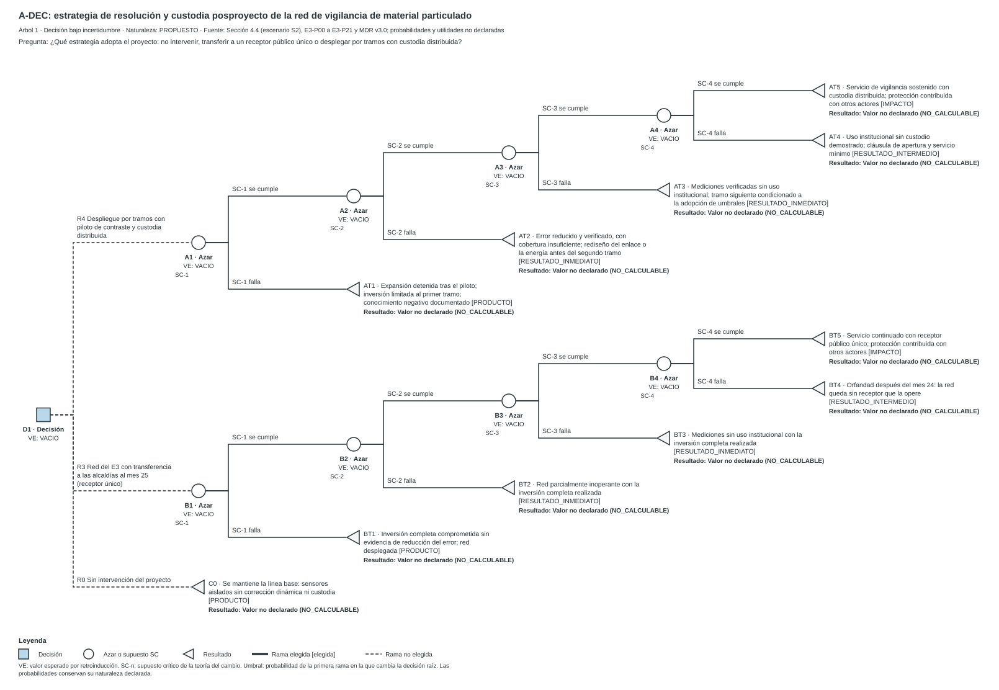
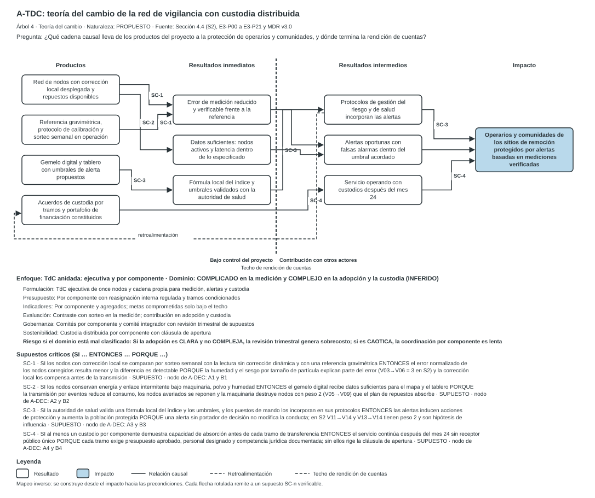

CASE_ID: SGR_CONV56_AIRE

## 4.4-MDR Metodología integrada de decisión y resolución

Esta sección aplica la metodología integrada de decisión y resolución al fenómeno de la vigilancia de material particulado en sitios de remoción de escombros. Se ejecuta en modo estándar, con perfil de proyecto de ciencia, tecnología e innovación. Las catorce piezas siguen este orden: síntesis, árboles, nueve análisis por fases, premortem y escenarios, valor y vacíos, y referencias. Utiliza los resultados de 4.3 y 4.4 sin modificarlos. Los departamentos y la alianza son SUPUESTO por instrucción del usuario. Los términos de referencia de la convocatoria no fueron aportados. El expediente técnico (fichas, métricas, señales, cálculos y pruebas) se entrega en archivos separados.

### 4.4-MDR.1 Síntesis decisional

**Decisión recomendada (condicionada).** El análisis recomienda la estrategia R4: desplegar la red por tramos, con un piloto de contraste y custodia distribuida por componente. No recomienda mantener R3 (transferencia a las alcaldías en el mes 25) como diseño base. Tampoco recomienda R0 (sin intervención). La recomendación es condicional: depende de cuatro supuestos críticos (SC-1 a SC-4) y de tres insumos ausentes. Los insumos ausentes son los términos de referencia, la ratificación de las fichas de 4.4 y la evidencia de capacidad de los custodios.

**Calificador.** CONDICIONALMENTE. La recomendación se apoya en juicios estructurales de influencia (estatuto HIE) y en supuestos declarados. El árbol de decisión es cualitativo porque ninguna probabilidad ni utilidad tiene fuente. Por eso el valor esperado es NO_CALCULABLE y el árbol no marca una rama elegida.

**Teoría del cambio en una oración.** Si la corrección local reduce el error verificado y las autoridades adoptan los umbrales, las alertas protegen a operarios y comunidades.

**Arquitectura de sostenibilidad.** La solución se diseña con la premisa de que ninguna entidad pública puede sostenerla sola al cierre. Cada componente recibe un custodio por tramos, con una cláusula de apertura si ninguno demuestra capacidad. El costo total de sostenimiento y el índice de capacidad de absorción son NO_CALCULABLE por falta de insumos. El portafolio que declara el expediente E3 concentra 63,2 % en una fuente y arroja un índice HHI de 0,472 en el año 1. Ambas cifras superan las convenciones locales PROPUESTAS (50 % y 0,40).

**Principal riesgo.** La adopción institucional carece de evidencia. La variable V15 participa en 140 de 144 ciclos simples de S2 y tres de sus cinco fichas de salida tienen confianza baja. El expediente E3 asigna a las alcaldías la operación desde el mes 25 sin compromiso presupuestal firmado (E3-P17).

**Valor estratégico.** Permite decidir, antes de la compra masiva, si el diseño se ejecuta por tramos con evidencia o en bloque con un receptor supuesto. La utilidad es potencial: ningún resultado observado respalda todavía la recomendación.

**Estado de la entrega.** Borrador con vacíos. El expediente separado registra las nueve fichas, las métricas, las señales y las pruebas.

### 4.4-MDR.2 Árbol de decisión A-DEC y árbol de teoría del cambio A-TDC

Los dos árboles se emiten antes del análisis por fases. Comparten los códigos SC-1 a SC-4. Cada árbol incluye su JSON canónico, el SVG editable y su alternativa textual. El JSON regenera el SVG con la herramienta de referencia.

#### Árbol A-DEC (decisión bajo incertidumbre, modalidad cualitativa)

El árbol compara tres estrategias. Cada una de las dos estrategias de despliegue enfrenta cuatro supuestos en cadena. El orden temporal es: medición (SC-1) en el Hito 2, energía y enlace (SC-2), uso institucional (SC-3) y custodia (SC-4). El árbol modela un camino crítico: la falla de un supuesto interrumpe la cadena. No modela la dependencia entre supuestos.

```json
{
 "tipo": "DECISION",
 "rol": "A-DEC",
 "titulo": "A-DEC: estrategia de resolución y custodia posproyecto de la red de vigilancia de material particulado",
 "naturaleza": "PROPUESTO",
 "fuente": "Sección 4.4 (escenario S2), E3-P00 a E3-P21 y MDR v3.0; probabilidades y utilidades no declaradas",
 "pregunta": "¿Qué estrategia adopta el proyecto: no intervenir, transferir a un receptor público único o desplegar por tramos con custodia distribuida?",
 "descripcion": "Árbol de decisión cualitativo con tres alternativas: R0 sin intervención, R3 transferencia al receptor público único y R4 despliegue por tramos bajo la premisa de diseño sin receptor público único. Cuatro supuestos críticos en cadena: SC-1 medición, SC-2 energía y enlace, SC-3 uso institucional y SC-4 custodia. Los resultados indican el nivel de la cadena alcanzado. Sin probabilidades ni utilidades declaradas, el valor esperado es NO_CALCULABLE y no se marca ninguna rama elegida.",
 "raiz": {
  "id": "D1",
  "tipo": "DECISION",
  "etiqueta": "Estrategia de resolución y custodia",
  "hijos": [
   {
    "rama": "R4 Despliegue por tramos con piloto de contraste y custodia distribuida",
    "nodo": {
     "id": "A1",
     "tipo": "AZAR",
     "supuesto": "SC-1",
     "etiqueta": "Medición: la corrección local reduce el error frente a la lectura sin corrección dinámica",
     "hijos": [
      {
       "rama": "SC-1 se cumple",
       "nodo": {
        "id": "A2",
        "tipo": "AZAR",
        "supuesto": "SC-2",
        "etiqueta": "Energía y enlace: nodos activos suficientes bajo maquinaria y humedad",
        "hijos": [
         {
          "rama": "SC-2 se cumple",
          "nodo": {
           "id": "A3",
           "tipo": "AZAR",
           "supuesto": "SC-3",
           "etiqueta": "Uso: autoridades adoptan umbrales de alerta validados en sus protocolos",
           "hijos": [
            {
             "rama": "SC-3 se cumple",
             "nodo": {
              "id": "A4",
              "tipo": "AZAR",
              "supuesto": "SC-4",
              "etiqueta": "Custodia: al menos un custodio por componente demuestra capacidad de absorción antes de cada tramo",
              "hijos": [
               {
                "rama": "SC-4 se cumple",
                "nodo": {
                 "id": "AT5",
                 "tipo": "TERMINAL",
                 "etiqueta": "Servicio de vigilancia sostenido con custodia distribuida; protección contribuida con otros actores",
                 "nivel_tdc": "IMPACTO",
                 "resultado": "Valor no declarado (NO_CALCULABLE)"
                }
               },
               {
                "rama": "SC-4 falla",
                "nodo": {
                 "id": "AT4",
                 "tipo": "TERMINAL",
                 "etiqueta": "Uso institucional sin custodio demostrado; cláusula de apertura y servicio mínimo",
                 "nivel_tdc": "RESULTADO_INTERMEDIO",
                 "resultado": "Valor no declarado (NO_CALCULABLE)"
                }
               }
              ]
             }
            },
            {
             "rama": "SC-3 falla",
             "nodo": {
              "id": "AT3",
              "tipo": "TERMINAL",
              "etiqueta": "Mediciones verificadas sin uso institucional; tramo siguiente condicionado a la adopción de umbrales",
              "nivel_tdc": "RESULTADO_INMEDIATO",
              "resultado": "Valor no declarado (NO_CALCULABLE)"
             }
            }
           ]
          }
         },
         {
          "rama": "SC-2 falla",
          "nodo": {
           "id": "AT2",
           "tipo": "TERMINAL",
           "etiqueta": "Error reducido y verificado, con cobertura insuficiente; rediseño del enlace o la energía antes del segundo tramo",
           "nivel_tdc": "RESULTADO_INMEDIATO",
           "resultado": "Valor no declarado (NO_CALCULABLE)"
          }
         }
        ]
       }
      },
      {
       "rama": "SC-1 falla",
       "nodo": {
        "id": "AT1",
        "tipo": "TERMINAL",
        "etiqueta": "Expansión detenida tras el piloto; inversión limitada al primer tramo; conocimiento negativo documentado",
        "nivel_tdc": "PRODUCTO",
        "resultado": "Valor no declarado (NO_CALCULABLE)"
       }
      }
     ]
    }
   },
   {
    "rama": "R3 Red del E3 con transferencia a las alcaldías al mes 25 (receptor único)",
    "nodo": {
     "id": "B1",
     "tipo": "AZAR",
     "supuesto": "SC-1",
     "etiqueta": "Medición: la corrección local reduce el error frente a la lectura sin corrección dinámica",
     "hijos": [
      {
       "rama": "SC-1 se cumple",
       "nodo": {
        "id": "B2",
        "tipo": "AZAR",
        "supuesto": "SC-2",
        "etiqueta": "Energía y enlace: nodos activos suficientes bajo maquinaria y humedad",
        "hijos": [
         {
          "rama": "SC-2 se cumple",
          "nodo": {
           "id": "B3",
           "tipo": "AZAR",
           "supuesto": "SC-3",
           "etiqueta": "Uso: autoridades adoptan umbrales de alerta validados en sus protocolos",
           "hijos": [
            {
             "rama": "SC-3 se cumple",
             "nodo": {
              "id": "B4",
              "tipo": "AZAR",
              "supuesto": "SC-4",
              "etiqueta": "Custodia: al menos un custodio por componente demuestra capacidad de absorción antes de cada tramo",
              "hijos": [
               {
                "rama": "SC-4 se cumple",
                "nodo": {
                 "id": "BT5",
                 "tipo": "TERMINAL",
                 "etiqueta": "Servicio continuado con receptor público único; protección contribuida con otros actores",
                 "nivel_tdc": "IMPACTO",
                 "resultado": "Valor no declarado (NO_CALCULABLE)"
                }
               },
               {
                "rama": "SC-4 falla",
                "nodo": {
                 "id": "BT4",
                 "tipo": "TERMINAL",
                 "etiqueta": "Orfandad después del mes 24: la red queda sin receptor que la opere",
                 "nivel_tdc": "RESULTADO_INTERMEDIO",
                 "resultado": "Valor no declarado (NO_CALCULABLE)"
                }
               }
              ]
             }
            },
            {
             "rama": "SC-3 falla",
             "nodo": {
              "id": "BT3",
              "tipo": "TERMINAL",
              "etiqueta": "Mediciones sin uso institucional con la inversión completa realizada",
              "nivel_tdc": "RESULTADO_INMEDIATO",
              "resultado": "Valor no declarado (NO_CALCULABLE)"
             }
            }
           ]
          }
         },
         {
          "rama": "SC-2 falla",
          "nodo": {
           "id": "BT2",
           "tipo": "TERMINAL",
           "etiqueta": "Red parcialmente inoperante con la inversión completa realizada",
           "nivel_tdc": "RESULTADO_INMEDIATO",
           "resultado": "Valor no declarado (NO_CALCULABLE)"
          }
         }
        ]
       }
      },
      {
       "rama": "SC-1 falla",
       "nodo": {
        "id": "BT1",
        "tipo": "TERMINAL",
        "etiqueta": "Inversión completa comprometida sin evidencia de reducción del error; red desplegada",
        "nivel_tdc": "PRODUCTO",
        "resultado": "Valor no declarado (NO_CALCULABLE)"
       }
      }
     ]
    }
   },
   {
    "rama": "R0 Sin intervención del proyecto",
    "nodo": {
     "id": "C0",
     "tipo": "TERMINAL",
     "etiqueta": "Se mantiene la línea base: sensores aislados sin corrección dinámica ni custodia",
     "nivel_tdc": "PRODUCTO",
     "resultado": "Valor no declarado (NO_CALCULABLE)"
    }
   }
  ]
 }
}
```



**Alternativa textual de A-DEC.**

Árbol 1 · Decisión bajo incertidumbre · rol A-DEC
Pregunta: ¿Qué estrategia adopta el proyecto: no intervenir, transferir a un receptor público único o desplegar por tramos con custodia distribuida?
Naturaleza: PROPUESTO

Valor esperado en la raíz: NO_CALCULABLE 

| Nodo | Tipo | Etiqueta | Supuesto | VE o valor | Umbral |
|---|---|---|---|---|---|
| D1 | DECISION | Estrategia de resolución y custodia |  | NO_CALCULABLE | — |
| A1 | AZAR | Medición: la corrección local reduce el error frente a la lectura sin corrección dinámica | SC-1 | NO_CALCULABLE | — |
| B1 | AZAR | Medición: la corrección local reduce el error frente a la lectura sin corrección dinámica | SC-1 | NO_CALCULABLE | — |
| C0 | TERMINAL | Se mantiene la línea base: sensores aislados sin corrección dinámica ni custodia |  | NO_CALCULABLE | — |
| A2 | AZAR | Energía y enlace: nodos activos suficientes bajo maquinaria y humedad | SC-2 | NO_CALCULABLE | — |
| AT1 | TERMINAL | Expansión detenida tras el piloto; inversión limitada al primer tramo; conocimiento negativo documentado |  | NO_CALCULABLE | — |
| B2 | AZAR | Energía y enlace: nodos activos suficientes bajo maquinaria y humedad | SC-2 | NO_CALCULABLE | — |
| BT1 | TERMINAL | Inversión completa comprometida sin evidencia de reducción del error; red desplegada |  | NO_CALCULABLE | — |
| A3 | AZAR | Uso: autoridades adoptan umbrales de alerta validados en sus protocolos | SC-3 | NO_CALCULABLE | — |
| AT2 | TERMINAL | Error reducido y verificado, con cobertura insuficiente; rediseño del enlace o la energía antes del segundo tramo |  | NO_CALCULABLE | — |
| B3 | AZAR | Uso: autoridades adoptan umbrales de alerta validados en sus protocolos | SC-3 | NO_CALCULABLE | — |
| BT2 | TERMINAL | Red parcialmente inoperante con la inversión completa realizada |  | NO_CALCULABLE | — |
| A4 | AZAR | Custodia: al menos un custodio por componente demuestra capacidad de absorción antes de cada tramo | SC-4 | NO_CALCULABLE | — |
| AT3 | TERMINAL | Mediciones verificadas sin uso institucional; tramo siguiente condicionado a la adopción de umbrales |  | NO_CALCULABLE | — |
| B4 | AZAR | Custodia: al menos un custodio por componente demuestra capacidad de absorción antes de cada tramo | SC-4 | NO_CALCULABLE | — |
| BT3 | TERMINAL | Mediciones sin uso institucional con la inversión completa realizada |  | NO_CALCULABLE | — |
| AT5 | TERMINAL | Servicio de vigilancia sostenido con custodia distribuida; protección contribuida con otros actores |  | NO_CALCULABLE | — |
| AT4 | TERMINAL | Uso institucional sin custodio demostrado; cláusula de apertura y servicio mínimo |  | NO_CALCULABLE | — |
| BT5 | TERMINAL | Servicio continuado con receptor público único; protección contribuida con otros actores |  | NO_CALCULABLE | — |
| BT4 | TERMINAL | Orfandad después del mes 24: la red queda sin receptor que la opere |  | NO_CALCULABLE | — |

Supuestos críticos para la decisión (distancia al umbral ≤ 0,15, regla PROPUESTA): ninguno.

Errores de coherencia: ninguno detectado.
Comprobaciones del SVG: xml_bien_formado=True, viewbox=True, title=True, desc_no_vacio=True, rol_declarado=True, tipo_declarado=True, colores_fuera_de_paleta=[], sin_script_enlace_imagen=True, sin_transformaciones=True, ids_unicos=True, tamano_minimo_9_5=True

**Nota sobre la criticidad de los supuestos.** La frase «ninguno» de la alternativa textual indica que el generador no calculó umbrales, porque faltan probabilidades. La criticidad de SC-1 a SC-4 para la decisión es NO_CALCULABLE. La regla de distancia 0,15 queda sin aplicar.

#### Árbol A-TDC (teoría del cambio)

El árbol tiene once resultados en cuatro niveles. El techo de rendición de cuentas separa los resultados bajo control del proyecto de aquellos a los que solo contribuye. Los supuestos SC-1 a SC-4 rotulan las flechas críticas y remiten a los nodos A1 a A4 y B1 a B4 de A-DEC.

```json
{
 "tipo": "TDC",
 "rol": "A-TDC",
 "nivel_detalle": "EJECUTIVA",
 "titulo": "A-TDC: teoría del cambio de la red de vigilancia con custodia distribuida",
 "naturaleza": "PROPUESTO",
 "fuente": "Sección 4.4 (S2), E3-P00 a E3-P21 y MDR v3.0",
 "pregunta": "¿Qué cadena causal lleva de los productos del proyecto a la protección de operarios y comunidades, y dónde termina la rendición de cuentas?",
 "descripcion": "Teoría del cambio de cuatro niveles y once resultados. Los productos y resultados inmediatos quedan bajo control del proyecto; los resultados intermedios y el impacto dependen de otros actores. Cuatro supuestos SC-1 a SC-4 rotulan las flechas críticas. La retroalimentación del uso institucional hacia los acuerdos de custodia representa el bucle de demanda. El panel declara dominio, arquitectura, efectos y riesgo de desajuste.",
 "niveles": [
  "Productos",
  "Resultados inmediatos",
  "Resultados intermedios",
  "Impacto"
 ],
 "techo_despues_de": 1,
 "nodos": [
  {
   "id": "P1",
   "nivel": 0,
   "texto": "Red de nodos con corrección local desplegada y repuestos disponibles"
  },
  {
   "id": "P2",
   "nivel": 0,
   "texto": "Referencia gravimétrica, protocolo de calibración y sorteo semanal en operación"
  },
  {
   "id": "P3",
   "nivel": 0,
   "texto": "Gemelo digital y tablero con umbrales de alerta propuestos"
  },
  {
   "id": "P4",
   "nivel": 0,
   "texto": "Acuerdos de custodia por tramos y portafolio de financiación constituidos"
  },
  {
   "id": "R1",
   "nivel": 1,
   "texto": "Error de medición reducido y verificable frente a la referencia"
  },
  {
   "id": "R2",
   "nivel": 1,
   "texto": "Datos suficientes: nodos activos y latencia dentro de lo especificado"
  },
  {
   "id": "R3",
   "nivel": 1,
   "texto": "Fórmula local del índice y umbrales validados con la autoridad de salud"
  },
  {
   "id": "I1",
   "nivel": 2,
   "texto": "Protocolos de gestión del riesgo y de salud incorporan las alertas"
  },
  {
   "id": "I2",
   "nivel": 2,
   "texto": "Alertas oportunas con falsas alarmas dentro del umbral acordado"
  },
  {
   "id": "I3",
   "nivel": 2,
   "texto": "Servicio operando con custodios después del mes 24"
  },
  {
   "id": "IM",
   "nivel": 3,
   "texto": "Operarios y comunidades de los sitios de remoción protegidos por alertas basadas en mediciones verificadas",
   "destacado": true
  }
 ],
 "enlaces": [
  {
   "de": "P3",
   "a": "R3",
   "supuesto": "SC-3"
  },
  {
   "de": "P1",
   "a": "R2",
   "supuesto": "SC-2"
  },
  {
   "de": "P1",
   "a": "R1",
   "supuesto": "SC-1"
  },
  {
   "de": "P2",
   "a": "R1",
   "supuesto": "SC-1"
  },
  {
   "de": "P4",
   "a": "I3",
   "supuesto": "SC-4"
  },
  {
   "de": "R3",
   "a": "I1",
   "supuesto": "SC-3"
  },
  {
   "de": "R1",
   "a": "I2"
  },
  {
   "de": "R2",
   "a": "I2"
  },
  {
   "de": "I1",
   "a": "IM",
   "supuesto": "SC-3"
  },
  {
   "de": "I2",
   "a": "IM"
  },
  {
   "de": "I3",
   "a": "IM",
   "supuesto": "SC-4"
  },
  {
   "de": "I1",
   "a": "P4"
  }
 ],
 "supuestos": [
  {
   "id": "SC-1",
   "si": "los nodos con corrección local se comparan por sorteo semanal con la lectura sin corrección dinámica y con una referencia gravimétrica",
   "entonces": "el error normalizado de los nodos corregidos resulta menor y la diferencia es detectable",
   "porque": "la humedad y el sesgo por tamaño de partícula explican parte del error (V03→V06 = 3 en S2) y la corrección local los compensa antes de la transmisión",
   "naturaleza": "SUPUESTO",
   "nodo_arbol": "A1 y B1"
  },
  {
   "id": "SC-2",
   "si": "los nodos conservan energía y enlace intermitente bajo maquinaria, polvo y humedad",
   "entonces": "el gemelo digital recibe datos suficientes para el mapa y el tablero",
   "porque": "la transmisión por eventos reduce el consumo, los nodos averiados se reponen y la maquinaria destruye nodos con peso 2 (V05→V09) que el plan de repuestos absorbe",
   "naturaleza": "SUPUESTO",
   "nodo_arbol": "A2 y B2"
  },
  {
   "id": "SC-3",
   "si": "la autoridad de salud valida una fórmula local del índice y los umbrales, y los puestos de mando los incorporan en sus protocolos",
   "entonces": "las alertas inducen acciones de protección y aumenta la población protegida",
   "porque": "una alerta sin portador de decisión no modifica la conducta; en S2 V11→V14 y V13→V14 tienen peso 2 y son hipótesis de influencia",
   "naturaleza": "SUPUESTO",
   "nodo_arbol": "A3 y B3"
  },
  {
   "id": "SC-4",
   "si": "al menos un custodio por componente demuestra capacidad de absorción antes de cada tramo de transferencia",
   "entonces": "el servicio continúa después del mes 24 sin receptor público único",
   "porque": "cada tramo exige presupuesto aprobado, personal designado y competencia jurídica documentada; sin ellos rige la cláusula de apertura",
   "naturaleza": "SUPUESTO",
   "nodo_arbol": "A4 y B4"
  }
 ],
 "enfoque": {
  "dominio": "COMPLICADO en la medición y COMPLEJO en la adopción y la custodia",
  "naturaleza_dominio": "INFERIDO",
  "arquitectura": "TdC anidada: ejecutiva y por componente",
  "efectos": [
   {
    "dimension": "Formulación",
    "efecto": "TdC ejecutiva de once nodos y cadena propia para medición, alertas y custodia"
   },
   {
    "dimension": "Presupuesto",
    "efecto": "Por componente con reasignación interna regulada y tramos condicionados"
   },
   {
    "dimension": "Indicadores",
    "efecto": "Por componente y agregados; metas comprometidas solo bajo el techo"
   },
   {
    "dimension": "Evaluación",
    "efecto": "Contraste con sorteo en la medición; contribución en adopción y custodia"
   },
   {
    "dimension": "Gobernanza",
    "efecto": "Comités por componente y comité integrador con revisión trimestral de supuestos"
   },
   {
    "dimension": "Sostenibilidad",
    "efecto": "Custodia distribuida por componente con cláusula de apertura"
   }
  ],
  "riesgo_desajuste": "Si la adopción es CLARA y no COMPLEJA, la revisión trimestral genera sobrecosto; si es CAOTICA, la coordinación por componente es lenta"
 }
}
```



**Alternativa textual de A-TDC.**

Árbol 4 · Teoría del cambio · rol A-TDC
Pregunta: ¿Qué cadena causal lleva de los productos del proyecto a la protección de operarios y comunidades, y dónde termina la rendición de cuentas?
Naturaleza: PROPUESTO

| Nivel | Nodo | Texto |
|---|---|---|
| Productos | P1 | Red de nodos con corrección local desplegada y repuestos disponibles |
| Productos | P2 | Referencia gravimétrica, protocolo de calibración y sorteo semanal en operación |
| Productos | P3 | Gemelo digital y tablero con umbrales de alerta propuestos |
| Productos | P4 | Acuerdos de custodia por tramos y portafolio de financiación constituidos |
| Resultados inmediatos | R1 | Error de medición reducido y verificable frente a la referencia |
| Resultados inmediatos | R2 | Datos suficientes: nodos activos y latencia dentro de lo especificado |
| Resultados inmediatos | R3 | Fórmula local del índice y umbrales validados con la autoridad de salud |
| Resultados intermedios | I1 | Protocolos de gestión del riesgo y de salud incorporan las alertas |
| Resultados intermedios | I2 | Alertas oportunas con falsas alarmas dentro del umbral acordado |
| Resultados intermedios | I3 | Servicio operando con custodios después del mes 24 |
| Impacto | IM | Operarios y comunidades de los sitios de remoción protegidos por alertas basadas en mediciones verificadas |

Relaciones: P3 → R3 (SC-3); P1 → R2 (SC-2); P1 → R1 (SC-1); P2 → R1 (SC-1); P4 → I3 (SC-4); R3 → I1 (SC-3); R1 → I2; R2 → I2; I1 → IM (SC-3); I2 → IM; I3 → IM (SC-4); I1 → P4.

SC-1: SI los nodos con corrección local se comparan por sorteo semanal con la lectura sin corrección dinámica y con una referencia gravimétrica ENTONCES el error normalizado de los nodos corregidos resulta menor y la diferencia es detectable PORQUE la humedad y el sesgo por tamaño de partícula explican parte del error (V03→V06 = 3 en S2) y la corrección local los compensa antes de la transmisión (SUPUESTO).

SC-2: SI los nodos conservan energía y enlace intermitente bajo maquinaria, polvo y humedad ENTONCES el gemelo digital recibe datos suficientes para el mapa y el tablero PORQUE la transmisión por eventos reduce el consumo, los nodos averiados se reponen y la maquinaria destruye nodos con peso 2 (V05→V09) que el plan de repuestos absorbe (SUPUESTO).

SC-3: SI la autoridad de salud valida una fórmula local del índice y los umbrales, y los puestos de mando los incorporan en sus protocolos ENTONCES las alertas inducen acciones de protección y aumenta la población protegida PORQUE una alerta sin portador de decisión no modifica la conducta; en S2 V11→V14 y V13→V14 tienen peso 2 y son hipótesis de influencia (SUPUESTO).

SC-4: SI al menos un custodio por componente demuestra capacidad de absorción antes de cada tramo de transferencia ENTONCES el servicio continúa después del mes 24 sin receptor público único PORQUE cada tramo exige presupuesto aprobado, personal designado y competencia jurídica documentada; sin ellos rige la cláusula de apertura (SUPUESTO).

Enfoque: TdC anidada: ejecutiva y por componente para dominio COMPLICADO en la medición y COMPLEJO en la adopción y la custodia.

Errores de coherencia: ninguno detectado.
Comprobaciones del SVG: xml_bien_formado=True, viewbox=True, title=True, desc_no_vacio=True, rol_declarado=True, tipo_declarado=True, colores_fuera_de_paleta=[], sin_script_enlace_imagen=True, sin_transformaciones=True, ids_unicos=True, tamano_minimo_9_5=True

**Revisión visual.** Se renderizaron ambos SVG con un navegador y se inspeccionaron. Los textos se leen completos y no se superponen nodos. La etiqueta SC-3 del enlace R3 a I1 cruza el trazo del techo y conserva su fondo blanco. El generador de referencia fija la disposición; no se editó a mano.

### 4.4-MDR.3 Construcción y dominio del fenómeno

Esta pieza fija qué fenómeno existe, quién lo construye y en qué dominio causal se ubica. Reutiliza el problema de 4.3 y 4.4. No lo sustituye por la solución preferida. Las fuentes se identifican con dos códigos: F-INF es el informe_FINAL de vigilancia tecnológica y F-E3 es el expediente Problematica_E3-P00.

#### Delimitación del fenómeno

| Campo | Contenido | Naturaleza y verificación |
| --- | --- | --- |
| Fenómeno observado | En sitios de remoción de escombros posteriores al sismo, la medición de PM2,5 y PM10 con sensores de bajo costo carece de verificación frente a una referencia. | DECLARADO en F-E3 (E3-P00, E3-P01); NO_VERIFICADO |
| Unidad decisora | El equipo formulador diseña la propuesta. El financiador decide la asignación. Rol del equipo: POR_IDENTIFICAR. | SUPUESTO |
| Población afectada | Operarios de remoción y comunidades colindantes. Cifras: VACIO. F-E3 (Cap. 14.3) menciona 87 municipios y 80 funcionarios sin fuente. | VACIO; NO_VERIFICADO |
| Territorio | Caldas, Cundinamarca y Valle del Cauca. | SUPUESTO por instrucción del usuario |
| Periodo y horizonte | 24 meses de ejecución y 12 meses posproyecto: 36 meses. | PROPUESTO |
| Nivel de agregación | Nodo-semana en la medición. Municipio-mes en la adopción. | PROPUESTO |
| Síntoma | Lecturas con error no cuantificado en el territorio. La línea base de error normalizado (NMAE) es VACIO. F-E3 cita 45 % sin localizador y fija tres metas distintas: menos de 30 %, 15 % o menos y menos de 15 %. | DOCUMENTADO en F-E3; CONTRADICTORIO |
| Problema como estado observable | En los sitios de remoción no se dispone de mediciones de PM2,5 y PM10 verificadas frente a una referencia ni de alertas incorporadas en protocolos de decisión. | PROPUESTO; NO_VERIFICADO |
| Explicación propuesta | El error de medición (V06) actúa como cuello de botella estructural entre el entorno físico y las variables de decisión. | INFERIDO (HIE en 4.4); NO_VERIFICADO |
| Solución preferida | Arquitectura híbrida con corrección local (ALT-03 de F-E3) y gemelo digital. Se registra como hipótesis de intervención. | DECLARADO en F-E3; se examina en el argumento |

El enunciado del problema describe un estado observable. La solución preferida figura aparte, como hipótesis. Ninguna observación disponible mide hoy el estado descrito: la línea base es un vacío.

#### Construcción discursiva

La tabla responde las cuatro preguntas de análisis del discurso de Bacchi (2009) y de Schön y Rein (1994).

| Pregunta | Respuesta | Fuente |
| --- | --- | --- |
| ¿Cómo se representa el problema? | Como una limitación técnica de medición y de comunicaciones: el error del sensor y el consumo de energía impiden calibrar en terreno. | F-E3, E3-P07 (contradicción raíz CTR-01) |
| ¿Qué supuestos sostienen esa representación? | (a) La causa principal es metrológica y energética. (b) La respuesta es tecnológica. (c) Las alcaldías adoptan y sostienen el tablero. | F-E3, E3-P09, E3-P17 y Cap. 14 |
| ¿Qué queda sin problematizar? | La emisión en la fuente, las acciones que activa la alerta, el umbral normativo aplicable y la responsabilidad de contratistas y administradoras de riesgos laborales (ARL). | Ausencia en F-E3; INFERIDO |
| ¿Qué efectos produce sobre los afectados? | Operarios y comunidades figuran como receptores de alertas. F-E3 no registra su participación en el diseño de los umbrales. | E3-P17 (matriz RACI); INFERIDO |

**Marcos rivales.** Se registran tres marcos con su portador. Ninguno cuenta con evidencia verificada en esta corrida.

| Marco rival | Portador | Qué sostendría | Fuente y estado |
| --- | --- | --- | --- |
| Control en la fuente y salud ocupacional | Autoridades laborales y ARL | El problema es la emisión de polvo en obra. La medición es secundaria. | Conocimiento externo; INFERIDO; NO_VERIFICADO |
| Gestión del riesgo de desastres como servicio | UNGRD y puestos de mando unificado | La alerta solo existe si un protocolo de mando la activa. | F-E3, E3-P17; INFERIDO |
| Metrología y acreditación | IDEAM | Solo un equipo acreditado como referencia sustenta una alerta oficial. | F-INF §6.5 (Tabla 30); INFERIDO |

#### Núcleo normativo

El núcleo normativo identifica derechos, mandatos y compromisos que delimitan las soluciones admisibles (Dunn, 2018). Los términos de referencia de la convocatoria no fueron aportados. Por esa razón, ninguna restricción se registra como no negociable con fuente normativa. Las restricciones siguientes se rotulan según su estado real.

| Restricción | Estado | Portador o fuente |
| --- | --- | --- |
| Tope de 14.000 millones de COP y reglas de elegibilidad | DECLARADO en F-E3 (cita TdR pp. 7-8 y 25); NO_VERIFICADO | Convocante; TdR no aportados |
| Protección de la salud y de un ambiente sano | CANDIDATO_A_VERIFICAR | Constitución Política, arts. 49 y 79 [conocimiento externo] |
| Competencia territorial en gestión del riesgo | CANDIDATO_A_VERIFICAR | Ley 1523 de 2012 [conocimiento externo] |
| Prioridad de la salud sobre la continuidad de obra | Preferencia del analista | Sin portador declarado |

#### Sistema apreciativo

Los juicios se separan en juicios de realidad, de valor e instrumentales, cada uno con su portador (Vickers, 1965).

| Tipo de juicio | Juicio | Portador y fuente | Estado |
| --- | --- | --- | --- |
| Realidad | El error normalizado supera 45 % sin corrección. | F-E3, Paso 1 (F_REV_SISTEMATICA sin localizador) | DECLARADO; NO_VERIFICADO |
| Realidad | La humedad sesga los sensores ópticos. F-INF §8.3 reporta correlación de 0,73. F-E3 usa 0,48 en 3.15, 4.6 y ND-11. | F-INF §8.3; F-E3 | CONTRADICTORIO entre fuentes |
| Valor | Evitar paros de obra por falsas alarmas. | Constructoras (F-E3, Tabla 14.2, lucro cesante) | DECLARADO; NO_VERIFICADO |
| Valor | Proteger primero a operarios y comunidades cuando se supera un umbral. | Sin portador declarado | VACIO |
| Instrumental | La corrección local reduce el error sin degradar energía ni latencia. | Equipo formulador (E3-P09, OP-03) | SUPUESTO |
| Instrumental | Las alcaldías operan el tablero desde el mes 25. | F-E3, E3-P17 y CLM-06 | SUPUESTO; NO_VERIFICADO |

Los dos juicios de valor sobre una misma alerta divergen: la protección inmediata y la continuidad de obra. El análisis conserva ambos. No los reconcilia por decisión del analista.

#### Estructura del problema (Simon, 1973)

| Condición | Evaluación | Evidencia |
| --- | --- | --- |
| C1. Criterio explícito para aceptar una solución | NO CUMPLE | Las metas del error son contradictorias y los TdR faltan. |
| C2. Estados y variables pertinentes identificados | CUMPLE con reserva | Quince variables con diccionario; cuatro variables latentes omitidas (4.3). |
| C3. Acciones disponibles identificadas | CUMPLE | Cuatro alternativas catalogadas en E3-P10. |
| C4. Relación entre acciones y resultados conocida con precisión | NO CUMPLE | Las relaciones son hipótesis de influencia sin datos del territorio. |

Dos condiciones se cumplen. La clasificación PROPUESTA es PARCIALMENTE_ESTRUCTURADO. No se activan los rasgos de problema perverso, porque ese paso exige una clasificación MAL_ESTRUCTURADO.

**Escala.** El fenómeno se clasifica como PROBLEMA_PUBLICO (INFERIDO), según la distinción de Mills (1959). Sus efectos exceden el entorno de cada operario y afectan a comunidades colindantes. El alcance poblacional es VACIO.

#### Dominio causal

La clasificación sigue los dominios de Snowden y Boone (2007) y la tipología de Glouberman y Zimmerman (2002). Se hace por partes. Ninguna parte queda en confusión.

| Parte | Dominio | Evidencia | Observación que cambiaría la clasificación |
| --- | --- | --- | --- |
| Medición con corrección local | COMPLICADO | La relación causa-efecto existe y requiere análisis experto. La corrección con la estación cercana elevó el R² de menos de 0,2 a 0,81 en un caso (F-INF §8.3). En S2, V03→V06 = 3. | Si el efecto de la corrección cambiara de signo entre sitios o semanas sin patrón, pasaría a COMPLEJO. |
| Adopción institucional y custodia | COMPLEJO | S2 contiene 144 ciclos simples y 140 incluyen V15. El juego de bien público de F-INF §6.5 sugiere patrones emergentes. | Si tres de tres departamentos ejecutaran una partida recurrente con protocolo firmado, pasaría a COMPLICADO. |

La naturaleza de ambas clasificaciones es INFERIDO y su verificación es NO_VERIFICADO. La fase aguda del sismo queda fuera del alcance. Por eso no se asigna el dominio caótico. La correspondencia con los cuatro tipos de problemas de Smalley (2018) sería INFERIDA y no se usa para clasificar.

#### Vacíos de la construcción

- Línea base de error de medición en el territorio: VACIO. Tenedor: equipo formulador. Vía: medición con referencia en el Hito 1.
- Términos de referencia: VACIO. Tenedor: entidad ejecutora supuesta. Vía: aportar el documento.
- Fórmula local del índice AQHI y umbrales (V-AQHI-01): VACIO. Tenedor: autoridad de salud. Vía: validación local.
- Población expuesta y carga de morbilidad: VACIO. Sin variable de resultado en el modelo.

### 4.4-MDR.4 Entorno estructural e institucional

Esta pieza registra qué estructuras y reglas habilitan o bloquean cada estrategia. Sus restricciones de continuidad alimentan la teoría del cambio y la sostenibilidad. Todas las filas conservan fuente y naturaleza.

#### Contexto estructural

| Condicionante | Tipo | Efecto | Fuente | Naturaleza y verificación |
| --- | --- | --- | --- | --- |
| Humedad relativa alta y polvo higroscópico | Físico | Limita: sesga la lectura óptica | S2, V03→V06 = 3; F-INF §8.3 | INFERIDO; PARCIALMENTE_VERIFICADO |
| Maquinaria de remoción | Físico | Limita: daña nodos (V05→V09 = 2) | S2, ficha V05→V09 | INFERIDO; NO_VERIFICADO |
| Infraestructura eléctrica y celular colapsada | Tecnológico | Limita: afecta energía y enlace | F-E3, 4.6 (cinco porqués) | DECLARADO; NO_VERIFICADO |
| Estaciones oficiales de referencia | Recurso | Posible recurso para calibrar. Cobertura en el territorio: VACIO. | F-INF §6.5 (IDEAM) | DECLARADO; NO_VERIFICADO |
| Tope de 14.000 millones de COP | Recurso | Limita el alcance. El desglose de F-E3 (Cap. 8) documenta 4.448,7 millones; faltan 9.551,3. | F-E3, Cap. 8 | CALCULADO sobre cifras de F-E3; NO_VERIFICADO |
| Capacidad técnica local | Recurso | Meta de certificar 80 funcionarios. Línea base: VACIO. | F-E3, Cap. 14.3 | DECLARADO; NO_VERIFICADO |

El mismo expediente contiene una contradicción de arquitectura. El problema declara el colapso de la infraestructura celular y eléctrica. La alternativa ALT-03 transmite por enlace celular 4G con 100 tarjetas SIM (F-E3, Cap. 8, Tabla 8.3) y no presupuesta enlace alterno. Esa contradicción sustenta el supuesto SC-2.

#### Reglas institucionales

Las reglas formales citan su norma controlante y las informales su evidencia de práctica (North, 1990; Ostrom, 2005).

| Regla | Tipo | Conducta que permite, exige o prohíbe | Fuente | Estado |
| --- | --- | --- | --- | --- |
| Términos de referencia de la convocatoria | Formal | Define elegibilidad, tope, madurez y gobernanza exigida. | F-E3 cita secciones 10.4, 10.6 y 10.16 | VACIO: TdR no aportados |
| Normas de gestión del riesgo y salud ocupacional | Formal | Asignan la competencia sobre la respuesta a una alerta. | Conocimiento externo | CANDIDATO_A_VERIFICAR |
| Anualidad presupuestal y vigencias futuras | Formal | Condicionan el compromiso de gasto recurrente después del cierre. | Conocimiento externo | CANDIDATO_A_VERIFICAR |
| Propiedad industrial: diez solicitudes PCT designan a Colombia | Formal | Condiciona la libertad de operación. Tres plazos de fase nacional siguen abiertos. | F-INF §8.3 (D-01) | DOCUMENTADO en F-INF; NO_VERIFICADO |
| Compra de sensores sin plan de calibración | Informal | Los compradores operan sin calibrar mientras ninguna regla lo exija. | F-INF §6.5 (Juego 1) y §8.3 | DOCUMENTADO en F-INF; fuente primaria no leída |
| Equipos que terminan en bodegas municipales | Informal | Práctica citada sin evidencia local. | F-E3, Cap. 14.3 (Murad Pedraza et al., 2026, p. 15, como se citó en F-E3) | DECLARADO; NO_VERIFICADO |

#### Selectividad estratégica

La selectividad estratégica examina qué estrategias favorece el diseño institucional vigente (Jessop, 2008; Hay, 2002). Pregunta de control: ¿qué estrategia tendría éxito aquí sin ser la mejor técnicamente? El diseño institucional supuesto favorece las estrategias de la columna izquierda y penaliza las de la derecha. La lectura es INFERIDA, porque los criterios de evaluación de la convocatoria no se aportaron.

| Estrategia favorecida | Mecanismo de la selectividad |
| --- | --- |
| Propuesta con novedad tecnológica visible (corrección local con aprendizaje automático embebido) | Los criterios de impacto y novedad pesan más que la verificación. F-E3 asigna 0,40 al impacto con peso SUPUESTO (E3-P14). |
| Entrega de activos físicos antes que servicios | Los rubros de inversión se costean con facilidad. El gasto recurrente exige compromisos posteriores (CANDIDATO_A_VERIFICAR). |
| Asignar la operación a entidades territoriales en la matriz de responsabilidades | La convocatoria exige evidencia de alianza y de gobernanza. Un rol asignado en papel satisface el formato (E3-P17). |

| Estrategia penalizada | Mecanismo de la selectividad |
| --- | --- |
| Piloto previo y compra por tramos | Retrasa el despliegue visible y exige reglas de decisión anticipadas. |
| Control de polvo en la fuente | Su gasto se percibe como obra y no como ciencia y tecnología. |

**Respuesta de diseño.** La estrategia R4 declara la selectividad en lugar de ocultarla. Presenta el piloto como producto de conocimiento con resultado verificable y los tramos como evidencia de alianza ejecutable.

#### Restricciones de continuidad

| Restricción | Efecto sobre la continuidad | Fuente | Estado |
| --- | --- | --- | --- |
| Anualidad presupuestal territorial | La partida para operar desde el mes 25 debe existir en el plan operativo anual del año fiscal respectivo. | Conocimiento externo | CANDIDATO_A_VERIFICAR |
| Calendario electoral | Las elecciones territoriales siguientes ocurren en octubre de 2027 y la posesión en enero de 2028. Si la ejecución empieza en 2027, el cambio de administración cae dentro de los 24 meses. | Conocimiento externo | CANDIDATO_A_VERIFICAR |
| Rotación de personal | La capacidad certificada se pierde con la salida de funcionarios. | F-E3, Cap. 14.3 | DECLARADO; NO_VERIFICADO |
| Plazos de liquidación y cierre | La transferencia se concentra en el cierre (compuerta G3, mes 24). | F-E3, E3-P17 | DECLARADO |
| Vencimientos de propiedad industrial | Tres plazos de fase nacional pueden afectar la operación. | F-INF §8.3 (D-01) | DOCUMENTADO en F-INF |

#### Vacíos del entorno

- Cobertura de estaciones de referencia en los tres departamentos: VACIO. Tenedor: IDEAM y autoridades ambientales (POR_IDENTIFICAR).
- Reglas del instrumento sobre gasto recurrente y compras por tramos: VACIO hasta aportar los TdR.
- Calendario real de inicio de la ejecución: VACIO. Determina si el cambio de administración cae dentro del proyecto.

### 4.4-MDR.5 Actores, poder e interdependencia

Esta pieza identifica quién decide, quién veta y quién custodia, y anticipa la reacción de cada actor. La alianza es SUPUESTO por instrucción del usuario. Ningún actor firmó compromiso alguno.

#### Identificación y lógica de acción

La tipología distingue actores con veto (Tsebelis, 2002). La lógica de acción distingue las consecuencias y lo apropiado (March y Olsen, 1989).

| Actor | Tipo | Fuente de autoridad o interés | Lógica de acción |
| --- | --- | --- | --- |
| Convocante y órganos de decisión del Sistema General de Regalías | DECISOR; ACTOR_CON_VETO; FINANCIADOR | Aprueba la asignación y los términos (F-E3, E3-P15) | De lo apropiado: cumplimiento de los términos. INFERIDO |
| Institución de educación superior ejecutora | EJECUTOR; CUSTODIO_POTENCIAL | Responde por la ejecución ante el control fiscal (E3-P17) | De las consecuencias: no tiene recursos permanentes (E3-P17, §13). DECLARADO |
| Empresa tecnológica aliada | EJECUTOR; CUSTODIO_POTENCIAL | Responde por propiedad intelectual y código (E3-P17) | De las consecuencias: modelo de negocio. INFERIDO |
| Alcaldías de municipios con remoción | ACTOR_CON_VETO; CUSTODIO_POTENCIAL; AFECTADO | Responden legalmente por actuar sobre la alerta (E3-P17) | De las consecuencias: presupuesto y ciclo electoral. INFERIDO |
| Gobernaciones y unidades departamentales de gestión del riesgo | CUSTODIO_POTENCIAL | F-E3, Tabla 14.3 las nombra como receptoras | Sin evidencia: NO_EVALUADO |
| UNGRD y puestos de mando unificado | DECISOR operativo; usuario | Reciben información en E3-P17 | De lo apropiado: protocolos de mando. INFERIDO |
| IDEAM y autoridades ambientales | Referencia metrológica | F-INF §6.5 (punto focal de acreditación) | De lo apropiado: acreditación. INFERIDO |
| Secretarías de salud, ADRES y ARL | FINANCIADOR potencial; beneficiario del ahorro | F-E3, Tabla 14.2 | Sin evidencia: NO_EVALUADO |
| Constructoras y contratistas de remoción | AFECTADO; generador de la emisión; FINANCIADOR potencial | F-E3, Tabla 14.2 (lucro cesante) | De las consecuencias: evitar paros. INFERIDO |
| Operarios y comunidades colindantes | AFECTADO | Exposición a PM2,5 y PM10 | No registrada: VACIO |
| Proveedores de sensores | EJECUTOR indirecto | F-INF §6.5 | De las consecuencias. INFERIDO |
| Órganos de control fiscal | Control | E3-P17 | De lo apropiado. INFERIDO |

#### Relevancia (poder, legitimidad y urgencia)

La relevancia combina poder, legitimidad y urgencia (Mitchell et al., 1997). La evaluación exige evidencia. Solo el convocante cuenta con evidencia directa de poder en los documentos. El resto se registra como NO_EVALUADO, con la evidencia que lo resolvería.

| Actor | Poder | Legitimidad | Urgencia | Evidencia que falta |
| --- | --- | --- | --- | --- |
| Convocante | ALTO (aprueba y fija términos; DECLARADO) | NO_EVALUADA | NO_EVALUADA | Términos de referencia |
| Alcaldías | NO_EVALUADO | NO_EVALUADA | NO_EVALUADA | Cartas de compromiso con partida y competencia |
| Constructoras | NO_EVALUADO | NO_EVALUADA | NO_EVALUADA | Contratos de obra y cláusulas ambientales |
| Operarios y comunidades | NO_EVALUADO | NO_EVALUADA | NO_EVALUADA | Línea base de exposición y consulta |
| IDEAM y autoridades ambientales | NO_EVALUADO | NO_EVALUADA | NO_EVALUADA | Convenio de referencia con estaciones |

Una constructora con poder de paralizar la obra y sin legitimidad sobre el umbral de alerta se registra como riesgo, no como aliada. La condición se evaluará cuando exista evidencia.

#### Reacciones previstas (anticipación cualitativa)

Sin pagos monetarios especificables, las reacciones son anticipaciones cualitativas INFERIDAS.

| Actor | Reacción prevista ante R4 | Reacción prevista ante R3 |
| --- | --- | --- |
| Alcaldías | Aceptan tramos si reciben capacidad demostrada y no asumen costos antes de recibirla | Aceptan la designación en la matriz y pueden no presupuestar la operación |
| Institución ejecutora | Mantiene el servicio mínimo si la cláusula de apertura le permite liberar activos | Queda como responsable de hecho si ninguna alcaldía asume la operación |
| Constructoras | Cofinancian si la alerta reduce paros por falsas alarmas | Presionan por umbrales altos para evitar paros |
| Convocante | Evalúa el costo adicional del piloto frente al riesgo de abandono | Valida el formato de alianza sin evidencia de ejecución |

#### Interdependencia estratégica

Un juego exige jugadores, estrategias y pagos especificados (Scharpf, 1997). El informe F-INF §6.5 modela como juego de bien público la decisión de calibrar y mantener sensores. Esta pieza adopta su estructura por analogía y la aplica a la custodia. Los jugadores son dos entidades territoriales candidatas. Las estrategias son asumir la operación y el mantenimiento (A) o no asumirlos (N).

| Pagos ordinales (4 mejor, 1 peor): fila, columna | Columna asume (A) | Columna no asume (N) |
| --- | --- | --- |
| Fila asume (A) | (3, 3) | (1, 4) |
| Fila no asume (N) | (4, 1) | (2, 2) |

El equilibrio de Nash es (N, N): ninguna entidad asume la operación. Ese resultado es peor para ambas que (A, A). Supuestos declarados: pagos ordinales tomados de F-INF §6.5, juego de una sola ronda, información completa y sin transferencias. Naturaleza: INFERIDO. Verificación: NO_VERIFICADO.

**Implicación de diseño.** Una regla que condiciona cada tramo de transferencia a la capacidad demostrada cambia los pagos de N. Ese es el mecanismo de R4. R3 deja intacto el equilibrio (N, N) y por eso depende de un compromiso externo.

**Red de actores.** No existen datos relacionales con fuente. No se infiere centralidad por percepción.

#### Vacíos de actores

- Compromisos escritos de alcaldías, gobernaciones y aliados: VACIO. Tenedor: equipo formulador.
- Evaluación de poder, legitimidad y urgencia con evidencia: VACIO.
- Participación de operarios y comunidades en la definición de umbrales: VACIO.

### 4.4-MDR.6 Encuadre y modelo decisional

Esta pieza elige el procedimiento de decisión que corresponde al entendimiento, al conflicto y al cambio requeridos. Puntúa los cuatro ejes con evidencia antes de mirar los modelos.

#### Ejes del encuadre

| Eje | Valor | Evidencia y derivación | Naturaleza |
| --- | --- | --- | --- |
| Entendimiento causal | MEDIO en la medición; BAJO en la adopción y la custodia; BAJO en la decisión integrada | La condición C4 no se cumple. El estimando E1 es identificable solo por diseño prospectivo y E2 no es identificable (4.3). Todas las relaciones de 4.4 son hipótesis de influencia. | INFERIDO |
| Magnitud del cambio | INCREMENTAL en la medición; ESTRUCTURAL en la custodia | La medición mejora un método existente. La custodia cambia quién opera y quién financia. Se deriva de la decisión requerida. | INFERIDO |
| Acuerdo sobre metas | MEDIO | Las metas del error son contradictorias en F-E3. Los valores sobre la alerta divergen (protección inmediata y continuidad de obra). | INFERIDO |
| Reversibilidad | PARCIALMENTE_REVERSIBLE | Los nodos y los datos se reutilizan con la cláusula de apertura. Los contratos de nube y los compromisos territoriales son difíciles de revertir. | INFERIDO |

#### Matriz de Braybrooke y Lindblom (1963) y contraste con el dominio

| Parte | Entendimiento × magnitud | Cuadrante | Dominio causal | Cuadrantes esperados | Resultado |
| --- | --- | --- | --- | --- | --- |
| Medición con corrección local | MEDIO × INCREMENTAL | Frontera entre Q1 y Q3: se examinan ambos | COMPLICADO | Q1 o Q2 | Coherente con Q1 |
| Adopción institucional y custodia | BAJO × ESTRUCTURAL | Q4: exploración, protección de la reversibilidad y aprendizaje | COMPLEJO | Q3 o Q4 | Coherente |

No existe discrepancia entre cuadrante y dominio. Por eso no se reabre la clasificación del dominio ni el eje de entendimiento.

**Matriz de Thompson y Tuden (1959), como contraste.** Acuerdo MEDIO y entendimiento BAJO ubican la decisión integrada en la frontera entre T3 (negociación y compromiso) y T4 (recomposición del problema). La frontera respalda tratar la custodia como una negociación con condiciones, no como una asignación unilateral.

#### Modelos compatibles

| Modelo | Condiciones | Evaluación con evidencia |
| --- | --- | --- |
| Racionalidad sinóptica | Metas acordadas, alternativas enumerables, consecuencias estimables con datos y tiempo suficiente | No se cumple. Las consecuencias no son estimables con datos. F-E3 usó una suma ponderada con pesos SUPUESTO; se conserva como dato. |
| Racionalidad limitada y satisfacción (Simon, 1955) | Información limitada y aspiraciones definibles | Se cumple con reserva. Las aspiraciones son en gran parte VACIO. |
| Incrementalismo desarticulado (Lindblom, 1959) | Entendimiento bajo y cambio incremental | No se cumple: la custodia es un cambio estructural. |
| Exploración mixta (Etzioni, 1967) | Coexisten decisiones fundamentales e incrementales | Se cumple. La custodia es fundamental; la calibración y el despliegue de nodos son incrementales. |
| Óptimo normativo (Dror, 1968) | Alto alcance y capacidad de invertir en el proceso | No hay evidencia de esa capacidad. |
| Estructuración participativa (Rosenhead y Mingers, 2001) | Acuerdo bajo, varios actores y problema mal estructurado | Se cumple solo para la custodia. La clasificación global es parcialmente estructurada. |

**Modelo seleccionado: exploración mixta.** El procedimiento barre las alternativas fundamentales (R0 a R5 y las formas de custodia). Luego examina en detalle las áreas críticas. Las áreas críticas son la medición con contraste (SC-1) y la capacidad de los custodios (SC-4).

**Modelo rival más cercano: racionalidad limitada y satisfacción.** Se conserva como regla de parada de los tramos: el proyecto avanza al tramo siguiente solo cuando se cumplen aspiraciones fijadas antes de buscar. No se adopta como modelo principal porque las aspiraciones no están definidas. La estructuración participativa complementa la exploración mixta en la parte de custodia.

**Tensión registrada.** El modelo es técnicamente adecuado. La selectividad estratégica (4.4-MDR.4) lo penaliza, porque retrasa el despliegue visible. El calendario electoral limita además el margen del piloto. La tensión permanece abierta y condiciona la factibilidad de R4.

### 4.4-MDR.7 Alternativas, método, sensibilidad y sesgos

Esta pieza evalúa las alternativas con los insumos disponibles. No declara ejecutado un método que carece de insumos. No anticipa un ganador. Reutiliza las alternativas del expediente E3 con su procedencia y agrega dos alternativas propuestas en esta corrida.

#### Criterios y aspiraciones registrados antes de evaluar (versión 1.0)

Los criterios siguientes se registraron antes de la matriz de compensaciones y no se modificaron después. Un criterio añadido luego se rotularía POSTERIOR.

| Código | Criterio | Nivel de aspiración | Naturaleza |
| --- | --- | --- | --- |
| CR-1 | Verificabilidad de la medición frente a una referencia, con diseño de contraste | La meta del error la fija el término de referencia: VACIO. F-E3 propone menos de 30 %, 15 % o menos y menos de 15 %. | PROPUESTO |
| CR-2 | Operación sin infraestructura pública estable | Disponibilidad de nodos mayor o igual que un umbral por fijar: VACIO. F-E3 cita 90 % y 95 % de tiempo de silencio del nodo, sin fuente. | PROPUESTO |
| CR-3 | Continuidad sin receptor público único | Máxima participación de una fuente de 50 % o menos e índice HHI de 0,40 o menos; prueba de orfandad superada | PROPUESTO (convenciones locales) |
| CR-4 | Corregibilidad: costo de reversión y tiempo de detección del error | Decisión de continuar o detener en el Hito 2 con evidencia | PROPUESTO |
| CR-5 | Compatibilidad con la convocatoria: tope, elegibilidad y madurez | Términos de referencia: VACIO | VACIO |
| CR-6 | Identificabilidad del efecto técnico | Sorteo semanal ejecutado y registrado (4.3) | PROPUESTO |

Los criterios C1 a C4 de F-E3 (E3-P14) se conservan como dato con su estado original. Sus pesos (0,40; 0,30; 0,15 y 0,15) son SUPUESTO y las utilidades carecen de evidencia. No se reutilizan como pesos de esta corrida.

#### Alternativas

| Código | Alternativa | Origen | Diseñada bajo la premisa sin receptor único |
| --- | --- | --- | --- |
| R0 | Sin intervención: sensores aislados que transmiten hasta agotar batería o crédito | ALT-00 de F-E3 (E3-P10) | No aplica: no hay servicio que sostener |
| R1 | Estaciones fijas robustas con paneles solares y calibración manual trimestral | ALT-01 de F-E3 | No |
| R2 | Malla de sensores con corrección centralizada en la nube | ALT-02 de F-E3 | No |
| R3 | Red híbrida con corrección local y transferencia a las alcaldías en el mes 25 | ALT-03 de F-E3 con la asignación de E3-P17 | No: supone un receptor |
| R4 | La misma tecnología que R3, por tramos, con piloto de contraste y custodia distribuida | PROPUESTA en esta corrida | Sí |
| R5 | Control del polvo en la fuente con medición de referencia mínima | PROPUESTA; deriva del marco rival de 4.4-MDR.3 | Sí |

R5 no cuenta con evidencia aportada y no se evalúa con datos. Se incluye para impedir que la elección parta de la solución preferida.

#### Método ejecutado: matriz de compensaciones

La matriz muestra desempeños sin agregarlos. La naturaleza de cada celda es INFERIDO y su verificación es NO_VERIFICADO, porque describe propiedades de diseño y no resultados medidos.

| Alternativa | CR-1 Verificabilidad | CR-2 Operación sin infraestructura estable | CR-3 Continuidad sin receptor único | CR-4 Corregibilidad | CR-5 Convocatoria | CR-6 Identificabilidad |
| --- | --- | --- | --- | --- | --- | --- |
| R0 | Sin referencia ni contraste | Sin corrección; sensores aislados | Sin servicio que sostener | Sin decisión que corregir | NO_EVALUADO | Sin diseño de contraste |
| R1 | Calibración manual trimestral; sin contraste previsto | Paneles y radioenlaces propios | Operación costosa; custodio no definido | Compra en bloque | NO_EVALUADO | Sin sorteo previsto |
| R2 | Corrección central con datos continuos | Depende del enlace continuo | Depende de contratos de nube; custodio no definido | Compra en bloque | NO_EVALUADO | Sin sorteo previsto |
| R3 | Corrección local sin diseño de contraste en F-E3 | Transmisión por eventos; enlace 4G sin alterno | Receptor público único supuesto | Compromiso total anticipado | NO_EVALUADO | Sin sorteo en F-E3; admite agregarlo |
| R4 | Referencia gravimétrica y sorteo semanal | El piloto verifica energía y enlace antes de cada tramo; enlace alterno por diseñar | Custodia por tramos y cláusula de apertura | Decisión de continuar o detener en el Hito 2 | NO_EVALUADO: costo del piloto y de la gobernanza sin estimar | Sorteo semanal previsto |
| R5 | No mide el error del sensor; mide exposición con referencia mínima | Poca electrónica; depende de la maquinaria | Operación por contratistas; custodio por definir | Reversible | NO_EVALUADO | No aplica al estimando E1 |

**Dominancia.** No se confirma ninguna relación de dominancia. R4 no empeora a R3 en CR-1, CR-2, CR-3, CR-4 ni CR-6 por construcción del diseño. Sin embargo, CR-5 es NO_EVALUADO: el costo del piloto y de la gobernanza no se estimó. Sin dominancia, la matriz no produce ganador.

#### Métodos no ejecutados

| Método | Estado | Motivo |
| --- | --- | --- |
| Árbol de decisión cuantitativo (Raiffa, 1968) | NO_CALCULABLE; árbol cualitativo entregado | Sin probabilidades ni utilidades con fuente |
| Métodos multicriterio (AHP, BWM, TOPSIS, suma ponderada) | NO_EJECUTADO | Los pesos carecen de procedencia y las utilidades de evidencia |
| Análisis costo-beneficio | NO_CALCULABLE | Sin flujos con fuente ni tasa de descuento |
| Análisis de robustez | NO_CALCULABLE | El criterio de aceptabilidad depende de los TdR |
| Análisis estructural Vester/MICMAC | Recibido, no recalculado | Resultados de 4.4 (S2) con identidad registrada en el expediente. Son hipótesis de influencia. |

**Estructura del cálculo pendiente.** Sean p1 a p4 las probabilidades de SC-1 a SC-4 y v1 a v5 los valores de los resultados de una rama. El valor esperado de esa rama es:

```text
VE = p1·[p2·(p3·(p4·v5 + (1 − p4)·v4) + (1 − p3)·v3) + (1 − p2)·v2] + (1 − p1)·v1
```

Con probabilidades declaradas, la herramienta de referencia barre 2.000 pasos y rotula los umbrales como aproximados.

**Resultado multicriterio de F-E3.** La suma ponderada de E3-P14 arroja 0,795 para ALT-03; 0,535 para ALT-02; 0,460 para ALT-00 y 0,325 para ALT-01. La aritmética se recalculó y es correcta (CALCULADO). Los pesos son SUPUESTO y las utilidades carecen de evidencia. Por eso el resultado no se usa como ganador.

#### Sensibilidad y condiciones de elección

El resultado de la matriz no depende de probabilidades ni de pesos. La sensibilidad se traslada a las condiciones bajo las cuales cambia la elección.

- **R4 se prefiere a R3** cuando se cumplen dos condiciones. El costo adicional del piloto, de la gobernanza y de los tramos cabe en el tope (CR-5). La probabilidad de SC-4 bajo custodia distribuida no es menor que bajo receptor único.
- **R3 se prefiere a R4** cuando, antes de la firma, cada componente cuenta con una entidad territorial con compromiso presupuestal vinculante y competencia jurídica. Esa condición equivale a capacidad de absorción 3 en las seis dimensiones.
- **R5 se combina con R4** si la evidencia de emisión en la fuente muestra que la mayor parte de la exposición es controlable. Esa evidencia no existe todavía.
- **R0 solo se admite** si el financiador no acepta R3 ni R4.

Umbral de cambio de la recomendación: NO_CALCULABLE, porque ninguna probabilidad tiene fuente.

#### Auditoría de sesgos

La auditoría cubre ocho sesgos, entre ellos el anclaje y la disponibilidad (Tversky y Kahneman, 1974) y la racionalización a posteriori (Festinger, 1957). Se aplica al decisor, al analista y al modelo de lenguaje.

| Sesgo | Decisor (expediente E3) | Analista y modelo de lenguaje (esta corrida) |
| --- | --- | --- |
| Confirmación | DETECTADO: los criterios del índice de cierre lógico derivan de la contradicción raíz que ALT-03 resuelve por construcción (E3-P11). | NO_EVALUADO. Contramedida aplicada: se conservaron R0, R1 y R2 y se enumeraron refutaciones. |
| Anclaje | DETECTADO: la cifra de 100 nodos y el 45 % de error orientan el diseño sin referencia independiente. | DETECTADO: se heredaron las cifras de F-E3 como punto de partida. Contramedida: se rotularon DECLARADO y NO_VERIFICADO. |
| Costo hundido | NO_DETECTADO: método de lectura dirigida de F-E3; no hay inversión previa documentada. | NO_DETECTADO por el mismo método. |
| Racionalización a posteriori | DETECTADO: E3-P09 impone tres operadores antes de evaluar alternativas y E3-P11 descarta las demás de forma definitiva. | Contramedida: criterios registrados antes de evaluar (versión 1.0). |
| Pensamiento desiderativo | DETECTADO: cifras favorables sin fuente (90 %, 20 %, 35 minutos como latencia). | Contramedida: rótulo SUPUESTO y NO_CALCULABLE. |
| Exceso de confianza | DETECTADO: «garantiza matemáticamente» y «demuestra matemáticamente» en E3-P05, E3-P09 y E3-P19. | Contramedida: calificador CONDICIONALMENTE y refutaciones enumeradas. |
| Disponibilidad | NO_EVALUADO: falta una tasa base de episodios de PM en remoción de escombros. | NO_EVALUADO. |
| Supuesto de receptor | DETECTADO: E3-P17 y el Capítulo 14 suponen que las alcaldías reciben y sostienen. | Contramedida: premisa sin receptor único y estrategia R4. |

El modelo de lenguaje que redacta tiende a completar los vacíos con prosa coherente. La contramedida es declarar VACIO y NO_CALCULABLE donde faltan insumos.

### 4.4-MDR.8 Teoría del cambio, supuestos, techo y matriz de efectos

Esta pieza explicita cómo y por qué la estrategia R4 produciría el cambio buscado. La teoría del cambio es provisional: usa el problema y las hipótesis de 4.3 y 4.4 y no exige un árbol de problemas terminado. Si 4.5 cambia la representación del problema, se versiona esta pieza.

#### Impacto y horizonte

El cambio de largo plazo se formula como estado observable con población, territorio y horizonte (Weiss, 1995; Taplin y Clark, 2012). El impacto es el problema central de la construcción, invertido. En 36 meses, operarios y comunidades de los sitios de remoción están protegidos por alertas basadas en mediciones verificadas. El territorio es SUPUESTO. La línea base de protección es VACIO.

#### Mapeo inverso

Cada fila responde: ¿qué debe ser cierto antes para que el nivel superior ocurra?

| Nodo | Resultado | Precondiciones | Variables de S2 |
| --- | --- | --- | --- |
| IM | Operarios y comunidades protegidos | I1, I2 e I3 | V14 |
| I1 | Protocolos de gestión del riesgo y de salud incorporan las alertas | R3 y la adopción (SC-3) | V15 |
| I2 | Alertas oportunas con falsas alarmas dentro del umbral | R1 y R2 | V12, V13 |
| I3 | Servicio operando con custodios después del mes 24 | P4 y la capacidad de los custodios (SC-4) | V15, V09 |
| R1 | Error reducido y verificable | P1 y P2 (SC-1) | V06 |
| R2 | Datos suficientes | P1 (SC-2) | V09, V08 |
| R3 | Fórmula local del índice y umbrales validados | P3 y la validación (SC-3) | V11, V12 |
| P1 | Nodos con corrección local y repuestos | Compra y despliegue por tramos | V07, V09, V10 |
| P2 | Referencia, protocolo y sorteo | Referencia gravimétrica y registro de asignación | V06 |
| P3 | Gemelo digital y tablero con umbrales propuestos | Desarrollo y datos de R2 | V10, V11 |
| P4 | Acuerdos de custodia y portafolio | Negociación por componente | V15 |

#### Arquitectura según el dominio

La parte de medición es COMPLICADO y la parte de adopción y custodia es COMPLEJO. La arquitectura elegida es la teoría del cambio anidada: una ejecutiva y una cadena por componente.

| Dominio | Arquitectura | Celda de desajuste | Decisión |
| --- | --- | --- | --- |
| COMPLICADO | Anidada | ADECUADA | Elegida para la medición |
| COMPLEJO | Anidada | ADMISIBLE_CON_AJUSTE: cada componente revisa sus supuestos periódicamente | Elegida con revisión trimestral de supuestos |
| COMPLEJO | Sistémica | ADECUADA | Arquitectura rival |
| COMPLICADO | Sistémica | RIESGO_SOBRECOSTO | Rechazada para la medición |
| COMPLEJO | Lineal | RIESGO_RIGIDEZ | Rechazada |

**Motivo del rechazo de la arquitectura sistémica.** Exigiría modelar bucles con fichas de salida de confianza baja. Su complejidad excedería la información disponible. La retroalimentación principal (el uso institucional que justifica contratos) se conserva como bucle en la teoría anidada. Se reexamina si el piloto revela patrones emergentes.

#### Anidamiento

La teoría ejecutiva cabe en una página y se desacopla por componente (Funnell y Rogers, 2011). Tiene once nodos. Las cadenas por componente son tres.

| Componente | Cadena | Nodos |
| --- | --- | --- |
| Medición | Referencia y corrección local, error verificable, alertas fiables | P1, P2, R1, R2, I2 |
| Alertas y adopción | Umbrales propuestos, validados, incorporados en protocolos | P3, R3, I1, IM |
| Custodia y financiación | Acuerdos por tramos, servicio con custodios | P4, I3, IM |

#### Supuestos críticos

Cada supuesto tiene mecanismo (PORQUE) y su naturaleza es SUPUESTO. Ninguno se declara INCOMPLETO. Ninguno tiene probabilidad en A-DEC.

**SC-1 (medición).**
- SI: los nodos con corrección local se comparan por sorteo semanal con la lectura sin corrección dinámica y con una referencia gravimétrica.
- ENTONCES: el error normalizado de los nodos corregidos resulta menor y la diferencia es detectable.
- PORQUE: la humedad y el sesgo por tamaño de partícula explican parte del error (V03→V06 = 3 en S2) y la corrección local los compensa antes de la transmisión.
- Evidencia: ficha V03→V06; F-INF §8.3 y §11.7; potencia recalculada en 4.3.6 (diferencia mínima detectable de 0,034 puntos de NMAE, CALCULADO sobre premisas NO_VERIFICADAS).
- Nodo de A-DEC: A1 y B1.

**SC-2 (energía y enlace).**
- SI: los nodos conservan energía y enlace intermitente bajo maquinaria, polvo y humedad.
- ENTONCES: el gemelo digital recibe datos suficientes para el mapa y el tablero.
- PORQUE: la transmisión por eventos reduce el consumo, los nodos averiados se reponen y la maquinaria destruye nodos con peso 2 (V05→V09) que el plan de repuestos absorbe.
- Evidencia: ficha V05→V09; F-E3, E3-P09 (OP-02). F-INF no contiene respaldo de la corrección en el borde.
- Nodo de A-DEC: A2 y B2.

**SC-3 (uso institucional).**
- SI: la autoridad de salud valida una fórmula local del índice y los umbrales, y los puestos de mando los incorporan en sus protocolos.
- ENTONCES: las alertas inducen acciones de protección y aumenta la población protegida.
- PORQUE: una alerta sin portador de decisión no modifica la conducta. En S2, V11→V14 y V13→V14 tienen peso 2 y son hipótesis de influencia.
- Evidencia: fichas de entrada de V14; F-INF §8.3 (D-04): ningún documento de alerta del corpus reporta detección, falsas alarmas ni anticipación.
- Nodo de A-DEC: A3 y B3.

**SC-4 (custodia).**
- SI: al menos un custodio por componente demuestra capacidad de absorción antes de cada tramo de transferencia.
- ENTONCES: el servicio continúa después del mes 24 sin receptor público único.
- PORQUE: cada tramo exige presupuesto aprobado, personal designado y competencia jurídica documentada. Sin ellos rige la cláusula de apertura.
- Evidencia: F-E3, E3-P17 (§13) y Tabla 14.2. No existe compromiso firmado.
- Nodo de A-DEC: A4 y B4.

#### Techo de rendición de cuentas

El techo separa lo que el proyecto controla de aquello a lo que solo contribuye. Las metas comprometidas se ubican bajo el techo. El término «techo de rendición de cuentas» es una convención de práctica sin atribución localizada.

| Zona | Nodos | Qué puede comprometer el proyecto |
| --- | --- | --- |
| Bajo el techo | P1 a P4, R1 a R3 | Nodos desplegados; error frente a la referencia; disponibilidad y latencia especificadas; umbrales propuestos y sometidos a validación |
| Sobre el techo | I1 a I3, IM | Solo contribución: adopción por las autoridades, alertas oportunas, servicio con custodios y protección de personas |

F-E3 compromete como indicadores de impacto la morbilidad (reducción de 15 %, PERS-S01) y la apropiación local del gasto operativo (PERS-S02). Ambos se ubican sobre el techo. Se reformulan como contribución.

#### Cuellos de adopción y marcos de cambio

| Eslabón que puede fallar | Evidencia | Marco de cambio elegido | Motivo |
| --- | --- | --- | --- |
| Incentivos y pagos: quién financia la operación | Juego de bien público con equilibrio (N, N) (4.4-MDR.5) | Economía política con arquitectura de decisiones: los tramos condicionados funcionan como opción por defecto | El cuello es de intereses, no de conocimiento |
| Habilidad y refuerzo del personal local | Rotación de personal (4.4-MDR.4) | ADKAR (Hiatt, 2006) | Identifica si falla la habilidad o el refuerzo |
| Cumplimiento del protocolo de calibración | Dependencia de un estándar operativo | PDCA (Deming, 1986) | El cuello es de ejecución de un estándar |

No se elige el modelo de transformación organizacional planificada, porque el sistema no depende de una sola organización.

#### Efectos del enfoque sobre el proyecto

| Dimensión | Efecto de la teoría anidada | Aplicación al proyecto |
| --- | --- | --- |
| Formulación | Teoría ejecutiva y por componente | Once nodos y tres cadenas |
| Presupuesto | Por componente, con reasignación interna regulada | Tramos condicionados a la evidencia |
| Indicadores | Por componente y agregados | Metas comprometidas solo bajo el techo |
| Evaluación | Contribución por componente y contrafactual donde aplique | Sorteo en la medición; contribución en adopción y custodia |
| Gobernanza | Comités por componente y comité integrador | Revisión trimestral de supuestos |
| Sostenibilidad | Custodia distribuida por componente | Cláusula de apertura |

**Riesgo de una clasificación errónea.** Si la adopción fuera CLARA, la revisión trimestral generaría sobrecosto. Si fuera CAOTICA, la coordinación por componente sería lenta.

#### Traducción a los formatos obligatorios

El instrumento puede exigir la matriz de marco lógico o un formato de proyecto. Su vigencia es CANDIDATO_A_VERIFICAR. La teoría del cambio gobierna y el formato es su proyección operativa. El formato no expresa tres elementos: el bucle de demanda (I1 hacia P4), la condicionalidad de los tramos (SC-4) y el sorteo semanal. Se documentan aparte.

#### Vacíos de la teoría del cambio

- Evidencia primaria de SC-2 y SC-3: VACIO. Vía: lectura de fuentes primarias y piloto.
- Mecanismo de cobertura de referencias: solo hay tres monitores gravimétricos presupuestados (F-E3, Tabla 8.3) para 100 nodos.

### 4.4-MDR.9 Validación argumentativa

Esta pieza somete la decisión y cada supuesto crítico a la estructura de Toulmin (1958), adaptada por Dunn (2018). Responde qué sostiene la propuesta y bajo qué condiciones falla.

#### Argumento de la decisión

**Información (I).**
1. S2 clasifica V06 como crítica en los cinco escenarios y V15 participa en 140 de 144 ciclos simples. Sus fichas de salida tienen confianza baja o media (4.4.13 y 4.4.14). CALCULADO; estatuto HIE.
2. F-E3 afirma que, si las alcaldías no asumen la responsabilidad de operar, la red termina en el mes 25 (E3-P17, §13). Ningún compromiso está firmado. DOCUMENTADO; NO_VERIFICADO.
3. F-INF §6.5 modela la calibración y el mantenimiento como un juego de bien público con equilibrio (N, N). INFERIDO.
4. F-INF §8.3 recomienda una fase 0 de 12 meses antes de la compra masiva y un protocolo de calibración colocalizada. DOCUMENTADO en F-INF; fuente primaria no leída.
5. 4.3 declara el estimando E1 identificable por diseño con sorteo semanal. CALCULADO sobre premisas NO_VERIFICADAS.

**Afirmación (C).** El proyecto ejecuta R4 antes que R3 como estrategia base y decide continuar o detener en el Hito 2 según la evidencia del piloto.

**Justificación (W).** Cuando el resultado depende de supuestos no verificados, se prefiere la opción de menor costo de reversión y menor tiempo de detección (Collingridge, 1980). La corrección tardía es costosa. Cuando la continuidad depende de un actor sin compromiso ejecutable, el diseño no lo supone.

**Respaldo (B).** Collingridge (1980) y Shediac-Rizkallah y Bone (1998) respaldan los dos principios. Ninguna de las dos obras se consultó en esta corrida.

**Calificador (Q).** CONDICIONALMENTE. C depende de los supuestos SC-1 a SC-4, que son SUPUESTO.

**Refutación (R).** C no se sostiene si ocurre alguna de estas condiciones observables:
1. Los términos de referencia prohíben el piloto o la compra por tramos.
2. El costo adicional del piloto y de la gobernanza excede el margen del tope de 14.000 millones de COP.
3. Cada componente cuenta con un custodio con compromiso presupuestal vinculante y competencia jurídica, con capacidad de absorción 3. Entonces R3 pasa a ser admisible.
4. En el Hito 2, el error normalizado de los nodos corregidos no resulta menor que el de la lectura sin corrección dinámica. Entonces R4 se detiene.

**Objeción (O).** La estrategia por tramos retrasa el despliegue en una emergencia y la gobernanza distribuida eleva los costos de coordinación. La respuesta parcial es que el piloto corre dentro de los 24 meses y que el Hito 2 ocurre en el mes 12. El costo adicional no se estimó. La objeción permanece ABIERTA.

#### Pruebas de argumento

| Prueba | Resultado | Motivo |
| --- | --- | --- |
| Pertinencia | CUMPLE para I(1), I(2) e I(5); NO_CUMPLE para I(3) e I(4) | I(3) e I(4) provienen de otro territorio y se usan como antecedente. Por eso Q no sube. |
| Autorización | CUMPLE | C es una decisión de diseño bajo incertidumbre. No se infiere causalidad de una correlación. |
| Respaldo | NO_EJECUTADO | B es localizable, pero no se consultó su edición ni su aplicabilidad. |
| Proporción | CUMPLE | Q no excede la fuerza de I y B. |
| Refutabilidad | CUMPLE | R enumera cuatro condiciones observables. |
| Rival | CUMPLE | O existe y queda registrada como abierta. |

#### Validación de los supuestos críticos

| Supuesto | Información | Justificación (PORQUE) | Respaldo | Calificador | Refutación observable | Objeción principal |
| --- | --- | --- | --- | --- | --- | --- |
| SC-1 | Ficha V03→V06 (confianza media); potencia recalculada | La humedad y el tamaño sesgan la lectura | F-INF §8.3 (cita secundaria) | CONDICIONALMENTE | La diferencia entre N4 y N1 no se distingue de cero con el sorteo completo | La mejora proviene de la cercanía a la referencia (DAG rival R1); se responde con el sorteo |
| SC-2 | Ficha V05→V09; contradicción del enlace 4G | La transmisión por eventos reduce el consumo | F-E3, E3-P09; sin respaldo en F-INF | PLAUSIBLEMENTE | Disponibilidad de nodos bajo el umbral en tres meses consecutivos | El enlace celular colapsa con el entorno; ABIERTA |
| SC-3 | Fichas de entrada de V14 | Una alerta sin portador no cambia la conducta | F-INF §8.3 (D-04): ausencia de reportes | PLAUSIBLEMENTE | Ningún puesto de mando incorpora los umbrales en 12 meses | La gobernación impone el uso sin fórmula local validada; ABIERTA |
| SC-4 | F-E3, E3-P17 y Tabla 14.2 | Cada tramo exige presupuesto, personal y competencia | Shediac-Rizkallah y Bone (1998) | CONDICIONALMENTE | Ningún custodio alcanza capacidad 2 al cierre del Hito 2 | Una ordenanza departamental sostendría sin tramos; ABIERTA |

#### Argumento de sostenibilidad

| Afirmación | Calificador | Motivo |
| --- | --- | --- |
| La red continúa operando después del mes 24 | NO_SOSTENIDO | La información disponible no incluye respaldo financiero ni institucional. |
| Las alcaldías asumen el gasto operativo de la nube desde el año 3 (CLM-06 de F-E3) | NO_SOSTENIDO | Es un SUPUESTO sin aval ni partida. |
| Si ningún custodio demuestra capacidad, el diseño preserva datos, código y conocimiento | CONDICIONALMENTE | Depende de que la cláusula de apertura se firme antes del primer tramo. |

#### Dialéctica de la controversia sobre la custodia

**Tesis.** Las alcaldías deben recibir la operación, porque responden legalmente por actuar sobre la alerta (E3-P17). La evidencia es la asignación de responsabilidad y la competencia territorial en gestión del riesgo.

**Antítesis.** Ninguna entidad pública puede sostener la solución por sí sola al cierre. Tres hechos la respaldan: no hay compromiso firmado, la institución ejecutora carece de recursos permanentes y el equilibrio del juego es (N, N).

**Síntesis.** La transferencia se hace por tramos a los custodios que demuestran capacidad. Las alcaldías conservan la competencia legal sobre la alerta. La operación técnica y el financiamiento se distribuyen. La síntesis conserva lo que cada posición explica. La tesis explica quién responde ante la ley. La antítesis explica por qué la responsabilidad legal no basta para sostener la operación.

#### Control de pensamiento grupal

Las contramedidas siguen a Janis (1982). Una sola instancia analítica ejecutó todas las funciones. No existe un evaluador crítico independiente. Se declara AUTORREVISION. Las objeciones abiertas se conservan sin resolver. La revisión humana de los cuatro supuestos y de la objeción principal es la condición de aceptación.

**Reentradas.** La prueba de pertinencia fallida para I(3) e I(4) no reabre una fase: limita el calificador. La prueba de respaldo no ejecutada se registra como vacío.

### 4.4-MDR.10 Sostenibilidad posproyecto

Esta pieza diseña la continuidad de la solución con la premisa de diseño PD-0: ninguna entidad pública puede asumir su sostenimiento al cierre. PD-0 es un SUPUESTO de diseño. No afirma la incapacidad de una entidad concreta; obliga a que la solución sobreviva sin depender de esa capacidad. Los umbrales de concentración y de capacidad de absorción son convenciones locales PROPUESTAS, no requisitos oficiales.

#### Evidencia de antecedentes

El usuario declara que existen antecedentes de baja sostenibilidad pública. Esa afirmación conserva el estado DECLARADO para proyectos de ciencia, tecnología e innovación en Colombia. La búsqueda en los archivos aportados encontró evidencia parcial sobre redes de monitoreo.

| Evidencia | Alcance | Fuente | Estado |
| --- | --- | --- | --- |
| 90,8 % de las estaciones de la red nacional propuesta carecería de plan de calibración | Propuesta de red de bajo costo | F-INF §8.3 (Murad Pedraza et al., 2026, como se citó en F-INF) | DOCUMENTADO en F-INF; fuente primaria no leída |
| 16,8 % de las estaciones brasileñas inactivas o sin estado | Redes de monitoreo en Brasil | F-INF §6.5 (Tavella et al., 2026, como se citó en F-INF) | DOCUMENTADO en F-INF; fuente primaria no leída |
| Equipos que terminan en bodegas municipales | Entidades territoriales colombianas | F-E3, Cap. 14.3 | DECLARADO; NO_VERIFICADO |

Ninguna fuente aportada evalúa la continuidad de proyectos financiados con regalías. La afirmación del usuario permanece sin respaldo propio en esta corrida.

#### Inventario de componentes

| Componente | Tipo | Función | Dependencias | Costo anual con fuente |
| --- | --- | --- | --- | --- |
| Nodos sensoriales (M1) | ACTIVOS_FISICOS | Miden PM2,5, PM10, humedad y viento | Energía; enlace de radio de largo alcance | VACIO por componente; línea agregada de repuestos en F-E3 |
| Gateways con corrección local (M2) | ACTIVOS_FISICOS; SOFTWARE | Corrigen el error en sitio y despachan picos | Energía estable; enlace celular | VACIO |
| Gemelo digital (M3) | SOFTWARE; DATOS | Mapa de dispersión y reentrenamiento | Nube; datos de M2 | Línea agregada de operación en F-E3 |
| Tablero de alertas (M4) | SOFTWARE; SERVICIO | Índice local y alertas | M3; fórmula local validada | VACIO |
| Series de datos | DATOS | Base maestra de mediciones | Licencia y propiedad | VACIO |
| Protocolo de calibración y sorteo | CONOCIMIENTO | Referencia y contraste | Monitores gravimétricos | VACIO |
| Operación y soporte | SERVICIO | Mantenimiento y soporte algorítmico | Personal certificado | Línea agregada de personal en F-E3 |
| Usuarios institucionales | RED_DE_USUARIOS | Uso del tablero en protocolos | Acuerdos y capacitación | VACIO |
| Modelos y código | PROPIEDAD_INTELECTUAL | Corrección local y gemelo | Libertad de operación (F-INF §8.3, D-01) | VACIO |

#### Costo total de sostenimiento y nivel mínimo de servicio

La fórmula es CTS anual = suma de operación, personal, licencias, mantenimiento, reposición y gobernanza. La reposición anual es el costo del activo dividido por su vida útil (Shediac-Rizkallah y Bone, 1998). F-E3 declara tres de los seis rubros en la Tabla 14.2. Faltan licencias, reposición y gobernanza.

**Resultado.** CTS anual es NO_CALCULABLE. Solo existe una cota inferior declarada: 190,00; 208,25 y 226,91 millones de COP en los años 1, 2 y 3 posteriores al proyecto. La naturaleza es PROPUESTO y la verificación es NO_VERIFICADO. Esa cifra no incluye el ahorro ni la inversión inicial.

**Nivel mínimo de servicio viable (propuesta).** El nivel mínimo comprende cuatro elementos: nodos de referencia verificados, un tablero con umbrales vigentes, conservación y publicación de datos, y mantenimiento correctivo. Su costo mínimo anual es NO_CALCULABLE, porque ningún rubro está desagregado por componente.

#### Índice de capacidad de absorción de los custodios (ICAR)

El índice puntúa de 0 a 3 seis dimensiones por custodio: financiera, talento, jurídica, técnica, continuidad y demanda. El resultado es el mínimo de las seis, sin compensación. Ningún candidato cuenta con evidencia en las seis dimensiones.

| Custodio candidato | Evidencia disponible | ICAR |
| --- | --- | --- |
| Alcaldías | Responden legalmente por actuar sobre la alerta (E3-P17). Sin partida ni compromiso. DECLARADO | NO_CALCULABLE |
| Gobernaciones y unidades de gestión del riesgo | Tabla 14.3 de F-E3 propone ordenanzas. No existen. | NO_CALCULABLE |
| UNGRD | Aporte en especie de personal (Tabla 14.2) sin aval | NO_CALCULABLE |
| IDEAM y autoridades ambientales | Referencia metrológica (F-INF §6.5). Sin convenio. | NO_CALCULABLE |
| Institución ejecutora | CONTRADICTORIO: sin recursos permanentes (E3-P17, §13) frente a personal en especie (Tabla 14.2) | NO_CALCULABLE |
| Empresa aliada | Responsable de código y propiedad intelectual (E3-P17). Sin modelo de negocio. | NO_CALCULABLE |
| ARL y corporación autónoma | Convenio de cofinanciación declarado en la Tabla 14.2 sin evidencia | NO_CALCULABLE |

No se asigna ningún valor por defecto. Un custodio sin evidencia queda NO_EVALUADO, no en cero.

#### Custodia distribuida

Ningún componente queda sin custodio o sin cláusula de apertura. La asignación de custodios es NO_CALCULABLE sin ICAR. La tabla fija las exigencias por componente y los candidatos. Ninguna entidad se asigna por defecto.

| Componente | Dimensiones que exige | Candidatos | Custodio asignado |
| --- | --- | --- | --- |
| Nodos y repuestos | Técnica; talento | Empresa aliada; institución ejecutora | POR_DEFINIR con ICAR |
| Gemelo digital y datos | Financiera; técnica | Institución ejecutora; empresa aliada | POR_DEFINIR con ICAR |
| Tablero y alertas | Jurídica; demanda | Unidades de gestión del riesgo; alcaldías | POR_DEFINIR con ICAR |
| Protocolo de calibración | Técnica; continuidad | Autoridad ambiental; institución ejecutora | POR_DEFINIR con ICAR |
| Gobernanza y acuerdos | Jurídica; continuidad | Órgano de gobierno de la alianza | POR_DEFINIR |

#### Motor financiero y concentración

La tabla usa las cifras que F-E3 declara en la Tabla 14.2, en millones de COP. Son PROPUESTAS y NO_VERIFICADAS. El cálculo es exacto sobre ellas. Se rotula CALCULADO sobre cifras NO_VERIFICADAS.

| Fuente declarada | Año 1 | Participación | Año 2 | Participación | Año 3 | Participación |
| --- | --- | --- | --- | --- | --- | --- |
| Secretarías TIC municipales (operación de nube e IoT) | 45,00 | 23,7 % | 47,25 | 22,7 % | 49,61 | 21,9 % |
| Convenio de ARL y corporación autónoma (mantenimiento y repuestos) | 25,00 | 13,2 % | 35,00 | 16,8 % | 45,00 | 19,8 % |
| IES regional y UNGRD en especie (personal técnico y soporte) | 120,00 | 63,2 % | 126,00 | 60,5 % | 132,30 | 58,3 % |
| Total declarado (costo parcial) | 190,00 | 100,0 % | 208,25 | 100,0 % | 226,91 | 100,0 % |
| Participación máxima | — | 63,2 % | — | 60,5 % | — | 58,3 % |
| Índice HHI | — | 0,472 | — | 0,446 | — | 0,427 |

**Lectura.** La participación máxima supera 50 % y el índice HHI supera 0,40 en los tres años. Ambos resultados incumplen las convenciones locales PROPUESTAS. La fuente concentrada es el personal técnico en especie. Ese aporte contradice la falta de recursos permanentes de la institución ejecutora (E3-P17).

**Fondo patrimonial.** El capital requerido es K = CTS cubierto / r_real, donde r_real es la rentabilidad real anual con fuente. K es NO_CALCULABLE: ni el CTS completo ni r_real tienen fuente.

#### Prueba de orfandad

Para cada fuente se compara la suma de las demás con el costo mínimo del servicio. Si la suma es menor, la fuente es CRITICA. El costo mínimo es NO_CALCULABLE. Por eso se calcula el umbral que lo vuelve crítico, con las cifras del año 1.

| Fuente | Suma de las demás fuentes, año 1 (millones de COP) |
| --- | --- |
| IES regional y UNGRD en especie | 70 |
| Secretarías TIC municipales | 145 |
| ARL y corporación autónoma | 165 |

Una fuente es CRITICA si el costo mínimo anual supera la suma de las demás.

La fuente en especie incluye a la UNGRD, que es una entidad pública. Esa fuente resulta CRITICA con cualquier nivel mínimo de servicio que cueste más de 70 millones de COP al año. El soporte técnico declarado cuesta 120. Si el nivel mínimo incluye ese soporte, la prueba invalida el portafolio declarado y reabre la asignación de custodia y el motor financiero. La conclusión es condicional al costo mínimo, que falta.

#### Transferencia por tramos condicionados

Cada tramo exige presupuesto aprobado, personal designado y competencia jurídica documentada. Los hitos son PROPUESTOS. Los meses toman como referencia los hitos de F-E3 (Capítulo 9).

| Tramo | Mes | Qué se transfiere | Condición de recepción |
| --- | --- | --- | --- |
| 0 | 6 | Nada. Se firman acuerdos de custodia y la cláusula de apertura. | Acuerdos firmados antes de comprar el segundo lote de nodos |
| 1 | 12 | Protocolo de calibración y series de datos | Evidencia del contraste (SC-1) y custodio con capacidad de absorción 2 o más |
| 2 | 18 | Nodos adicionales y tablero a los custodios con capacidad demostrada | Partida en el plan operativo anual y personal designado |
| 3 | 24 | Operación continua de los componentes con custodio | Competencia jurídica documentada y primer pago del servicio |

Un componente sin custodio que cumpla la condición permanece bajo la alianza o pasa a la cláusula de apertura.

#### Cláusula de apertura y salida ordenada

Si el motor financiero falla, los datos, el código y el conocimiento se liberan con una licencia definida. Los activos físicos pasan a un custodio académico o comunitario con un manual de reactivación.

- **Disparador (PROPUESTO).** La cobertura del costo mínimo es menor que 100 % durante dos trimestres consecutivos.
- **Licencia.** La elección de la licencia de datos y código es un VACIO que decide el equipo formulador y la empresa aliada. La libertad de operación sobre propiedad industrial requiere la consulta recomendada en F-INF §8.3 (D-01).
- **Manual de reactivación.** Contiene el inventario de activos, los procedimientos de calibración, la estructura de datos y las credenciales de custodia.

#### Gobernanza

| Miembro del órgano | Naturaleza | Función |
| --- | --- | --- |
| Institución ejecutora | Académica | Ejecución técnica y custodia del conocimiento |
| Empresa aliada | Privada | Desarrollo y mantenimiento tecnológico |
| Alcaldías y gobernaciones | Territorial | Uso de la alerta y competencia legal |
| Autoridad ambiental o IDEAM | Nacional o regional | Referencia metrológica |
| ARL o constructoras | Sector productivo | Cofinanciación y uso del dato |

Regla de decisión PROPUESTA: mayoría calificada y veto de cada custodio sobre su propio componente. Rendición: informe anual público con tres indicadores de continuidad (capacidad de absorción de cada custodio, cobertura del costo mínimo y disponibilidad de nodos). Condición de caducidad: la cláusula de apertura se activa si la cobertura cae bajo el disparador.

#### Instrumentos de contexto

Los instrumentos siguientes son CANDIDATO_A_VERIFICAR. No se consultó su fuente controlante. No se afirma su vigencia.

| Instrumento | Uso posible |
| --- | --- |
| Vigencias futuras | Comprometer el gasto recurrente después del cierre |
| Asociaciones público-privadas | Operación con una empresa por contrato |
| Convenios de cofinanciación | Aportes de ARL y autoridades ambientales |
| Pago por resultados | Pago ligado a disponibilidad y verificación |
| Corporaciones mixtas de ciencia, tecnología e innovación | Vehículo operador de la red |
| Obras por impuestos y beneficios tributarios | Financiación por el sector privado |
| Reglas de operación y mantenimiento de proyectos con regalías | Límites al gasto recurrente |

#### Vacíos de sostenibilidad

- Costos por componente, licencias, reposición y gobernanza: VACIO. Vía: cotización y vida útil por activo.
- Evidencia por dimensión del índice para cada custodio: VACIO. Vía: cartas de compromiso, actos administrativos y certificados.
- Rentabilidad real del fondo patrimonial: VACIO.
- Evidencia de continuidad de proyectos con regalías: VACIO.

### 4.4-MDR.11 Ejecución, evaluación y aprendizaje

Esta pieza define qué evidencia obliga a corregir la decisión o la teoría del cambio, y cómo se corrige. Entrega el protocolo para el responsable. No promete vigilancia posterior.

**Hipótesis de intervención.** Si se ejecuta R4 durante 24 meses, en el horizonte de 36 meses se espera observar tres resultados. Primero, una diferencia detectable del logaritmo del error normalizado entre los nodos con corrección local y los nodos sin corrección dinámica, en el indicador nodo-semana. Segundo, al menos un tramo de custodia recibido por un custodio con capacidad de absorción 2 o más. Tercero, al menos un puesto de mando que incorpore los umbrales validados.

**Acción estratégica (Hay, 2002).** El equipo formulador busca financiar una solución verificable. Lee un contexto que premia la novedad visible (4.4-MDR.4). Elige presentar el piloto como producto de conocimiento y los tramos como evidencia de alianza ejecutable.

#### Implementación de abajo hacia arriba

La conducta requerida en el punto de entrega determina los recursos y las reglas (Lipsky, 1980; Elmore, 1979).

| Punto de entrega | Conducta requerida | Recursos necesarios | Reglas necesarias |
| --- | --- | --- | --- |
| Cuadrilla de remoción | Reduce o detiene la actividad al superar el umbral | Alerta comprensible en sitio | Protocolo con el contratista y regla de reanudación |
| Funcionario del puesto de mando | Valida la alerta y activa el protocolo | Acceso al tablero y capacitación | Mandato y umbrales con portador |
| Técnico de campo | Registra la asignación semanal y repone nodos | Repuestos; acta de asignación; actualización remota de nodos (VACIO) | Registro previo a la lectura de datos |

#### Consecuencias no deseadas

Ninguna anticipación es exhaustiva (Merton, 1936). El plan exige monitoreo, no previsión total.

| Efecto plausible | Mecanismo | Señal que lo revelaría | Respuesta prevista |
| --- | --- | --- | --- |
| Falsa seguridad | Un sesgo residual produce lecturas bajas y las autoridades relajan la vigilancia | Casos respiratorios sin alerta previa | Publicar rangos de incertidumbre y mantener la referencia |
| Presión para subir umbrales | Las alertas generan paros de obra costosos | Solicitudes de cambio de umbral después de cada alerta | Umbral con portador y registro público de cambios |
| Desplazamiento de recursos | La medición sustituye el control del polvo en la fuente | Ausencia de medidas de supresión en obra | Combinar R4 con R5 |
| Pérdida de nodos | La maquinaria y el hurto reducen la disponibilidad | Caída de la disponibilidad por sitio | Repuestos y reubicación |
| Dependencia del proveedor | El código cerrado impide el cambio de custodio | Cláusulas de licencia restrictivas | Cláusula de apertura |

#### Corregibilidad

Entre alternativas comparables se prefiere la de menor costo de reversión y menor tiempo de detección del error (Collingridge, 1980). R4 detecta una falla de SC-1 en el mes 12. R3 la detectaría después de comprometer la inversión completa.

#### Ruta evaluativa

La elección responde a la pregunta evaluativa y no al prestigio del método. La secuencia recorre cada pregunta con su condición.

| Pregunta evaluativa | Condición | Ruta elegida | Motivo |
| --- | --- | --- | --- |
| ¿Cuál es el efecto promedio del método de corrección sobre el error de medición? | Grupo de comparación válido por sorteo y casos suficientes (5.200 nodo-semanas, 4.3) | Diseño contrafactual experimental con análisis de la teoría del cambio | El sorteo semanal intra-nodo genera el grupo de comparación |
| ¿Por qué, para quién y en qué contexto se adoptan las alertas? | Pregunta por mecanismo y contexto (Pawson y Tilley, 1997) | Evaluación realista | Tres departamentos con contextos distintos |
| ¿Contribuyó el proyecto a proteger personas? | Pocos casos con teoría previa y atribución difícil (Mayne, 2012; Befani y Mayne, 2014) | Análisis de contribución o rastreo de procesos | E2 no es identificable (4.3) |
| ¿Qué combinaciones causales explican la custodia? | Varios casos comparables (Ragin, 1987) | No aplica | Tres casos no bastan |
| ¿Qué resultados emergieron sin teoría previa? | Ausencia de teoría del cambio (Wilson-Grau, 2019) | No aplica | La teoría del cambio existe |

#### Supuestos priorizados, frecuencia y revisión

La criticidad por umbral es NO_CALCULABLE. La priorización es PROPUESTA: se monitorean primero SC-2 y SC-3, con el calificador más bajo, y SC-1, que activa el punto de reversión. Frecuencia PROPUESTA de revisión: trimestral para adopción y custodia (dominio complejo); anual para la medición (dominio complicado), con corte en el mes 12.

#### Aprendizaje de bucle doble

Cuando los datos contradicen un supuesto, se revisan el supuesto, las metas y la teoría en uso (Argyris y Schön, 1978). La revisión no se limita a las actividades. Cada revisión se registra como una nueva versión de la teoría del cambio.

#### Plan de ejecución, evaluación y aprendizaje

| Elemento | Contenido | Naturaleza |
| --- | --- | --- |
| Indicador principal | Logaritmo del error normalizado por nodo-semana | PROPUESTO |
| Línea base | VACIO: medición con referencia en el primer hito | VACIO |
| Umbral de detención de R4 | El intervalo de confianza de 95 % de la diferencia entre N4 y N1 incluye cero con el sorteo completo | PROPUESTO |
| Umbral de revisión de la disponibilidad | Menor que 80 % durante tres meses consecutivos | PROPUESTO; sin fuente |
| Umbral de falsas alarmas | Habilidad frente a una línea base de persistencia, según F-INF §8.3 (D-04) | PROPUESTO |
| Punto de reversión | Hito 2 (mes 12): detener la expansión si SC-1 falla | PROPUESTO |
| Prueba piloto | Sorteo semanal durante 52 semanas con 100 nodos y 20 % de repuestos | PROPUESTO (4.3) |
| Responsable | RESPONSABLE_POR_DESIGNAR | VACIO |

Los umbrales no provienen de normas ni de metas aprobadas, porque los términos de referencia faltan. Por esa razón son PROPUESTOS.

#### Vacíos de ejecución

- Línea base de error de medición, disponibilidad y falsas alarmas: VACIO.
- Mecanismo de actualización remota del nivel de corrección en cada nodo: VACIO. Condiciona el sorteo.
- Responsable del seguimiento: VACIO.

### 4.4-MDR.12 Premortem y escenarios

#### Premortem

Se supone que la decisión R4 fracasó en el horizonte de 36 meses (Klein, 2007). La tabla enumera las causas por fase de origen, con señal temprana, contención y responsable.

| Fase de origen | Causa del fracaso | Señal temprana | Contención | Responsable |
| --- | --- | --- | --- | --- |
| Construcción | La línea base y la meta del error no se fijaron y no se puede declarar éxito | Metas distintas en documentos del mismo expediente | Fijar meta y método antes del primer hito | Equipo formulador (POR_IDENTIFICAR) |
| Entorno | Los TdR prohíben el piloto o la compra por tramos | Observaciones del convocante al formato | Presentar el piloto como producto de conocimiento | Equipo formulador |
| Actores | Las alcaldías no presupuestan la operación; el cambio de administración rompe el compromiso | Cartas de compromiso sin partida | Acuerdos por tramos y ordenanzas como condición | Gobernaciones (POR_IDENTIFICAR) |
| Encuadre | El dominio se clasificó mal y la revisión de supuestos resulta lenta o costosa | Ajustes frecuentes del plan sin resultado | Revisión trimestral con regla de parada | Comité integrador |
| Alternativas | La elección racionalizó una alternativa preferida | Criterios nuevos después de evaluar | Criterios registrados con versión | Analista |
| Teoría del cambio (SC-1) | La corrección local no reduce el error frente a la lectura sin corrección | Diferencia no distinta de cero a mitad del piloto | Detener la expansión en el mes 12 | Equipo científico |
| Teoría del cambio (SC-2) | Los nodos pierden energía o enlace y el gemelo no recibe datos | Disponibilidad bajo el umbral | Repuestos y enlace alterno | Empresa aliada |
| Argumento | La refutación no era observable y el fallo se detecta tarde | Refutaciones sin indicador | Indicadores por condición de refutación | Evaluador |
| Sostenibilidad (pérdida de custodia) | Ningún custodio alcanza capacidad 2 y la fuente principal desaparece | Cobertura del costo mínimo menor que 100 % | Cláusula de apertura | Órgano de gobierno |
| Ejecución | Los umbrales de revisión no se aplican por falta de responsable | Revisión trimestral omitida | Designar responsable en el acuerdo de alianza | Comité integrador |

#### Tres futuros

Los futuros son combinaciones de supuestos y no pronósticos. Cada uno declara qué supuestos se cumplen y cómo se comportan la teoría del cambio y la sostenibilidad. Las nueve opciones por futuro son PROPUESTAS hasta su aprobación. Las opciones de un objetivo difieren en mecanismo, no solo en intensidad.

**Futuro conservador.** SC-1 y SC-2 se cumplen; SC-3 y SC-4 fallan. La teoría del cambio llega a los resultados inmediatos. La sostenibilidad activa la cláusula de apertura.

| Objetivo | Opción y mecanismo | Condición de viabilidad | Riesgo principal |
| --- | --- | --- | --- |
| 1. Consolidar una medición verificada | 1a. Ampliar el sorteo a más nodos con la misma referencia (más réplicas de contraste) | Monitores gravimétricos suficientes | Cobertura de referencias: solo tres monitores presupuestados |
|  | 1b. Co-ubicar nodos con estaciones oficiales (referencia externa) | Convenio con la autoridad ambiental | Representatividad de los sitios |
|  | 1c. Corrección por reglas fijas con humedad, sin aprendizaje embebido (método más simple) | El error se mantiene aceptable con reglas fijas | Deriva no corregida |
| 2. Dar uso técnico sin adopción pública | 2a. Tablero para la interventoría y la institución ejecutora (usuarios técnicos) | Acuerdo con el contratista | Conflicto de interés del contratista |
|  | 2b. Informes a ARL y constructoras para el control de exposición ocupacional | Convenio con la ARL | Uso para eludir responsabilidades |
|  | 2c. Publicación abierta de series y boletines para universidades y comunidades | Licencia abierta de datos | Lectura sin protocolo de respuesta |
| 3. Preservar activos y conocimiento | 3a. Servicio mínimo con un custodio académico (custodia única) | Recursos del custodio para el servicio mínimo | Falta de recursos permanentes |
|  | 3b. Liberación abierta de datos y código con manual de reactivación (apertura) | Licencia definida antes del primer tramo | Pérdida de la capacidad de operación |
|  | 3c. Contrato de servicios con constructoras y ARL para mantener nodos de referencia (financiación privada) | Contratos con vigencia superior al proyecto | Dependencia de pocos clientes |

**Futuro base.** SC-1, SC-2 y SC-3 se cumplen; SC-4 se cumple en parte de los componentes. La teoría del cambio llega a la incorporación de protocolos y a un servicio parcial. La sostenibilidad ejecuta tramos parciales.

| Objetivo | Opción y mecanismo | Condición de viabilidad | Riesgo principal |
| --- | --- | --- | --- |
| 1. Mantener el error verificado en operación | 1a. Recalibración por ventana estable con referencia permanente en un subconjunto de nodos (algorítmico) | Referencias permanentes financiadas | Deriva entre recalibraciones |
|  | 1b. Recalibración periódica manual con técnicos locales certificados (humano) | Técnicos con permanencia | Rotación de personal |
|  | 1c. Reentrenamiento con datos de referencia compartidos entre sitios (colaborativo) | Acuerdo de datos entre custodios | Sesgo por sitio |
| 2. Incorporar umbrales en los protocolos | 2a. Protocolo piloto en un departamento y expansión por evidencia (secuencia territorial) | Un departamento con capacidad | Aprendizaje no transferible |
|  | 2b. Acto administrativo departamental que adopta los umbrales (normativo) | Competencia jurídica de la gobernación | Cambio de administración |
|  | 2c. Cláusulas ambientales en contratos de obra que citan los umbrales (contractual) | Cooperación de las entidades contratantes | Cumplimiento formal sin conducta |
| 3. Sostener el servicio por componente | 3a. Contrato de servicio entre alcaldías y la institución ejecutora (pago por servicio) | Partida en el plan operativo anual | Anualidad presupuestal |
|  | 3b. Cofinanciación de repuestos por ARL y autoridad ambiental (convenio) | Convenio con vigencia plurianual | Concentración en una fuente |
|  | 3c. Tablero a la unidad de gestión del riesgo y protocolo de calibración a la autoridad ambiental (custodia por función) | Mandato y personal designado | Capacidad insuficiente |

**Futuro ambicioso.** SC-1 a SC-4 se cumplen. La teoría del cambio alcanza el impacto en forma de contribución. La sostenibilidad completa la transferencia por tramos con un motor financiero diversificado.

| Objetivo | Opción y mecanismo | Condición de viabilidad | Riesgo principal |
| --- | --- | --- | --- |
| 1. Extender la verificación a más sitios | 1a. Red de referencia compartida con estaciones oficiales y universidades (infraestructura común) | Acuerdos de datos y mantenimiento | Dependencia de terceros |
|  | 1b. Nodos de referencia itinerantes (movilidad) | Personal y logística | Cobertura temporal discontinua |
|  | 1c. Auditoría independiente periódica con muestreo gravimétrico (control externo) | Contratación recurrente | Costo recurrente |
| 2. Integrar alertas en las rutinas de salud y gestión del riesgo | 2a. Integración al sistema de información de las ARL (ocupacional) | Convenio e interoperabilidad | Uso limitado a empresas afiliadas |
|  | 2b. Integración al protocolo de emergencia departamental (gestión del riesgo) | Mandato departamental | Sobrecarga del protocolo |
|  | 2c. Mensajes de riesgo con guía por grupo para comunidades (comunicación) | Validación local del mensaje | Interpretación errónea del mensaje |
| 3. Consolidar el motor financiero y la transferencia completa | 3a. Fondo patrimonial o reserva de mantenimiento con rendimiento real (capital) | Rentabilidad real con fuente | Capital requerido elevado |
|  | 3b. Licenciamiento del servicio a otras entidades territoriales (ingreso propio) | Demanda de otras entidades | Competencia con servicios gratuitos |
|  | 3c. Pago por resultados ligado a disponibilidad y verificación (desempeño) | Indicadores verificables y pagador | Disputas por la medición |

Los escenarios aportan a la decisión porque muestran qué cadena se rompe en cada combinación de supuestos y qué opciones sobreviven. El análisis no asigna probabilidades a los futuros.

### 4.4-MDR.13 Valor, vacíos y consecuencias para el árbol de problemas

#### Valor estratégico

La entrega habilita una decisión previa a la compra masiva: ejecutar el diseño por tramos con evidencia o comprometerlo en bloque con un receptor supuesto. Habilita además tres trabajos. El primero es una sesión de revisión humana de los cuatro supuestos. El segundo es una lista de insumos que condicionan el uso de la recomendación. El tercero es un registro de contraste para 4.5. La utilidad es potencial. Ningún resultado observado respalda todavía la recomendación. No se afirman ahorros ni impactos medidos.

#### ¿Qué se me escapa?

La tabla registra los vacíos y las contradicciones con efecto material. No se inventaron vacíos para completar el apartado.

| Vacío o contradicción | Efecto sobre la decisión | Tenedor | Vía de obtención | Plazo |
| --- | --- | --- | --- | --- |
| Términos de referencia no aportados | Impide evaluar compatibilidad, tope y tramos (CR-5) | Entidad ejecutora supuesta | Aportar el documento | NO_ESTIMADO |
| Fichas de 4.4 sin ratificación | Los supuestos SC-1 a SC-4 descansan en hipótesis estructurales | Equipo formulador | Sesión de adjudicación con acta, desde los 14 enlaces de mayor efecto | NO_ESTIMADO |
| Sin compromiso de custodios | Impide calcular la capacidad de absorción y la prueba de orfandad | Alcaldías, gobernaciones y aliados | Cartas con partida y competencia jurídica | NO_ESTIMADO |
| Costo total de sostenimiento incompleto | Impide calcular el motor financiero y el capital del fondo | Equipo formulador | Cotizar licencias, reposición y gobernanza | NO_ESTIMADO |
| Línea base de error y metas contradictorias | Impide declarar éxito del piloto | Equipo formulador | Medición con referencia y meta de los TdR | NO_ESTIMADO |
| Fórmula local del índice y umbrales | Impide que las alertas sean accionables | Autoridad de salud (POR_IDENTIFICAR) | Validación local con desenlaces | NO_ESTIMADO |
| Enlace y energía en entorno colapsado | El diseño usa enlace celular sin alterno | Empresa aliada | Diseñar enlace alterno y presupuestarlo | NO_ESTIMADO |
| Cuatro versiones de dónde se calibra | Cambia la arquitectura, el costo y el sorteo | Equipo formulador | Fijar una sola definición en el diccionario | NO_ESTIMADO |
| Desglose presupuestal que no concilia | Documenta 4.448,7 de 14.000 millones | Equipo formulador | Reconciliar el Capítulo 8 con el tope | NO_ESTIMADO |
| Participación de operarios y comunidades | Los umbrales carecen de portador de valor | Equipo formulador | Consulta antes de fijar umbrales | NO_ESTIMADO |
| Libertad de operación sobre propiedad industrial | Puede afectar la operación | Equipo formulador | Consulta de solicitudes PCT (F-INF §8.3, D-01) | Plazos de fase nacional abiertos |

Las cuatro versiones sobre el lugar de calibración son:

- En el chip del sensor (E3-P09).
- En el gateway (E3-P15).
- En un diez por ciento de gateways (Paso 1).
- En el microcontrolador de cada nodo (Paso 6).

#### Consecuencias para el árbol de problemas (4.5)

El árbol de problemas expresa estados problemáticos, causas y efectos sustentados. No invierte la teoría del cambio de forma mecánica y no añade una causa para justificar la estrategia preferida. Cada enlace conserva su evidencia o su naturaleza de hipótesis. Los códigos causales son los de las variables V01 a V15.

| Enlace de la teoría del cambio | Estado problemático candidato | Relación en S2 | Evidencia previa | Marco rival | Acción para 4.5 |
| --- | --- | --- | --- | --- | --- |
| P1, P2 hacia R1 | Error de medición no verificado (V06) | V03→V06, V02→V06, V07→V06 con peso 3; V01→V06 con 2; V04→V06 y V10→V06 con 1 | Fichas con confianza baja a media | Control en la fuente | Mantener las seis causas con su peso y su estatuto HIE |
| P1 hacia R2 | Disponibilidad y latencia insuficientes (V09, V08) | V05→V09 = 2; V08→V13 = 2; V08→V06 = 0 | Ficha V08→V06 con dominio de 0 a 2 | Ninguno | No tratar la latencia como causa de V06 sin evidencia |
| P3 hacia R3 | Índice sin fórmula local (V11) | V06→V11 = 3; V01→V11 = 3 | Vacío de la fórmula del índice | Metrología | Registrar la fórmula local como vacío, no como causa |
| R3 hacia I1 | Baja adopción institucional (V15) | V12→V15 = 2; V15 en 140 de 144 ciclos | Fichas de salida con confianza baja | Gestión del riesgo | Registrar V15 como efecto y como causa retroalimentada |
| P4 hacia I3 | Orfandad después del cierre | Sin variable en el modelo | Vacío: sin variable de resultado | Gestión del riesgo | Registrar como hipótesis fuera del modelo |

**Desacuerdos que 4.5 debe conservar.** El expediente E3 afirma que la causa raíz es la arquitectura que depende de la nube. Ninguna variable de las quince representa esa arquitectura y la matriz no la deriva. 4.5 la trata como hipótesis. El expediente E3 también presenta V07 como palanca máxima. S2 la clasifica como frontera, con influencia indirecta de rango 8.

**Efectos propuestos sobre capítulos posteriores.** Los efectos son dependencias futuras. Esta salida no autoriza escribir esos capítulos.

| Capítulos | Efecto propuesto |
| --- | --- |
| 1, 3, 5 y 6 | Reformular el problema como estado observable, los objetivos como conversión del problema central y el método con piloto de contraste |
| 8, 10, 12, 13 y 18 | Presupuestar por tramos con reserva; tratar SC-1 a SC-4 como riesgos; ubicar metas bajo el techo y reformular como contribución las que lo exceden; construir el marco lógico desde la teoría del cambio |
| 14, 15, 16 y 21 | Sustituir la asunción de operación por las alcaldías con custodia por tramos, cláusula de apertura y portafolio verificado |

**Autorización.** Esta sección no muta la autorización contractual ni selecciona la alternativa final. La recomendación es una propuesta condicionada y no un acuerdo institucional.

### 4.4-MDR.14 Referencias APA 7

Las referencias bibliográficas provienen del conocimiento previo del metaprompt y su estado es NO_VERIFICADO_EN_ESTA_CORRIDA. No se consultaron ediciones, páginas ni identificadores. No se agregaron identificadores de objeto digital para evitar datos no comprobados. Los dos archivos aportados por el usuario se leyeron completos. Las citas de segunda mano (Murad Pedraza et al., 2026; Tavella et al., 2026) provienen de esos archivos. No figuran en la lista porque no se consultaron las fuentes primarias, conforme a la norma APA 7 para fuentes secundarias.

#### Archivos aportados

Informe de vigilancia tecnológica y bibliometría de 42 documentos [Documento de trabajo aportado por el usuario, autoría NO_IDENTIFICADA]. (2026). Archivo informe_FINAL.docx. Citado como F-INF.

Embudo de problematización y análisis causal del sistema de vigilancia ambiental, E3-P00 a E3-P21, Pasos 1, 3, 4, 5 y 6 [Documento de trabajo aportado por el usuario, autoría NO_IDENTIFICADA]. (2026). Archivo Problematica_E3-P00.docx. Citado como F-E3.

#### Obras citadas

Argyris, C., y Schön, D. A. (1978). *Organizational learning: A theory of action perspective*. Addison-Wesley.

Bacchi, C. (2009). *Analysing policy: What's the problem represented to be?* Pearson Australia.

Befani, B., y Mayne, J. (2014). Process tracing and contribution analysis: A combined approach to generative causal inference for impact evaluation. *IDS Bulletin, 45*(6), 17–36.

Braybrooke, D., y Lindblom, C. E. (1963). *A strategy of decision: Policy evaluation as a social process*. Free Press.

Collingridge, D. (1980). *The social control of technology*. Frances Pinter.

Deming, W. E. (1986). *Out of the crisis*. MIT Center for Advanced Engineering Study.

Dror, Y. (1968). *Public policymaking reexamined*. Chandler.

Dunn, W. N. (2018). *Public policy analysis: An integrated approach* (6.ª ed.). Routledge.

Elmore, R. F. (1979). Backward mapping: Implementation research and policy decisions. *Political Science Quarterly, 94*(4), 601–616.

Etzioni, A. (1967). Mixed-scanning: A «third» approach to decision-making. *Public Administration Review, 27*(5), 385–392.

Festinger, L. (1957). *A theory of cognitive dissonance*. Stanford University Press.

Funnell, S. C., y Rogers, P. J. (2011). *Purposeful program theory: Effective use of theories of change and logic models*. Jossey-Bass.

Glouberman, S., y Zimmerman, B. (2002). *Complicated and complex systems: What would successful reform of Medicare look like?* (Discussion Paper No. 8). Commission on the Future of Health Care in Canada.

Hay, C. (2002). *Political analysis: A critical introduction*. Palgrave.

Hiatt, J. M. (2006). *ADKAR: A model for change in business, government and our community*. Prosci.

Janis, I. L. (1982). *Groupthink: Psychological studies of policy decisions and fiascoes* (2.ª ed.). Houghton Mifflin.

Jessop, B. (2008). *State power: A strategic-relational approach*. Polity.

Klein, G. (2007). Performing a project premortem. *Harvard Business Review, 85*(9), 18–19.

Lindblom, C. E. (1959). The science of «muddling through». *Public Administration Review, 19*(2), 79–88.

Lipsky, M. (1980). *Street-level bureaucracy: Dilemmas of the individual in public services*. Russell Sage Foundation.

March, J. G., y Olsen, J. P. (1989). *Rediscovering institutions: The organizational basis of politics*. Free Press.

Mayne, J. (2012). Contribution analysis: Coming of age? *Evaluation, 18*(3), 270–280.

Merton, R. K. (1936). The unanticipated consequences of purposive social action. *American Sociological Review, 1*(6), 894–904.

Mills, C. W. (1959). *The sociological imagination*. Oxford University Press.

Mitchell, R. K., Agle, B. R., y Wood, D. J. (1997). Toward a theory of stakeholder identification and salience. *Academy of Management Review, 22*(4), 853–886.

North, D. C. (1990). *Institutions, institutional change and economic performance*. Cambridge University Press.

Ostrom, E. (2005). *Understanding institutional diversity*. Princeton University Press.

Pawson, R., y Tilley, N. (1997). *Realistic evaluation*. Sage.

Ragin, C. C. (1987). *The comparative method: Moving beyond qualitative and quantitative strategies*. University of California Press.

Raiffa, H. (1968). *Decision analysis: Introductory lectures on choices under uncertainty*. Addison-Wesley.

Rosenhead, J., y Mingers, J. (Eds.). (2001). *Rational analysis for a problematic world revisited* (2.ª ed.). Wiley.

Scharpf, F. W. (1997). *Games real actors play: Actor-centered institutionalism in policy research*. Westview Press.

Schön, D. A., y Rein, M. (1994). *Frame reflection: Toward the resolution of intractable policy controversies*. Basic Books.

Shediac-Rizkallah, M. C., y Bone, L. R. (1998). Planning for the sustainability of community-based health programs. *Health Education Research, 13*(1), 87–108.

Simon, H. A. (1955). A behavioral model of rational choice. *The Quarterly Journal of Economics, 69*(1), 99–118.

Simon, H. A. (1973). The structure of ill structured problems. *Artificial Intelligence, 4*(3–4), 181–201.

Smalley, A. (2018). *Four types of problems: From reactive troubleshooting to creative innovation*. Lean Enterprise Institute.

Snowden, D. J., y Boone, M. E. (2007). A leader's framework for decision making. *Harvard Business Review, 85*(11), 68–76.

Taplin, D. H., y Clark, H. (2012). *Theory of change basics: A primer on theory of change*. ActKnowledge.

Thompson, J. D., y Tuden, A. (1959). Strategies, structures, and processes of organizational decision. En J. D. Thompson et al. (Eds.), *Comparative studies in administration*. University of Pittsburgh Press.

Toulmin, S. E. (1958). *The uses of argument*. Cambridge University Press.

Tsebelis, G. (2002). *Veto players: How political institutions work*. Princeton University Press.

Tversky, A., y Kahneman, D. (1974). Judgment under uncertainty: Heuristics and biases. *Science, 185*(4157), 1124–1131.

Vickers, G. (1965). *The art of judgment: A study of policy making*. Chapman & Hall.

Weiss, C. H. (1995). Nothing as practical as good theory. En J. P. Connell et al. (Eds.), *New approaches to evaluating community initiatives* (pp. 65–92). Aspen Institute.

Wilson-Grau, R. (2019). *Outcome harvesting: Principles, steps, and evaluation applications*. Information Age Publishing.

**Alcance de esta sección.** La sección 4.4-MDR termina aquí. El árbol de problemas (tipo 5) corresponde a 4.5 y no se emite en esta sección. Esta sección no modifica la autorización contractual ni selecciona la alternativa final.
