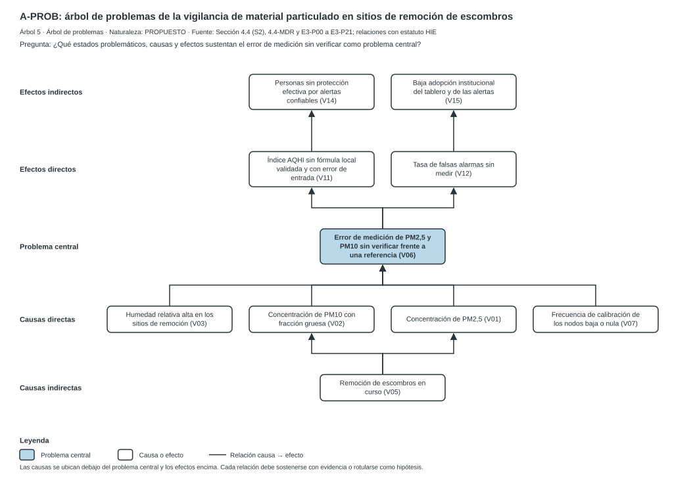

CASE_ID: SGR_CONV56_AIRE

## 4.5 ÁRBOL DE PROBLEMAS COMPLETO

Esta sección construye el árbol de problemas (tipo 5, rol A-PROB). Utiliza los resultados causales de 4.3 y 4.4 y el registro de contraste de 4.4-MDR. Los nodos conservan los identificadores de las quince variables del modelo. El árbol no sustituye al árbol de decisión ni al de teoría del cambio. No selecciona una alternativa. Todas las relaciones tienen estatuto HIE (hipótesis de influencia estructural): ninguna es un efecto estimado. Las fuentes se identifican con dos códigos: F-INF es el informe_FINAL de vigilancia tecnológica y F-E3 es el expediente Problematica_E3-P00.

### 4.5.1 Problema central y criterios de construcción

**Problema central.** Error de medición de PM2,5 y PM10 sin verificar frente a una referencia (V06). Se toma de dos observaciones independientes de la alternativa preferida. Primero, S2 clasifica V06 como crítica en los cinco escenarios de 4.4.13. Segundo, la construcción del fenómeno en 4.4-MDR.3 define como problema la ausencia de mediciones verificadas. El expediente E3 eligió el mismo nodo con otra matriz.

**Alcance del problema central.** El problema de 4.4-MDR.3 tiene dos partes: la medición sin verificar y la ausencia de alertas incorporadas en protocolos. El árbol representa la primera como problema central. La segunda aparece como efecto (V15) y como bucle que el árbol no dibuja.

**Criterios de construcción.**

- Cada nodo es una variable del modelo, formulada como estado problemático y rotulada con su identificador.
- Las causas se ubican debajo del problema central y los efectos encima.
- Se dibujan las relaciones de peso 2 o 3 en S2 que unen niveles contiguos sin compartir trazos ambiguos. Las demás permanecen en el registro de contraste.
- No se dibujan bucles. El registro los conserva.
- No se añade ninguna causa que el modelo no contenga. Las hipótesis externas figuran en 4.5.5.

### 4.5.2 Árbol A-PROB

El árbol tiene diez nodos y diez relaciones. El JSON canónico precede al SVG y la alternativa textual lo sigue.

```json
{
 "tipo": "PROBLEMAS",
 "rol": "A-PROB",
 "titulo": "A-PROB: árbol de problemas de la vigilancia de material particulado en sitios de remoción de escombros",
 "naturaleza": "PROPUESTO",
 "fuente": "Sección 4.4 (S2), 4.4-MDR y E3-P00 a E3-P21; relaciones con estatuto HIE",
 "pregunta": "¿Qué estados problemáticos, causas y efectos sustentan el error de medición sin verificar como problema central?",
 "descripcion": "Árbol de problemas con diez nodos y diez relaciones en cinco niveles. El problema central es el error de medición sin verificar frente a una referencia (V06). Las causas directas son humedad, PM10, PM2,5 y frecuencia de calibración. La causa indirecta es la remoción de escombros. Los efectos son un índice sin fórmula local, falsas alarmas sin medir, baja adopción institucional y personas sin protección efectiva. Todas las relaciones son hipótesis de influencia estructural sin efecto estimado.",
 "niveles": [
  "Efectos indirectos",
  "Efectos directos",
  "Problema central",
  "Causas directas",
  "Causas indirectas"
 ],
 "nodos": [
  {
   "id": "V14",
   "nivel": 0,
   "texto": "Personas sin protección efectiva por alertas confiables (V14)"
  },
  {
   "id": "V15",
   "nivel": 0,
   "texto": "Baja adopción institucional del tablero y de las alertas (V15)"
  },
  {
   "id": "V11",
   "nivel": 1,
   "texto": "Índice AQHI sin fórmula local validada y con error de entrada (V11)"
  },
  {
   "id": "V12",
   "nivel": 1,
   "texto": "Tasa de falsas alarmas sin medir (V12)"
  },
  {
   "id": "V06",
   "nivel": 2,
   "texto": "Error de medición de PM2,5 y PM10 sin verificar frente a una referencia (V06)",
   "destacado": true
  },
  {
   "id": "V03",
   "nivel": 3,
   "texto": "Humedad relativa alta en los sitios de remoción (V03)"
  },
  {
   "id": "V02",
   "nivel": 3,
   "texto": "Concentración de PM10 con fracción gruesa (V02)"
  },
  {
   "id": "V01",
   "nivel": 3,
   "texto": "Concentración de PM2,5 (V01)"
  },
  {
   "id": "V07",
   "nivel": 3,
   "texto": "Frecuencia de calibración de los nodos baja o nula (V07)"
  },
  {
   "id": "V05",
   "nivel": 4,
   "texto": "Remoción de escombros en curso (V05)"
  }
 ],
 "enlaces": [
  {
   "de": "V05",
   "a": "V02"
  },
  {
   "de": "V05",
   "a": "V01"
  },
  {
   "de": "V03",
   "a": "V06"
  },
  {
   "de": "V02",
   "a": "V06"
  },
  {
   "de": "V01",
   "a": "V06"
  },
  {
   "de": "V07",
   "a": "V06"
  },
  {
   "de": "V06",
   "a": "V11"
  },
  {
   "de": "V06",
   "a": "V12"
  },
  {
   "de": "V11",
   "a": "V14"
  },
  {
   "de": "V12",
   "a": "V15"
  }
 ]
}
```



**Alternativa textual de A-PROB.**

Árbol 5 · Árbol de problemas · rol A-PROB
Pregunta: ¿Qué estados problemáticos, causas y efectos sustentan el error de medición sin verificar como problema central?
Naturaleza: PROPUESTO

| Nivel | Nodo | Texto |
|---|---|---|
| Efectos indirectos | V14 | Personas sin protección efectiva por alertas confiables (V14) |
| Efectos indirectos | V15 | Baja adopción institucional del tablero y de las alertas (V15) |
| Efectos directos | V11 | Índice AQHI sin fórmula local validada y con error de entrada (V11) |
| Efectos directos | V12 | Tasa de falsas alarmas sin medir (V12) |
| Problema central | V06 | Error de medición de PM2,5 y PM10 sin verificar frente a una referencia (V06) |
| Causas directas | V03 | Humedad relativa alta en los sitios de remoción (V03) |
| Causas directas | V02 | Concentración de PM10 con fracción gruesa (V02) |
| Causas directas | V01 | Concentración de PM2,5 (V01) |
| Causas directas | V07 | Frecuencia de calibración de los nodos baja o nula (V07) |
| Causas indirectas | V05 | Remoción de escombros en curso (V05) |

Relaciones causa → efecto: V05 → V02; V05 → V01; V03 → V06; V02 → V06; V01 → V06; V07 → V06; V06 → V11; V06 → V12; V11 → V14; V12 → V15.

Errores de coherencia: ninguno detectado.
Comprobaciones del SVG: xml_bien_formado=True, viewbox=True, title=True, desc_no_vacio=True, rol_declarado=True, tipo_declarado=True, colores_fuera_de_paleta=[], sin_script_enlace_imagen=True, sin_transformaciones=True, ids_unicos=True, tamano_minimo_9_5=True

**Revisión visual.** Se renderizó el SVG con un navegador y se inspeccionó. Los trazos de cada relación son distinguibles y ningún texto se superpone. Se retiraron del dibujo las relaciones que compartían trazos y generaban lecturas ambiguas. El registro de contraste las conserva.

### 4.5.3 Nodos y relaciones con su evidencia

#### Nodos

| Nodo | Estado problemático | Nivel | Evidencia del estado | Naturaleza y verificación |
| --- | --- | --- | --- | --- |
| V06 | Error de medición sin verificar frente a una referencia | Problema central | La línea base es VACIO. F-E3 cita 45 % sin localizador. | DECLARADO; NO_VERIFICADO |
| V03 | Humedad relativa alta | Causa directa | F-E3 describe el entorno; sin serie medida | DECLARADO; NO_VERIFICADO |
| V02 | Concentración de PM10 con fracción gruesa | Causa directa | F-INF §3.1 (cociente PM2,5/PM10 de 0,88 en una mina); régimen distinto en escombros | INFERIDO; NO_VERIFICADO |
| V01 | Concentración de PM2,5 | Causa directa | Sin serie del territorio | VACIO |
| V07 | Frecuencia de calibración baja o nula | Causa directa | F-E3, E3-P10: los sensores aislados carecen de protocolo de ajuste dinámico | DECLARADO; NO_VERIFICADO |
| V05 | Remoción de escombros en curso | Causa indirecta | F-E3: premisa del caso | SUPUESTO por instrucción del usuario |
| V11 | Índice AQHI sin fórmula local validada | Efecto directo | F-INF §8.4 (D-05) recomienda validar un índice local | DOCUMENTADO en F-INF; fuente primaria no leída |
| V12 | Tasa de falsas alarmas sin medir | Efecto directo | F-INF §1.3 hallazgo 2: ningún documento de alertas la reporta | DOCUMENTADO en F-INF |
| V15 | Baja adopción institucional | Efecto indirecto | Sin medición de uso; el supuesto de adopción es SC-3 | SUPUESTO; NO_VERIFICADO |
| V14 | Personas sin protección efectiva por alertas confiables | Efecto indirecto | Sin variable de resultado ni línea base | VACIO |

#### Relaciones dibujadas

La columna «Peso» muestra el valor de S2 y, entre paréntesis, el dominio admisible. Todas las relaciones tienen estatuto HIE y verificación NO_VERIFICADO.

| Relación | Peso | Signo | Confianza | Naturaleza | Fuente principal | Explicación rival principal |
| --- | --- | --- | --- | --- | --- | --- |
| V05→V02 | 3 (2, 3) | + | ALTA | INFERIDO | F-E3, E3-P04 §12 | El rociado y los cerramientos actúan sobre V05, no sobre la relación |
| V05→V01 | 2 (2, 3) | + | MEDIA | INFERIDO | F-E3, E3-P04 §12; F-INF §1.4 | Con maquinaria eléctrica o rociado de agua el valor sería menor |
| V03→V06 | 3 (2, 3) | + | MEDIA | DOCUMENTADO | F-INF §1.3 y §3.1 (Suresh et al., 2025, p. 30, como se citó en F-INF) | La correlación de 0,73 podría reflejar covariación estacional |
| V02→V06 | 3 (2, 3) | + | MEDIA | INFERIDO | F-INF §3.1 (Suresh et al., 2025, como se citó en F-INF); F-E3, E3-P04 §12 | El inlet protegido y la limpieza programada reducen el efecto |
| V01→V06 | 2 (1, 2, 3) | + | BAJA | INFERIDO | F-E3, E3-P04 §12 | El error normalizado puede bajar al subir la concentración; signo mixto |
| V07→V06 | 3 (2, 3) | - | MEDIA | INFERIDO | F-INF §3.1 (Bang et al., 2026, pp. 6-8, como se citó en F-INF) y §11.6 | El método y la distancia a la referencia explican más que la frecuencia |
| V06→V11 | 3 (2, 3) | + | MEDIA | INFERIDO | F-E3, E3-P04 §12; F-INF §1.3 hallazgo 5 | Filtros de calidad de dato amortiguarían la propagación |
| V06→V12 | 2 (1, 2, 3) | + | MEDIA | INFERIDO | F-E3, E3-P04 §12; F-INF §1.3 hallazgo 2 | Si las alertas parten del índice agregado, el valor directo sería 0 o 1 |
| V11→V14 | 2 (1, 2, 3) | + | MEDIA | PROPUESTO | F-E3, E3-P04 §12 y E3-P18 | Un protocolo obligatorio con medidas automáticas daría 3 |
| V12→V15 | 2 (1, 2, 3) | - | MEDIA | INFERIDO | F-E3, E3-P04 §12 y E3-P18 | Si un municipio suspende el uso tras dos episodios, el valor sería 3 |

**Sensibilidad.** La perturbación de un enlace a la vez (4.4.13) identifica a V05→V02 y V03→V06 entre los de mayor efecto sobre las clases. El enlace V07→V06, si bajara de 3 a 2, convertiría a V07 en autónoma relativa y cambiaría la clase indirecta de V10. Ningún valor recibe probabilidad.

### 4.5.4 Contraste con el árbol de problemas del expediente E3

El árbol de E3 (sección 4.5 del expediente, con sus tablas 4.6 a 4.8) se contrasta con los resultados de 4.4. La tabla conserva los desacuerdos. No ajusta el problema a una solución preferida.

| Afirmación de F-E3 | Resultado en 4.4 (S0, S1 y S2) | Tratamiento en esta sección |
| --- | --- | --- |
| V06 es el problema central | Coincide: V06 es crítica en los cinco escenarios | Se conserva con otra matriz |
| V06 tiene TA 6 y TP 15 | S0: 6 y 13. S1: 6 y 15. S2: 8 y 13 | Los valores coinciden con S1 y dependen del escenario |
| V07 tiene rango indirecto 1,0 («pilar oculto») | S0 en A⁶: único con influencia positiva. S1: rango 3. S2: rango 8 | El rango 1,0 coincide con S0. La tabla de F-E3 combina dos matrices |
| V08 (latencia) es polo de la contradicción raíz y tiene rango 3,0 | S2: rango 15 (último). V08→V06 = 0 con dominio de 0 a 2 | No se dibuja V08 como causa de V06 |
| La causa raíz es la arquitectura que depende de la nube | Ninguna variable de las quince la representa. La matriz no la deriva | Se trata como hipótesis fuera del modelo (4.5.5) |
| La extinción en A⁷ demuestra un grafo acíclico | Solo S0 se extingue. S2 tiene 144 ciclos simples | La extinción es propiedad de las 22 aristas de S0 |
| V12 y V15 son reactivas y forman el follaje | S2: V12 es frontera y V15 es crítica. Solo V14 es reactiva en los cinco escenarios | Se dibujan como efectos con la reserva de clase |
| V15 es solo un efecto | S2: V15 tiene cinco aristas de salida y participa en 140 de 144 ciclos | El efecto se dibuja. El bucle queda en el registro |

### 4.5.5 Lo que el árbol no representa

- **Bucles.** S2 contiene cuatro ciclos de dos aristas: V06 y V07, V09 y V15, V11 y V12, V14 y V15. V15 retroalimenta a V05, V07, V09, V10 y V14. El árbol no dibuja bucles.
- **Variables fuera del tronco.** V04, V08, V09, V10 y V13 no se dibujan. V04 y V10 tienen relaciones de confianza baja o de peso 1 con V06. V08 y V13 no se vinculan con V06 en S2. V09 actúa sobre V10 y sobre V15.
- **Variables latentes omitidas del modelo.** La distancia a la referencia, la edad del sensor, los episodios de humo y la precipitación no tienen identificador (4.3). Pueden alterar las relaciones dibujadas.
- **Marco rival de control en la fuente.** El árbol no representa la emisión de polvo en obra como causa. Su construcción exigiría otro problema central: la exposición, no el error de medición. Ese árbol no se construyó.
- **Hipótesis de F-E3 sin variable.** La dependencia de la nube como causa raíz no figura. Se conserva como hipótesis a contrastar con el piloto.
- **Continuidad posproyecto y morbilidad.** No existen variables en el modelo. Permanecen como hipótesis y vacíos (4.4-MDR.13).

### 4.5.6 Estado y consecuencias

El árbol queda como borrador con vacíos. Sus relaciones requieren la sesión de adjudicación de las fichas de 4.4, comenzando por los enlaces de mayor efecto. Un cambio de ficha obliga a reconstruir solo los nodos y enlaces afectados. Esta sección no modifica las decisiones de 4.4-MDR ni selecciona la alternativa final. La formalización del problema y la generación de alternativas dependen de este árbol, pero no se ejecutan aquí.

### 4.5.7 Referencias

Esta sección no cita obras adicionales a las de 4.4-MDR.14. Las fuentes de las relaciones son los archivos aportados por el usuario, leídos completos.

Informe de vigilancia tecnológica y bibliometría de 42 documentos [Documento de trabajo aportado por el usuario, autoría NO_IDENTIFICADA]. (2026). Archivo informe_FINAL.docx. Citado como F-INF.

Embudo de problematización y análisis causal del sistema de vigilancia ambiental, E3-P00 a E3-P21, Pasos 1, 3, 4, 5 y 6 [Documento de trabajo aportado por el usuario, autoría NO_IDENTIFICADA]. (2026). Archivo Problematica_E3-P00.docx. Citado como F-E3.

**Alcance de esta sección.** La sección 4.5 termina aquí. No autoriza por sí sola la formalización del problema ni capítulos posteriores.
